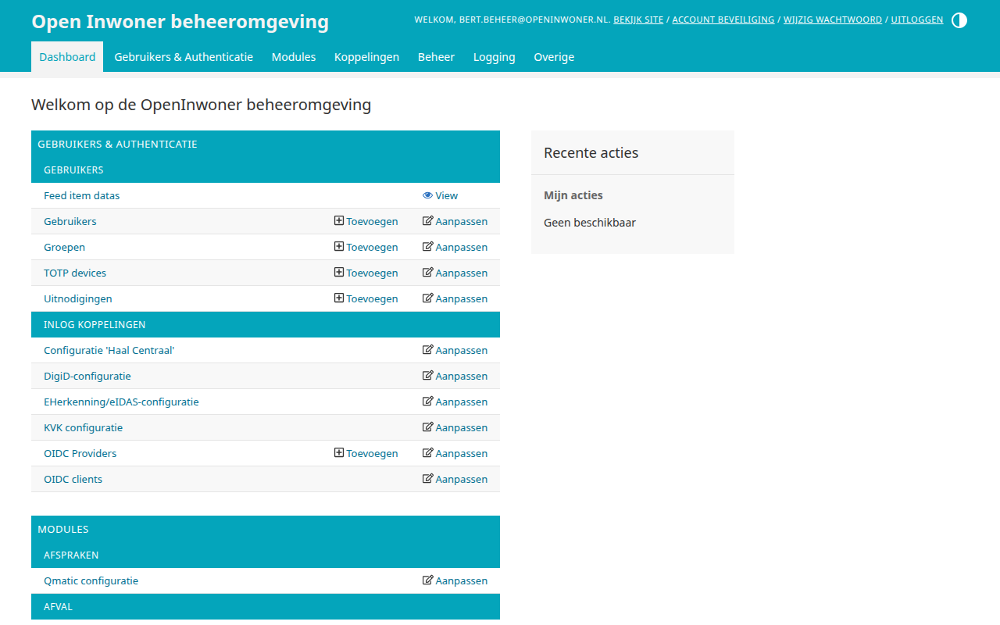
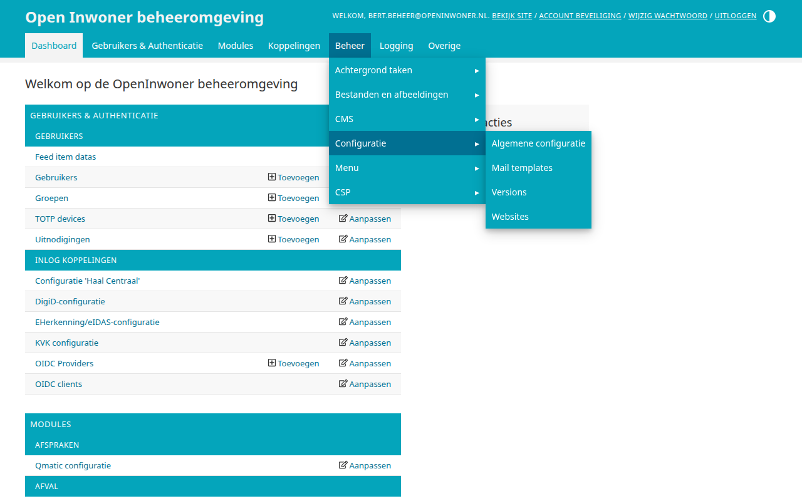
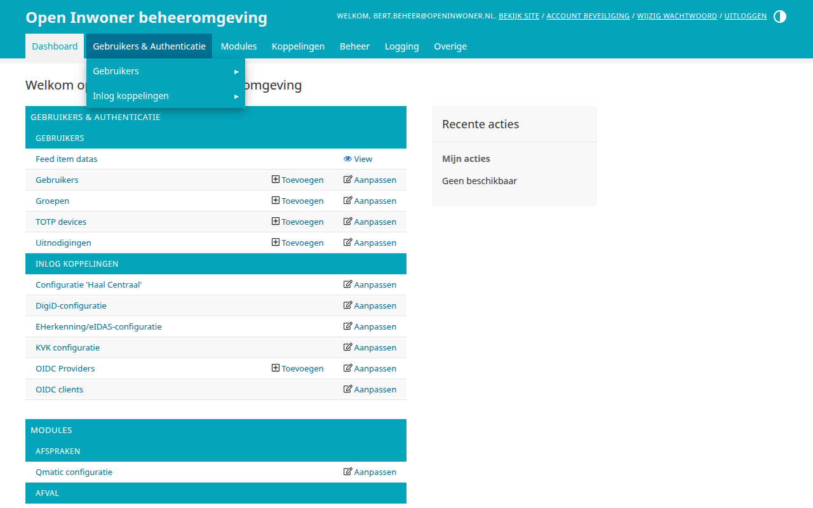
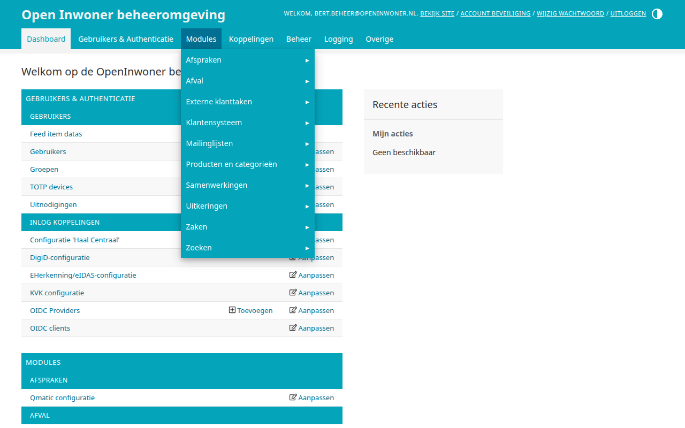
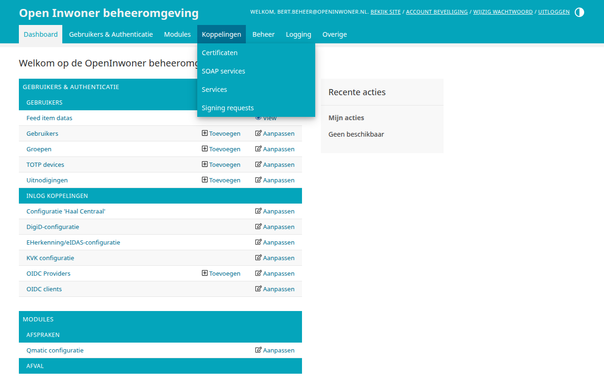
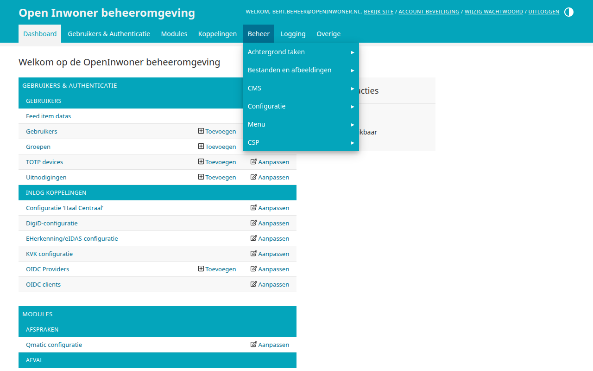
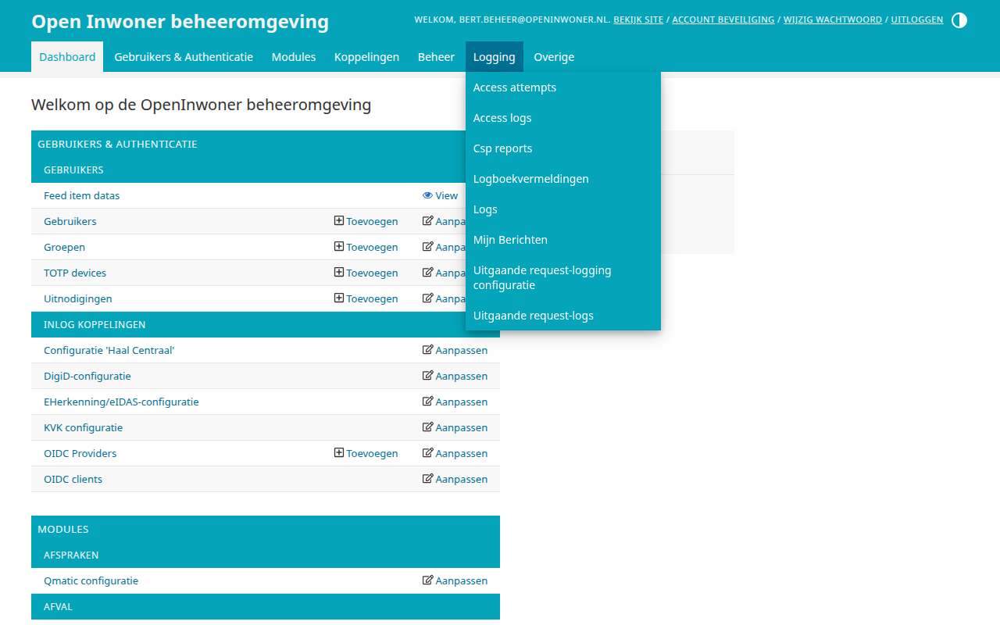
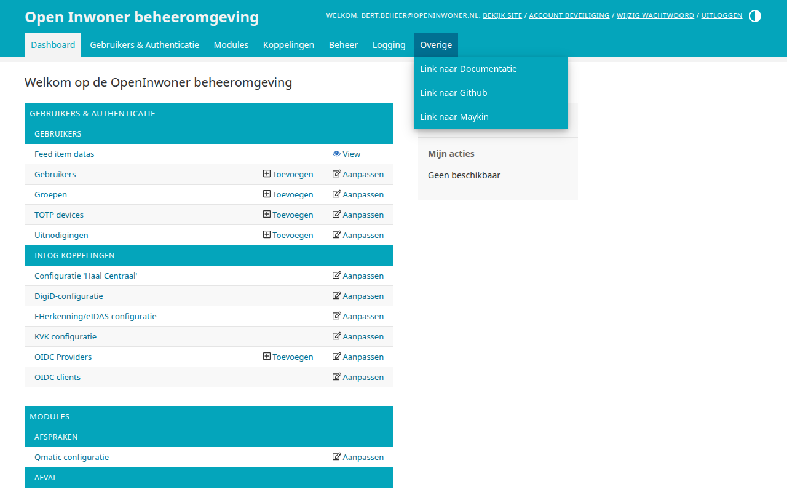

.. _dashboard:

.. _hoofdstuk-3:

=================================
3. Indeling van de beheeromgeving
=================================

Wanneer u bent ingelogd komt u terecht op het dashboard. Bovenin elk scherm van de beheeromgeving staat het menu, waarmee u alle onderdelen van Open Inwoner bereikt. Het dashboard zelf toont dezelfde onderdelen als het menu, gegroepeerd in tabellen. Per onderdeel kunt u met :guilabel:`Toevoegen` direct een nieuw item aanmaken of met :guilabel:`Aanpassen` het overzicht openen.

3.1. Het menu
=============

Het menu begint met de link **Dashboard**, waarmee u vanuit elk scherm terugkeert naar het dashboard. Daarna volgen zes groepen:

- **Gebruikers & Authenticatie**
- **Modules**
- **Koppelingen**
- **Beheer**
- **Logging**
- **Overige**

Wanneer u met de muis over een groep beweegt, klapt een lijst met de onderdelen van die groep open. Sommige groepen zijn onderverdeeld in subgroepen, herkenbaar aan het pijltje (▸) achter de naam. Beweegt u met de muis over een subgroep, dan klapt rechts daarvan een tweede lijst open met de onderdelen van de subgroep. Klik op een onderdeel om het overzicht ervan te openen.

In deze handleiding wordt de weg door het menu genoteerd als bijvoorbeeld **Beheer > Configuratie > Algemene configuratie**: de groep, de subgroep en het onderdeel.

U ziet alleen de onderdelen waarvoor u rechten heeft (zie :ref:`hoofdstuk 2 <hoofdstuk-2>`). Een groep of subgroep waarin u niets mag openen, wordt niet getoond.

.. note::

   De indeling van het menu wordt bij elke update van Open Inwoner opnieuw ingesteld. Wijzigingen die u zelf in het menu aanbrengt via **Beheer > Menu > Applicatiegroepen** (zie :ref:`hoofdstuk 21.1 <hoofdstuk-21-1>`) gaan bij een update dus verloren.

3.2. Gebruikers & Authenticatie
===============================

- **Gebruikers**: de gebruikers, uitnodigingen, feed item data, groepen en TOTP devices (zie :ref:`hoofdstuk 4 <hoofdstuk-4>`).
- **Inlog koppelingen**: de configuratie van DigiD, eHerkenning/eIDAS, OpenID Connect, KVK en Haal Centraal (zie :ref:`hoofdstuk 5 <hoofdstuk-5>`).

3.3. Modules
============

Onder Modules vindt u de onderdelen van Open Inwoner die een inwoner op de website gebruikt, met de koppelingen die daarvoor nodig zijn.

- **Afspraken**: de Qmatic-configuratie voor Mijn afspraken (zie :ref:`hoofdstuk 6 <hoofdstuk-6>`).
- **Afval**: de configuratie van Mijn Afval (zie :ref:`hoofdstuk 7 <hoofdstuk-7>`).
- **Externe klanttaken**: de Objects API-configuratie (zie :ref:`hoofdstuk 8 <hoofdstuk-8>`).
- **Klantensysteem**: de configuratie van het klantensysteem en de KlantContactMomenten voor Mijn vragen (zie :ref:`hoofdstuk 9 <hoofdstuk-9>`).
- **Mailinglijsten**: de Laposta-configuratie voor de nieuwsbrieven (zie :ref:`hoofdstuk 10 <hoofdstuk-10>`).
- **Producten en categorieën**: de producten, onderwerpen, organisaties, tags, veelgestelde vragen, vragenlijststappen en de Open Forms-configuratie (zie :ref:`hoofdstuk 11 <hoofdstuk-11>`).
- **Samenwerkingen**: de acties, berichten en documenten, evenals de samenwerkingsplannen en plantemplates (zie :ref:`hoofdstuk 12 <hoofdstuk-12>`).
- **Uitkeringen**: de configuratie van Mijn uitkeringen (zie :ref:`hoofdstuk 13 <hoofdstuk-13>`).
- **Zaken**: de configuratie van Open Zaak, de zaaktypen en de notificaties voor Mijn Zaken (zie :ref:`hoofdstuk 14 <hoofdstuk-14>`; hoe u Mijn Zaken inricht leest u in :ref:`hoofdstuk 14.1 <hoofdstuk-14-1>`).
- **Zoeken**: feedback, synoniemen en zoekveldgewicht (zie :ref:`hoofdstuk 15 <hoofdstuk-15>`).

Op de website worden voor sommige modules andere namen gebruikt dan in de beheeromgeving:

+----------------------------------------+--------------------------------------------------------------+
|    **Beheeromgeving**                  |    **Website**                                               |
+========================================+==============================================================+
|    | Klantensysteem                    |    | Mijn vragen                                             |
|    | Laposta                           |    | Mijn profiel – nieuwsbrieven, voorkeuren en meldingen   |
|    | Qmatic                            |    | Mijn afspraken                                          |
|    | SSD                               |    | Mijn uitkeringen                                        |
|    | SOAP services                     |    | Mijn uitkeringen                                        |
|    | Catalogus configs                 |    | Mijn zaken                                              |
|    | Open Zaak                         |    | Mijn zaken                                              |
|    | Open Forms client configuration   |    | Producten                                               |
|    | Webhook-abonnementen              |    | Mijn zaken - notificaties                               |
|    | Configuratie Mijn Afval           |    | Mijn afval                                              |
+----------------------------------------+--------------------------------------------------------------+

3.4. Koppelingen
================

Onder Koppelingen vindt u de services, SOAP services, certificaten en signing requests waarmee Open Inwoner externe systemen bereikt (zie :ref:`hoofdstuk 16 <hoofdstuk-16>`). De configuratie van de koppelingen zelf vindt u bij de module die ze gebruikt.

3.5. Beheer
===========

- **Achtergrond taken**: de taken die Open Inwoner op de achtergrond uitvoert en hun planning (zie :ref:`hoofdstuk 17 <hoofdstuk-17>`).
- **Bestanden en afbeeldingen**: de mappen met alle bestanden en afbeeldingen (zie :ref:`hoofdstuk 18 <hoofdstuk-18>`).
- **CMS**: de pagina's van Open Inwoner (zie :ref:`hoofdstuk 19 <hoofdstuk-19>`).
- **Configuratie**: de algemene configuratie, mail templates, versies en websites (zie :ref:`hoofdstuk 20 <hoofdstuk-20>`).
- **Menu**: de indeling van dit menu (zie :ref:`hoofdstuk 21 <hoofdstuk-21>`).
- **CSP**: de CSP settings, die bepalen naar welke externe diensten de browser verzoeken mag doen, bijvoorbeeld voor Google Analytics of SiteImprove (zie :ref:`hoofdstuk 22.1 <hoofdstuk-22-1>`).

3.6. Logging
============

Onder Logging vindt u de inlogpogingen, de access logs, de CSP reports, de logboekvermeldingen, de logs en verzonden e-mails van de mailserver, en de logging van uitgaande requests (zie :ref:`hoofdstuk 23 <hoofdstuk-23>`).

3.7. Overige
============

Onder Overige vindt u links naar de documentatie van Open Inwoner, de broncode op Github en de website van Maykin.

