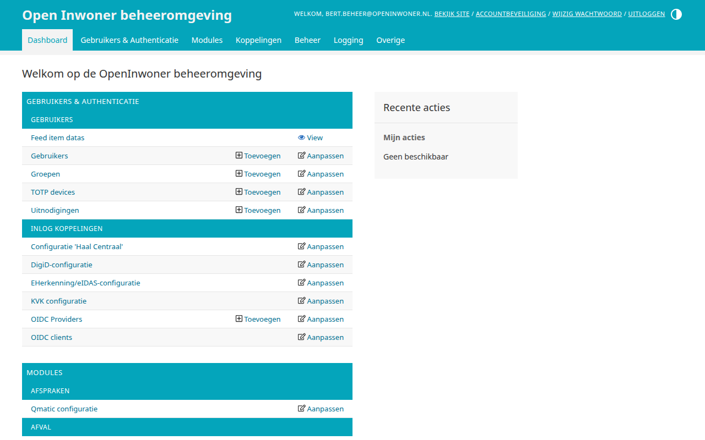
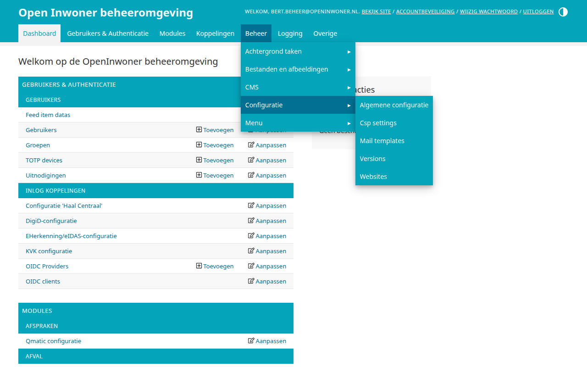
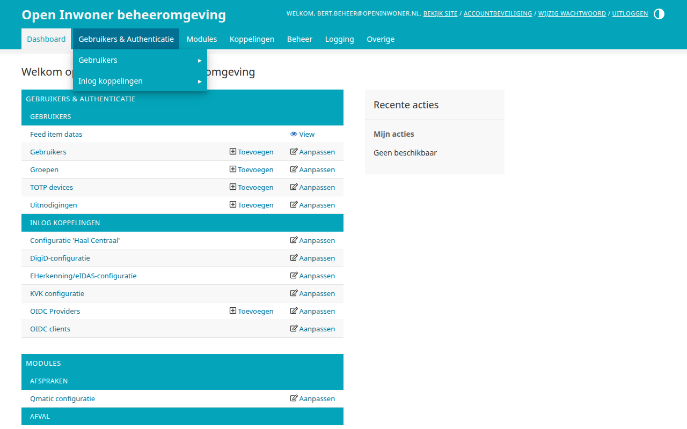
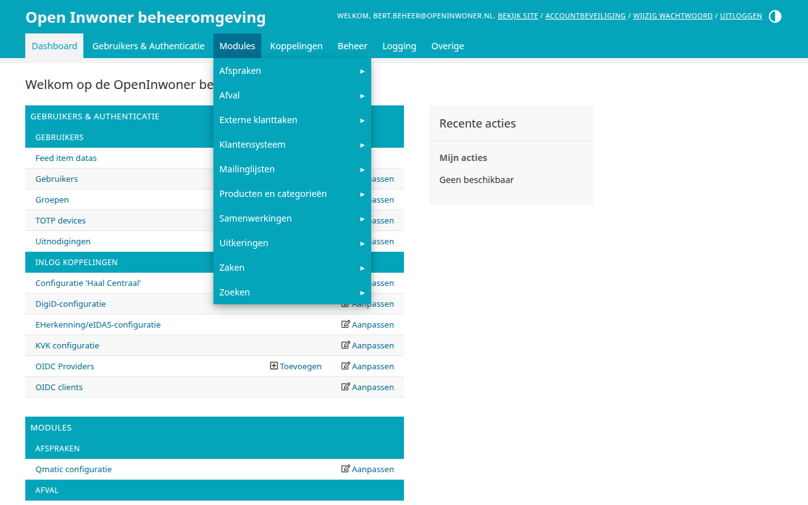
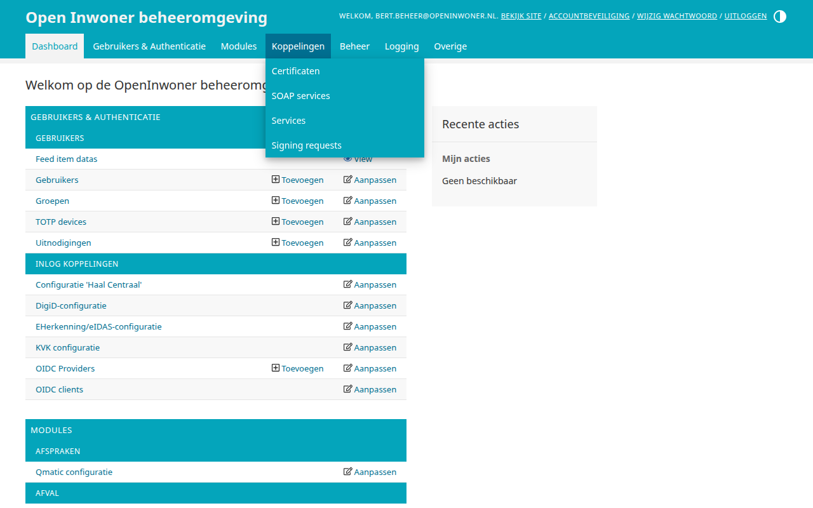
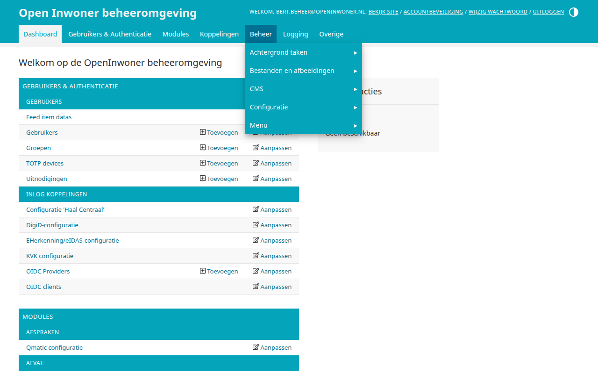
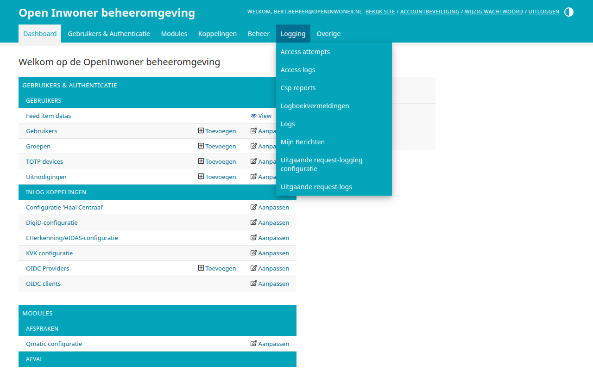
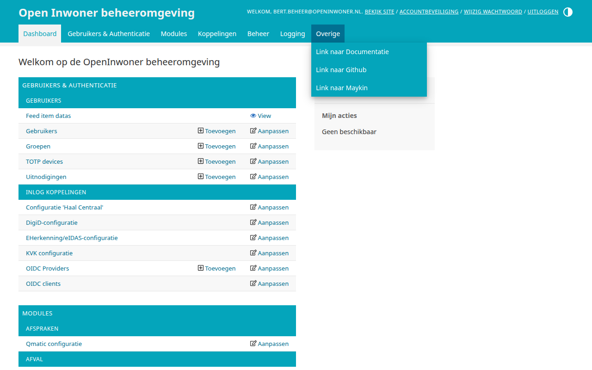

.. _dashboard:

============
3. Dashboard
============

Wanneer u bent ingelogd komt u terecht op het dashboard. Bovenin elk scherm van de beheeromgeving staat het menu, waarmee u alle onderdelen van Open Inwoner bereikt. Het dashboard zelf toont dezelfde onderdelen als het menu, gegroepeerd in tabellen. Per onderdeel kunt u met [Toevoegen] direct een nieuw item aanmaken of met [Aanpassen] het overzicht openen.

3.1. Het menu
=============

Het menu begint met de link **Dashboard**, waarmee u vanuit elk scherm terugkeert naar het dashboard. Daarna volgen zes groepen:

- **Gebruikers & Authenticatie**
- **Modules**
- **Koppelingen**
- **Beheer**
- **Logging**
- **Overige**

Wanneer u met de muis over een groep beweegt, klapt een lijst met de onderdelen van die groep open. Sommige groepen zijn onderverdeeld in subgroepen, herkenbaar aan het pijltje (▸) achter de naam. Beweegt u met de muis over een subgroep, dan klapt rechts daarvan een tweede lijst open met de onderdelen van de subgroep. Klik op een onderdeel om het overzicht ervan te openen.

In deze handleiding wordt de weg door het menu genoteerd als bijvoorbeeld **Beheer > Configuratie > Algemene configuratie**: de groep, de subgroep en het onderdeel.

U ziet alleen de onderdelen waarvoor u rechten heeft (zie hoofdstuk 2). Een groep of subgroep waarin u niets mag openen, wordt niet getoond.

.. note::

   De indeling van het menu wordt bij elke update van Open Inwoner opnieuw ingesteld. Wijzigingen die u zelf in het menu aanbrengt via **Beheer > Menu > Applicatiegroepen** (zie hoofdstuk 13.1) gaan bij een update dus verloren.

3.2. Gebruikers & Authenticatie
===============================

- **Gebruikers**: de gebruikers, uitnodigingen en feed item data (zie hoofdstuk 4), en de groepen en TOTP devices (zie hoofdstuk 8).
- **Inlog koppelingen**: de configuratie van DigiD, eHerkenning/eIDAS, OpenID Connect, KVK en Haal Centraal (zie hoofdstuk 10).

3.3. Modules
============

Onder Modules vindt u de onderdelen van Open Inwoner die een inwoner aan de voorkant gebruikt, met de koppelingen die daarvoor nodig zijn.

- **Afspraken**: de Qmatic-configuratie voor Mijn afspraken (zie hoofdstuk 9).
- **Afval**: de configuratie van Mijn Afval.
- **Externe klanttaken**: de Objects API-configuratie (zie hoofdstuk 9).
- **Klantensysteem**: de configuratie van het klantensysteem en de KlantContactMomenten voor Mijn vragen (zie hoofdstuk 9).
- **Mailinglijsten**: de Laposta-configuratie voor de nieuwsbrieven (zie hoofdstuk 9).
- **Producten en categorieën**: de producten, onderwerpen, organisaties, tags, veelgestelde vragen en vragenlijststappen (zie hoofdstuk 6), en de Open Forms-configuratie (zie hoofdstuk 9).
- **Samenwerkingen**: de acties, berichten en documenten (zie hoofdstuk 4), evenals de samenwerkingsplannen en plantemplates (zie hoofdstuk 5).
- **Uitkeringen**: de configuratie van Mijn uitkeringen (zie hoofdstuk 9).
- **Zaken**: de configuratie van Open Zaak, de zaaktypen en de notificaties voor Mijn Zaken (zie hoofdstuk 9; hoe u Mijn Zaken inricht leest u in hoofdstuk 9.0).
- **Zoeken**: feedback, synoniemen en zoekveldgewicht (zie hoofdstuk 7).

3.4. Koppelingen
================

Onder Koppelingen vindt u de services, SOAP services, certificaten en signing requests waarmee Open Inwoner externe systemen bereikt (zie hoofdstuk 9). De configuratie van de koppelingen zelf vindt u bij de module die ze gebruikt.

3.5. Beheer
===========

- **Achtergrond taken**: de taken die Open Inwoner op de achtergrond uitvoert en hun planning (zie hoofdstuk 13).
- **Bestanden en afbeeldingen**: de mappen met alle bestanden en afbeeldingen (zie hoofdstuk 13).
- **CMS**: de pagina's van Open Inwoner (zie hoofdstuk 11).
- **Configuratie**: de algemene configuratie, CSP settings, mail templates, versies en websites (zie hoofdstuk 12).
- **Menu**: de indeling van dit menu (zie hoofdstuk 13.1).

3.6. Logging
============

Onder Logging vindt u de inlogpogingen, de logboekvermeldingen, de verzonden e-mails, de CSP reports en de logs van uitgaande requests (zie hoofdstuk 8).

3.7. Overige
============

Onder Overige vindt u links naar de documentatie van Open Inwoner, de broncode op Github en de website van Maykin.

