.. _gebruikersprofielen:

.. _hoofdstuk-4:

=============
4. Gebruikers
=============

In dit hoofdstuk leest u hoe u de gebruikers van Open Inwoner beheert, hun uitnodigingen en feed item data, en de beheerdersgroepen en de tweestapsverificatie (2FA) van beheerders. De meeste gebruikers hoeft u niet zelf aan te maken: een gebruikersaccount wordt automatisch aangemaakt wanneer iemand voor het eerst inlogt, meestal met DigiD.

U vindt de onderdelen van dit hoofdstuk in het menu onder **Gebruikers & Authenticatie > Gebruikers**.

.. _hoofdstuk-4-1:

4.1. Feed item data
===================

**Locatie in het menu:** Gebruikers & Authenticatie > Gebruikers > Feed item datas

Gebruikers zien na inloggen op de homepage een blok "Openstaande acties", wanneer dit blok (de CMS-plugin "Openstaande acties") op de homepage is geplaatst. In dit blok staan meldingen voor de gebruiker, bijvoorbeeld dat de status van een zaak is gewijzigd of dat een samenwerking bijna afloopt. Elke melding wordt weergegeven met een titel en een omschrijving.

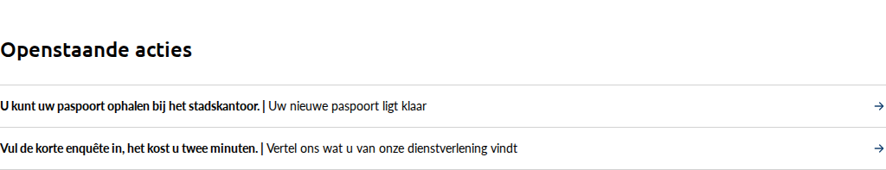

Elke melding is een feed item. Er zijn vier soorten (types): "Eenvoudig tekstbericht", "Zaakstatus is gewijzigd", "Document is toegevoegd" en "Samenwerkingsplan loopt af". Een melding verdwijnt uit het blok zodra de gebruiker de informatie heeft bekeken of de actie heeft voltooid. Meldingen over zaken worden alleen getoond als de pagina van Mijn Zaken gepubliceerd is, en meldingen over samenwerkingen alleen als de pagina van Samenwerken gepubliceerd is.

In de beheeromgeving is het overzicht van de feed items te raadplegen. Dit onderdeel is read-only.

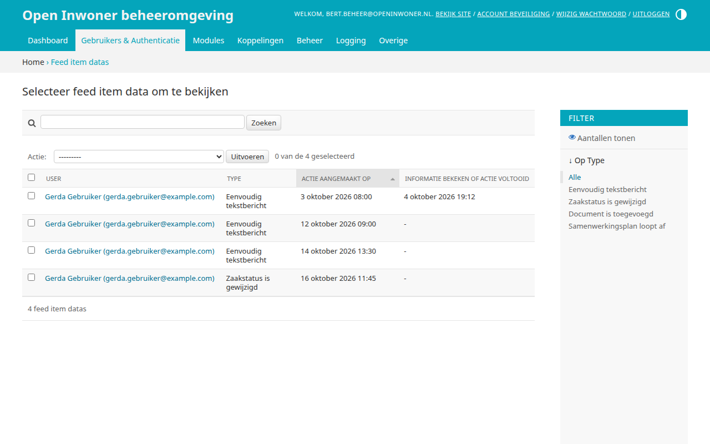

Het overzicht toont per feed item de kolommen **User** (de gebruiker voor wie het feed item is; deze kolomnaam is nog niet vertaald), **Type**, **Actie aangemaakt op** (vanaf wanneer het feed item getoond wordt) en **Informatie bekeken of actie voltooid** (of, en zo ja wanneer, de gebruiker de informatie heeft bekeken of de actie heeft voltooid). Standaard staan de feed items op volgorde van **Actie aangemaakt op**. U kunt sorteren op elke kolom (zie :ref:`hoofdstuk 12.1.1 <hoofdstuk-12-1-1>`), rechts filteren op **Type** en met de zoekbalk zoeken op het e-mailadres, de voornaam of de achternaam van de gebruiker.

Wilt u weten welke meldingen een bepaalde gebruiker op dit moment in het blok "Openstaande acties" ziet? Gebruik dan de knop :guilabel:`Openstaande acties ophalen voor gebruiker` in het wijzigingsscherm van de gebruiker, zie :ref:`hoofdstuk 4.2.3 <hoofdstuk-4-2-3>`.

.. _hoofdstuk-4-2:

4.2. Gebruikers
===============

**Locatie in het menu:** Gebruikers & Authenticatie > Gebruikers > Gebruikers

Onder gebruikers vindt u alle gebruikers van uw Open Inwoner: zowel inwoners en bedrijven als begeleiders en beheerders. Inwoners en bedrijven krijgen automatisch een account wanneer zij voor het eerst inloggen, bijvoorbeeld met DigiD of eHerkenning. Indien gewenst kunt u gebruikers ook zelf toevoegen, wijzigen en verwijderen. Daarnaast kunt u de permissies van gebruikers wijzigen.

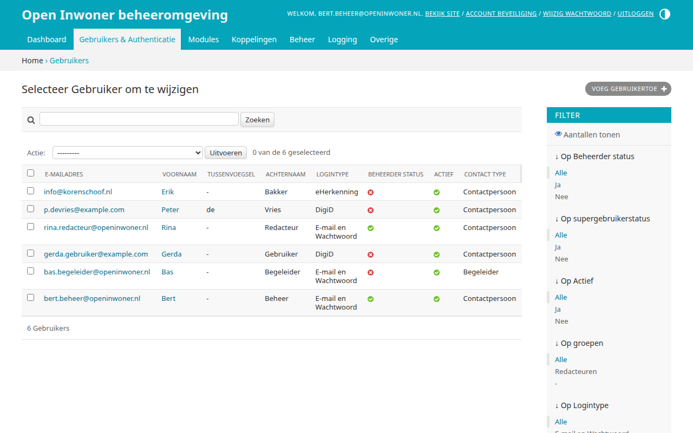

Het overzicht toont per gebruiker de kolommen **E-mailadres**, **Voornaam**, **Tussenvoegsel**, **Achternaam**, **Logintype**, **Beheerder status**, **Actief**, **Contact type**, **Laatste aanmelding** en **Vorige aanmelding**. Met de zoekbalk zoekt u op voornaam, tussenvoegsel, achternaam en e-mailadres.

Rechts kunt u de gebruikers filteren op beheerstatus ("Op Beheerder status"), supergebruikerstatus, activiteit ("Op Actief"), groep ("Op groepen") en de manier van inloggen ("Op Logintype"). Kiest u bijvoorbeeld bij **Logintype** voor "DigiD", dan ziet u enkel de gebruikers die met DigiD inloggen.

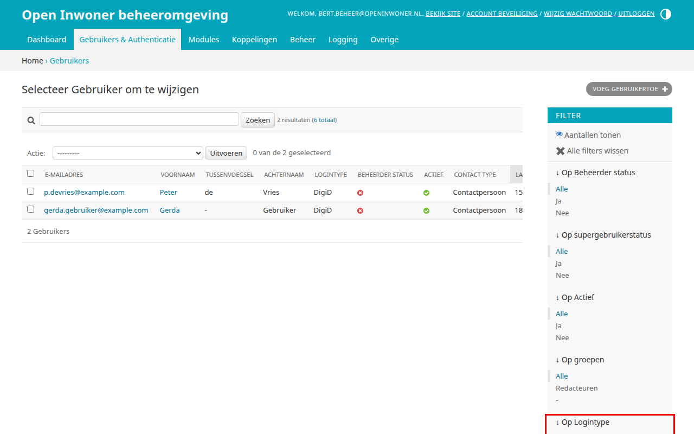

.. note::

   Een gebruiker die versies van CMS-pagina's heeft aangemaakt, kan niet worden verwijderd zolang die versies bestaan. Bij het verwijderen van zo'n gebruiker krijgt u een overzicht van de versies die dit tegenhouden (zie :ref:`hoofdstuk 19.1.11 <hoofdstuk-19-1-11>`). Wilt u alleen voorkomen dat zo'n gebruiker nog kan inloggen, dan kunt u de gebruiker ook op inactief zetten door het vinkje bij **Actief** weg te halen (zie :ref:`hoofdstuk 4.2.3 <hoofdstuk-4-2-3>`).

4.2.1. Gebruikersoverzicht sorteren
-----------------------------------

U kunt het gebruikersoverzicht op elke kolom sorteren, bijvoorbeeld op e-mailadres, achternaam of laatste aanmelding. Standaard staan de gebruikers op volgorde van laatste aanmelding. Dit doet u door op de gewenste kolomnaam te klikken. Voor meer details over het sorteren van de gebruikers, raadpleegt u de beschrijving bij :ref:`hoofdstuk 12.1.1 <hoofdstuk-12-1-1>`.

4.2.2. Gebruiker toevoegen
--------------------------
Door in het gebruikersoverzicht op de knop :guilabel:`Gebruiker toevoegen +` rechts bovenin uw scherm te klikken kunt u een nieuwe gebruiker toevoegen. Er wordt een nieuw scherm geopend waar u enkele gegevens dient in te vullen. Wanneer alle gegevens zijn ingevuld klikt u op :guilabel:`Opslaan`. U komt dan in het wijzigingsscherm van de nieuwe gebruiker (zie :ref:`hoofdstuk 4.2.3 <hoofdstuk-4-2-3>`), waar u de overige gegevens en de permissies kunt invullen.

.. note::

   Een gebruiker die u hier aanmaakt, logt in met e-mailadres en wachtwoord. Voor beheerders (gebruikers met **Beheerder status**) werkt dit altijd, via de inlogpagina van de beheeromgeving. Andere gebruikers kunnen alleen met e-mailadres en wachtwoord inloggen op de website als de optie **Sta lokale registratie toe** in de algemene configuratie aan staat (zie :ref:`hoofdstuk 20.1.1 <hoofdstuk-20-1-1>`). Staat deze optie uit, dan toont de inlogpagina van de website alleen DigiD, eHerkenning en andere gekoppelde inlogmethoden, en kan zo'n gebruiker dus niet inloggen.

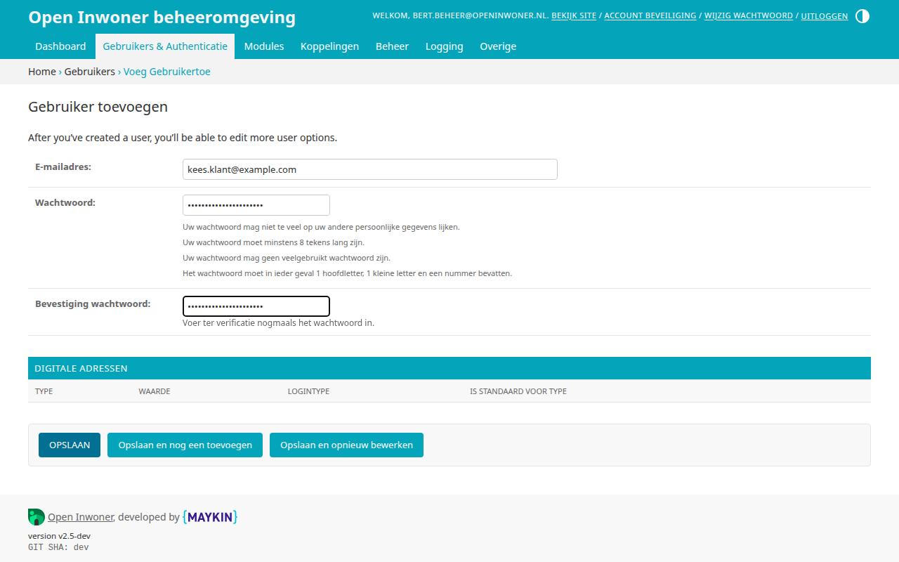

| **E-mailadres**
| Dit is het e-mailadres waarmee de nieuwe gebruiker kan inloggen.

| **Wachtwoord**
| Voer hier het gewenste wachtwoord in. Onder het veld staat aan welke eisen het wachtwoord moet voldoen.

| **Bevestiging wachtwoord**
| Herhaal hier het wachtwoord ter controle.

.. _hoofdstuk-4-2-3:

4.2.3. Gebruiker wijzigen
-------------------------
Door op een gebruiker in het overzicht te klikken, kunt u deze wijzigen. Er wordt een nieuw scherm geopend waar u naast de persoonlijke gegevens diverse wijzigingen kunt aanbrengen. De onderdelen "Permissies" en "Notificaties" zijn standaard ingeklapt; klik op de titel van een onderdeel om het uit te klappen (zie :ref:`hoofdstuk 4.2.4 <hoofdstuk-4-2-4>` en :ref:`4.2.5 <hoofdstuk-4-2-5>`).

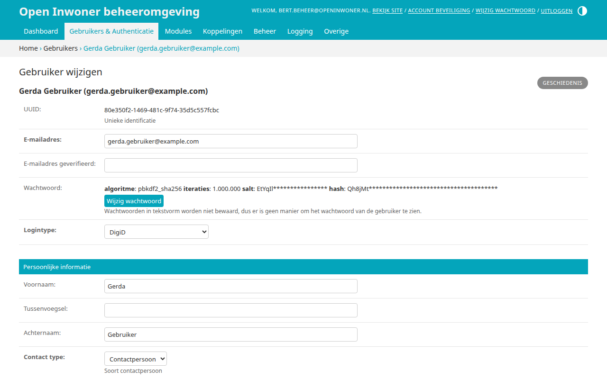

Bovenaan het scherm staan de volgende velden:

| **UUID**
| Het unieke kenmerk van de gebruiker. Dit veld kunt u niet wijzigen.

| **E-mailadres**
| Het e-mailadres van de gebruiker. Gebruikers die met e-mail en wachtwoord inloggen, gebruiken dit e-mailadres om in te loggen.

| **E-mailadres geverifieerd**
| Het e-mailadres dat de gebruiker heeft bevestigd via de link in de verificatie-e-mail. Het e-mailadres geldt als geverifieerd wanneer dit veld gelijk is aan **E-mailadres**. Dit wordt gebruikt wanneer e-mailverificatie verplicht is (zie :ref:`hoofdstuk 20.1.8 <hoofdstuk-20-1-8>`).

| **Wachtwoord**
| Het wachtwoord zelf wordt niet getoond. Klik op de knop onder het veld om een nieuw wachtwoord in te stellen.

| **Logintype**
| De manier waarop de gebruiker inlogt. Kies in het dropdown menu voor "E-mail en Wachtwoord", "DigiD", "eHerkenning", "OpenId connect", "EIDAS-persoon met BSN", "EIDAS-persoon met pseudo-ID" of "EIDAS-bedrijf met bedrijfs-ID".

Onder **Persoonlijke informatie** staan de persoonsgegevens van de gebruiker. Bij gebruikers die met DigiD of eHerkenning inloggen, worden deze gegevens na het inloggen automatisch ingevuld vanuit de gekoppelde basisregistraties.

| **Voornaam**, **Tussenvoegsel** en **Achternaam**
| De naam van de gebruiker.

| **Contact type**
| Wat voor soort contactpersoon de gebruiker is. In het dropdown menu kunt u kiezen uit "Contactpersoon", "Begeleider" of "Organisatie".

| **OpenID Connect ID**
| Wanneer de gebruiker via OpenID Connect heeft ingelogd, staat hier de bijbehorende ID. Dit veld kunt u niet wijzigen.

| **Afbeelding**
| Een pasfoto van de gebruiker. Alleen een gebruiker met contact type "Begeleider" kan een afbeelding hebben.

| **Cropping**
| Hier kiest u welk deel van de afbeelding getoond wordt. Dit veld (de naam is nog niet vertaald) verschijnt pas wanneer er een afbeelding is.

| **Telefoonnummer**
| Het telefoonnummer van de gebruiker.

| **Geselecteerde onderwerpen**
| De onderwerpen waar de gebruiker in geïnteresseerd is. Typ een deel van de naam van een onderwerp om het te zoeken en te selecteren. Via :guilabel:`+` kunt u een nieuw onderwerp toevoegen.

Onder **Contacten - uitnodigingen** staan de contactpersonen van de gebruiker, zie :ref:`hoofdstuk 4.2.6 <hoofdstuk-4-2-6>`.

Onder **Belangrijke datums** ziet u wanneer de gebruiker voor het laatst en de keer daarvoor is ingelogd, en wanneer het account is aangemaakt. Deze datums (**Laatste aanmelding**, **Vorige aanmelding** en **Datum aangemeld**) kunt u niet wijzigen.

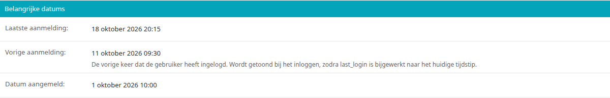

Onder het onderdeel "Checks" staat de knop :guilabel:`Openstaande acties ophalen voor gebruiker`. Hiermee controleert u welke meldingen de gebruiker op dit moment in het blok "Openstaande acties" op de homepage ziet (zie :ref:`hoofdstuk 4.1 <hoofdstuk-4-1>`). Het veld heet **Config check links** (nog niet vertaald). Alleen supergebruikers kunnen deze controle uitvoeren.

.. note::

   Het onderdeel "Checks" is alleen zichtbaar als de technisch beheerder de omgevingsvariabele ``ENABLE_INTERACTIVE_CHECKS`` heeft aangezet. Deze staat standaard uit: de controles zijn bedoeld voor het inrichten van een nieuwe omgeving en voor geavanceerd probleemonderzoek, niet voor dagelijks gebruik. Zulke controles kunnen bovendien echte verzoeken naar gekoppelde systemen doen. Zet de variabele daarom alleen tijdelijk aan wanneer dat nodig is.

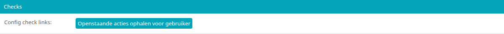

Klik op de knop en vervolgens op :guilabel:`Run Check`. U ziet dan hoeveel meldingen de gebruiker ziet ("2 feeditems gevonden"), en daaronder de details: per melding het type en of er actie nodig is, het totale aantal feed items van de gebruiker, en bij "filtered_out_types" de types die niet getoond worden omdat de bijbehorende pagina (Mijn Zaken of Samenwerken) niet gepubliceerd is. Met :guilabel:`← Back` keert u terug naar de gebruiker.

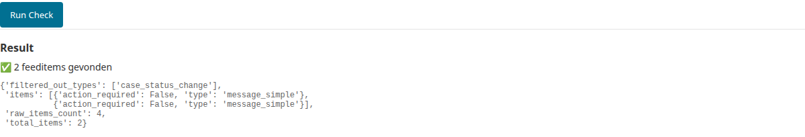

Onderaan het scherm staan de **Digitale adressen** van de gebruiker: de e-mailadressen en telefoonnummers die de gebruiker in zijn of haar profiel heeft opgegeven, met per adres het **Type** (e-mailadres of telefoonnummer), de **Waarde**, het **Logintype** en of het adres het standaardadres voor dat type is (**Is standaard voor type**). Deze adressen zijn alleen in te zien; u kunt ze hier niet toevoegen, wijzigen of verwijderen.

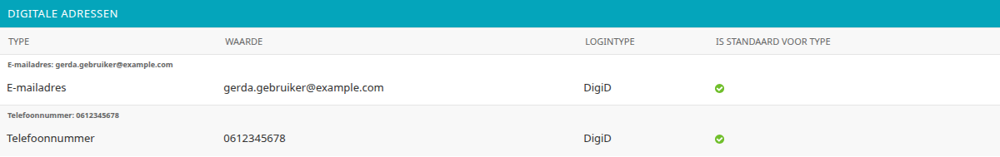

| **Opslaan of verwijderen**
| U kunt in dit scherm ook de betreffende gebruiker verwijderen door onderaan het scherm op de rode knop :guilabel:`Verwijderen` te klikken (zie de opmerking bij :ref:`hoofdstuk 4.2 <hoofdstuk-4-2>` over gebruikers met versies van CMS-pagina's). Als u uw wijzigingen tussentijds wilt opslaan, klikt u op :guilabel:`Opslaan en opnieuw bewerken`. Wanneer u tevreden bent met uw wijzigingen klikt u op :guilabel:`Opslaan` om terug te keren naar het overzicht. Of u klikt op :guilabel:`Opslaan en nog een toevoegen` als u een extra gebruiker wilt toevoegen.

.. _hoofdstuk-4-2-4:

4.2.4. Permissies wijzigen
--------------------------

Door in het gebruikersoverzicht op een bepaalde gebruiker te klikken kunt u deze wijzigen, zoals in :ref:`4.2.3 <hoofdstuk-4-2-3>` beschreven. Wanneer u de permissies van een gebruiker wilt aanpassen, klikt u in het wijzigingsscherm op de titel "Permissies" om dit onderdeel uit te klappen. U kunt nu de diverse wijzigingen rond de permissies aanbrengen.

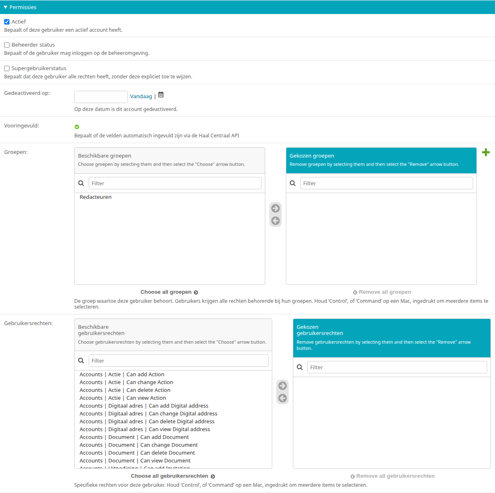

| **Actief**
| Door hier het vinkje weg te halen zet u de gebruikersaccount op inactief; de gebruiker kan dan niet meer inloggen. Dit is een alternatief voor het verwijderen van een account.

| **Beheerder status**
| Zet hier een vinkje wanneer u de gebruiker een beheerdersrol wilt geven.

.. warning::

   De gebruiker krijgt hiermee toegang tot de beheeromgeving.

| **Supergebruikerstatus**
| Zet hier een vinkje wanneer u de gebruiker de rol van supergebruiker wilt geven.

.. warning::

   De gebruiker krijgt hiermee alle rechten, ongeacht de groepen en permissies die u verderop instelt. Geef deze status alleen als dat echt de bedoeling is.

| **Gedeactiveerd op**
| De datum waarop de gebruiker zijn of haar account heeft gedeactiveerd. Dit veld wordt niet meer gebruikt: wanneer een gebruiker zijn of haar profiel verwijdert, wordt het account direct verwijderd.

| **Vooringevuld**
| Geeft aan of de gegevens van de gebruiker automatisch zijn ingevuld via de Haal Centraal API (BRP). Dit veld kunt u niet wijzigen.

| **Groepen**
| Hier kunt u de gebruikersaccount aan bepaalde groepen toevoegen, waardoor zij automatisch bepaalde rechten krijgen. Het gaat hier om beheerdergroepen (zie :ref:`hoofdstuk 4.3 <hoofdstuk-4-3>`). Selecteer een groep in het linker veld en klik op het pijltje naar rechts om de gebruiker aan de groep toe te voegen. Laat het rechter veld leeg als de gebruiker niet tot een groep behoort. U kunt de gebruiker dan in het volgende veld specifieke permissies geven.

| **Gebruikersrechten**
| Hier kunt u de gebruikersaccount bepaalde rechten toewijzen. Houd de :kbd:`Ctrl` toets op uw toetsenbord ingedrukt om meerdere rechten te selecteren. Wanneer u tevreden bent met uw selectie klikt u op het icoontje van het pijltje naar rechts, waardoor de gekozen permissies naar het rechter veld worden verplaatst. Wilt u alle permissies kiezen? Dan klikt u op de knop :guilabel:`Alle kiezen`. Om alle gekozen permissies te verwijderen klikt u op :guilabel:`Alle verwijderen`. Wanneer u de permissies naar wens hebt gewijzigd, scrolt u naar de onderkant van het venster en kunt u de gebruikersaccount opslaan zoals aangegeven onder :ref:`4.2.3 <hoofdstuk-4-2-3>`.

.. _hoofdstuk-4-2-5:

4.2.5. Notificatie-instellingen aanpassen
-----------------------------------------

Wanneer u in het wijzigingsscherm op de titel "Notificaties" klikt, krijgt u de notificatie-instellingen van de betreffende gebruiker te zien. Een vinkje geeft aan dat de gebruiker dit soort e-mailnotificaties ontvangt. Indien gewenst kunnen deze gegevens worden gewijzigd, zodat de gebruiker bepaalde notificaties juist wel of juist niet ontvangt. De gebruiker kan deze instellingen ook zelf wijzigen in zijn of haar profiel.

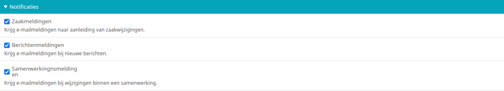

| **Zaakmeldingen**
| Of de gebruiker e-mailnotificaties ontvangt over wijzigingen in zijn of haar zaken.

| **Berichtenmeldingen**
| Of de gebruiker e-mailnotificaties ontvangt over nieuwe berichten.

| **Samenwerkingnsmeldingen**
| Of de gebruiker e-mailnotificaties ontvangt over wijzigingen binnen een samenwerking (ook acties). De naam van dit veld bevat een typefout.

Deze instellingen gelden alleen voor de soorten notificaties die voor het hele platform zijn ingeschakeld. Dit stelt u in onder de Algemene configuratie, in het onderdeel "Notificaties" (zie :ref:`hoofdstuk 20.1.8 <hoofdstuk-20-1-8>`). Daar stelt u ook in of e-mailverificatie verplicht is, en welk bericht gebruikers daarover te zien krijgen.

.. _hoofdstuk-4-2-6:

4.2.6. Contacten - uitnodigingen
--------------------------------

Onder contacten – uitnodigingen kunnen beheerders contactpersonen toevoegen aan gebruikers. Klik in het veld en typ een gedeelte van een naam of e-mailadres om de beschikbare gebruikers te zien, en klik op een gebruiker om deze toe te voegen. Met het kruisje voor een contactpersoon verwijdert u deze weer.

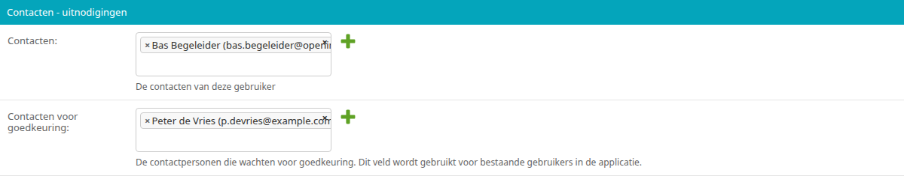

| **Contacten**
| De contactpersonen van de gebruiker. Wanneer de gebruiker in zijn of haar profiel zelf contactpersonen toevoegt, zijn deze hier ook zichtbaar. Een contactpersoon die u hier toevoegt, krijgt de gebruiker ook als contactpersoon.

| **Contacten voor goedkeuring**
| De contactpersonen die nog moeten worden goedgekeurd. Een toegevoegde contactpersoon komt in eerste instantie hier te staan, en verschijnt na wederzijdse goedkeuring bij **Contacten**. Dit veld wordt gebruikt voor contactpersonen die al een account hebben.

Een gebruiker kan ook contacten toevoegen die nog geen account hebben. Deze toekomstige contacten ontvangen dan eerst een uitnodiging om een account aan te maken (zie :ref:`hoofdstuk 4.5 <hoofdstuk-4-5>`).

.. _hoofdstuk-4-3:

4.3. Groepen
============

**Locatie in het menu:** Gebruikers & Authenticatie > Gebruikers > Groepen

Bij Groepen vindt u een overzicht van de beschikbare gebruikersgroepen (beheerders) van de Open Inwoner omgeving. Het gebruik van beheerdersgroepen stelt u in staat op groepsniveau permissies en rollen toe te kennen. Via groepenbeheer kunnen afzonderlijke gebruikersgroepen of beheergroepen worden ingericht door een (overkoepelend) functioneel beheerder. Hiermee kunnen specifieke rechten worden toegekend aan beheerders van het platform, of kan het beheer van bepaalde onderdelen worden gedelegeerd aan beheerders die slechts toegang hebben tot een deel van de beheeromgeving.

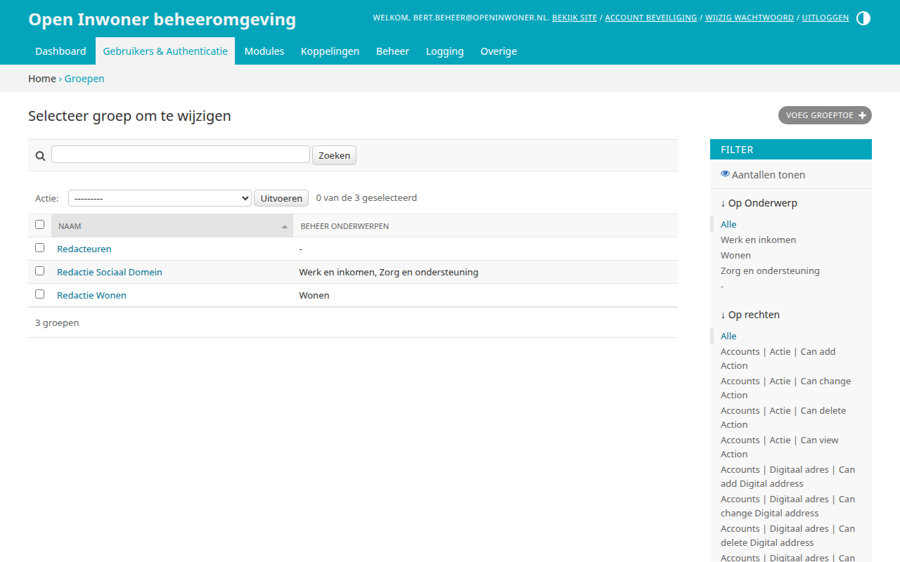

4.3.1. Groep toevoegen
----------------------

Door in het overzicht op de knop :guilabel:`Groep toevoegen +` rechts bovenin uw scherm te klikken kunt u een nieuwe groep toevoegen. Er wordt een nieuw scherm geopend waar u de groep een naam dient te geven. Vervolgens
selecteert u alle voor deze groep gewenste rechten. Indien alle gewenste rechten zijn geselecteerd klikt u op :guilabel:`Opslaan`.

.. tip::

   Selecteer de rechten in het linker vak (*Beschikbare rechten*) en klik op de pijl naar rechts om ze naar het rechter vak (*Gekozen rechten*) te verplaatsen. Met het filterveld boven het vak zoekt u een recht op naam. Houd de :kbd:`Ctrl`-toets (:kbd:`Command` op een Mac) ingedrukt om meerdere rechten in één keer te selecteren.

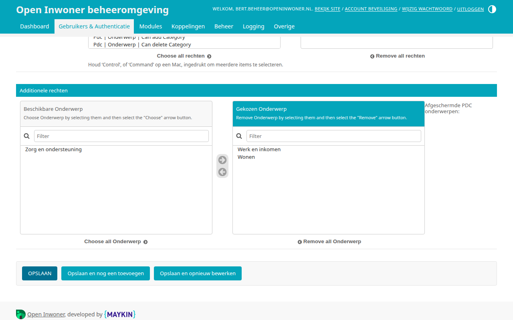

.. _hoofdstuk-4-3-2:

4.3.2. Additionele rechten
--------------------------

Door in het veld **Afgeschermde PDC onderwerpen** onderwerpen te selecteren kunt u een beheerdersgroep additionele rechten geven. Hier selecteert u de onderwerpen die voor de betreffende beheerdersgroep van toepassing zijn. Op deze manier kunt u de beheerdersgroep op onderwerpniveau bepaalde rechten geven. De betreffende beheerdersgroep heeft dan enkel de geselecteerde rechten over de geselecteerde onderwerpen.

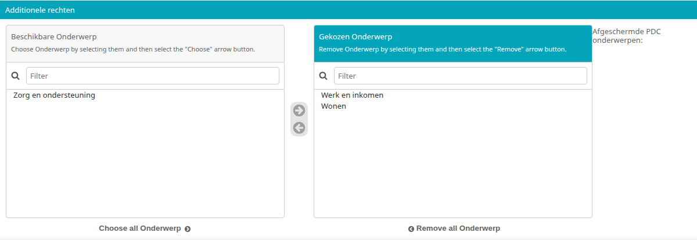

4.4. TOTP devices
=================

**Locatie in het menu:** Gebruikers & Authenticatie > Gebruikers > TOTP devices

Bij TOTP devices vindt u de middels TOTP (time-based one time password) goedgekeurde apparaten waarmee kan worden ingelogd. TOTP is een van de meest gebruikte vormen van tweestapsverificatie (2FA). U kunt TOTP devices toevoegen, wijzigen of verwijderen.

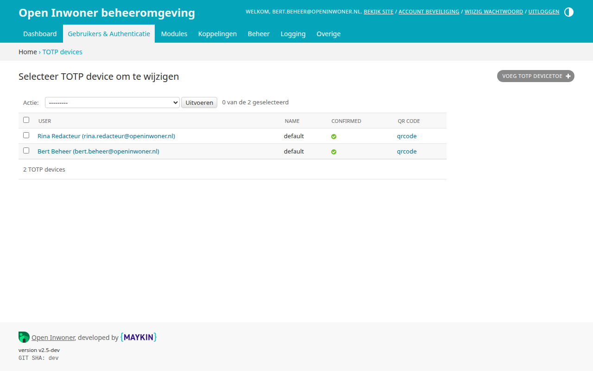

4.4.1. TOTP device toevoegen
----------------------------

Door in het overzicht op de knop :guilabel:`TOTP device toevoegen +` rechts bovenin uw scherm te klikken kunt u een nieuw apparaat toevoegen waarmee met TOTP kan worden ingelogd. Er wordt een nieuw scherm geopend waar u enkele gegevens dient in te vullen. Wanneer alle gegevens zijn ingevuld klikt u op :guilabel:`Opslaan`.

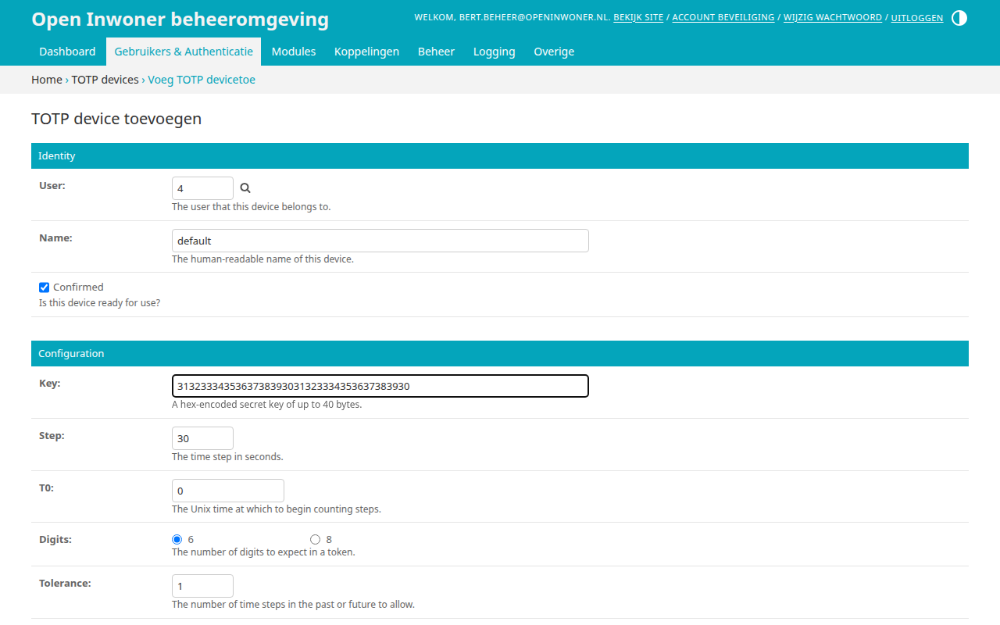

4.4.2. TOTP device wijzigen
---------------------------

Door op een e-mailadres in het overzicht te klikken, kunt u het goedgekeurde TOTP device wijzigen. Er wordt een nieuw scherm geopend waar u diverse wijzigingen kunt aanbrengen.

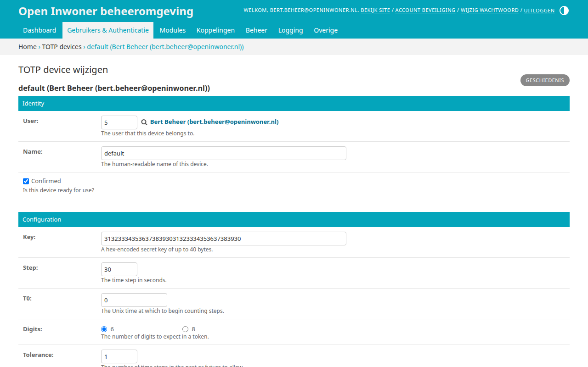

Het formulier is in het Engels. Onder het onderdeel **Identity** vindt u de volgende velden:

**User**
Hier ziet u het gebruiker-ID van degene aan wie het TOTP device is gekoppeld, met daarnaast de naam en het mailadres van die gebruiker. Wijzig dit ID niet.

**Name**
Hier zet u de naam van het TOTP device. Dit staat standaard op ‘default’.

**Confirmed**
Hiermee geeft u aan of het TOTP device is bevestigd. Alleen met een bevestigd TOTP device kan worden ingelogd.

**Let op!**
**De velden onder de onderdelen Configuration, State en Throttling zijn technische velden die enkel in overleg met de leverancier aangepast dienen te worden.** Onderaan het formulier vindt u bij **QR Code** een link naar de QR-code van het TOTP device.

**Opslaan**
Als u uw wijzigingen tussentijds wilt opslaan, klikt u op :guilabel:`Opslaan en opnieuw bewerken`. Wanneer u tevreden bent met uw wijzigingen klikt u op :guilabel:`Opslaan` om terug te keren naar het overzicht. Of u klikt op :guilabel:`Opslaan en nog een toevoegen` als u een extra item wilt toevoegen.

4.4.3. TOTP device verwijderen
------------------------------

Wanneer u een of meerdere TOTP devices wilt verwijderen, klikt u in de checkbox links van de gebruiker van het TOTP device. Selecteer vervolgens in het dropdown menu bij ‘Actie’ de actie ‘Geselecteerde TOTP devices verwijderen’ en klik op de knop :guilabel:`Uitvoeren`. De geselecteerde TOTP devices zijn nu verwijderd.

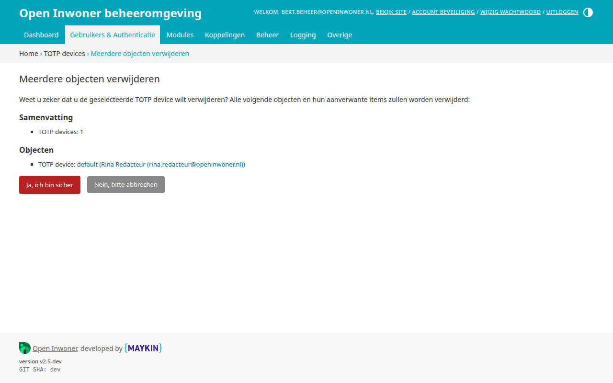

**Let op! Door een TOTP device te verwijderen wordt de beheerder bij opnieuw inloggen gevraagd de QR-code nogmaals te scannen. Dit is noodzakelijk als de beheerder zijn 2FA code is kwijtgeraakt of vergeten. Op deze manier kan dit TOTP device worden gereset.**

.. _hoofdstuk-4-5:

4.5. Uitnodigingen
==================

**Locatie in het menu:** Gebruikers & Authenticatie > Gebruikers > Uitnodigingen

Onder uitnodigingen vindt u een overzicht van de door gebruikers uitgenodigde personen. U kunt in het overzicht raadplegen wie degene is die de persoon heeft uitgenodigd én wie er is uitgenodigd. Bij ‘Geaccepteerd’ kunt u zien of de uitnodiging is afgerond. Daarnaast kunt u uitnodigingen toevoegen, wijzigen of verwijderen.

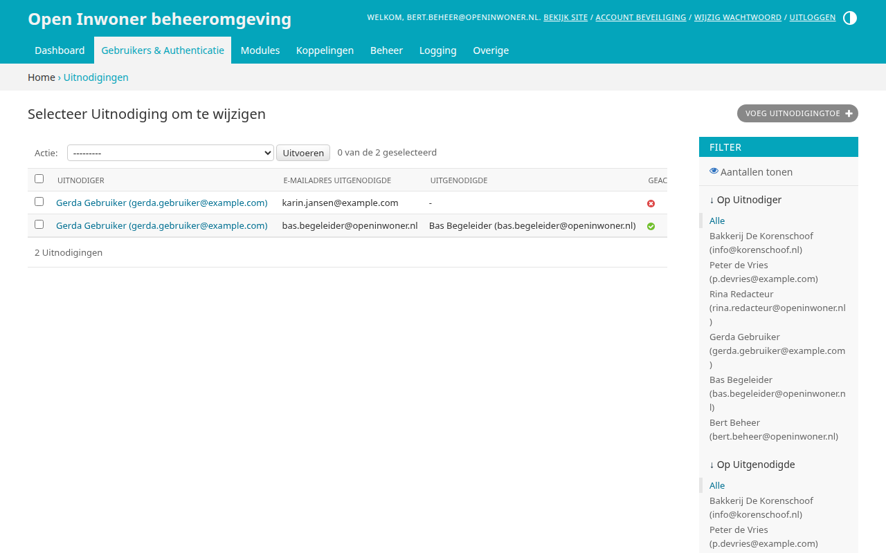

Het overzicht toont per uitnodiging de kolommen **Uitnodiger**, **E-mailadres uitgenodigde**, **Uitgenodigde**, **Geaccepteerd** en **Aangemaakt op**. Rechts kunt u de uitnodigingen filteren op **Uitnodiger** en op **Uitgenodigde**.

.. _hoofdstuk-4-5-1:

4.5.1. Uitnodiging toevoegen
----------------------------

Door in het uitnodigingsoverzicht op de knop :guilabel:`Uitnodiging toevoegen +` rechts bovenin uw scherm te klikken kunt u een nieuwe uitnodiging toevoegen. Er wordt een nieuw scherm geopend waar u enkele gegevens dient in te vullen. Wanneer alle gegevens zijn ingevuld klikt u op :guilabel:`Opslaan`.

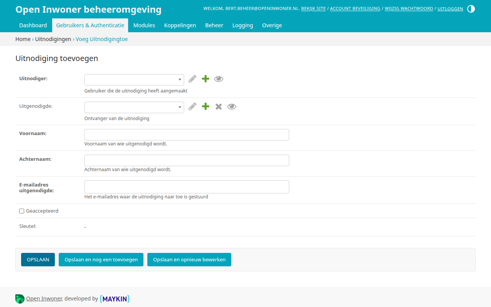

| **Uitnodiger**
| De gebruiker die de uitnodiging verstuurt. Typ een deel van de naam of het e-mailadres van de gebruiker om deze te zoeken en te selecteren.

| **Uitgenodigde**
| De gebruiker die is uitgenodigd, wanneer deze al een account heeft. Typ een deel van de naam of het e-mailadres om de gebruiker te zoeken en te selecteren. Laat dit veld leeg wanneer de uitgenodigde nog geen account heeft.

| **Voornaam** en **Achternaam**
| De voor- en achternaam van de uitgenodigde.

| **E-mailadres uitgenodigde**
| Het e-mailadres waar de uitnodiging naartoe gestuurd wordt.

| **Geaccepteerd**
| Hier wordt aangegeven of de uitnodiging is geaccepteerd of niet. Wanneer de uitnodiging niet is geaccepteerd is de checkbox leeg en staat er in het overzicht een rood kruisje.

| **Sleutel**
| De unieke code in de link van de uitnodiging. Deze wordt aangemaakt wanneer de uitnodiging wordt opgeslagen en kunt u niet wijzigen.

4.5.2. Uitnodiging wijzigen
---------------------------
Door op een uitnodiging in het overzicht te klikken, kunt u deze wijzigen. Er wordt een nieuw scherm geopend waar u diverse wijzigingen kunt aanbrengen. Meer informatie over de te wijzigen velden vindt u
bij :ref:`4.5.1 <hoofdstuk-4-5-1>`.

4.5.3. Uitnodiging verwijderen
------------------------------
Wanneer u een of meerdere uitnodigingen wilt verwijderen, klikt u in de checkbox links van de uitnodiging. Selecteer vervolgens in het dropdown menu bij ‘Actie’ de actie ‘Geselecteerde uitnodigingen verwijderen’ en klik op de knop :guilabel:`Uitvoeren`. De geselecteerde uitnodigingen zijn nu verwijderd.

**Let op! Als de uitnodiging is verwijderd voordat deze is geaccepteerd, zal de uitnodiging ongeldig worden en kan de ontvanger de uitnodiging niet voltooien.**
