.. _gebruikersprofielen:

======================
4. Gebruikersprofielen
======================

In dit hoofdstuk leest u hoe u de gebruikers van Open Inwoner beheert, en wat gebruikers aan de voorkant van Open Inwoner hebben aangemaakt. De onderdelen staan op twee plekken in het menu:

* **Gebruikers & Authenticatie > Gebruikers**: de gebruikers zelf (4.5), de uitnodigingen (4.6) en de feed item data (4.4).
* **Modules > Samenwerkingen**: de acties (4.1), berichten (4.2) en documenten (4.3) van gebruikers.

Zowel via het menu als via het dashboard kunt u naar het gewenste onderdeel doorklikken.

4.1. Acties
===========

**Locatie in het menu:** Modules > Samenwerkingen > Acties

Onder acties vindt u alle acties die gebruikers aan de voorkant van Open Inwoner (onder Mijn Profiel en in samenwerkingen) hebben aangemaakt. Dit onderdeel is enkel in te zien (read-only): u kunt geen acties toevoegen of wijzigen.

.. image:: images/actions-list.png
   :alt: Het overzicht van de acties, met rechts de filters
   :width: 600px

Het overzicht toont per actie de kolommen **Actie titel**, **Status**, **Plan** (de samenwerking waar de actie bij hoort), **Aangemaakt op**, **Aangemaakt door** en **Gemarkeerd als verwijderd**. Standaard staan de acties op volgorde van de datum waarvoor ze moeten worden uitgevoerd.

Rechts kunt u de acties filteren op **Gemarkeerd als verwijderd** en op **Aangemaakt door**. Kiest u bij **Aangemaakt door** een gebruiker, dan ziet u enkel de acties die deze gebruiker heeft aangemaakt.

Een actie die een gebruiker verwijdert, wordt niet echt verwijderd maar gemarkeerd als verwijderd. Via het dropdown menu bij ‘Actie’ kunt u geselecteerde acties zelf als verwijderd markeren ("Markeer geselecteerde acties als soft-deleted.") of zo'n markering ongedaan maken ("Herstel geselecteerde soft-deleted acties"); de gebruiker ziet de actie dan weer. Met "Geselecteerde acties verwijderen" verwijdert u acties definitief.

4.1.1. Actieoverzicht sorteren
------------------------------

U kunt het actieoverzicht op elke kolom sorteren, bijvoorbeeld op actie titel, aanmaakdatum of de gebruiker die de actie heeft aangemaakt. Dit doet u door op de gewenste kolomnaam te klikken. Klikt u nogmaals op dezelfde kolomnaam, dan wisselt u tussen oplopend en aflopend sorteren. Dit kan ook met het icoontje van het driehoekje dat naar boven of naar beneden wijst.

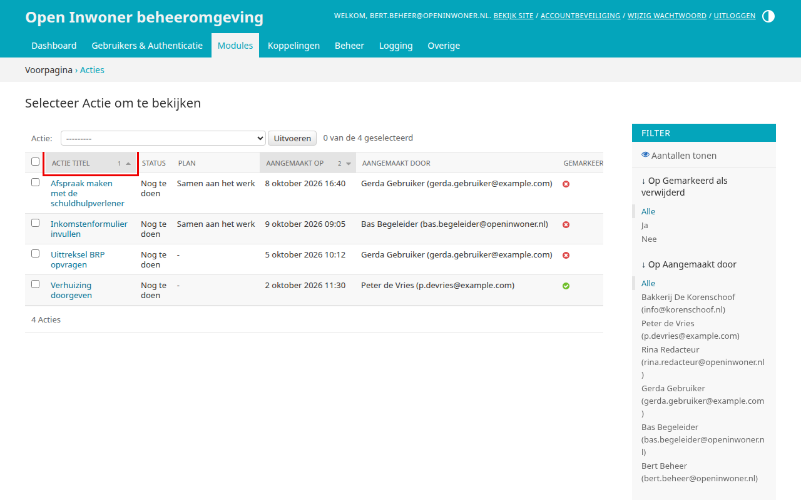

U kunt ook op meerdere kolommen tegelijk sorteren. Klikt u na **Actie titel** ook op **Aangemaakt op**, dan wordt de lijst gesorteerd op aanmaakdatum en daarbinnen op actie titel. Het is belangrijk te weten dat de nieuw aangeklikte kolom óver de al actieve sortering wordt gezet: de laatst aangeklikte kolom geldt dus als ‘hoofd’. Bij elke gesorteerde kolom staat een cijfer dat de volgorde van de sortering aangeeft. Om een kolom uit de sortering te verwijderen, klikt u op het icoontje van de twee driehoekjes met de streep erdoor.

4.2. Berichten
==============

**Locatie in het menu:** Modules > Samenwerkingen > Berichten

Onder berichten vindt u alle berichten die gebruikers elkaar via de Open Inwoner omgeving hebben gestuurd. Dit onderdeel is read-only: er kunnen geen wijzigingen worden aangebracht.

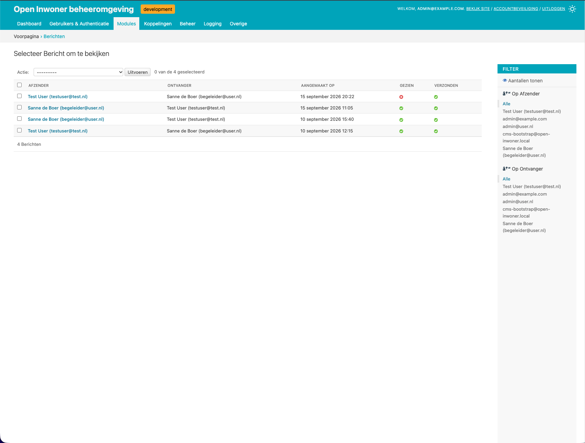

Het overzicht toont per bericht de kolommen **Afzender**, **Ontvanger**, **Aangemaakt op**, **Gezien** en **Verzonden**. Bij **Gezien** ziet u of de ontvanger het bericht heeft gelezen, bij **Verzonden** of de ontvanger een e-mail over het bericht is gestuurd. Dit wordt weergegeven met een groen vinkje (ja) of een rood kruisje (nee).

Rechts kunt u de berichten filteren op **Afzender** en op **Ontvanger**. U ziet dan enkel de berichten die verzonden zijn door, of naar, een bepaalde gebruiker.

4.2.1. Details berichten
------------------------

Door op een specifiek bericht te klikken kunt u de details van het bericht raadplegen:

| **UUID**
| Het unieke kenmerk (Universally Unique ID) van het bericht.

| **Afzender**
| De gebruiker die het bericht heeft gestuurd.

| **Ontvanger**
| De gebruiker aan wie het bericht is gestuurd.

| **Content**
| De tekst van het bericht.

| **Gezien**
| Of de ontvanger het bericht heeft gezien.

| **Verzonden**
| Of de ontvanger een e-mail over het bericht is gestuurd.

| **Bestand**
| Een eventuele bijlage bij het bericht. Klik op de bestandsnaam om de bijlage te downloaden.

4.3. Documenten
===============

**Locatie in het menu:** Modules > Samenwerkingen > Documenten

Onder documenten vindt u alle documenten die gebruikers aan de voorkant van Open Inwoner (onder Mijn Profiel en in samenwerkingen) hebben toegevoegd. Dit onderdeel is read-only: er kunnen geen wijzigingen worden aangebracht.

.. image:: images/documents-list.png
   :alt: Het overzicht van de documenten, met rechts het filter op eigenaar
   :width: 600px

Het overzicht toont per document de kolommen **Naam**, **Bestand**, **Aangemaakt op** en **Eigenaar**. Klik op de bestandsnaam om het document te downloaden. Rechts kunt u de documenten filteren op **Eigenaar**. U ziet dan enkel de documenten die toegevoegd zijn door een bepaalde gebruiker.

4.3.1. Documentenoverzicht sorteren
-----------------------------------

U kunt het documentenoverzicht sorteren op naam, aanmaakdatum en eigenaar; op de kolom **Bestand** kunt u niet sorteren. Dit doet u door op de gewenste kolomnaam te klikken. Voor meer details over het sorteren, raadpleegt u de beschrijving bij hoofdstuk 4.1.1.

4.4. Feed item data
===================

**Locatie in het menu:** Gebruikers & Authenticatie > Gebruikers > Feed item datas

Gebruikers zien na inloggen op de homepage een blok "Openstaande acties", wanneer dit blok (de CMS-plugin "Openstaande acties") op de homepage is geplaatst. In dit blok staan meldingen voor de gebruiker, bijvoorbeeld dat de status van een zaak is gewijzigd of dat een samenwerking bijna afloopt. Elke melding wordt weergegeven met een titel en een omschrijving.

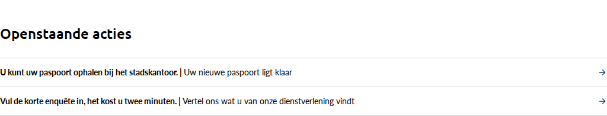

Elke melding is een feed item. Er zijn vier soorten (types): "Eenvoudig tekstbericht", "Zaakstatus is gewijzigd", "Document is toegevoegd" en "Samenwerkingsplan loopt af". Een melding verdwijnt uit het blok zodra de gebruiker de informatie heeft bekeken of de actie heeft voltooid. Meldingen over zaken worden alleen getoond als de pagina van Mijn Zaken gepubliceerd is, en meldingen over samenwerkingen alleen als de pagina van Samenwerken gepubliceerd is.

In de backend is het overzicht van de feed items te raadplegen. Dit onderdeel is read-only.

.. image:: images/feed-items-list.png
   :alt: Het overzicht van de feed items, met rechts het filter op type
   :width: 600px

Het overzicht toont per feed item de kolommen **User** (de gebruiker voor wie het feed item is; deze kolomnaam is nog niet vertaald), **Type**, **Actie aangemaakt op** (vanaf wanneer het feed item getoond wordt) en **Informatie bekeken of actie voltooid** (of, en zo ja wanneer, de gebruiker de informatie heeft bekeken of de actie heeft voltooid). Standaard staan de feed items op volgorde van **Actie aangemaakt op**. U kunt sorteren op elke kolom (zie hoofdstuk 4.1.1), rechts filteren op **Type** en met de zoekbalk zoeken op het e-mailadres, de voornaam of de achternaam van de gebruiker.

Wilt u weten welke meldingen een bepaalde gebruiker op dit moment in het blok "Openstaande acties" ziet? Gebruik dan de knop [Fetch userfeed for user] in het wijzigingsscherm van de gebruiker, zie hoofdstuk 4.5.3.

4.5. Gebruikers
===============

**Locatie in het menu:** Gebruikers & Authenticatie > Gebruikers > Gebruikers

Onder gebruikers vindt u alle gebruikers van uw Open Inwoner: zowel inwoners en bedrijven als begeleiders en beheerders. Indien gewenst kunt u gebruikers toevoegen, wijzigen en verwijderen. Daarnaast kunt u de permissies van gebruikers wijzigen.

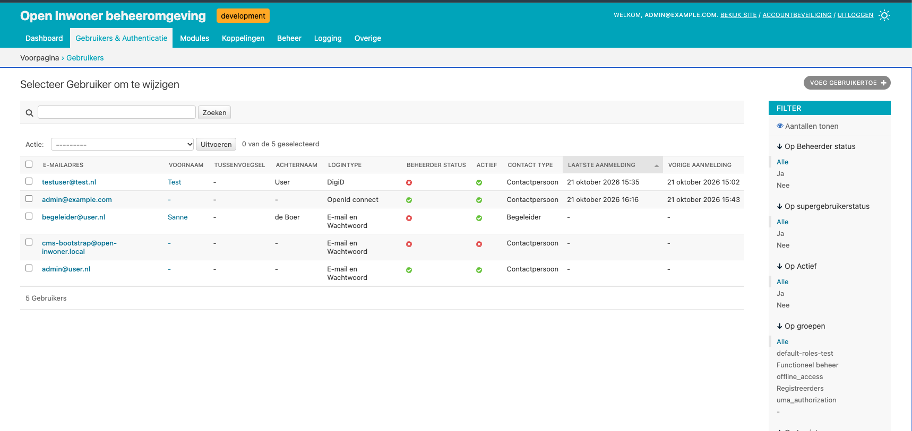

Het overzicht toont per gebruiker de kolommen **E-mailadres**, **Voornaam**, **Tussenvoegsel**, **Achternaam**, **Logintype**, **Beheerder status**, **Actief**, **Contact type**, **Laatste aanmelding** en **Vorige aanmelding**. Met de zoekbalk zoekt u op voornaam, tussenvoegsel, achternaam en e-mailadres.

Rechts kunt u de gebruikers filteren op beheerstatus ("Op Beheerder status"), supergebruikerstatus, activiteit ("Op Actief"), groep ("Op groepen") en de manier van inloggen ("Op Logintype"). Kiest u bijvoorbeeld bij **Logintype** voor "DigiD", dan ziet u enkel de gebruikers die met DigiD inloggen.

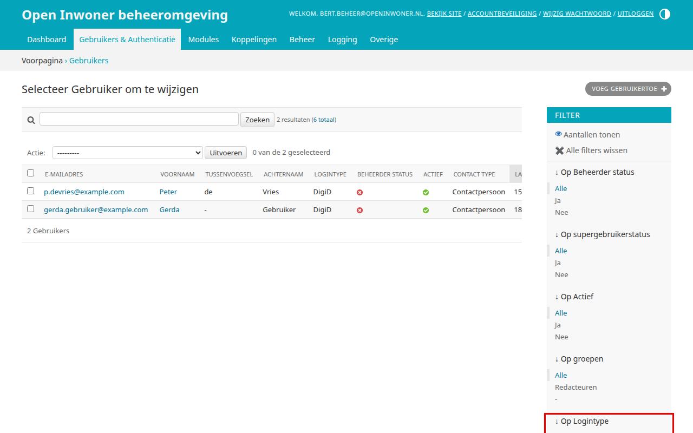

**Let op!** Een gebruiker die versies van CMS-pagina's heeft aangemaakt, kan niet worden verwijderd zolang die versies bestaan. Bij het verwijderen van zo'n gebruiker krijgt u een overzicht van de versies die dit tegenhouden (zie hoofdstuk 11.1.11).

4.5.1. Gebruikersoverzicht sorteren
-----------------------------------

U kunt het gebruikersoverzicht op elke kolom sorteren, bijvoorbeeld op e-mailadres, achternaam of laatste aanmelding. Standaard staan de gebruikers op volgorde van laatste aanmelding. Dit doet u door op de gewenste kolomnaam te klikken. Voor meer details over het sorteren van de gebruikers, raadpleegt u de beschrijving bij hoofdstuk 4.1.1.

4.5.2. Gebruiker toevoegen
--------------------------
Door in het gebruikersoverzicht op de knop [Gebruiker toevoegen +] rechts bovenin uw scherm te klikken kunt u een nieuwe gebruiker toevoegen. Er wordt een nieuw scherm geopend waar u enkele gegevens dient in te vullen. Wanneer alle gegevens zijn ingevuld klikt u op [Opslaan]. U komt dan in het wijzigingsscherm van de nieuwe gebruiker (zie hoofdstuk 4.5.3), waar u de overige gegevens en de permissies kunt invullen.

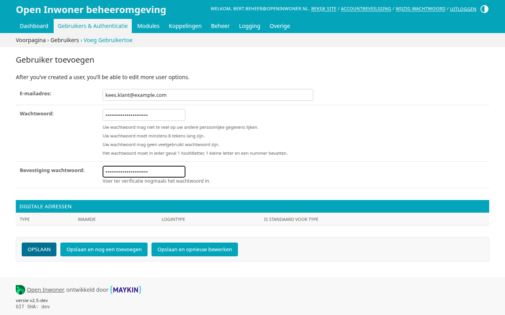

| **E-mailadres**
| Dit is het e-mailadres waarmee de nieuwe gebruiker kan inloggen.

| **Wachtwoord**
| Voer hier het gewenste wachtwoord in. Onder het veld staat aan welke eisen het wachtwoord moet voldoen.

| **Bevestiging wachtwoord**
| Herhaal hier het wachtwoord ter controle.

4.5.3. Gebruiker wijzigen
-------------------------
Door op een gebruiker in het overzicht te klikken, kunt u deze wijzigen. Er wordt een nieuw scherm geopend waar u naast de persoonlijke gegevens diverse wijzigingen kunt aanbrengen. De onderdelen "Permissies" en "Notificaties" zijn standaard ingeklapt; klik op de titel van een onderdeel om het uit te klappen (zie hoofdstuk 4.5.4 en 4.5.5).

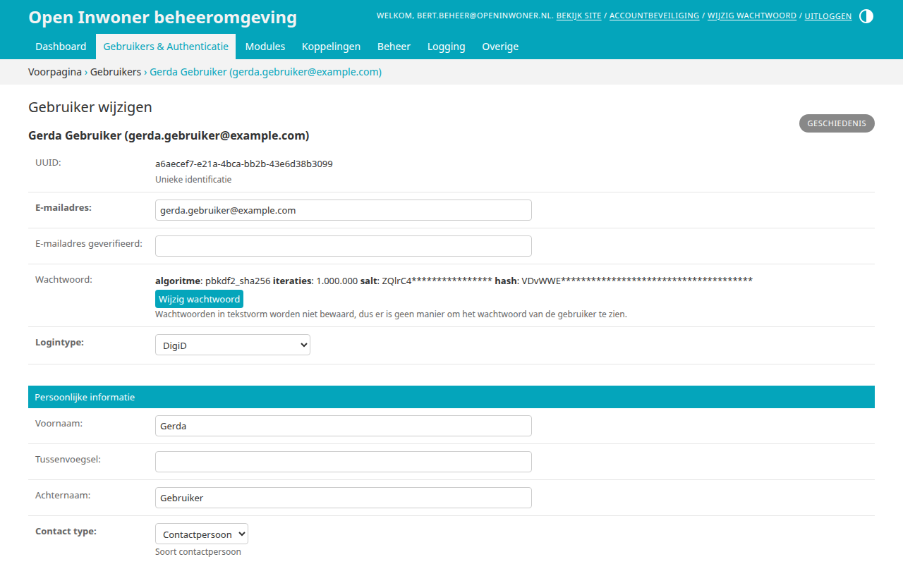

Bovenaan het scherm staan de volgende velden:

| **UUID**
| Het unieke kenmerk van de gebruiker. Dit veld kunt u niet wijzigen.

| **E-mailadres**
| Het e-mailadres van de gebruiker. Gebruikers die met e-mail en wachtwoord inloggen, gebruiken dit e-mailadres om in te loggen.

| **E-mailadres geverifieerd**
| Het e-mailadres dat de gebruiker heeft bevestigd via de link in de verificatie-e-mail. Het e-mailadres geldt als geverifieerd wanneer dit veld gelijk is aan **E-mailadres**. Dit wordt gebruikt wanneer e-mailverificatie verplicht is (zie hoofdstuk 12.1.8).

| **Wachtwoord**
| Het wachtwoord zelf wordt niet getoond. Klik op de knop onder het veld om een nieuw wachtwoord in te stellen.

| **Logintype**
| De manier waarop de gebruiker inlogt. Kies in het dropdown menu voor "E-mail en Wachtwoord", "DigiD", "eHerkenning", "OpenId connect", "EIDAS-persoon met BSN", "EIDAS-persoon met pseudo-ID" of "EIDAS-bedrijf met bedrijfs-ID".

Onder **Persoonlijke informatie** staan de persoonsgegevens van de gebruiker. Bij gebruikers die met DigiD of eHerkenning inloggen, worden deze gegevens na het inloggen automatisch ingevuld vanuit de gekoppelde basisregistraties.

| **Voornaam**, **Tussenvoegsel** en **Achternaam**
| De naam van de gebruiker.

| **Contact type**
| Wat voor soort contactpersoon de gebruiker is. In het dropdown menu kunt u kiezen uit "Contactpersoon", "Begeleider" of "Organisatie".

| **OpenID Connect ID**
| Wanneer de gebruiker via OpenID Connect heeft ingelogd, staat hier de bijbehorende ID. Dit veld kunt u niet wijzigen.

| **Afbeelding**
| Een pasfoto van de gebruiker. Alleen een gebruiker met contact type "Begeleider" kan een afbeelding hebben.

| **Cropping**
| Hier kiest u welk deel van de afbeelding getoond wordt. Dit veld (de naam is nog niet vertaald) verschijnt pas wanneer er een afbeelding is.

| **Telefoonnummer**
| Het telefoonnummer van de gebruiker.

| **Geselecteerde onderwerpen**
| De onderwerpen waar de gebruiker in geïnteresseerd is. Typ een deel van de naam van een onderwerp om het te zoeken en te selecteren. Via [+] kunt u een nieuw onderwerp toevoegen.

Onder **Contacten - uitnodigingen** staan de contactpersonen van de gebruiker, zie hoofdstuk 4.5.6.

Onder **Belangrijke datums** ziet u wanneer de gebruiker voor het laatst en de keer daarvoor is ingelogd, en wanneer het account is aangemaakt. Deze datums (**Laatste aanmelding**, **Vorige aanmelding** en **Datum aangemeld**) kunt u niet wijzigen.

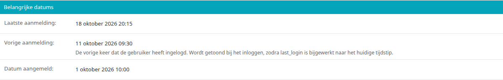

Onder het onderdeel "Checks" (de titel is nog niet vertaald) staat de knop [Fetch userfeed for user]. Hiermee controleert u welke meldingen de gebruiker op dit moment in het blok "Openstaande acties" op de homepage ziet (zie hoofdstuk 4.4). Het veld heet **Config check links** en is, net als de knop, nog niet vertaald. Alleen supergebruikers kunnen deze controle uitvoeren.

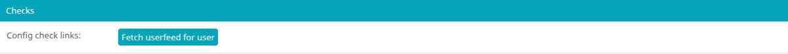

Klik op de knop en vervolgens op [Run Check]. U ziet dan hoeveel meldingen de gebruiker ziet ("2 feed items found"), en daaronder de details: per melding het type en of er actie nodig is, het totale aantal feed items van de gebruiker, en bij "filtered_out_types" de types die niet getoond worden omdat de bijbehorende pagina (Mijn Zaken of Samenwerken) niet gepubliceerd is. Met [← Back] keert u terug naar de gebruiker.

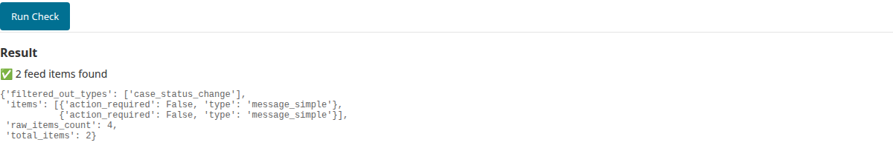

Onderaan het scherm staan de **Digitale adressen** van de gebruiker: de e-mailadressen en telefoonnummers die de gebruiker in zijn of haar profiel heeft opgegeven, met per adres het **Type** (e-mailadres of telefoonnummer), de **Waarde**, het **Logintype** en of het adres het standaardadres voor dat type is (**Is standaard voor type**). Deze adressen zijn alleen in te zien; u kunt ze hier niet toevoegen, wijzigen of verwijderen.

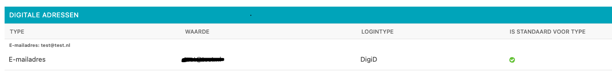

| **Opslaan of verwijderen**
| U kunt in dit scherm ook de betreffende gebruiker verwijderen door onderaan het scherm op de rode knop [Verwijderen] te klikken (zie de opmerking bij hoofdstuk 4.5 over gebruikers met versies van CMS-pagina's). Als u uw wijzigingen tussentijds wilt opslaan, klikt u op [Opslaan en opnieuw bewerken]. Wanneer u tevreden bent met uw wijzigingen klikt u op [Opslaan] om terug te keren naar het overzicht. Of u klikt op [Opslaan en nieuwe toevoegen] als u een extra gebruiker wilt toevoegen.

4.5.4. Permissies wijzigen
--------------------------

Door in het gebruikersoverzicht op een bepaalde gebruiker te klikken kunt u deze wijzigen, zoals in 4.5.3 beschreven. Wanneer u de permissies van een gebruiker wilt aanpassen, klikt u in het wijzigingsscherm op de titel "Permissies" om dit onderdeel uit te klappen. U kunt nu de diverse wijzigingen rond de permissies aanbrengen.

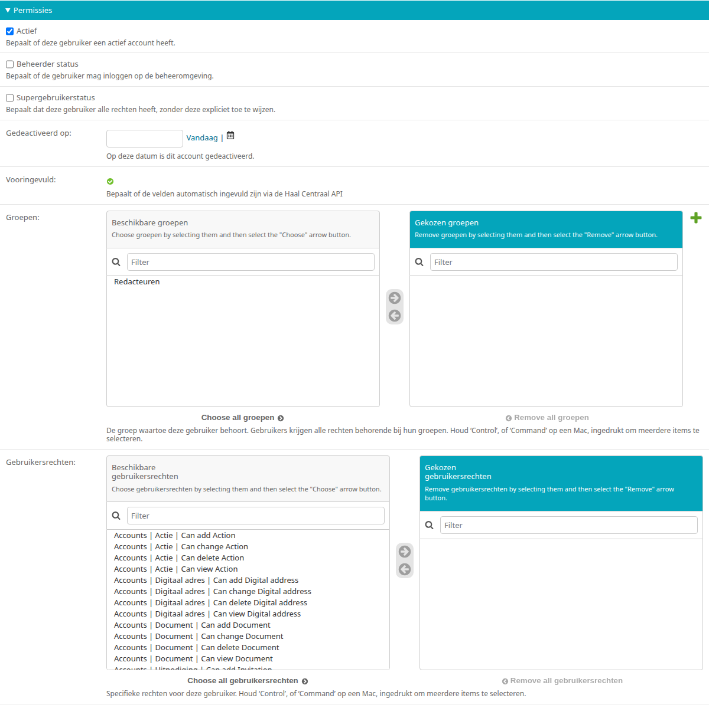

| **Actief**
| Door hier het vinkje weg te halen zet u de gebruikersaccount op inactief; de gebruiker kan dan niet meer inloggen. Dit is een alternatief voor het verwijderen van een account.

| **Beheerder status**
| Zet hier een vinkje wanneer u de gebruiker een beheerdersrol wilt geven. **Let op! De gebruiker krijgt hiermee toegang tot de beheeromgeving.**

| **Supergebruikerstatus**
| Zet hier een vinkje wanneer u de gebruiker de rol van supergebruiker wilt geven. **Let op! De gebruiker krijgt hiermee alle rechten.**

| **Gedeactiveerd op**
| De datum waarop de gebruiker zijn of haar account heeft gedeactiveerd. Dit veld wordt niet meer gebruikt: wanneer een gebruiker zijn of haar profiel verwijdert, wordt het account direct verwijderd.

| **Vooringevuld**
| Geeft aan of de gegevens van de gebruiker automatisch zijn ingevuld via de Haal Centraal API (BRP). Dit veld kunt u niet wijzigen.

| **Groepen**
| Hier kunt u de gebruikersaccount aan bepaalde groepen toevoegen, waardoor zij automatisch bepaalde rechten krijgen. Het gaat hier om beheerdergroepen (zie hoofdstuk 8.4). Selecteer een groep in het linker veld en klik op het pijltje naar rechts om de gebruiker aan de groep toe te voegen. Laat het rechter veld leeg als de gebruiker niet tot een groep behoort. U kunt de gebruiker dan in het volgende veld specifieke permissies geven.

| **Gebruikersrechten**
| Hier kunt u de gebruikersaccount bepaalde rechten toewijzen. Houd de [ctrl] toets op uw toetsenbord ingedrukt om meerdere rechten te selecteren. Wanneer u tevreden bent met uw selectie klikt u op het icoontje van het pijltje naar rechts, waardoor de gekozen permissies naar het rechter veld worden verplaatst. Wilt u alle permissies kiezen? Dan klikt u op de knop [Alle kiezen]. Om alle gekozen permissies te verwijderen klikt u op [Alle verwijderen]. Wanneer u de permissies naar wens hebt gewijzigd, scrolt u naar de onderkant van het venster en kunt u de gebruikersaccount opslaan zoals aangegeven onder 4.5.3.

4.5.5. Notificatie-instellingen aanpassen
-----------------------------------------

Wanneer u in het wijzigingsscherm op de titel "Notificaties" klikt, krijgt u de notificatie-instellingen van de betreffende gebruiker te zien. Een vinkje geeft aan dat de gebruiker dit soort e-mailnotificaties ontvangt. Indien gewenst kunnen deze gegevens worden gewijzigd, zodat de gebruiker bepaalde notificaties juist wel of juist niet ontvangt. De gebruiker kan deze instellingen ook zelf wijzigen in zijn of haar profiel.

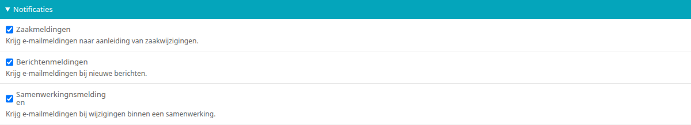

| **Zaakmeldingen**
| Of de gebruiker e-mailnotificaties ontvangt over wijzigingen in zijn of haar zaken.

| **Berichtenmeldingen**
| Of de gebruiker e-mailnotificaties ontvangt over nieuwe berichten.

| **Samenwerkingnsmeldingen**
| Of de gebruiker e-mailnotificaties ontvangt over wijzigingen binnen een samenwerking (ook acties). De naam van dit veld bevat een typefout.

Deze instellingen gelden alleen voor de soorten notificaties die voor het hele platform zijn ingeschakeld. Dit stelt u in onder de Algemene configuratie, in het onderdeel "Notificaties" (zie hoofdstuk 12.1.8). Daar stelt u ook in of e-mailverificatie verplicht is, en welk bericht gebruikers daarover te zien krijgen.

4.5.6. Contacten - uitnodigingen
--------------------------------

Onder contacten – uitnodigingen kunnen beheerders contactpersonen toevoegen aan gebruikers. Klik in het veld en typ een gedeelte van een naam of e-mailadres om de beschikbare gebruikers te zien, en klik op een gebruiker om deze toe te voegen. Met het kruisje voor een contactpersoon verwijdert u deze weer.

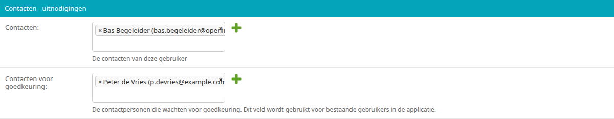

| **Contacten**
| De contactpersonen van de gebruiker. Wanneer de gebruiker in zijn of haar profiel zelf contactpersonen toevoegt, zijn deze hier ook zichtbaar. Een contactpersoon die u hier toevoegt, krijgt de gebruiker ook als contactpersoon.

| **Contacten voor goedkeuring**
| De contactpersonen die nog moeten worden goedgekeurd. Een toegevoegde contactpersoon komt in eerste instantie hier te staan, en verschijnt na wederzijdse goedkeuring bij **Contacten**. Dit veld wordt gebruikt voor contactpersonen die al een account hebben.

Een gebruiker kan ook contacten toevoegen die nog geen account hebben. Deze toekomstige contacten ontvangen dan eerst een uitnodiging om een account aan te maken (zie hoofdstuk 4.6).

4.6. Uitnodigingen
==================

**Locatie in het menu:** Gebruikers & Authenticatie > Gebruikers > Uitnodigingen

Onder uitnodigingen vindt u een overzicht van de door gebruikers uitgenodigde personen. U kunt in het overzicht raadplegen wie degene is die de persoon heeft uitgenodigd én wie er is uitgenodigd. Bij ‘Geaccepteerd’ kunt u zien of de uitnodiging is afgerond. Daarnaast kunt u uitnodigingen toevoegen, wijzigen of verwijderen.

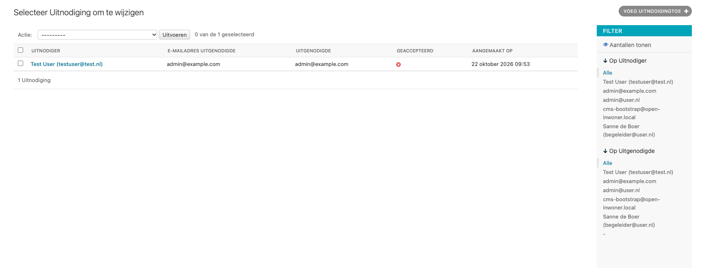

Het overzicht toont per uitnodiging de kolommen **Uitnodiger**, **E-mailadres uitgenodigde**, **Uitgenodigde**, **Geaccepteerd** en **Aangemaakt op**. Rechts kunt u de uitnodigingen filteren op **Uitnodiger** en op **Uitgenodigde**.

4.6.1. Uitnodiging toevoegen
----------------------------

Door in het uitnodigingsoverzicht op de knop [Uitnodiging toevoegen +] rechts bovenin uw scherm te klikken kunt u een nieuwe uitnodiging toevoegen. Er wordt een nieuw scherm geopend waar u enkele gegevens dient in te vullen. Wanneer alle gegevens zijn ingevuld klikt u op [Opslaan].

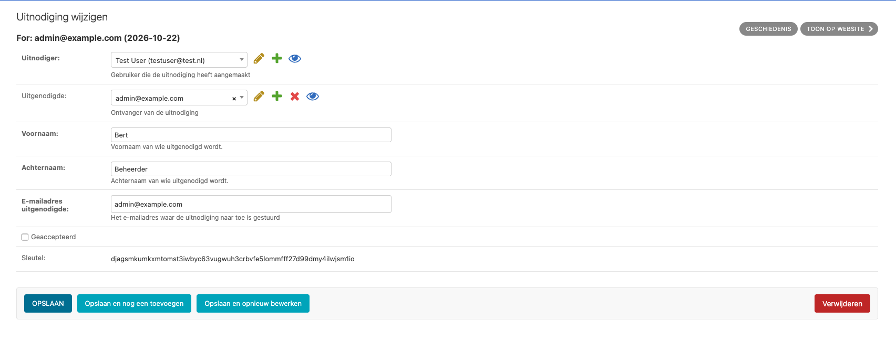

| **Uitnodiger**
| De gebruiker die de uitnodiging verstuurt. Typ een deel van de naam of het e-mailadres van de gebruiker om deze te zoeken en te selecteren.

| **Uitgenodigde**
| De gebruiker die is uitgenodigd, wanneer deze al een account heeft. Typ een deel van de naam of het e-mailadres om de gebruiker te zoeken en te selecteren. Laat dit veld leeg wanneer de uitgenodigde nog geen account heeft.

| **Voornaam** en **Achternaam**
| De voor- en achternaam van de uitgenodigde.

| **E-mailadres uitgenodigde**
| Het e-mailadres waar de uitnodiging naartoe gestuurd wordt.

| **Geaccepteerd**
| Hier wordt aangegeven of de uitnodiging is geaccepteerd of niet. Wanneer de uitnodiging niet is geaccepteerd is de checkbox leeg en staat er in het overzicht een rood kruisje.

| **Sleutel**
| De unieke code in de link van de uitnodiging. Deze wordt aangemaakt wanneer de uitnodiging wordt opgeslagen en kunt u niet wijzigen.

4.6.2. Uitnodiging wijzigen
---------------------------
Door op een uitnodiging in het overzicht te klikken, kunt u deze wijzigen. Er wordt een nieuw scherm geopend waar u diverse wijzigingen kunt aanbrengen. Meer informatie over de te wijzigen velden vindt u
bij 4.6.1.

4.6.3. Uitnodiging verwijderen
------------------------------
Wanneer u een of meerdere uitnodigingen wilt verwijderen, klikt u in de checkbox links van de uitnodiging. Selecteer vervolgens in het dropdown menu bij ‘Actie’ de actie ‘Geselecteerde uitnodigingen verwijderen’ en klik op de knop [Uitvoeren]. De geselecteerde uitnodigingen zijn nu verwijderd.

**Let op! Als de uitnodiging is verwijderd voordat deze is geaccepteerd, zal de uitnodiging ongeldig worden en kan de ontvanger de uitnodiging niet voltooien.**
