.. _inlog_koppelingen:

.. _hoofdstuk-5:

====================
5. Inlog koppelingen
====================

Bij inlog koppelingen kunt u de authenticatiemogelijkheden voor inwoners, bedrijven en beheerders instellen.

U vindt de onderdelen van dit hoofdstuk in het menu onder **Gebruikers & Authenticatie > Inlog koppelingen**.

5.1. Configuratie ‘Haal Centraal’
=================================

**Locatie in het menu:** Gebruikers & Authenticatie > Inlog koppelingen > Configuratie 'Haal Centraal'

Dit dient ter configuratie van de BRP-integratie met de Open Inwoner omgeving. De beheerder stelt hier de Haal Centraal API-service en BRP-versie in, en configureert de HTTP-headers die met elke aanvraag worden meegestuurd.

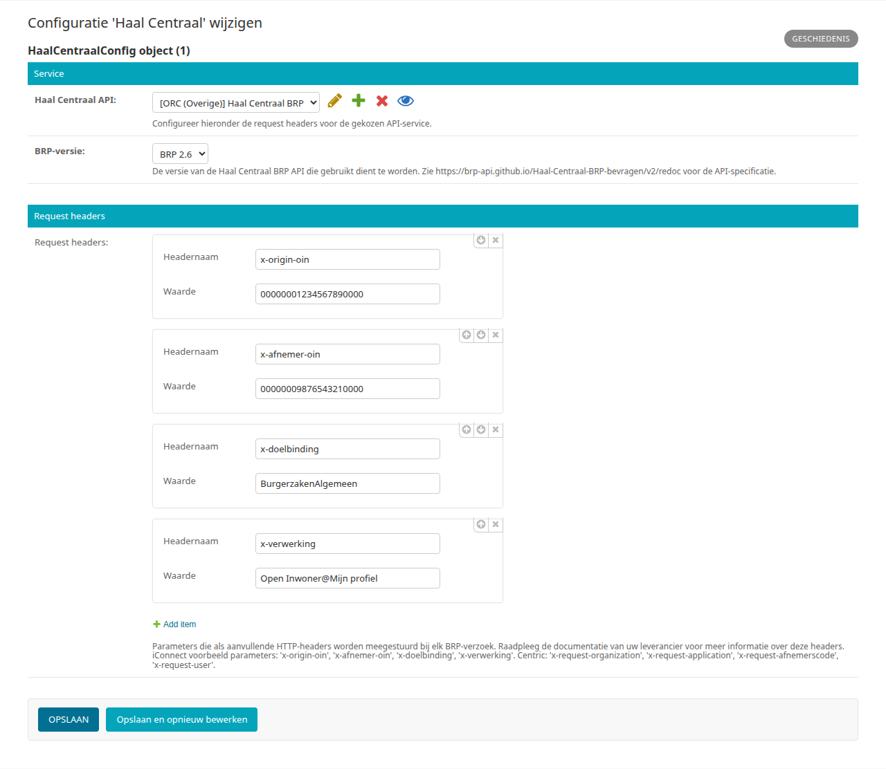

**BRP-versie**

Selecteer de versie van de Haal Centraal BRP API die uw leverancier ondersteunt:

- ``1.3`` — BRP 1.3 (GET-gebaseerde API, endpoint ``ingeschrevenpersonen``)
- ``2.0`` t/m ``2.7`` — BRP 2.x (POST-gebaseerde API, endpoint ``personen``)

.. note::

   Patch versies hebben geen invloed op de keuze: gebruikt uw leverancier bijvoorbeeld
   versie 2.6.2, kies dan ``2.6``.

**Request headers**

Voer de HTTP-headers in als sleutel/waarde-paren die bij elke BRP-aanvraag worden toegevoegd. Welke headers vereist zijn is afhankelijk van uw leverancier:

*I Connect*

+--------------------+------------------------------------------+
| Header             | Omschrijving                             |
+====================+==========================================+
| x-origin-oin       | OIN van de gemeente (afzender)           |
+--------------------+------------------------------------------+
| x-afnemer-oin      | OIN van de afnemer                       |
+--------------------+------------------------------------------+
| x-doelbinding      | Doelbinding van de aanvraag              |
+--------------------+------------------------------------------+
| x-verwerking       | Verwerkingsactiviteit (vrij tekstveld)   |
+--------------------+------------------------------------------+

*Centric*

+--------------------------+------------------------------------------+
| Header                   | Omschrijving                             |
+==========================+==========================================+
| x-request-organization   | Organisatienaam                          |
+--------------------------+------------------------------------------+
| x-request-application    | Applicatienaam                           |
+--------------------------+------------------------------------------+
| x-request-afnemerscode   | Afnemerscode                             |
+--------------------------+------------------------------------------+
| x-request-user           | Gebruikersnaam                           |
+--------------------------+------------------------------------------+

Raadpleeg de documentatie van uw leverancier voor de exacte waarden.

.. note::

   De waarde van ``x-verwerking`` werd in eerdere versies gevalideerd op het voorkomen van maximaal één ``@``-teken. Deze validatie is vervallen omdat het veld is vervangen door een generiek sleutel/waarde-veld zonder leverancierspecifieke beperkingen.

.. _hoofdstuk-5-2:

5.2. DigiD configuratie
=======================

**Locatie in het menu:** Gebruikers & Authenticatie > Inlog koppelingen > DigiD-configuratie

Dit is de configuratie voor de koppeling van het Open Inwoner platform met DigiD van Logius. Bij de onboarding van Open Inwoner wordt bij deze configuratie hulp geboden.

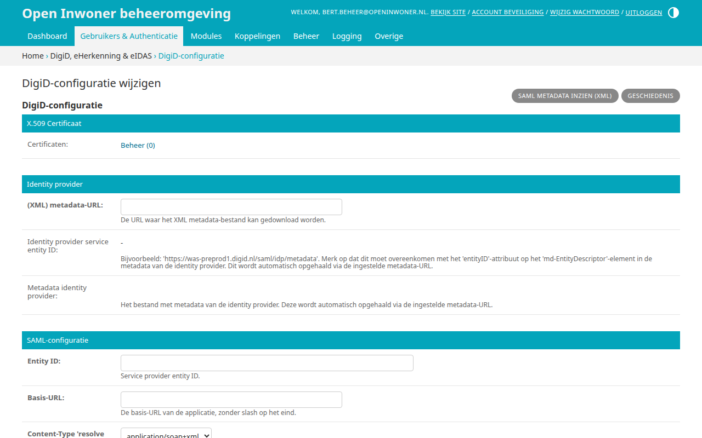

.. note::

   Wanneer de OpenID Connect-koppeling voor DigiD is ingeschakeld (zie :ref:`hoofdstuk 5.5 <hoofdstuk-5-5>`),
   vervangt deze de SAML-koppeling op de loginpagina. Beide kunnen niet tegelijkertijd
   actief zijn.

5.3. eHerkenning/eIDAS configuratie
===================================

**Locatie in het menu:** Gebruikers & Authenticatie > Inlog koppelingen > EHerkenning/eIDAS-configuratie

Dit is de configuratie voor de koppeling van het Open Inwoner platform met eHerkenning bij een eHerkenningsmakelaar. Bij de onboarding van Open Inwoner wordt bij deze configuratie hulp geboden.

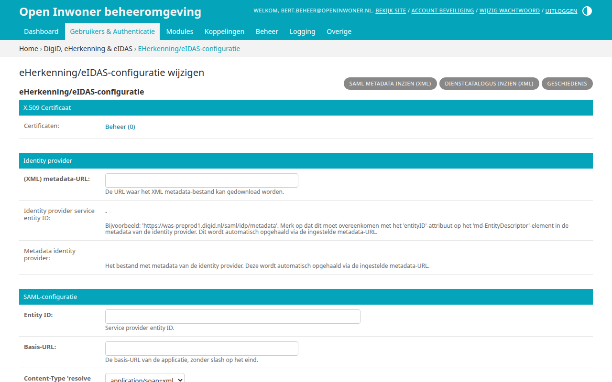

.. note::

   Wanneer de OpenID Connect-koppeling voor eHerkenning is ingeschakeld (zie :ref:`hoofdstuk 5.5 <hoofdstuk-5-5>`),
   vervangt deze de SAML-koppeling op de loginpagina. Beide kunnen niet tegelijkertijd
   actief zijn.

5.4. KVK configuratie
=====================

**Locatie in het menu:** Gebruikers & Authenticatie > Inlog koppelingen > KVK configuratie

Dit is de configuratie voor de koppeling van het Open Inwoner platform met de KVK. Om Mijn Bedrijven te kunnen gebruiken is het noodzakelijk om de KVK API in te stellen. Hierdoor worden – na het inloggen met eHerkenning – de gegevens van het bedrijf opgehaald en getoond en vooraf ingevuld. Om de KVK API in te kunnen stellen zijn de API key, een client certificate (SSL) en een server certificate (SSL) noodzakelijk.

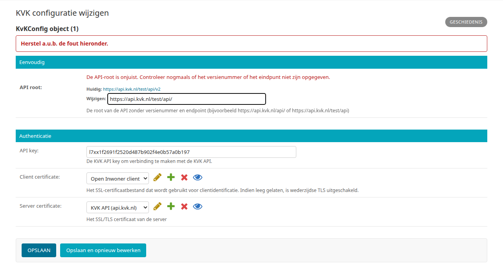

**API root**
De API root is verschillend voor de testomgeving en de productieomgeving van Open Inwoner. Bij de testomgeving moet de root https://api.kvk.nl/test/api/ zijn en bij de productieomgeving https://api.kvk.nl/api/. Vul de root in zonder versienummer of endpoint (dus niet ``.../api/v2``); anders wordt de waarde bij het opslaan geweigerd.

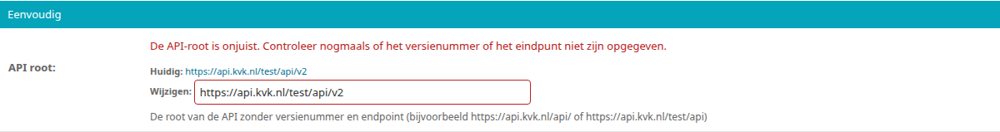

Let op! Er is een abonnement noodzakelijk om gebruik te kunnen maken van deze API. Meer informatie over de KVK API kunt u vinden op: https://developers.kvk.nl/documentation

**API key**
De API key ontvangt u wanneer u zich aanmeldt om gebruik te maken van de KVK API.

**Client certificate**
Het SSL-certificaat dat wordt gebruikt voor clientidentificatie. Dit veld kan leeg blijven.

**Server certificate**
Het SSL/TLS certificaat van de server. Dit certificaat kunt u downloaden van de KVK
website: https://developers.kvk.nl/documentation/certificates

Het gedownloade zip-bestand bevat meerdere certificaat bestanden die u moet combineren
tot één bestand:

1. Pak het zip-bestand uit
2. Combineer alle ``.crt`` bestanden tot één bestand via de commandline:

   .. code-block:: bash

      cat bestand1.crt bestand2.crt bestand3.crt > combined.crt

   Bijvoorbeeld (bestandsnamen kunnen afwijken):

   .. code-block:: bash

      cat api.kvk.nl.crt "DigiCert G2 TLS EU RSA4096 SHA384 2022 CA1.crt" \
          "DigiCert Global Root G2.crt" > combined.crt

3. Upload het gecombineerde bestand bij **Server certificate** door een bestand
   certificaat bij te werken (potlood icoon) of een nieuw certificaat toe te voegen
   (via het plus icoon).

.. _hoofdstuk-5-5:

5.5. OpenID Connect configuratie (DigiD, eHerkenning en eIDAS)
==============================================================

Open Inwoner ondersteunt inloggen voor burgers (DigiD, eIDAS) en bedrijven
(eHerkenning, eIDAS) via het OpenID Connect protocol (OIDC), doorgaans via een
identity broker zoals Signicat of Keycloak. Dit is een alternatief voor de
SAML-gebaseerde DigiD- en eHerkenning-koppelingen. OIDC staat standaard
uitgeschakeld en vereist technische configuratie voordat het in gebruik genomen
kan worden.

**Let op! Enkel de technisch beheerder dient de OpenID Connect configuratie te wijzigen.**

.. note::

   De aparte beheerpagina's *OpenID Connect configuratie voor DigiD*,
   *OpenID Connect configuratie voor eHerkenning* en *OpenID Connect
   configuratie voor eIDAS* (evenals de aparte OpenID Connect-configuratie
   voor beheerders) zijn vervangen door twee generieke beheerschermen:
   **OIDC Providers** en **OIDC clients**. Bestaande configuratie wordt bij
   een upgrade automatisch overgezet.

De velden van de OIDC providers en clients worden (vooralsnog) grotendeels in het
Engels getoond. De configuratie bestaat uit twee delen:

1. Een **OIDC provider** bevat de verbindingsgegevens van de OpenID Connect
   provider (de identity broker), zoals de verschillende endpoints. Meerdere
   clients kunnen naar dezelfde provider verwijzen: gebruikt u één broker voor
   zowel DigiD als eHerkenning, dan hoeft u de endpoints maar één keer in te
   richten.
2. Een **OIDC client** per loginmethode bevat het client-ID, het secret, de
   scopes en de methode-specifieke instellingen (claims,
   betrouwbaarheidsniveaus).

.. _hoofdstuk-5-5-1:

5.5.1. OIDC Providers
---------------------

**Locatie in het menu:** Gebruikers & Authenticatie > Inlog koppelingen > OIDC Providers

Maak een provider aan (of open een bestaande).

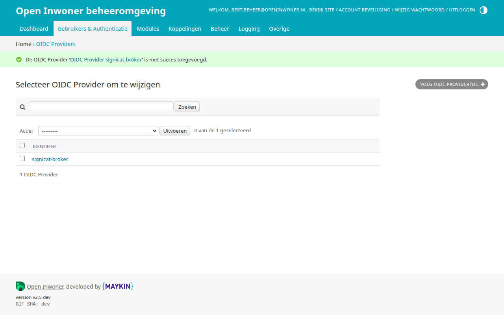

.. note::

   Bij een upgrade vanaf een eerdere versie zijn de providers automatisch
   aangemaakt op basis van de oude configuratie, met namen als
   ``oidc-digid-provider`` en ``oidc-eherkenning-provider``. Verwijzen deze
   naar dezelfde broker, dan kunt u ze desgewenst samenvoegen tot één provider.

**Identifier**
Unieke (technische) naam van de provider, bijvoorbeeld ``signicat-broker``.

**Discovery endpoint**
URL van het discovery-endpoint van de provider, eindigend op een ``/``. Het pad
``.well-known/openid-configuration`` wordt automatisch toegevoegd. Als dit is
ingevuld, kunnen de overige eindpunten worden weggelaten - ze worden automatisch
afgeleid bij het opslaan van de configuratie.

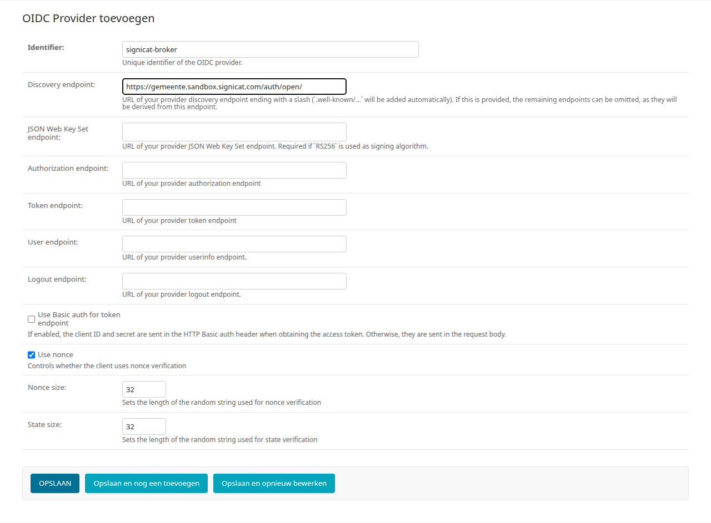

.. note::

   Als er geen discovery-endpoint beschikbaar is, kunnen de onderstaande velden
   handmatig worden ingevuld.

**JSON Web Key Set endpoint**
URL van het JWKS-endpoint. Verplicht bij gebruik van het ``RS256``-algoritme.

**Authorization endpoint**
URL van het autorisatie-endpoint van de provider.

**Token endpoint**
URL van het token-endpoint van de provider.

**User endpoint**
URL van het userinfo-endpoint van de provider.

**Logout endpoint**
URL van het logout-endpoint van de provider. Optioneel.

**Use Basic auth for token endpoint**
Indien ingeschakeld worden client-ID en secret via HTTP Basic auth meegestuurd
bij het ophalen van het access token. Standaard worden ze in de request body
geplaatst.

**Use nonce**
Schakelt nonce-verificatie in of uit (standaard ingeschakeld).

**Nonce size** / **State size**
Lengte van de willekeurige nonce- en state-strings (standaard: 32 tekens).

.. _hoofdstuk-5-5-2:

5.5.2. OIDC clients
-------------------

**Locatie in het menu:** Gebruikers & Authenticatie > Inlog koppelingen > OIDC clients

Voor elke ondersteunde loginmethode bestaat er automatisch precies één client;
clients kunnen niet worden toegevoegd of verwijderd, alleen gewijzigd:

- ``oidc-digid`` - DigiD-login voor burgers
- ``oidc-eherkenning`` - eHerkenning-login voor bedrijven
- ``oidc-eidas`` - eIDAS-login voor Europese burgers en bedrijven
- ``admin-oidc`` - OpenID Connect-login voor (hoofd)beheerders en medewerkers
  (zie ook :ref:`hoofdstuk 20.1.9 <hoofdstuk-20-1-9>`)

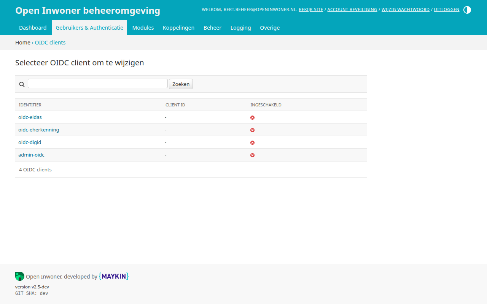

Elke client heeft een eigen redirect-URI (callback-URL) die bij de identity
provider bekend moet zijn. Vervang in onderstaande voorbeelden de basis-URL
(``https://mijn.gemeente.nl``, het adres waarop uw Open Inwoner-omgeving
bereikbaar is) door die van uw eigen omgeving:

- ``oidc-digid`` - ``https://mijn.gemeente.nl/digid-oidc/callback/``
- ``oidc-eherkenning`` - ``https://mijn.gemeente.nl/eherkenning-oidc/callback/``
- ``oidc-eidas`` - ``https://mijn.gemeente.nl/eidas-oidc/callback/``
- ``admin-oidc`` - ``https://mijn.gemeente.nl/oidc/callback/``

.. note::

   De legacy per-provider callback-URL's hierboven voor ``oidc-digid``,
   ``oidc-eherkenning`` en ``oidc-eidas`` worden gebruikt zolang de
   verouderde omgevingsvariabele ``OIDC_USE_LEGACY_ENDPOINTS`` op zijn
   standaardwaarde ``True`` staat. Is de whitelist bij uw identity broker
   al bijgewerkt met de generieke callback-URL
   (``https://mijn.gemeente.nl/oidc/callback/``, dezelfde die ``admin-oidc``
   al gebruikt), zet deze variabele dan op ``False``: alle vier de clients
   gebruiken dan dezelfde generieke callback-URL. Deze instelling en de
   legacy callback-URL's worden in een toekomstige release verwijderd.

Open de client die u wilt configureren:

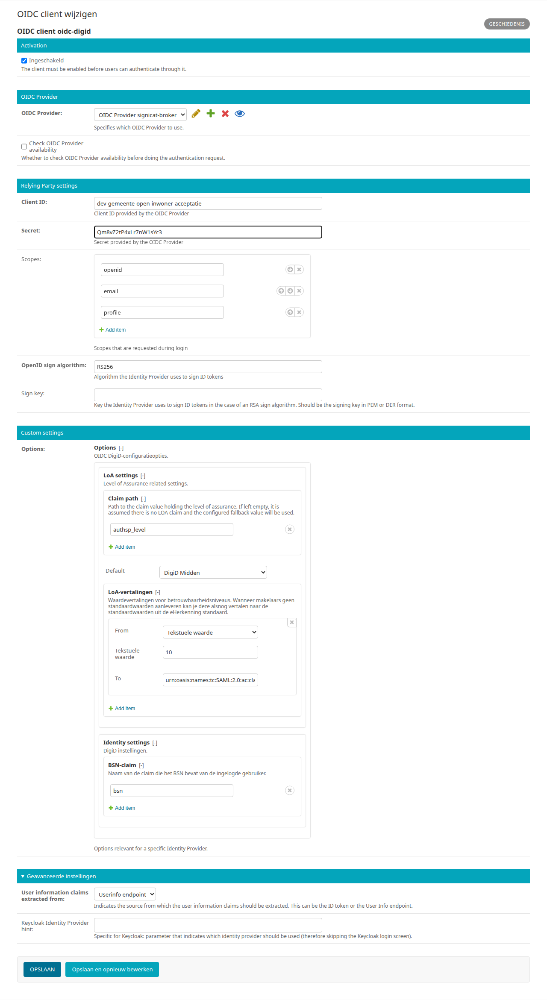

*Activation*

**Ingeschakeld**
Schakelt de loginmethode via OIDC in of uit. Staat standaard uitgeschakeld.

.. note::

   Wanneer ingeschakeld, vervangt de OIDC-koppeling de SAML-gebaseerde
   DigiD- of eHerkenning-koppeling op de loginpagina. Beide kunnen niet
   tegelijkertijd actief zijn.

*OIDC Provider*

**OIDC Provider**
Selecteer hier de provider die u in :ref:`hoofdstuk 5.5.1 <hoofdstuk-5-5-1>` heeft ingericht.

**Check OIDC Provider availability**
Indien ingeschakeld wordt vóór het doorsturen van de gebruiker gecontroleerd of
de provider bereikbaar is. Staat standaard uitgeschakeld.

*Relying Party settings*

**Client ID**
Het client-ID verstrekt door de OIDC-provider (identity broker).

**Secret**
Het bijbehorende client-secret van de OIDC-provider.

**Scopes**
De scopes die worden aangevraagd bij de identity provider. Standaard:
``openid``, ``email``, ``profile``. Pas dit aan volgens de instructies van uw
broker, bijvoorbeeld ``openid`` en ``bsn`` voor DigiD of ``openid`` en ``kvk``
voor eHerkenning.

**OpenID sign algorithm**
Algoritme waarmee de provider ID-tokens ondertekent. Gebruik ``RS256`` bij een
asymmetrisch sleutelpaar.

**Sign key**
Openbare sleutel van de provider in PEM- of DER-formaat. Alleen vereist bij
RSA-algoritmen zoals ``RS256`` als er geen JWKS-endpoint beschikbaar is.

*Custom settings*

**Options**
Methode-specifieke instellingen, zoals de claims en betrouwbaarheidsniveaus.
De beschikbare velden verschillen per client, zie :ref:`hoofdstuk 5.5.3 <hoofdstuk-5-5-3>`.

*Geavanceerde instellingen*

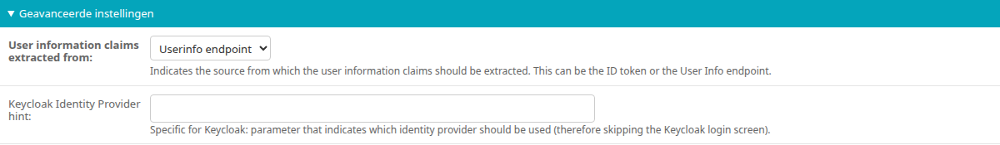

.. _digid-oidc-userinfo-bron:

**User information claims extracted from**
Bepaalt vanwaar de gebruikersclaims worden opgehaald: het *Userinfo endpoint*
(standaard) of het *ID token*. Kies *Userinfo endpoint* wanneer de identity
provider de claims niet in het ID-token zelf meelevert.

**Keycloak Identity Provider hint**
Alleen van toepassing bij Keycloak: geeft aan welke identity provider gebruikt
moet worden, zodat het Keycloak-loginscherm wordt overgeslagen. Laat leeg bij
andere providers.

.. _hoofdstuk-5-5-3:

5.5.3. Opties per loginmethode
------------------------------

In het veld **Options** van elke OIDC client worden claim-*paden* ingesteld: een
pad bestaat uit één of meer stappen, zodat ook geneste claims bereikbaar zijn.
Het pad ``kvk`` > ``kvkNummer`` verwijst bijvoorbeeld naar de claim
``kvkNummer`` binnen de claim ``kvk``. Meestal volstaat een pad van één stap.

Alle clients hebben de volgende **LoA settings**
(Level of Assurance):

**Claim path**
Pad van de claim met het betrouwbaarheidsniveau. Laat leeg als de provider geen
LoA levert; de waarde bij **Default** wordt dan gebruikt.

**Default**
Het betrouwbaarheidsniveau dat wordt toegepast als de identity provider geen
LoA-claim meestuurt in het token. Het betrouwbaarheidsniveau bepaalt welke
acties een ingelogde gebruiker mag uitvoeren - een hoger niveau vereist een
sterkere vorm van authenticatie.

**LoA-vertalingen**
Vertaaltabel voor LoA-claimwaarden van de provider naar de standaardniveaus.
Gebruik dit als de provider eigen waarden hanteert. Bijvoorbeeld:

* Klik op "Add item"
* Kies "Tekstuele waarde" in de **From** dropdown en voer de waarde van de
  provider in, bijvoorbeeld ``10``
* Selecteer het bijbehorende niveau (bijvoorbeeld "DigiD Basis") in de **To**
  dropdown
* Herhaal voor de overige waarden en niveaus

DigiD (``oidc-digid``)
~~~~~~~~~~~~~~~~~~~~~~

**Identity settings** > **BSN-claim**
Pad van de claim die het BSN van de ingelogde gebruiker bevat.
Standaard: ``bsn``.

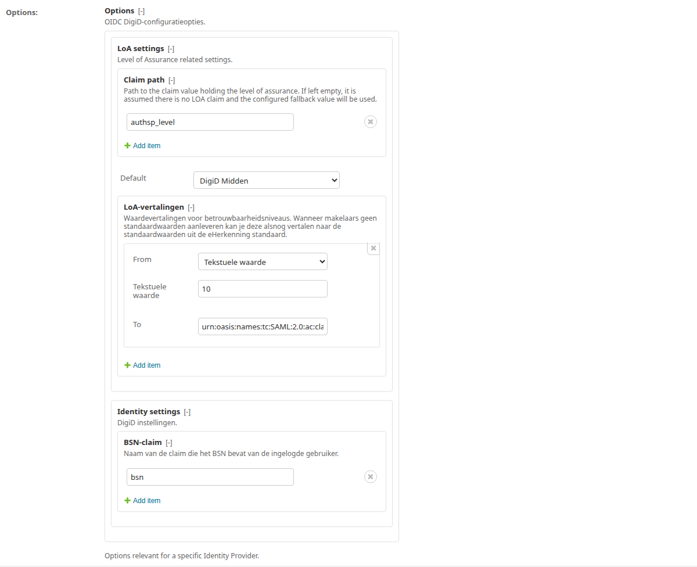

eHerkenning (``oidc-eherkenning``)
~~~~~~~~~~~~~~~~~~~~~~~~~~~~~~~~~~

Onder **Identity settings**:

**Claimnaam identificatietype**
Pad van de claim die aangeeft hoe de bedrijfsidentifier geïnterpreteerd moet
worden. Verwachte waarden: ``urn:etoegang:1.9:EntityConcernedID:KvKnr``
(KVK-nummer) of ``urn:etoegang:1.9:EntityConcernedID:RSIN``.
Standaard: ``namequalifier``.

**Claimnaam juridisch verantwoordelijke**
Pad van de claim met het KVK-nummer of RSIN van het ingelogde bedrijf.
Standaard: ``urn:etoegang:core:LegalSubjectID``.

**Claimnaam handelende persoon**
Pad van de claim met de (pseudonieme) identifier van de gebruiker die namens
het bedrijf handelt. Standaard: ``urn:etoegang:core:ActingSubjectID``.

**Claimnaam vestigingsnummer**
Pad van de claim met het vestigingsnummer, indien van toepassing.
Standaard: ``urn:etoegang:1.9:ServiceRestriction:Vestigingsnr``.

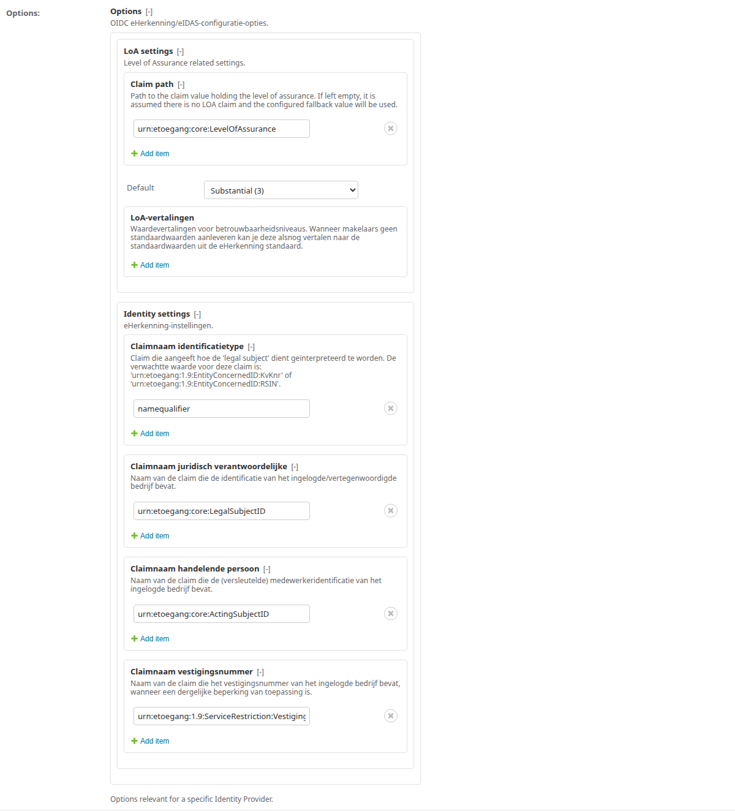

eIDAS (``oidc-eidas``)
~~~~~~~~~~~~~~~~~~~~~~

Via eIDAS kunnen zowel Europese burgers als bedrijven inloggen; beide varianten
worden met dezelfde client geconfigureerd. De eIDAS-specifieke velden worden
(vooralsnog) in het Engels getoond. Onder **Identity settings**:

**Legal subject pseudo identifier claim path**
Pad van de claim met de pseudonieme identifier van de ingelogde gebruiker.
Verplicht voor alle eIDAS-logins.
Standaard: ``urn:etoegang:1.12:EntityConcernedID:PseudoID``.

**Legal subject bsn identifier claim path**
Pad van de claim met het BSN van de ingelogde gebruiker, indien deze een BSN
aan de eIDAS-identiteit heeft gekoppeld.
Standaard: ``urn:etoegang:1.12:EntityConcernedID:BSN``.

**Legal subject first name claim path** / **Legal subject family name claim path**
Paden van de claims met de voor- en achternaam van de ingelogde gebruiker.
Standaard: ``urn:etoegang:1.9:attribute:FirstName`` respectievelijk
``urn:etoegang:1.9:attribute:FamilyName``.

**Legal subject date of birth claim path**
Pad van de claim met de geboortedatum van de ingelogde gebruiker.
Standaard: ``urn:etoegang:1.9:attribute:DateOfBirth``.

**Legal entity identifier claim path**
Pad van de claim met de identifier van de rechtspersoon, bij bedrijfslogins.
Standaard: ``urn:etoegang:1.11:EntityConcernedID:eIDASLegalIdentifier``.

**Company name claim path**
Pad van de claim met de bedrijfsnaam, bij bedrijfslogins.
Standaard: ``urn:etoegang:1.11:attribute-represented:CompanyName``.

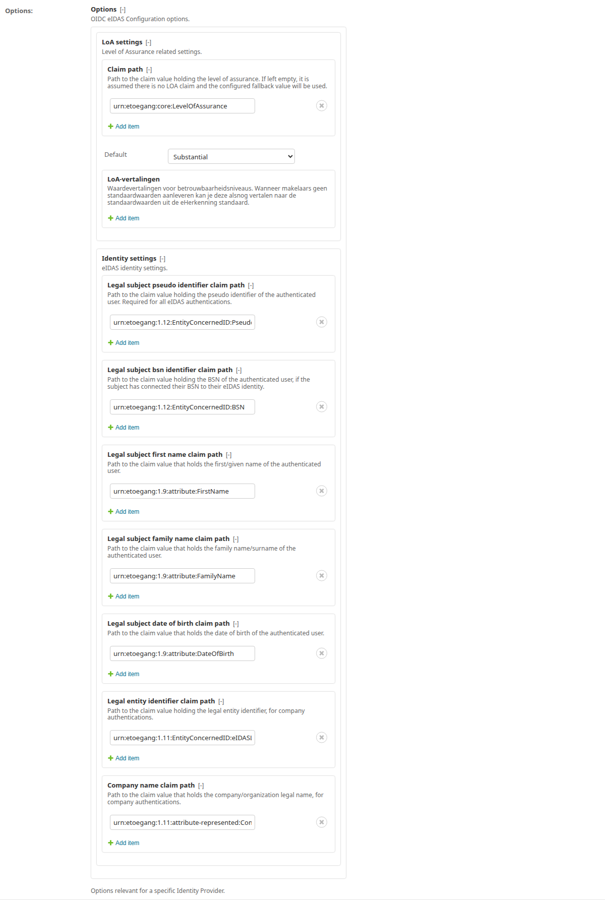

5.5.4. Signicat (eID Hub, nieuwe stijl)
---------------------------------------

`Signicat <https://www.signicat.com/>`_ is een veelgebruikte identity broker voor
DigiD en eHerkenning via OIDC. Onderstaande instellingen zijn de aanbevolen configuratie
voor gebruik met Open Inwoner. Deze instructies gaan uit van de **eID and Wallet Hub**
(nieuwe stijl), niet de legacy-omgeving.

- Log in op https://dashboard.signicat.com/
- Ga naar de **eID and Wallet Hub**
- Klik op **Add Client**:

  - **Client name**: een beschrijvende naam, bij voorkeur:
    ``{gemeente}-open-inwoner-{acceptatie,productie}``
  - **Redirect URI**: de basis-URL van de deploy, zonder verdere paden, bijvoorbeeld
    ``https://open-inwoner-test.maykin.nl``

- Tabblad **URIs**:

  - **Redirect URIs** - voeg de volgende vier toe (pas de basis-URL aan):

    - ``https://open-inwoner-test.maykin.nl/digid-oidc/callback/``
    - ``https://open-inwoner-test.maykin.nl/eherkenning-oidc/callback/``
    - ``https://open-inwoner-test.maykin.nl/eidas-oidc/callback/``
    - ``https://open-inwoner-test.maykin.nl/oidc/callback/``

    .. note::

       De laatste (generieke) callback-URL wordt voor de burger- en
       bedrijfslogins alleen gebruikt wanneer ``OIDC_USE_LEGACY_ENDPOINTS``
       op ``False`` staat (zie :ref:`hoofdstuk 5.5.2 <hoofdstuk-5-5-2>`); met de standaardwaarde
       ``True`` blijven de drie bovenstaande legacy-URL's in gebruik. Door
       de generieke URL nu alvast bij de broker te whitelisten, kan die
       omgevingsvariabele later worden omgezet zonder wijziging bij de
       broker, vooruitlopend op het uiteindelijk verdwijnen van de
       legacy-URL's.

  - **Post logout Redirect URIs**:

    - ``https://open-inwoner-test.maykin.nl/accounts/login/``

  - **Front Channel Logout URI**:

    - ``https://open-inwoner-test.maykin.nl/accounts/login/``

  - **Required Front Channel Logout Session**: uitgevinkt
  - **Automatic Redirect to Logout URL**: aangevinkt

- Tabblad **Secrets**:

  - Maak één secret aan met een beschrijvende naam (gebruik bijvoorbeeld de URL van de doelomgeving)
  - Kopieer de client secret naar het daartoe bestemde veld in Open Inwoner

- Tabblad **Access**:

  - **Allowed scopes**:
    - ``openid``
    - ``eherkenning-extra``
    - ``idp-id``
    - ``profile``
  - **Identity provider restrictions**: leeg laten
  - **ACR values**: leeg laten
  - **Force use ACR values**: leeg laten

- Tabblad **Advanced**:

  - Sectie **Security**:

    - **ID Token User data**: ``Minimal``

      .. note::

         Omdat Signicat met deze instelling de claims niet in het ID-token meelevert,
         moet in Open Inwoner onder *Geavanceerde instellingen* de optie
         **User information claims extracted from** worden ingesteld op
         *Userinfo endpoint*. Dit veld is te vinden op de betreffende
         **OIDC clients** pagina's in de beheeromgeving (zie :ref:`hoofdstuk 5.5.2 <hoofdstuk-5-5-2>`).

    - **User Info Response Type**: ``JSON``
    - **Content encryption algorithm**: ``A128CBC-HS256``
    - **Allowed CORS Origins**: leeg laten
    - **Requires Secret**: aanvinken; alle overige checkboxes uitvinken

5.5.5. Geschiedenis
-------------------

Wanneer er wijzigingen aan een OIDC client of OIDC provider hebben plaatsgevonden, kunnen deze worden nagetrokken in de geschiedenis rechts bovenin beeld.

5.6. OpenID Connect sessie management
=====================================

Bij gebruik van OpenID Connect (OIDC) voor DigiD en eHerkenning is het belangrijk om
rekening te houden met sessie-management. Open Inwoner vernieuwt periodiek de
authenticatiesessie om te controleren of de gebruiker nog steeds ingelogd is bij de
Identity Provider (IdP).

5.6.1. Automatische sessievernieuwing
-------------------------------------

De omgevingsvariabele ``OIDC_RENEW_ID_TOKEN_EXPIRY_SECONDS`` bepaalt hoe vaak
de sessie wordt ververst. De standaardwaarde is **15 minuten**. Na deze periode wordt de
gebruiker automatisch en onzichtbaar doorgestuurd naar de IdP:

- **Als de IdP-sessie nog actief is**: De gebruiker wordt automatisch teruggestuurd naar
  Open Inwoner en kan ongestoord doorwerken. Dit gebeurt op de achtergrond zonder dat de
  gebruiker het merkt.

- **Als de IdP-sessie verlopen is**: De gebruiker wordt uitgelogd en krijgt een
  foutmelding te zien:

  - DigiD: *"Uw DigiD-sessie is verlopen. Log alstublieft opnieuw in."*
  - eHerkenning: *"Uw eHerkenning-sessie is verlopen. Log alstublieft opnieuw in."*

.. important::

   Stel de sessieduur bij uw Identity Provider (DigiD/eHerkenning) in op **minimaal de
   duur van één vernieuwingsinterval langer** dan ``OIDC_RENEW_ID_TOKEN_EXPIRY_SECONDS``.
   Bij voorkeur zelfs aanzienlijk langer om te voorkomen dat gebruikers onverwacht worden
   uitgelogd tijdens het werken. Houd hierbij rekening met de eisen en aanbevelingen van
   Logius en uw identity broker (bijvoorbeeld Signicat).

   Bijvoorbeeld:

   - Als ``OIDC_RENEW_ID_TOKEN_EXPIRY_SECONDS`` is ingesteld op 10 minuten (600 seconden)
   - Stel de IdP-sessieduur in op minimaal 21 minuten of langer, zodat de gebruiker tot
     tweemaal toe de sessie kan laten vernieuwen.

   Als de IdP-sessieduur korter is dan het vernieuwingsinterval, kunnen gebruikers
   onverwacht worden uitgelogd. Let ook op dat een korter vernieuwingsinterval betekent
   dat er vaker een redirect plaatsvindt naar de IdP. Hierdoor is de kans groter dat
   een redirect gebeurt tijdens het versturen van een formulier (POST-verzoek), wat kan
   leiden tot verlies van ingevulde gegevens.
