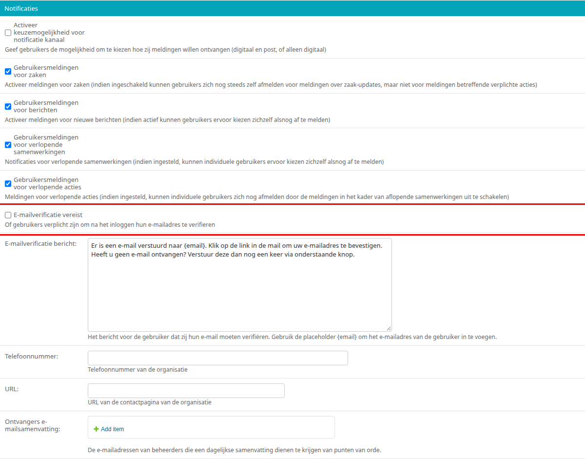

.. _hoofdstuk-6:

============
6. Afspraken
============

U vindt de onderdelen van dit hoofdstuk in het menu onder **Modules > Afspraken**.

6.1. Qmatic configuratie
========================

**Locatie in het menu:** Modules > Afspraken > Qmatic configuratie

De Qmatic configuratie maakt het mogelijk dat gebruikers in Mijn profiel hun balie-afspraken bij de gemeente kunnen raadplegen. Hiervoor wordt gebruik gemaakt van een calendar API waar de gegevens vandaan gehaald worden. Ook is er de mogelijkheid een reservering URL in te geven, zodat gebruikers hun afspraak bij de gemeente kunnen wijzigen of verwijderen.

6.1.1. E-mailverificatie vereist
--------------------------------

De afspraken worden alleen getoond aan gebruikers die hun e-mailadres hebben bevestigd: Open Inwoner zoekt de afspraken op aan de hand van het bevestigde e-mailadres. Zet daarom in de Algemene configuratie (**Beheer > Configuratie > Algemene configuratie**) onder "Notificaties" een vinkje bij **E-mailverificatie vereist**, zodat gebruikers na het inloggen worden gevraagd hun e-mailadres te bevestigen (zie :ref:`hoofdstuk 10.1.1 <hoofdstuk-10-1-1>`).

