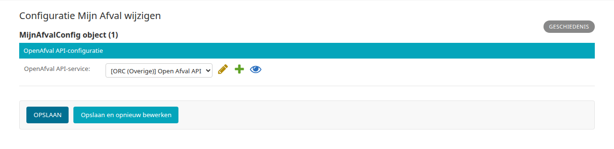

.. _hoofdstuk-7:

========
7. Afval
========

U vindt de onderdelen van dit hoofdstuk in het menu onder **Modules > Afval**.

.. _hoofdstuk-7-1:

7.1. Configuratie Mijn Afval
============================

**Locatie in het menu:** Modules > Afval > Configuratie Mijn Afval

Met Mijn Afval zien inwoners die met DigiD zijn ingelogd hun afvalgegevens, die Open Inwoner ophaalt uit Open Afval. Hier stelt u in met welke service Open Inwoner verbinding maakt met Open Afval.

| **OpenAfval API-service**
| De service van de Open Afval API, onder **OpenAfval API-configuratie**. U kiest uit de services met het type "ORC (Overige)" die zijn aangemaakt via **Koppelingen > Services** (zie :ref:`hoofdstuk 16.3 <hoofdstuk-16-3>`).

Klik op :guilabel:`Opslaan`.

.. important::

   Dit scherm legt alleen vast met welke service Open Inwoner verbinding maakt. Om Mijn Afval aan inwoners te tonen, maakt u in het CMS een pagina aan en koppelt u daaraan de applicatie Mijn Afval (zie :ref:`hoofdstuk 19.4 <hoofdstuk-19-4>`).
