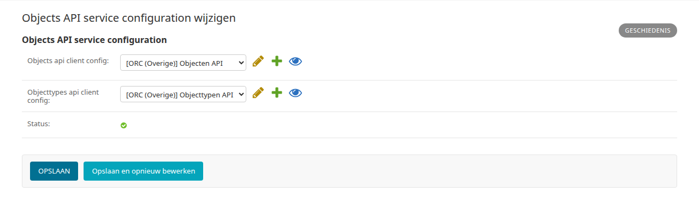

.. _hoofdstuk-8:

=====================
8. Externe klanttaken
=====================

U vindt de onderdelen van dit hoofdstuk in het menu onder **Modules > Externe klanttaken**.

.. important::

   Dit scherm legt alleen vast met welke servers (de Objecten API en de Objecttypen API) Open Inwoner verbinding maakt. Daarmee zien inwoners nog geen externe taken. Om de functie te gebruiken plaatst u de Takenlijst plugin op een pagina in het CMS (zie :ref:`hoofdstuk 19.2.12 <hoofdstuk-19-2-12>`). Zonder die plugin heeft deze configuratie geen zichtbaar effect.

.. _objects-api-configuratie:

8.1. Objects API service configuration
======================================

**Locatie in het menu:** Modules > Externe klanttaken > Objects API service configuration

Bij **Modules > Externe klanttaken > Objects API service configuration** stelt u in welke API's Open Inwoner gebruikt voor de externe taken van inwoners, die de Takenlijst plugin toont (zie :ref:`hoofdstuk 19.2.12 <hoofdstuk-19-2-12>`). De velden worden (nog) in het Engels getoond.

| **Objects api client config**
| De service van de Objecten API: de externe bron waar de gegevens (de taken) vandaan komen.

| **Objecttypes api client config**
| De service van de Objecttypen API: deze geeft aan welke typen objecten via de Objecten API beschikbaar zijn.

| **Status**
| Of Open Inwoner verbinding kan maken met de Objecten API: een groen vinkje als de verbinding werkt, anders een rood kruis met de foutmelding. Zolang niet beide services zijn gekozen, staat hier dat de configuratie niet compleet is.

U kiest de services uit de services die zijn aangemaakt via **Koppelingen > Services** (zie :ref:`hoofdstuk 16.3 <hoofdstuk-16-3>`) en klikt op :guilabel:`Opslaan`.

