.. _datakoppelingen:

==================
9. Datakoppelingen
==================

Onder datakoppelingen vindt u als beheerder alle elementen met betrekking tot de koppelingen van het
Open Inwoner platform. Denk aan de koppelingen met Haal centraal, Open Klant, Open Formulieren,
DigID en Open Zaak. Ook kunnen hier de koppelingen worden geconfigureerd.

Wat betreft koppelingen worden er aan de voorkant van het platform andere namen gebruikt dan in de
backend en sommige koppelingen hebben betrekking op particulieren, andere weer op zakelijke
gebruikers. Dit is overzichtelijk weergegeven in de tabel op deze pagina.

+-----------------------------------+---------------------------------------------------------------+
|    **Backend**                    |    **Frontend**                                               |
+===================================+===============================================================+
|    | Open Klant                   |    | Mijn vragen                                              |
|    | Laposta                      |    | Mijn profiel – nieuwsbrieven. Voorkeuren en meldingen    |
|    | Qmatic                       |    | Mijn afspraken                                           |
|    | SSD                          |    | Mijn uitkeringen                                         |
|    | SOAP services                |    | Mijn uitkeringen                                         |
|    | Catalogus configs            |    | Mijn zaken                                               |
|    | Open Zaak                    |    | Mijn zaken                                               |
|    | Open Formulieren             |    | Producten                                                |
|    | Webhook-abonnementen         |    | Mijn zaken - notificaties                                |
|    | Open Afval                   |    | Mijn afval                                               |
+-----------------------------------+---------------------------------------------------------------+

.. _mijn-zaken-inrichten:

9.0. Mijn Zaken inrichten
=========================

In Mijn Zaken ziet een inwoner die met DigiD (of een bedrijf dat met eHerkenning) is ingelogd zijn of haar zaken uit Open Zaak of eSuite. Om Mijn Zaken in te richten doorloopt u de onderstaande stappen in deze volgorde. Bij elke stap staat waar u de details van het betreffende scherm vindt.

9.0.1. Stap 1: Services aanmaken
--------------------------------

Open Inwoner haalt de zaken op via drie API's van het zaaksysteem. Voor elke API maakt u een service aan via **Koppelingen > Services** en de knop [Service toevoegen]:

- de **Zaken API**, met als type "ZRC (Zaken API)";
- de **Catalogi API**, met als type "ZTC (Catalogi API)";
- de **Documenten API**, met als type "DRC (Documenten API)".

Vul per service ten minste het label, de slug, het type, de basisurl van de API en de authorisatiegegevens in en klik op [Opslaan]. De velden worden beschreven in hoofdstuk 9.15.

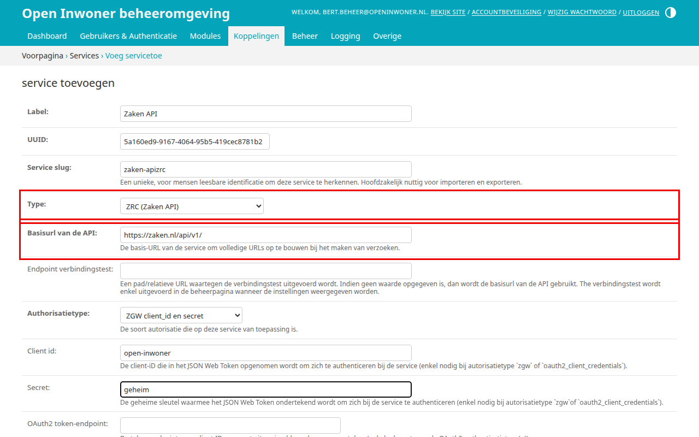

9.0.2. Stap 2: ZGW API set instellen
------------------------------------

Ga naar **Modules > Zaken > Configuratie 'Open Zaak'** en klik onder "ZGW API sets" op [Nog een ZGW API set toevoegen]. Vul onder "Basisconfiguratie" een naam in en kies de services uit stap 1 bij **Zaken API**, **Documenten API** en **Catalogi API**. Deze drie zijn verplicht; de **Formulieren API** is optioneel. Klik daarna op [Opslaan].

Gebruikt u (nog) geen klantensysteem (zie hoofdstuk 9.4), maak dan het veld **Klanten API back-end** leeg. Staat daar een klantensysteem dat niet is geconfigureerd, dan kunt u de API set niet opslaan.

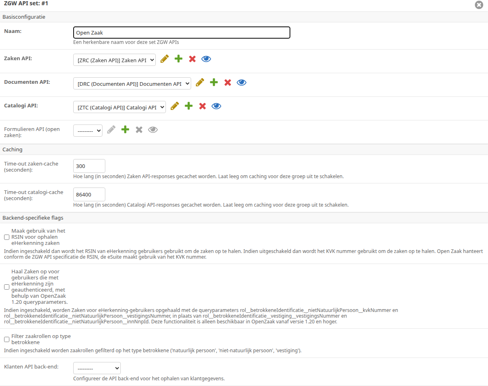

De velden van de API set worden beschreven in hoofdstuk 9.3.4, de overige instellingen van de Configuratie 'Open Zaak' in hoofdstuk 9.3. De standaardinstellingen volstaan om Mijn Zaken te laten werken.

9.0.3. Stap 3: Zaaktypen importeren
-----------------------------------

De zaaktypen worden elke dag om 07:00 uur automatisch geïmporteerd door de achtergrondtaak "Importeer ZGW data". Wilt u niet wachten, dan start u de import zelf via **Beheer > Achtergrond taken > Periodic tasks**: klik bij de taak "Importeer ZGW data" op [Start taak]. De taak wordt uitgevoerd door de achtergrondverwerking van het platform; het kan dus even duren voordat de zaaktypen zichtbaar zijn.

Na de import vindt u de zaaktypen onder **Modules > Zaken > Zaaktype configuraties**. Zaaktypen die in het zaaksysteem als "intern" zijn aangemerkt, worden niet geïmporteerd.

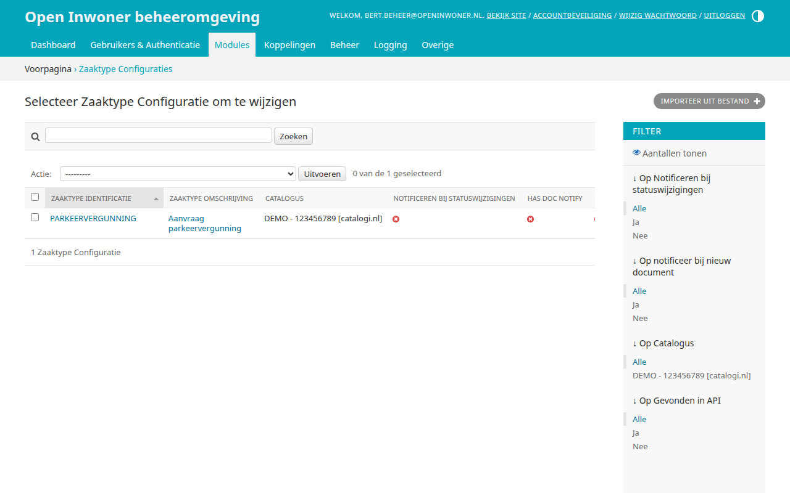

Voor het tonen van zaken is de import niet nodig. U heeft de geïmporteerde zaaktypen wel nodig om per zaaktype instellingen te doen, zoals notificaties, het uploaden van documenten, het contactformulier en de teksten bij statussen. Zie hoofdstuk 9.18.

9.0.4. Stap 4: De pagina Mijn zaken aanmaken
--------------------------------------------

Mijn Zaken staat op een pagina in het CMS. Ga naar **Beheer > CMS > Pagina inhoudelijk** en maak onder de startpagina een pagina aan met de titel "Mijn zaken" (zie hoofdstuk 11.1.5). Pagina's onder de startpagina worden in het menu getoond.

9.0.5. Stap 5: Pagina opties instellen en publiceren
----------------------------------------------------

Open de pagina in de bewerkmodus en kies in de CMS-werkbalk [Pagina] > [Pagina opties...] (zie hoofdstuk 11.5):

- zet een vinkje bij **Vereist DigiD/eHerkenning authenticatie**, zodat alleen inwoners en bedrijven die met DigiD of eHerkenning zijn ingelogd Mijn zaken in het menu zien;
- kies bij **Icoon** het icoon "Zaken" voor het menu.

Klik op [Opslaan] en daarna in de werkbalk op [Publiceer].

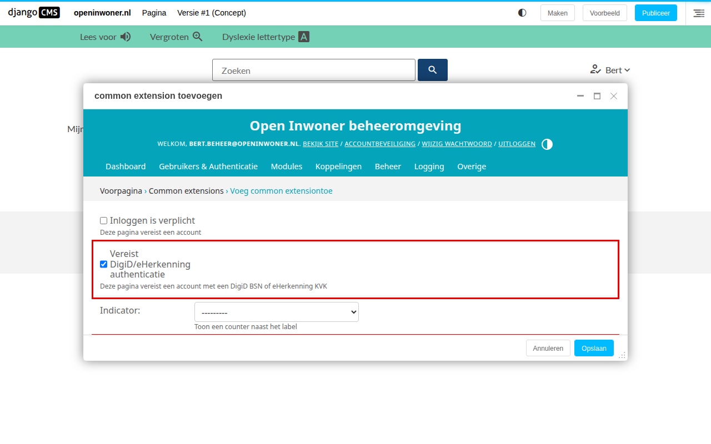

.. note::

   Stel de pagina opties in voordat u in stap 6 de applicatie koppelt. Daarna toont de pagina Mijn Zaken, en die kunt u als beheerder zonder BSN niet openen, ook niet in de bewerkmodus.

9.0.6. Stap 6: De applicatie koppelen
-------------------------------------

Ga in het paginaoverzicht naar de **Geavanceerde instellingen** van de pagina (zie hoofdstuk 11.1.3), kies bij **Applicatie** de "Mijn Zaken app" en klik op [Opslaan]. De URL van de pagina is vanaf nu het startpunt van Mijn Zaken, bijvoorbeeld ``/mijn-zaken/`` (zie hoofdstuk 11.4). De gekoppelde applicatie is een instelling van de pagina zelf en geldt direct, ook voor de gepubliceerde versie; opnieuw publiceren is niet nodig.

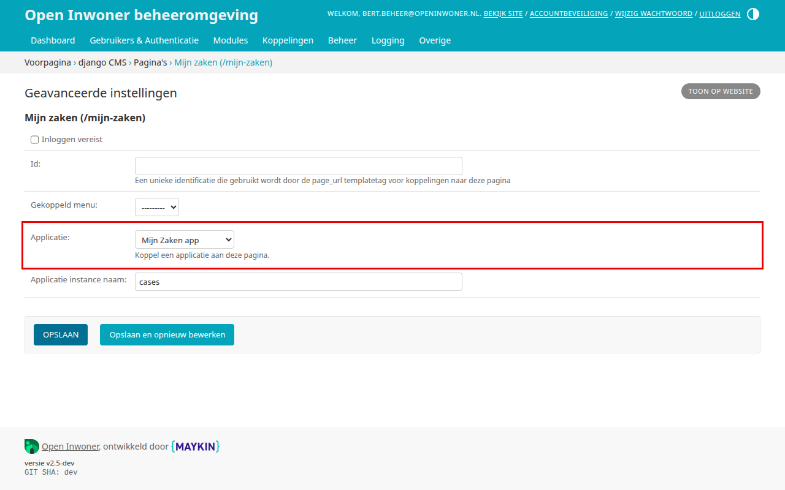

9.0.7. Stap 7: Controleren als inwoner
--------------------------------------

Log in met DigiD als een inwoner die zaken heeft in het zaaksysteem. In de navigatie aan de linkerkant van de pagina staat nu "Mijn zaken". Ingelogde gebruikers vinden de pagina's onder de startpagina in deze navigatie; het menu onder hun naam bevat alleen Mijn profiel (als die pagina bestaat) en Uitloggen.

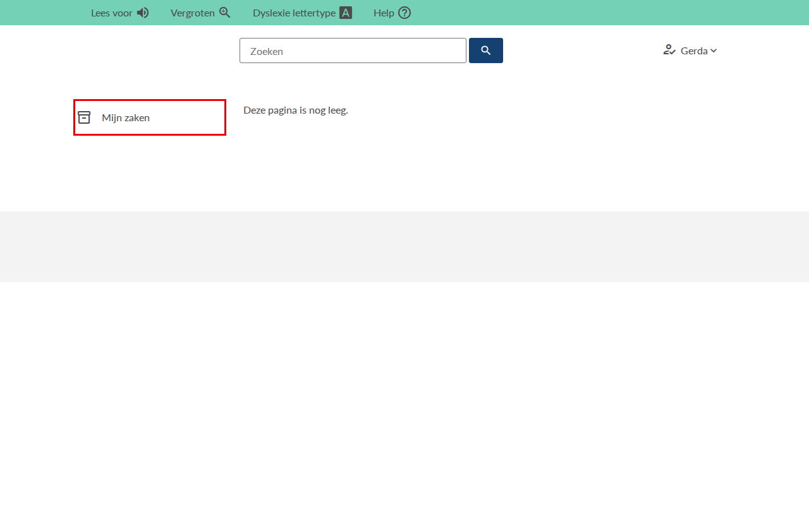

Mijn zaken toont de zaken van de inwoner. Bij elke zaak staat de omschrijving van het zaaktype.

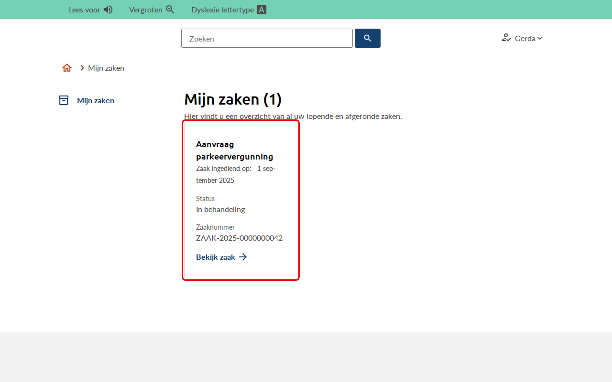

Via een zaak opent de inwoner de details van de zaak, met de statussen en documenten.

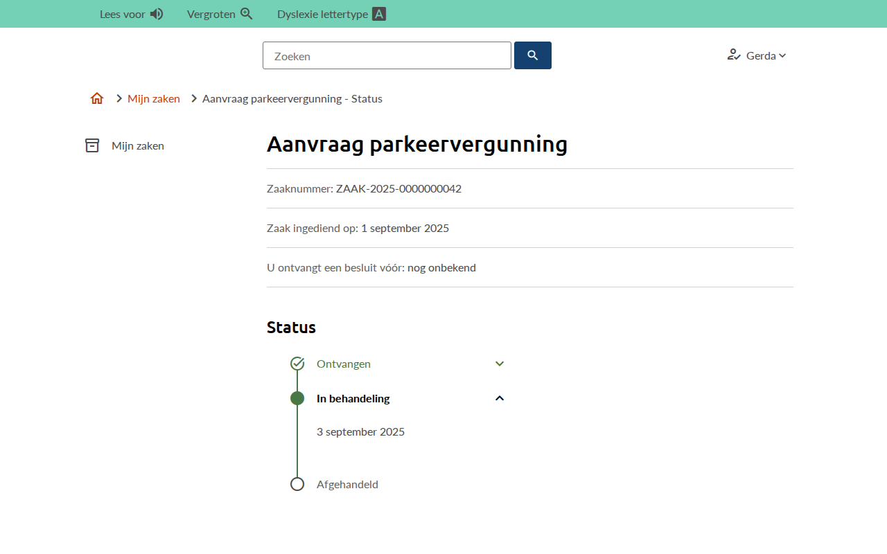

9.0.8. Wanneer ziet een inwoner een zaak?
-----------------------------------------

Een inwoner ziet een zaak in Mijn zaken als aan alle volgende voorwaarden is voldaan:

- de inwoner heeft een rol bij de zaak: de zaken worden in de Zaken API opgezocht op het BSN van de inwoner (of het KvK-nummer van het bedrijf). Onder **Beperk de getoonde zaken tot deze rol** kunt u dit beperken tot één rol, bijvoorbeeld de initiator;
- de zaak heeft een status. Wilt u ook zaken zonder status tonen, zet dan een vinkje bij **Toon zaken die geen status hebben** (zie hoofdstuk 9.3.2);
- het zaaktype is in het zaaksysteem aangemerkt als "extern". Zaken van interne zaaktypen worden nooit getoond;
- de vertrouwelijkheid van de zaak is niet hoger dan de ingestelde **Vertrouwelijkheid van de zaak**. Standaard is dit "Openbaar" (zie hoofdstuk 9.3.1);
- als bij het zaaktype **Show cases from date** is ingevuld, is de zaak op of na die datum gestart (zie hoofdstuk 9.18.1).

9.0.9. Wat als een stap ontbreekt?
----------------------------------

- **Geen ZGW API set** (stap 1 en 2): Mijn zaken toont de melding "U heeft op dit moment nog geen lopende zaken."
- **Zaaktypen niet geïmporteerd** (stap 3): de zaken worden wel getoond, maar u kunt geen instellingen per zaaktype doen.
- **Geen gepubliceerde pagina, of geen applicatie gekoppeld** (stap 4 tot en met 6): Mijn zaken staat niet in het menu en er zijn geen links naar Mijn zaken. Zonder gepubliceerde pagina met de "Mijn Zaken app" bestaat het adres van Mijn zaken niet; zonder gekoppelde applicatie is de pagina een gewone, lege pagina.
- **Geen "Vereist DigiD/eHerkenning authenticatie"** (stap 5): Mijn zaken staat ook voor bezoekers die niet zijn ingelogd in het menu. De zaken zelf blijven beschermd: een bezoeker die niet is ingelogd wordt naar de inlogpagina gestuurd, en een gebruiker zonder BSN of KvK-nummer krijgt een melding dat hij of zij geen toegang heeft tot de pagina (403).
- **De zaak voldoet niet aan de voorwaarden** (zie 9.0.8): de zaak wordt niet getoond. Heeft de inwoner geen zichtbare zaken, dan ziet hij of zij de melding "U heeft op dit moment nog geen lopende zaken."
- **Het zaaksysteem is niet bereikbaar**: Mijn zaken toont de melding "Er is iets misgegaan bij het ophalen van uw zaken. Ververs de pagina of probeer het later opnieuw." Kon een deel van de zaken niet worden opgehaald, dan ziet de inwoner de zaken die wel zijn opgehaald, met een melding dat niet alle zaken konden worden opgehaald.

9.1 Catalogus Configs
=====================

Catalogus configs worden automatisch geïmporteerd vanuit Open Zaak of eSuite via de ZGW-koppeling. Aan deze catalogi zijn zaaktypes gekoppeld, zoals geconfigureerd in het onderdeel Zaaktypeconfiguratie.

.. _CatalogusImportExport:

Catalogus Configs Importeren en Exporteren
------------------------------------------

Catalogi en Zaaktype Configuraties kunnen worden geëxporteerd en geïmporteerd tussen verschillende OIP-installaties (bijvoorbeeld tussen acceptatie- en testomgevingen).

.. note::
   De import/export-functionaliteit vereist dat de gekoppelde zaaksystemen materieel gelijk zijn. Dit betekent dat de catalogi en onderliggende zaaktypes in beide ZGW API's aanwezig moeten zijn (hoewel de URLs en UUIDs mogen verschillen). Voer daarom de ``Importeer ZGW data`` periodieke taak eerst handmatig uit op zowel de bron als bestemming zodat de ZGW objecten volledig in sync zijn.

.. note::
   Het onderstaande proces spitst zich toe op het importeren van hele Catalogus Configuraties. Echter, het is eveneens mogelijk om alleen bepaalde Zaaktype Configuraties te importeren/exporteren. Dit werkt op exact dezelfde wijze als in deze sectie is omschreven voor de Catalogus Configuraties. Ongeacht via welk scherm de export is aangemaakt, kunnen de opgeslagen bestande op zowel de totaaloverzichten van Catalogus Configuraties en Zaaktype Configruates geïmporteerd worden. Zie ook :ref:`ZTCImportExport`.

Importproces
^^^^^^^^^^^^

Tijdens de import zoekt de ontvangende installatie catalogi en zaaktypes op basis van specifieke kenmerken. Deze matching bepaalt hoe bijbehorende data (beschrijvingen, instellingen en metadata) worden gekoppeld.

Matching-attributen
"""""""""""""""""""

- **Catalogus Config**: ``domein`` en ``rsin`` moeten gelijk zijn
- **Zaaktype Configuratie**: ``identificatie`` en bovenliggende ``catalogus`` moeten gelijk zijn
- **Status, Resultaat en Informatie Object Typen**: ``omschrijving`` en de bovenliggende
  ``zaaktype`` moeten gelijk zijn

Exporteren van catalogus configuraties
--------------------------------------

Stappen voor exporteren:

#. Selecteer een of meer Catalogus Config-objecten of Zaaktype Configuratie-objecten
#. Kies "Opslaan als bestand" in de "Actie" dropdown linksboven de catalogilijst

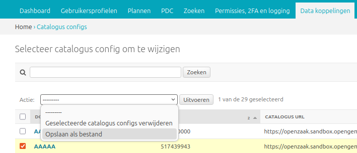

De export omvat alle catalogi, zaaktypes en onderliggende objecten (resultaattypen, informatie-objecttypen, etc.) van de geselecteerde catalogi.

Importeren van catalogus configuraties
--------------------------------------

Stappen voor importeren:

#. Klik op "Importeer uit een bestand" rechtsboven op de catalogus configs-overzichtspagina

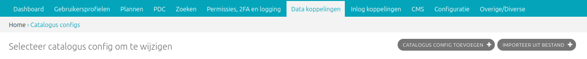

#. Selecteer een bestand van uw lokale computer
#. Upload het bestand

    .. warning::
      - Het importeren kan aanzienlijke tijd in beslag nemen

#. Na afloop toont het systeem:

     * Het aantal succesvol geïmporteerde objecten
     * Het aantal niet-geïmporteerde objecten. De meest voorkomende reden voor foutmeldingen
       betreft pntbrekende objecten met de gespecificeerde matching-attributen. De attributen die ertoe leidden dat bepaalde objecten niet gevonden konden worden, zullen zoveel mogelijk worden vermeld.

9.2. Certificaten
=================

Hier worden de certificaten van het platform beheerd, bijvoorbeeld voor de koppelingen met SOAP services (zie hoofdstuk 9.13) en KvK. U vindt ze via **Koppelingen > Certificaten**. Het overzicht toont per certificaat het label, het serienummer, het type, de periode waarin het certificaat geldig is, of het certificaat op dit moment geldig is en of de private key bij het certificaat past. Er zijn twee typen: "Key-pair" (een certificaat met de bijbehorende private key) en "Certificate only" (alleen het certificaat). U kunt het overzicht filteren op type. Klik op een certificaat om het te wijzigen.

De schermen van de certificaten worden (nog) in het Engels getoond.

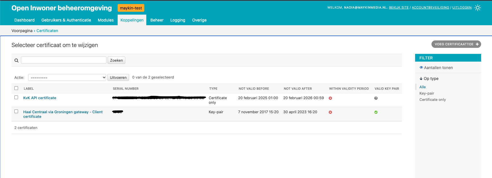

9.2.1. Nieuw certificaat toevoegen
----------------------------------

U voegt een certificaat toe met de knop [Certificaat toevoegen] rechtsboven in het overzicht. Vul het label en het type in, upload het certificaat en, bij een key-pair, de private key, en klik op [Opslaan].

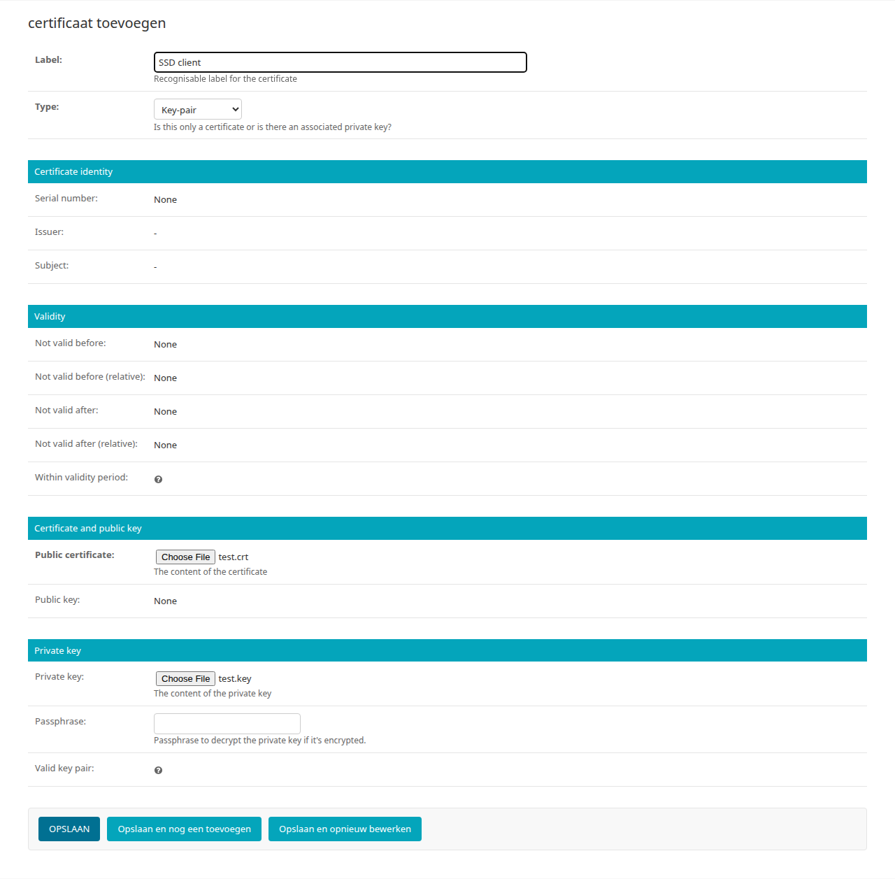

| **Label**
| Een herkenbaar label voor het certificaat. Onder dit label kiest u het certificaat bij een koppeling.

| **Type**
| "Key-pair" voor een certificaat met de bijbehorende private key, bijvoorbeeld een clientcertificaat waarmee Open Inwoner zich bij een andere partij identificeert. "Certificate only" voor alleen het (publieke) certificaat, bijvoorbeeld het certificaat van een server of een rootcertificaat.

Onder **Certificate identity** en **Validity** ziet u, nadat u het certificaat heeft opgeslagen, de gegevens die uit het certificaat worden gelezen: **Serial number** (het serienummer), **Issuer** (de uitgever), **Subject** (voor wie het certificaat is uitgegeven), **Not valid before** en **Not valid after** (de geldigheidsperiode, ook als relatieve tijd) en **Within validity period** (of het certificaat op dit moment geldig is).

Onder **Certificate and public key**:

| **Public certificate**
| Het certificaat, als bestand in PEM-formaat. Na het opslaan wordt de bijbehorende **Public key** getoond.

Onder **Private key**:

| **Private key**
| De private key van het certificaat, als bestand in PEM-formaat. Alleen nodig bij het type "Key-pair". De private key kan na het uploaden niet meer worden gedownload.

| **Passphrase**
| Het wachtwoord van de private key, als deze is versleuteld. De private key wordt dan ontsleuteld opgeslagen. Laat dit veld leeg bij een private key die niet is versleuteld: vult u toch een wachtwoord in, dan wordt het certificaat niet opgeslagen.

| **Valid key pair**
| Na het opslaan ziet u hier of de private key bij het certificaat past.

.. _zgw-api-configuratie:

9.3. Configuratie ‘Open Zaak’
=============================

Dit is de configuratie voor de koppeling van het Open Inwoner platform met Open Zaak of eSuite. U vindt deze via **Modules > Zaken > Configuratie 'Open Zaak'**. Om Mijn Zaken te kunnen gebruiken is het noodzakelijk om in een ZGW API set (zie hoofdstuk 9.3.4) de Zaken API, de Catalogi API en de Documenten API in te stellen. Hierdoor worden – na het inloggen met DigiD of eHerkenning – de zaken van inwoners en bedrijven getoond onder het onderdeel Mijn zaken. Om gebruikers verder te laten gaan met niet-afgeronde formulieren stelt u daarnaast de Formulieren API in; deze is optioneel. Het volledige stappenplan om Mijn Zaken in te richten vindt u in hoofdstuk 9.0. De standaardinstellingen volstaan om Mijn Zaken te laten werken.

Het scherm bestaat uit de onderdelen hieronder. De onderdelen "Advanced options", "Feature flags", "Performance" en "Zaakdetail dashboard labels" zijn standaard ingeklapt; klik op de titel van een onderdeel om het uit te klappen. De titels "Advanced options" en "Feature flags" en het veld **Allowed file extensions** worden (nog) in het Engels getoond. Nadat u iets heeft gewijzigd, klikt u op [Opslaan].

9.3.1. Geavanceerde opties
--------------------------

Onder "Advanced options" stelt u in welke zaken en documenten aan gebruikers worden getoond, en enkele algemene instellingen voor Mijn zaken.

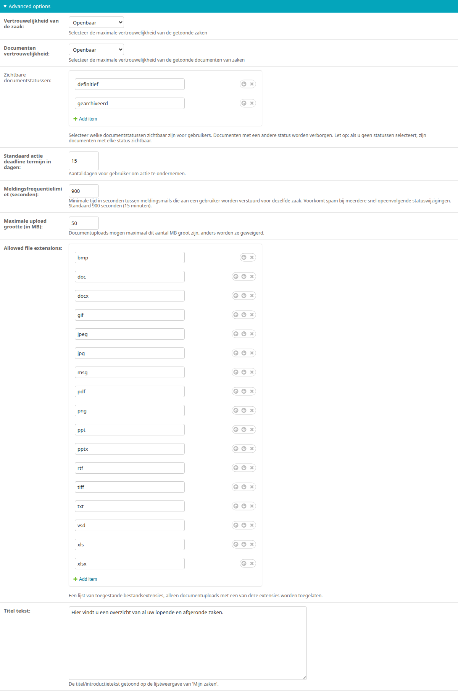

| **Vertrouwelijkheid van de zaak**
| De maximale vertrouwelijkheid van de zaken die aan gebruikers worden getoond. Dit staat standaard op "Openbaar" en kan worden verhoogd tot en met "Zeer geheim". Zaken met een hogere vertrouwelijkheid worden niet getoond: Open Inwoner vraagt bij de Zaken API alleen de zaken op tot en met deze vertrouwelijkheid.

| **Documenten vertrouwelijkheid**
| De maximale vertrouwelijkheid van de documenten die bij een zaak worden getoond. Ook dit staat standaard op "Openbaar"; documenten met een hogere vertrouwelijkheid worden niet getoond.

| **Zichtbare documentstatussen**
| De statussen die een document moet hebben om zichtbaar te zijn voor de gebruiker. U vult per regel een status in: ``in_bewerking`` (In bewerking), ``ter_vaststelling`` (Ter vaststelling), ``definitief`` (Definitief) of ``gearchiveerd`` (Gearchiveerd). Standaard zijn dit ``definitief`` en ``gearchiveerd``. Documenten met een andere status worden niet getoond. **Let op:** wanneer u geen enkele status invult, worden documenten met *alle* statussen getoond.

| **Standaard actie deadline termijn in dagen**
| Het aantal dagen dat de gebruiker krijgt om actie te ondernemen. De uiterste datum (vandaag plus dit aantal dagen) wordt genoemd in de notificatie-e-mails over een zaak. Standaard is dit 15 dagen.

| **Meldingsfrequentielimiet (seconden)**
| De minimale tijd in seconden tussen twee notificatie-e-mails aan dezelfde gebruiker voor dezelfde zaak. Dit voorkomt dat gebruikers worden overspoeld met e-mails wanneer er meerdere statuswijzigingen kort na elkaar plaatsvinden. De standaardwaarde is 900 seconden (15 minuten).

| **Maximale upload grootte (in MB)**
| De maximaal toegestane grootte van documenten die gebruikers uploaden. Grotere bestanden worden geweigerd. Standaard is dit 50 MB.

| **Allowed file extensions**
| De bestandsextensies (zoals ``pdf`` of ``docx``) die documenten mogen hebben die gebruikers uploaden. Documenten met een andere extensie worden geweigerd.

| **Titel tekst**
| De introductietekst die bovenaan de lijstweergave van Mijn zaken wordt getoond.

**Een hogere vertrouwelijkheid instellen**

Standaard ziet een inwoner alleen zijn of haar openbare zaken. Om ook zaken met een hogere vertrouwelijkheid te tonen, kiest u bij **Vertrouwelijkheid van de zaak** de hoogste vertrouwelijkheid die getoond mag worden, bijvoorbeeld "Vertrouwelijk", en klikt u op [Opslaan]. Vanaf dat moment ziet de inwoner in Mijn zaken ook zijn of haar zaken tot en met die vertrouwelijkheid. Verlaagt u de vertrouwelijkheid weer, dan worden deze zaken niet meer getoond. Zie ook hoofdstuk 9.0.8 voor alle voorwaarden waaraan een zaak moet voldoen om getoond te worden.

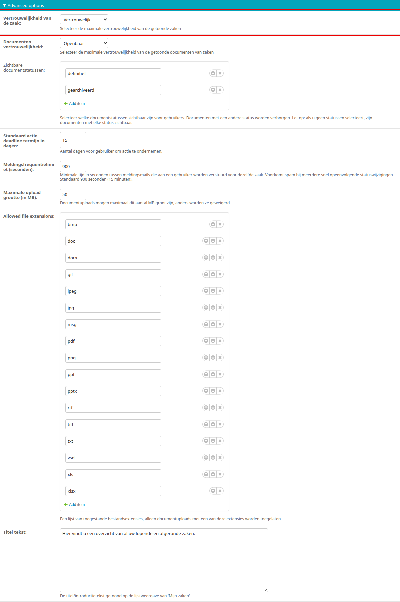

9.3.2. Feature Flags
--------------------

Onder "Feature flags" schakelt u extra functies van Mijn zaken in of uit.

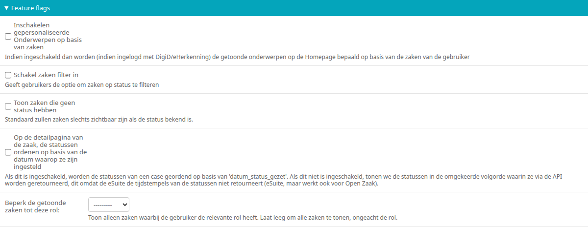

| **Inschakelen gepersonaliseerde Onderwerpen op basis van zaken**
| Wanneer hier een vinkje staat, worden na inloggen met DigiD of eHerkenning de op de homepage getoonde onderwerpen bepaald aan de hand van de zaken van de ingelogde gebruiker: het zijn de onderwerpen die gekoppeld zijn aan zaaktypen waarvan de gebruiker ten minste één zaak heeft. De gebruiker ziet op deze manier dus enkel relevante onderwerpen.

| **Schakel zaken filter in**
| Wanneer hier een vinkje staat, kunnen gebruikers in Mijn zaken hun zaken filteren op status.

| **Toon zaken die geen status hebben**
| Standaard worden zaken alleen in Mijn zaken getoond als ze een status hebben. Wanneer hier een vinkje staat, worden ook zaken zonder status getoond (zie hieronder). Dit staat standaard uit.

| **Op de detailpagina van de zaak, de statussen ordenen op basis van de datum waarop ze zijn ingesteld**
| Wanneer hier een vinkje staat, worden de statussen op de detailpagina van een zaak geordend op de datum waarop ze zijn gezet. Zonder vinkje worden de statussen getoond in de omgekeerde volgorde waarin de Zaken API ze teruggeeft, omdat de eSuite geen tijdstippen van de statussen teruggeeft.

| **Beperk de getoonde zaken tot deze rol**
| Kiest u hier een rol (bijvoorbeeld "Initiator"), dan worden alleen de zaken getoond waarbij de gebruiker die rol heeft. Laat u dit veld leeg, dan worden alle zaken getoond waarbij de gebruiker een rol heeft.

**Zaken zonder status tonen**

Een zaak die (nog) geen status heeft, wordt standaard niet in Mijn zaken getoond. Zet een vinkje bij **Toon zaken die geen status hebben** en klik op [Opslaan] om deze zaken toch te tonen. Vanaf dat moment ziet de inwoner ook zijn of haar zaken zonder status in Mijn zaken.

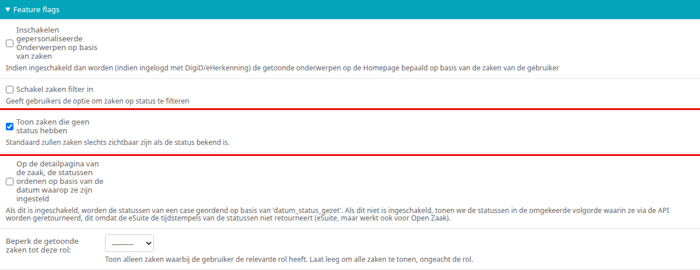

9.3.3. API-gedrag override-opties
---------------------------------

Onder "API-gedrag override-opties" past u aan hoe Open Inwoner de gegevens uit het zaaksysteem gebruikt. De eerste twee opties zijn bedoeld voor een koppeling met de eSuite.

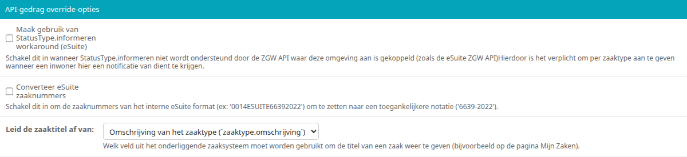

| **Maak gebruik van StatusType.informeren workaround (eSuite)**
| Zet hier alleen een vinkje wanneer StatusType.informeren niet wordt ondersteund door de ZGW API waar Open Inwoner aan is gekoppeld (zoals de eSuite ZGW API). Hierdoor wordt het verplicht om per zaaktype aan te geven wanneer een inwoner een notificatie dient te krijgen (zie hoofdstuk 9.18).

| **Converteer eSuite zaaknummers**
| Wanneer hier een vinkje staat, worden de zaaknummers van de eSuite van het interne formaat (bijvoorbeeld "0014ESUITE66392022") omgezet naar een leesbaarder formaat ("6639-2022").

| **Leid de zaaktitel af van**
| Welk gegeven uit het zaaksysteem als titel van een zaak wordt getoond, bijvoorbeeld in Mijn zaken: de omschrijving van het zaaktype (standaard), de omschrijving van de zaak, of het onderwerp van het zaaktype.

9.3.4. ZGW API sets
-------------------

Een API set bestaat uit verschillende API’s die samen een zaaksysteem vormen. Er is geen maximum aantal te configureren API sets. Door meerdere sets te configureren kunnen meerdere zaaksystemen parallel worden gebruikt. U kunt een API set toevoegen door onder "ZGW API sets" op [Nog een ZGW API set toevoegen] te klikken. De API's kiest u uit de services die zijn aangemaakt via **Koppelingen > Services** (zie hoofdstuk 9.0.1).

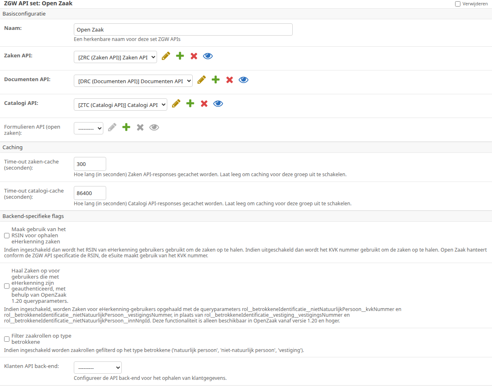

Onder **Basisconfiguratie**:

| **Naam**
| Een herkenbare naam voor de API set. Deze naam is vrij in te vullen.

| **Zaken API**
| Deze API levert de zaken of aanvragen in Mijn zaken. Dit veld is verplicht.

| **Documenten API**
| Deze API haalt de documenten op die bij een bepaalde zaak horen. Dit veld is verplicht.

| **Catalogi API**
| In de catalogi zit alle informatie over zaaktypen en andere gerelateerde informatie, zoals statussen, documenten en resultaten. De Catalogi API vult de zaaktypeconfiguratie in. Dit veld is verplicht.

| **Formulieren API (open zaken)**
| Deze API slaat de gegevens van onvoltooide formulieren op, zodat gebruikers verder kunnen gaan met een formulier dat ze nog niet hebben afgerond. Dit veld is optioneel.

Onder **Caching**:

| **Time-out zaken-cache (seconden)**
| Hoe lang (in seconden) de antwoorden van de Zaken API en de Documenten API worden bewaard, zodat ze niet bij elke pagina opnieuw worden opgehaald. Standaard is dit 300 seconden (5 minuten). Laat het veld leeg om dit voor deze API set uit te schakelen.

| **Time-out catalogi-cache (seconden)**
| Hoe lang (in seconden) de antwoorden van de Catalogi API worden bewaard. Standaard is dit 86400 seconden (24 uur). Laat het veld leeg om dit voor deze API set uit te schakelen.

Onder **Backend-specifieke flags** staan opties die bepalen op welke wijze met deze API's wordt gecommuniceerd:

| **Maak gebruik van het RSIN voor ophalen eHerkenning zaken**
| Indien aangevinkt, worden de zaken van eHerkenning gebruikers opgehaald met het RSIN van het bedrijf in plaats van het KvK-nummer. Open Zaak hanteert conform de ZGW API specificatie het RSIN, de eSuite maakt gebruik van het KvK-nummer.

| **Haal Zaken op voor gebruikers die met eHerkenning zijn geauthenticeerd, met behulp van OpenZaak 1.20 queryparameters.**
| Indien aangevinkt, worden zaken voor eHerkenning gebruikers opgehaald met de ``rol__betrokkeneIdentificatie__nietNatuurlijkPersoon__kvkNummer`` en ``rol__betrokkeneIdentificatie__nietNatuurlijkPersoon__vestigingsNummer`` query parameters, in plaats van de oudere ``rol__betrokkeneIdentificatie__vestiging__vestigingsNummer`` en ``rol__betrokkeneIdentificatie__nietNatuurlijkPersoon__innNnpId`` parameters. Deze nieuwe parameters zijn specifiek bedoeld voor OpenZaak versies 1.20 of hoger. Voor eSuite of oudere versies van OpenZaak maakt u geen gebruik van deze optie.

| **Filter zaakrollen op type betrokkene**
| Indien aangevinkt, worden de rollen van zaken gefilterd op het type betrokkene ('natuurlijk persoon', 'niet-natuurlijk persoon', 'vestiging').

| **Klanten API back-end**
| Het klantensysteem waarin de klantgegevens voor deze API set staan (zie hoofdstuk 9.4). In de regel is dit eSuite voor eSuite zaaksystemen, en OpenKlant 2 voor Open Zaak. Laat dit veld leeg indien u geen gebruik maakt van een klantensysteem: staat hier een klantensysteem dat niet is geconfigureerd, dan kunt u de API set niet opslaan.

9.3.5. Performance
------------------

Onder "Performance" stelt u in hoe Mijn zaken de zaken ophaalt. De standaardinstellingen volstaan in de meeste gevallen.

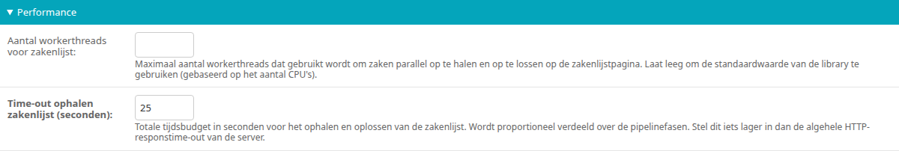

| **Aantal workerthreads voor zakenlijst**
| Het maximale aantal zaken dat tegelijk wordt opgehaald en verwerkt voor het overzicht van Mijn zaken. Laat dit veld leeg om de standaardwaarde te gebruiken, die afhangt van het aantal processoren van de server.

| **Time-out ophalen zakenlijst (seconden)**
| De totale tijd in seconden die het ophalen van de zaken voor het overzicht van Mijn zaken mag duren. Standaard is dit 25 seconden. Stel dit iets lager in dan de maximale tijd die de server krijgt om een pagina te tonen. Zaken die niet op tijd zijn opgehaald worden niet getoond; de gebruiker ziet dan een melding dat niet alle zaken konden worden opgehaald (zie hoofdstuk 9.0.9).

9.3.6. Zaakdetail dashboard labels
----------------------------------

Onder "Zaakdetail dashboard labels" stelt u de teksten in die op de detailpagina van een zaak bij de gegevens van de zaak staan.

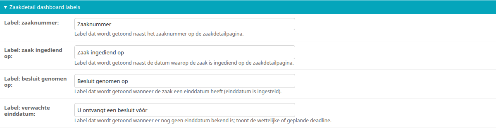

| **Label: zaaknummer**
| De tekst bij het zaaknummer. Standaard is dit "Zaaknummer".

| **Label: zaak ingediend op**
| De tekst bij de datum waarop de zaak is ingediend. Standaard is dit "Zaak ingediend op".

| **Label: besluit genomen op**
| De tekst bij de einddatum van de zaak, als de zaak is afgerond. Standaard is dit "Besluit genomen op".

| **Label: verwachte einddatum**
| De tekst bij de wettelijke of geplande einddatum, zolang de zaak nog geen einddatum heeft. Standaard is dit "U ontvangt een besluit vóór".

.. _configuratie-klanten-systeem:

9.4. Configuratie Klanten Systeem
=================================

Dit is de configuratie voor de koppeling van het Open Inwoner Platform met een klantensysteem, zoals eSuite of OpenKlant2. U vindt deze via **Modules > Klantensysteem > Configuratie Klanten Systeem**. Indien één of beide systemen zijn geconfigureerd, worden klantgegevens (zoals e-mailadres en telefoonnummer) met deze systemen uitgewisseld. Deze systemen zijn ook noodzakelijk om gebruik te kunnen maken van het "Mijn Vragen" gedeelte van het platform.

Bovenaan het scherm staan de links "Configureer de eSuite backend" en "Configureer de OpenKlant2 backend" naar de configuratie van de twee klantensystemen (zie hoofdstuk 9.4.1 en 9.4.2). Configureer eerst het klantensysteem dat u gebruikt, en kies het daarna als primaire backend.

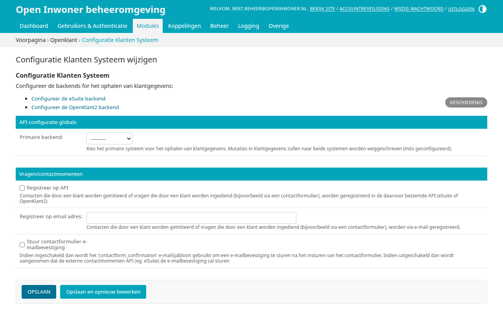

Onder **API configuratie globals**:

| **Primaire backend**
| Het klantensysteem waaruit klantgegevens worden uitgelezen en waarin nieuwe vragen in "Mijn Vragen" worden aangemaakt. U kiest uit "ESUITE" en "OPENKLANT2". Het wegschrijven van klantgegevens gebeurt altijd naar alle geconfigureerde klantensystemen, maar voor het bijwerken van de klantgegevens op basis van het klantensysteem wordt enkel naar de primaire backend gekeken. De primaire backend bepaalt ook welke onderwerpen het contactformulier toont: bij eSuite de onderwerpen met een e-Suite onderwerpcode, bij OpenKlant2 de onderwerpen van OpenKlant2 (zie hieronder). Zonder primaire backend toont het contactformulier geen onderwerpen.

U kunt alleen een klantensysteem kiezen dat is geconfigureerd: voor eSuite moeten de Klanten API en de Contactmomenten API zijn ingesteld, voor OpenKlant2 de Klanten API. Is dat niet het geval, dan wordt de configuratie niet opgeslagen en ziet u een (Engelse) foutmelding, bijvoorbeeld "OpenKlant2 must be configured with a Klanten API service before it can be selected as backend".

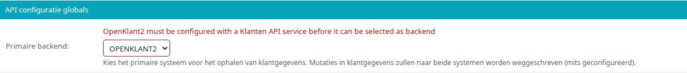

Onder **Vragen/contactmomenten** stelt u in wat er gebeurt met de vragen die gebruikers via het contactformulier stellen. Het contactformulier is beschikbaar zodra hier een e-mailadres is ingevuld of de primaire backend is geconfigureerd.

| **Registreer op API**
| Wanneer hier een vinkje staat, worden vragen die via het contactformulier worden gesteld geregistreerd in het klantensysteem van de primaire backend.

| **Registreer op email adres**
| Vult u hier een e-mailadres in, dan worden vragen die via het contactformulier worden gesteld naar dit e-mailadres gestuurd. Dit kan naast of in plaats van de registratie in het klantensysteem.

| **Stuur contactformulier e-mailbevestiging**
| Wanneer hier een vinkje staat, stuurt Open Inwoner de gebruiker een bevestiging met het e-mailsjabloon "contactform_confirmation" nadat een vraag in het klantensysteem is geregistreerd. Zonder vinkje wordt aangenomen dat het klantensysteem zelf de bevestiging stuurt. Wordt een vraag alleen per e-mail geregistreerd, dan stuurt Open Inwoner altijd een bevestiging.

9.4.1. E-suite
--------------

Wanneer u binnen de Configuratie Klanten Systeem klikt op de link "Configureer de eSuite backend", opent het scherm met de configuratie van de eSuite. De velden onder "Performance" en het veld **Exclude contactmoment kanalen** worden (nog) in het Engels getoond.

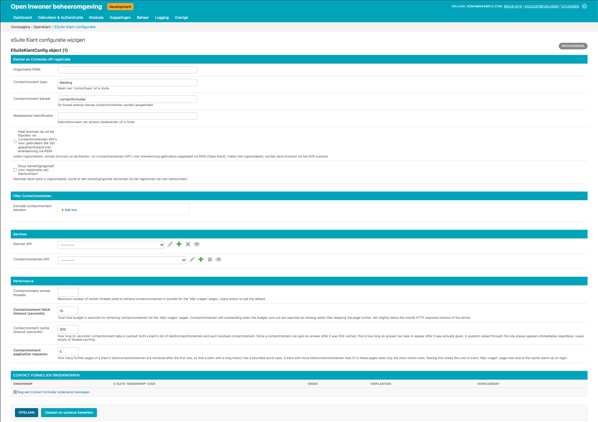

Onder **Klanten en Contacten API registratie** stelt u in hoe vragen als contactmoment in de eSuite worden geregistreerd:

| **Organisatie RSIN**
| Het RSIN van de organisatie (de gemeente).

| **Contactmoment type**
| De naam van het "contacttype" uit de eSuite waarmee het contactmoment wordt geregistreerd.

| **Contactmoment kanaal**
| Het kanaal waarlangs de contactmomenten worden aangemaakt, de manier waarop contact is gezocht.

| **Medewerker identificatie**
| De gebruikersnaam van een medewerker van de gemeente in de eSuite. Blijft dit veld leeg, dan wordt het contactmoment op basis van het onderwerp bij de juiste afdeling afgeleverd.

| **Haal bronnen op uit de Klanten- en Contactmomenten-API's voor gebruikers die zijn geauthenticeerd met eHerkenning via RSIN**
| Indien dit is ingeschakeld, worden bronnen uit de Klanten- en Contactmomenten-API's voor eHerkenning-gebruikers opgehaald via het RSIN van het bedrijf (Open Klant). Indien dit niet is ingeschakeld, worden deze bronnen via het KvK-nummer opgehaald.

| **Stuur bevestigingsmail voor registratie van klantcontact**
| Indien dit is ingeschakeld, vraagt Open Inwoner de eSuite om een bevestigingsmail te sturen wanneer een vraag als klantcontact wordt geregistreerd. Of Open Inwoner zelf een bevestiging stuurt, stelt u in hoofdstuk 9.4 in.

Onder **Filter Contactmomenten**:

| **Exclude contactmoment kanalen**
| De kanalen van de eSuite waarvan de contactmomenten niet aan gebruikers worden getoond, één per regel. Dit is met name nuttig voor kanalen die enkel voor intern gebruik bestemd zijn.

Onder **Services** kiest u de **Klanten API** en de **Contactmomenten API** van de eSuite, uit de services die zijn aangemaakt via **Koppelingen > Services** (zie hoofdstuk 9.15). Beide zijn nodig om de eSuite als primaire backend te kunnen kiezen.

Onder **Performance** stelt u in hoe de contactmomenten voor de pagina's van "Mijn Vragen" worden opgehaald. De standaardinstellingen volstaan in de meeste gevallen.

| **Contactmoment worker threads**
| Het maximale aantal contactmomenten dat tegelijk wordt opgehaald. Laat dit veld leeg om de standaardwaarde te gebruiken.

| **Contactmoment fetch timeout (seconds)**
| De totale tijd in seconden die het ophalen van de contactmomenten mag duren. Standaard is dit 15 seconden. Contactmomenten die niet op tijd zijn opgehaald, worden als ontbrekend gemeld in plaats van dat de pagina langer laadt. Stel dit iets lager in dan de maximale tijd die de server krijgt om een pagina te tonen.

| **Contactmoment cache timeout (seconds)**
| Hoe lang (in seconden) de contactmomenten van een klant worden bewaard, zodat ze niet bij elke pagina opnieuw worden opgehaald. Standaard is dit 300 seconden (5 minuten). Een antwoord op een vraag kan er zo lang over doen om zichtbaar te worden; een vraag die via de website wordt gesteld, is altijd direct zichtbaar. Laat het veld leeg om dit uit te schakelen.

| **Contactmoment pagination requests**
| Hoeveel extra pagina's met klantcontactmomenten na de eerste worden opgehaald. Standaard is dit 5. Een klant met meer klantcontactmomenten dan in deze pagina's passen, ziet alleen de meest recente. Een hogere waarde maakt elke pagina van "Mijn Vragen" en het vullen van de cache bij het inloggen zwaarder.

Contactformulier onderwerpen
^^^^^^^^^^^^^^^^^^^^^^^^^^^^

Onder "Contact formulier onderwerpen" stelt u de onderwerpen in waaruit de gebruiker in het contactformulier kiest (zie hoofdstuk 11.2.10). Geef elk onderwerp een **e-Suite 'onderwerp' code**: een contactmoment met deze onderwerpcode komt automatisch bij de juiste afdeling terecht, en met de eSuite als primaire backend toont het contactformulier alleen de onderwerpen met een code. Met de pijlen in de kolom **Move** wijzigt u de volgorde van de onderwerpen. U verwijdert een onderwerp door een vinkje te zetten bij **Verwijderen?**. Om nog een onderwerp toe te voegen klikt u op [Nog een Contact formulier onderwerp toevoegen]. Als alles naar wens is geconfigureerd klikt u op [Opslaan].

9.4.2. OpenKlant2
-----------------

Wanneer u binnen de Configuratie Klanten Systeem klikt op de link "Configureer de OpenKlant2 backend", opent het scherm met de configuratie van OpenKlant2. De velden onder "Performance" worden (nog) in het Engels getoond.

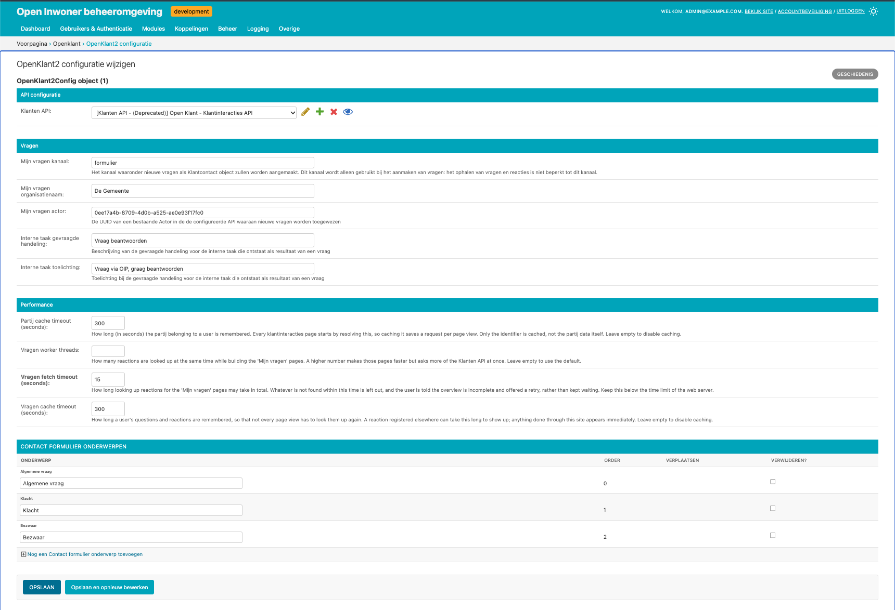

API Configuratie
^^^^^^^^^^^^^^^^

Onder **API configuratie** kiest u bij **Klanten API** de service met de technische configuratie voor het communiceren met OpenKlant2 (de Klantinteracties API). Deze is nodig om OpenKlant2 als primaire backend te kunnen kiezen.

Het API-token van OpenKlant2 stelt u als volgt in op de Service:

* **Authorisatietype**: API sleutel
* **Header sleutel**: ``Authorization``
* **Header waarde**: ``Token <uw token>``

Vul het token dus niet in bij het veld *Secret*; dat veld wordt voor deze koppeling niet gebruikt. Bestaande Services waarbij het token nog in *Secret* stond, zijn bij de update automatisch omgezet. De op de Service ingestelde time-out wordt ook toegepast op verzoeken aan OpenKlant2.

Vragen
^^^^^^

De instellingen onder **Vragen** zijn noodzakelijk voor de integratie met OpenKlant2 in het "Mijn Vragen" gedeelte van de website.

| **Mijn vragen kanaal**
| Het kanaal waaronder nieuwe vragen als klantcontact worden aangemaakt. Dit kanaal wordt alleen gebruikt bij het aanmaken van vragen: het ophalen van vragen en reacties is niet beperkt tot dit kanaal.

| **Mijn vragen organisatienaam**
| De naam van de organisatie die bij nieuwe vragen wordt vastgelegd.

| **Mijn vragen actor**
| De UUID van een bestaande Actor in OpenKlant2. Nieuwe vragen worden als interne taak aan deze Actor toegewezen voor afhandeling.

| **Interne taak gevraagde handeling**
| De beschrijving van de gevraagde handeling van de interne taak die voor een vraag wordt aangemaakt.

| **Interne taak toelichting**
| De toelichting bij de gevraagde handeling van de interne taak.

Performance
^^^^^^^^^^^

Onder **Performance** stelt u in hoe de vragen voor de pagina's van "Mijn Vragen" worden opgehaald. De standaardinstellingen volstaan in de meeste gevallen.

| **Partij cache timeout (seconds)**
| Hoe lang (in seconden) wordt onthouden welke partij bij een gebruiker hoort. Elke pagina van "Mijn Vragen" begint hiermee; alleen de identificatie wordt bewaard, niet de gegevens van de partij. Standaard is dit 300 seconden (5 minuten). Laat het veld leeg om dit uit te schakelen.

| **Vragen worker threads**
| Hoeveel reacties tegelijk worden opgehaald. Een hoger aantal maakt de pagina's sneller, maar belast de Klanten API meer. Laat dit veld leeg om de standaardwaarde te gebruiken.

| **Vragen fetch timeout (seconds)**
| Hoe lang het ophalen van de reacties in totaal mag duren. Standaard is dit 15 seconden. Wat niet op tijd is gevonden, wordt weggelaten: de gebruiker krijgt dan een melding dat het overzicht niet compleet is en kan het opnieuw proberen. Stel dit lager in dan de maximale tijd die de server krijgt om een pagina te tonen.

| **Vragen cache timeout (seconds)**
| Hoe lang (in seconden) de vragen en reacties van een gebruiker worden bewaard. Standaard is dit 300 seconden (5 minuten). Een reactie die elders is geregistreerd, kan er zo lang over doen om zichtbaar te worden; wat via de website gebeurt, is altijd direct zichtbaar. Laat het veld leeg om dit uit te schakelen.

Contactformulier onderwerpen
^^^^^^^^^^^^^^^^^^^^^^^^^^^^

Onder "Contact formulier onderwerpen" stelt u de onderwerpen in waaruit de gebruiker in het contactformulier kiest wanneer OpenKlant2 de primaire backend is. Deze onderwerpen hebben geen e-Suite onderwerpcode. Met de pijlen in de kolom **Move** wijzigt u de volgorde, met een vinkje bij **Verwijderen?** verwijdert u een onderwerp en met [Nog een Contact formulier onderwerp toevoegen] voegt u een onderwerp toe. Als alles naar wens is geconfigureerd klikt u op [Opslaan].

9.5. KlantContactMomenten
=========================

Bij **Modules > Klantensysteem > KlantContactMomenten** vindt u per vraag van een gebruiker welk antwoord de gebruiker het laatst heeft gezien. Het overzicht toont de **Gebruiker** die de vraag heeft gesteld, de **Contactmoment URL** van de vraag in het klantensysteem en bij **Last seen answer** (nog niet vertaald) de UUID van het laatste antwoord dat de gebruiker heeft bekeken. Dit veld is leeg zolang de gebruiker geen vraag met een antwoord heeft geopend. Omdat een vraag in de loop van de tijd meerdere antwoorden kan krijgen, wordt een later antwoord zo weer als nieuw getoond. U kunt zoeken op de naam en het e-mailadres van de gebruiker en op de URL van het contactmoment.

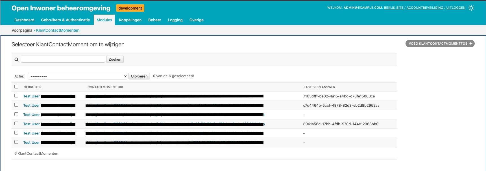

9.6. Laposta configuratie
=========================

Laposta is de API voor nieuwsbriefintegratie. U vindt de configuratie via **Modules > Mailinglijsten > Laposta configuratie**. Onder "Eenvoudig" vult u de **API root** (de URL van de Laposta API met versienummer, bijvoorbeeld ``https://api.laposta.nl/v2/``), de **Basic Authentication gebruikersnaam** en het **Basic Authentication wachtwoord** in.

Onder "Geavanceerd" staan bij **Limit list selection to** (nog niet vertaald) de nieuwsbrieven die in Laposta bestaan. Zet een vinkje bij de nieuwsbrieven waarvoor gebruikers zich mogen inschrijven en klik op [Opslaan]. Zet u nergens een vinkje, dan kunnen gebruikers uit alle nieuwsbrieven kiezen. De lijst met nieuwsbrieven wordt tijdelijk bewaard: een nieuwe nieuwsbrief in Laposta kan er tot 15 minuten over doen om hier te verschijnen.

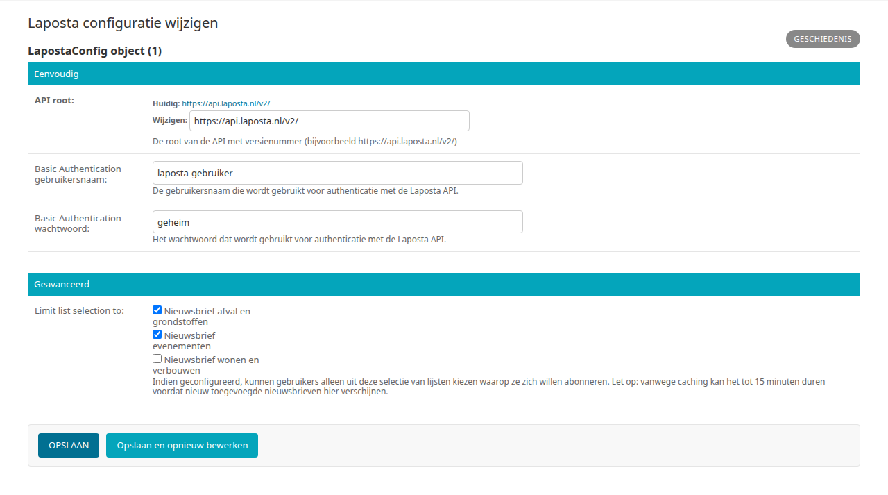

Aan de voorkant van Open Inwoner krijgen gebruikers in Mijn Profiel de mogelijkheid zich in te schrijven voor deze nieuwsbrieven. Gebruikers kunnen zich te allen tijde aan- en afmelden en hun voorkeuren wijzigen.

9.6.1. E-mailverificatie vereist
--------------------------------

De nieuwsbrieven worden alleen getoond aan gebruikers die hun e-mailadres hebben bevestigd. Zet daarom in de Algemene configuratie (**Beheer > Configuratie > Algemene configuratie**) onder "Notificaties" een vinkje bij **E-mailverificatie vereist**. Gebruikers die hun e-mailadres nog niet hebben bevestigd, worden dan na het inloggen gevraagd dit te doen: zij krijgen een e-mail met een link waarmee zij hun e-mailadres bevestigen. Dit geldt zodra de pagina Mijn profiel is gepubliceerd. Het veld **E-mailverificatie bericht** is dan verplicht: dit is de tekst die de gebruiker ziet nadat de e-mail is verstuurd.

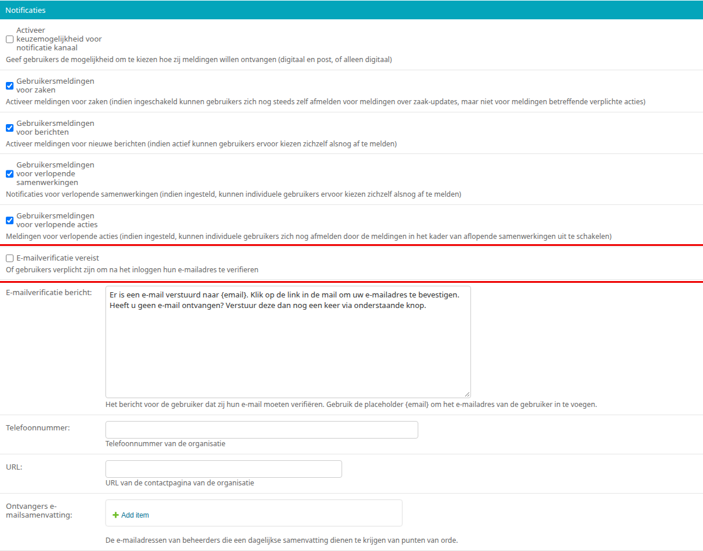

9.7. Notificaties componentconfiguratie
=======================================

Wanneer u de notificaties van de componentconfiguratie instelt kunt u notificaties ontvangen van wijzigingen aan Zaken of documenten in eSuite of Open Zaak. Bij de instellingen kan aangegeven worden hoeveel afleverpogingen het systeem mag doen en de vertraging die er tussen de afleverpogingen mag zitten.

9.7.1. Notificaties instellen
=============================

Om de notificaties van de componentconfiguratie in te stellen volgt u het volgende stappenplan:

1) Creëer een ZGW Service voor de notificatie-API (NRC) met door de ZGW backend
   verzorgde referenties (/admin/zgw_consumers/service/). Deze Service heeft de volgende
   rechten nodig om referenties te kunnen verzorgen:

-  catalogi.lezen
-  zaken.lezen
-  zaken.bijwerken
-  documenten.lezen
-  documenten.aanmaken
-  notificaties.consumeren

2) Update Notificaties componentconfiguratie
   (/admin/notifications/notificationsapiconfig/), selecteer de bij stap 1
   aangemaakte Service.

3) De Configuratie 'Open Zaak' moet worden ingesteld voor Zaken (ZRC), Catalogus (ZTC)
   en Documenten (DRC). (/admin/openzaak/openzaakconfig/) Selecteer in eSuite ook "Maak
   gebruik van StatusType.informeren workaround (eSuite)".

4) Configureer in eSuite de Zaaktypes (/admin/openzaak/zaaktypeconfig/) Selecteer de
   Zaaktypes en InformatieObjectTypes en configureer de bijbehorende notificatieopties.
   Er is een cronjob om deze catalogus te importeren. Dit commando kan te allen tijde
   worden uitgevoerd door via **Beheer > Achtergrond taken > Periodic tasks** de
   "Importeer ZGW data" taak handmatig te starten via de "Start taak" knop.

.. _objects-api-configuratie:

9.8. Objects API service configuration
======================================

Bij **Modules > Externe klanttaken > Objects API service configuration** stelt u in welke API's Open Inwoner gebruikt voor de externe taken van inwoners, die de Takenlijst plugin toont (zie hoofdstuk 11.2.12). De velden worden (nog) in het Engels getoond.

| **Objects api client config**
| De service van de Objecten API: de externe bron waar de gegevens (de taken) vandaan komen.

| **Objecttypes api client config**
| De service van de Objecttypen API: deze geeft aan welke typen objecten via de Objecten API beschikbaar zijn.

| **Status**
| Of Open Inwoner verbinding kan maken met de Objecten API: een groen vinkje als de verbinding werkt, anders een rood kruis met de foutmelding. Zolang niet beide services zijn gekozen, staat hier dat de configuratie niet compleet is.

U kiest de services uit de services die zijn aangemaakt via **Koppelingen > Services** (zie hoofdstuk 9.15) en klikt op [Opslaan].

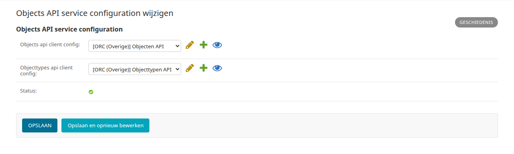

9.9. Open Forms client configuration
====================================

Bij Open Forms client configuration kunt u de configuratie van de Open Forms client gekoppeld aan het Open Inwoner Platform wijzigen. Hiermee kunt u Open Inwoner koppelen aan Open Formulieren. Wanneer dit is ingesteld is het mogelijk bij ieder product een formulier te selecteren uit Open Formulieren in plaats van via een externe URL om zo een aanvraag in gang te zetten. De Open Forms client configuration dient eenmalig te worden ingesteld. Dit kan door de beheerder of door Maykin worden gedaan.

9.9.1. SDK
----------

Bij SDK kunnen de instellingen rond de voorkant van Open Formulieren worden aangepast. Het gaat hier om de CSS en Javascript instellingen voor wat betreft de vormgeving van Open Formulieren zoals ze voor de gebruiker na het doorklikken zichtbaar zijn. Op deze manier kan de huisstijl eenvoudig worden doorgevoerd in het betreffende formulier.

9.9.2. Gebruik Sentry
---------------------

Open Formulieren kan gebruik maken van logs op Sentry. Wanneer er een vinkje is gezet bij “Gebruik Sentry” worden SDK errors van Open Formulieren automatisch doorgestuurd naar de ingestelde Sentry instantie.

9.10. Open Zaak informatieobject notificatie records
====================================================

Bij Open Zaak informatieobject notificatie records vindt u een register met daarin gegevens over naar welke gebruikers welke notificaties zijn verstuurd naar aanleiding van het toevoegen of wijzigen van een document.

9.11. Open Zaak statusnotificatie records
=========================================

Bij Open Zaak statusnotificatie records vindt u naar welke gebruikers welke notificaties zijn verstuurd naar aanleiding van een statuswijziging.

9.12. Qmatic configuratie
=========================

De Qmatic configuratie maakt het mogelijk dat gebruikers in Mijn profiel hun balie-afspraken bij de Gemeente kunnen raadplegen. Hiervoor wordt gebruik gemaakt van een calendar API waar de gegevens vandaan gehaald worden. Ook is er de mogelijkheid een reservering URL in te geven, zodat gebruikers hun afspraak bij de gemeente kunnen wijzigen of verwijderen.

9.12.1. E-mailverificatie vereist
---------------------------------

De afspraken worden alleen getoond aan gebruikers die hun e-mailadres hebben bevestigd: Open Inwoner zoekt de afspraken op aan de hand van het bevestigde e-mailadres. Zet daarom in de Algemene configuratie (**Beheer > Configuratie > Algemene configuratie**) onder "Notificaties" een vinkje bij **E-mailverificatie vereist**, zodat gebruikers na het inloggen worden gevraagd hun e-mailadres te bevestigen (zie hoofdstuk 9.6.1).

9.13. SOAP services
===================

Bij **Koppelingen > SOAP services** staan de externe SOAP-API koppelingen van het Open Inwoner Platform, zoals de koppeling met de Suite voor Sociaal Domein (zie hoofdstuk 9.14). Wijzig bestaande SOAP services alleen als u zeker weet wat het gevolg is: de koppelingen die ernaar verwijzen gebruiken de wijziging direct.

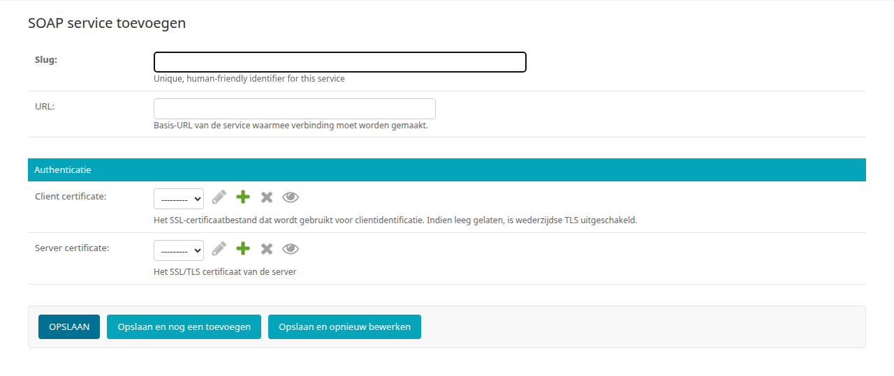

| **Slug**
| Een unieke, korte naam voor de SOAP service, zonder spaties, bijvoorbeeld ``ssd-uitkeringen``. Onder deze naam kiest u de SOAP service bij een koppeling. Dit veld vervangt het vroegere veld "Label".

| **URL**
| De basis-URL van de SOAP service.

Onder **Authenticatie** (de velden worden nog in het Engels getoond):

| **Client certificate**
| Het certificaat waarmee Open Inwoner zich bij de SOAP service identificeert (mutual TLS), gekozen uit de certificaten van hoofdstuk 9.2. Laat u dit veld leeg, dan wordt geen clientcertificaat gebruikt.

| **Server certificate**
| Het SSL/TLS-certificaat van de server, waarmee Open Inwoner controleert dat het met de juiste server verbinding maakt.

9.14. SSD
=========
Bij **Modules > Uitkeringen > Mijn uitkeringen** configureert u de koppeling met de Suite voor Sociaal Domein (SSD) en het onderdeel Mijn uitkeringen: welke overzichten van uitkeringen gebruikers kunnen downloaden en welke teksten daarbij staan.

9.14.1. SSD clients
-------------------

Onder "SSD clients" stelt u de koppeling met de Suite voor Sociaal Domein in.

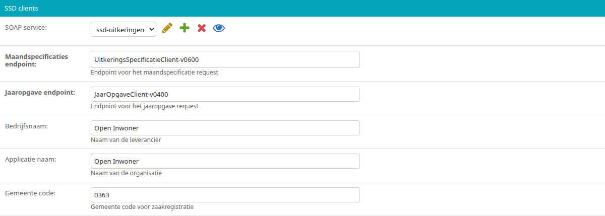

| **SOAP service**
| De SOAP service waarmee de SSD wordt bevraagd (zie hoofdstuk 9.13).

| **Maandspecificaties endpoint**
| Het endpoint voor het opvragen van de maandspecificaties.

| **Jaaropgave endpoint**
| Het endpoint voor het opvragen van de jaaropgaven.

| **Bedrijfsnaam**
| De naam van de leverancier.

| **Applicatie naam**
| De naam van de applicatie die gebruik maakt van de SSD.

| **Gemeente code**
| De gemeentecode voor de zaakregistratie.

9.14.2. Mijn uitkeringen
------------------------

Onder "Mijn uitkeringen" vult u bij **Tekst voor overzicht** de begeleidende tekst in die bovenaan het onderdeel Mijn uitkeringen staat. Dit is een tekstveld zonder opmaakmogelijkheden.

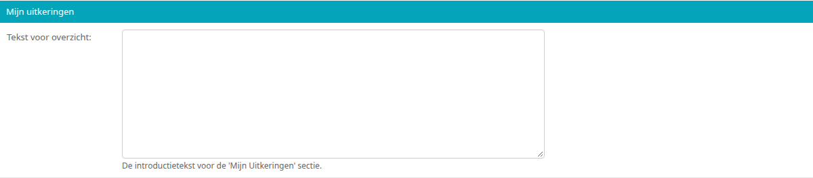

9.14.3. Maandspecificatie
-------------------------

Onder "Maandspecificatie" configureert u het tabblad Maandspecificatie in het onderdeel Mijn uitkeringen.

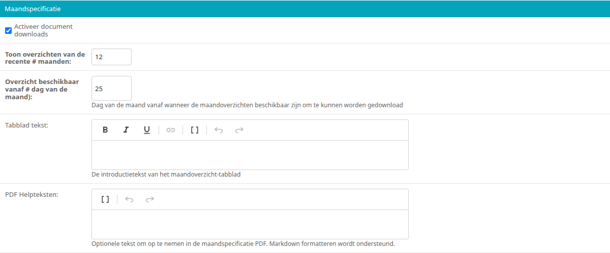

| **Activeer document downloads**
| Wanneer hier een vinkje staat, kunnen gebruikers hun maandspecificaties downloaden. Dit staat standaard aan.

| **Toon overzichten van de recente # maanden**
| Van hoeveel maanden overzichten worden getoond. Standaard is dit 12.

| **Overzicht beschikbaar vanaf # dag van de maand)**
| Vanaf welke dag van de maand de maandspecificatie van de voorgaande maand beschikbaar is om te downloaden. Standaard is dit de 25e.

| **Tabblad tekst**
| De begeleidende tekst op het tabblad Maandspecificatie. Hier kunt u een teksteditor met eenvoudige opmaak (vet, cursief, onderstreept en links) gebruiken.

| **PDF Helpteksten**
| Optionele toelichting die in de PDF van de maandspecificatie wordt opgenomen, in alinea's zonder opmaak.

9.14.4. Jaaropgave
------------------

Onder "Jaaropgave" configureert u het tabblad Jaaropgave in het onderdeel Mijn uitkeringen.

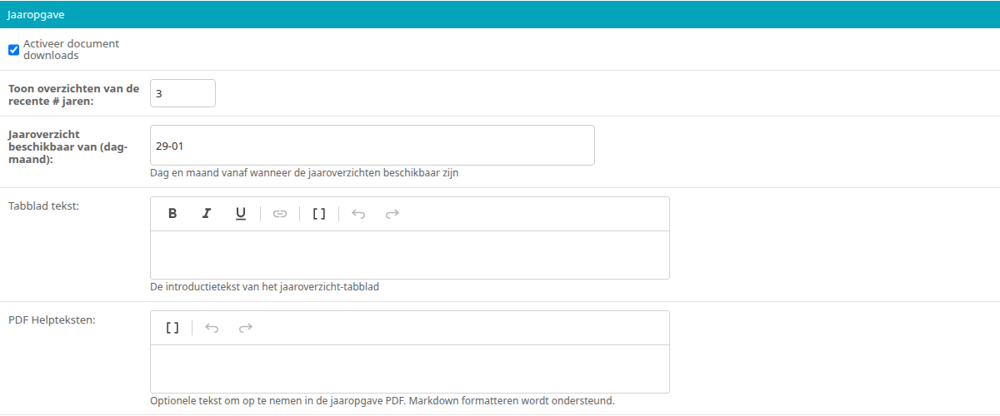

| **Activeer document downloads**
| Wanneer hier een vinkje staat, kunnen gebruikers hun jaaropgaven downloaden. Dit staat standaard aan.

| **Toon overzichten van de recente # jaren**
| Van hoeveel jaar overzichten worden getoond. Standaard is dit 3.

| **Jaaroverzicht beschikbaar van (dag-maand)**
| Vanaf welke dag en maand (bijvoorbeeld ``29-01``) de jaaropgave van het voorgaande jaar beschikbaar is om te downloaden. Standaard is dit 29 januari.

| **Tabblad tekst**
| De begeleidende tekst op het tabblad Jaaropgave. Hier kunt u een teksteditor met eenvoudige opmaak (vet, cursief, onderstreept en links) gebruiken.

| **PDF Helpteksten**
| Optionele toelichting die in de PDF van de jaaropgave wordt opgenomen, in alinea's zonder opmaak.

9.15. Services
==============

Bij Services staan alle externe REST-API koppelingen met het Open Inwoner Platform ingesteld. Wijzig bestaande services alleen als u zeker weet wat het gevolg is: andere onderdelen van het platform, zoals de ZGW API sets (zie hoofdstuk 9.3.4), verwijzen ernaar.

9.15.1. Een ZGW service toevoegen
---------------------------------

Voor Mijn Zaken heeft u een service nodig voor de Zaken API, de Catalogi API en de Documenten API van het zaaksysteem (zie hoofdstuk 9.0). U voegt een service toe via de knop [Service toevoegen]. De belangrijkste velden zijn:

| **Label**
| Een herkenbare naam voor de service, bijvoorbeeld "Zaken API".

| **Service slug**
| Een unieke, korte naam voor de service, zonder spaties. Deze wordt automatisch ingevuld op basis van het label.

| **Type**
| Het soort API, bijvoorbeeld "ZRC (Zaken API)", "ZTC (Catalogi API)" of "DRC (Documenten API)". In een ZGW API set kunt u alleen services van het juiste type kiezen.

| **Basisurl van de API**
| De URL waarop de API begint, bijvoorbeeld ``https://zaken.gemeente.nl/zaken/api/v1/``. U krijgt deze URL van de leverancier of beheerder van het zaaksysteem.

| **Authorisatietype**
| De manier waarop Open Inwoner zich bij de API aanmeldt: "ZGW client_id en secret" (gebruikelijk voor Open Zaak en eSuite), "API sleutel" of "Geen authorisatie".

| **Client id** en **Secret**
| De gegevens waarmee Open Inwoner zich aanmeldt bij het authorisatietype "ZGW client_id en secret". U krijgt deze van de beheerder van het zaaksysteem.

| **Header sleutel** en **Header waarde**
| De gegevens waarmee Open Inwoner zich aanmeldt bij het authorisatietype "API sleutel".

Klik op [Opslaan]. Wanneer u de service daarna opnieuw opent, ziet u bij **Statuscode van de verbindingstest** of de API bereikbaar is: de statuscode 200 betekent dat de verbinding werkt. Staat er geen statuscode, dan kon geen verbinding worden gemaakt.

9.16. Signing requests
=======================

Hier kunt u een CSR (Certificate Signing Request) genereren die kan worden ingediend bij een certificeringsinstantie (CA) voor de uitgifte van een digitaal certificaat.

9.17. Webhook-abonnementen
==========================

Bij **Modules > Zaken > Webhook-abonnementen** stelt u in dat Open Inwoner de notificaties van een bepaald kanaal (zaken, documenten, besluiten) van Open Zaak of eSuite ontvangt, via de Notificaties API. Deze webhookberichten worden onder andere gebruikt om status updates aan inwoners te tonen of e-mailmeldingen te versturen, bijvoorbeeld bij een zaak-update.

In het overzicht van webhook-abonnementen ziet u per abonnement de **Callback URL**, de **Kanalen**, de **Client ID** en het **NC-abonnement**: de URL van het abonnement in de Notificaties API. Is het NC-abonnement leeg, dan is het abonnement (nog) niet geregistreerd.

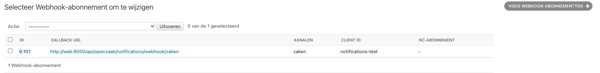

9.17.1. Webhook-abonnement aanmaken
--------------------------------------

U kunt een webhook-abonnement aanmaken door op de knop [Webhook-abonnement toevoegen] te klikken. Er wordt dan een nieuw venster geopend waar u het webhook-abonnement kunt configureren.

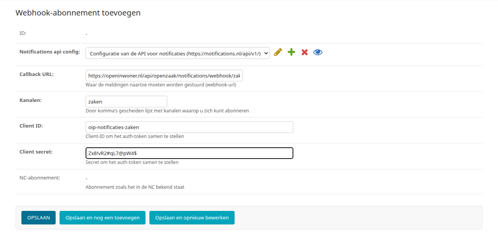

| **Notifications api config**
| De configuratie van de Notificaties API waarbij het abonnement wordt geregistreerd (zie hoofdstuk 9.7). U kunt hier ook een nieuwe configuratie toevoegen. Dit veld heeft (nog) geen Nederlandse naam.

| **Callback URL**
| De host waar het Open Inwoner Platform op gedeployed is, gevolgd door het vaste pad ``/api/openzaak/notifications/webhook/zaken``. Bijvoorbeeld: ``https://open-inwoner.gemeente.nl/api/openzaak/notifications/webhook/zaken``.

| **Kanalen**
| De kanalen waarop u zich wilt abonneren. U kunt meerdere kanalen invullen door ze te scheiden met een komma (,), maar in de praktijk zal u hier vaak ``zaken`` invullen.

| **Client ID**
| Het client ID waarmee het token wordt samengesteld waarmee de Notificaties API zich bij Open Inwoner aanmeldt. U kunt hier zelf een waarde voor bedenken. Houd daarbij in gedachte dat de client ID in het systeem van de verzender betekenisvol moet zijn (bijvoorbeeld ``oip-notificaties-gemeente-demodam-acc``).

| **Client secret**
| Het geheim waarmee het token wordt samengesteld. Client ID en Client secret kunnen arbitrair zijn, maar het Client secret moet moeilijk te raden zijn. Gebruik hiervoor dus veel karakters met een mengsel van leestekens, cijfers en letters.

De velden **ID** en **NC-abonnement** worden automatisch ingevuld.

Wanneer alle velden zijn ingevuld klikt u op [Opslaan]. Daarna registreert u het abonnement expliciet: selecteer het in het overzicht, kies de actie "Registreer de webhooks" en klik op [Uitvoeren]. Open Inwoner registreert het abonnement dan bij de Notificaties API, en het **NC-abonnement** toont de URL van het abonnement daar.

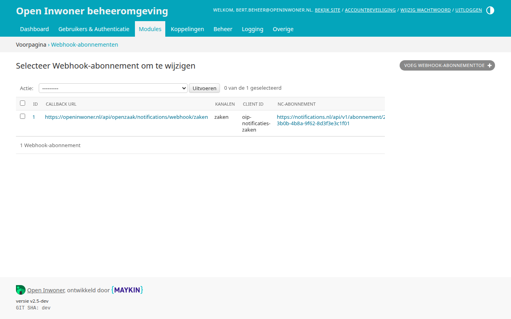

Wanneer de webhook correct is geregistreerd en berichten ontvangt, worden deze opgeslagen als
notificatieberichten en asynchroon verwerkt via een Celery-taak. U kunt de ontvangen berichten
inzien en beheren via §9.17.3.

.. warning::
   Blijft het veld NC-abonnement na het registreren leeg, dan is de registratie niet gelukt. U krijgt dan een foutmelding in beeld. Een abonnement dat al is geregistreerd, wordt bij opnieuw registreren overgeslagen.

9.17.2. Webhook-abonnement verwijderen
--------------------------------------

Indien u een webhook-abonnement wilt verwijderen is het belangrijk tijdens het verwijderproces de juiste volgorde aan te houden. U dient allereerst de webhook te deregistreren: selecteer het abonnement in het overzicht, kies de actie "De webhooks deregistreren" en klik op [Uitvoeren]. Als de webhook succesvol is gederegistreerd, is in het overzicht de URL bij het NC-abonnement verdwenen. Is het deregistreren niet gelukt, dan krijgt u een foutmelding in beeld. Vervolgens kunt u het abonnement verwijderen met de actie "Geselecteerde Webhook-abonnementen verwijderen".

9.17.3. Notificatieberichten
-----------------------------

Elk binnenkomend webhookbericht wordt direct opgeslagen als een notificatiebericht onder
**Modules > Zaken > Notificatieberichten**, ongeacht of de verdere verwerking slaagt. Dit biedt
een auditspoor van alle ontvangen berichten en maakt het mogelijk om mislukte berichten opnieuw
te verwerken. Berichten die groter zijn dan de maximale payload-grootte (zie hoofdstuk 9.17.4), die niet bij een webhook-abonnement horen (de aanmelding van de verzender klopt niet) of die geen geldige JSON zijn, worden geweigerd en niet opgeslagen.

Het overzicht toont per bericht het **ID**, het webhook-abonnement (**Subscription**), het **Kanaal**, de **Status** en wanneer het bericht is ontvangen (**Received at**), het laatst is verwerkt (**Last processed at**) en wanneer de verwerking is gestart (**Process started at**). Deze namen worden (nog) in het Engels getoond. U kunt filteren op status, abonnement, kanaal, of het bericht geldig is (is valid) en op de datum van ontvangst en verwerking, en zoeken in het kanaal, de verwerkingsfout en de inhoud van het bericht (de payload). Notificatieberichten kunt u niet zelf toevoegen.

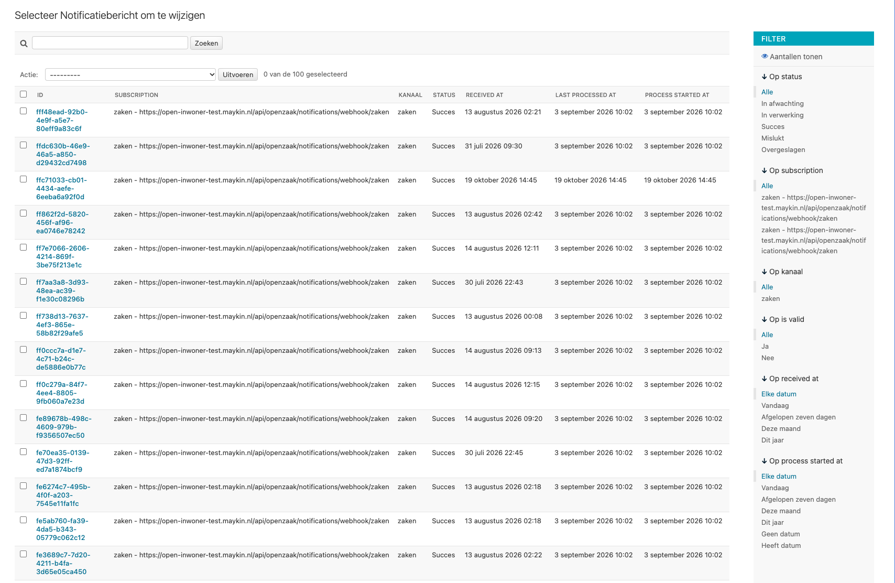

Klik op een bericht om de details te zien. Alle velden zijn alleen-lezen, behalve de status. Onder **Processing output** ziet u de uitkomst van de verwerking, bijvoorbeeld waarom een bericht is overgeslagen, en onder **Processing error** de foutmelding van een mislukte verwerking. **Payload** bevat het ontvangen bericht zelf.

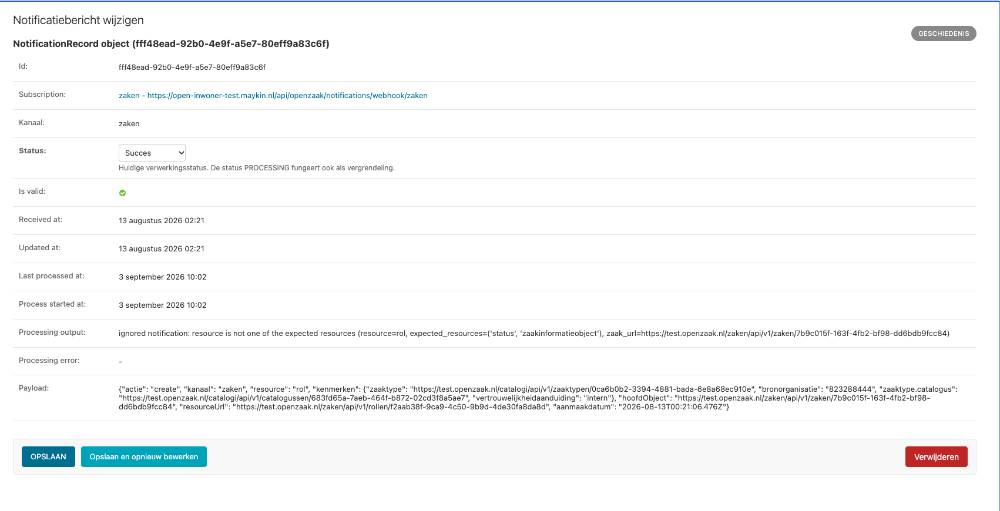

Statusoverzicht
^^^^^^^^^^^^^^^

Elk notificatiebericht doorloopt een verwerkingsstatus:

.. list-table::
   :header-rows: 1
   :widths: 20 80

   * - Status
     - Betekenis
   * - **In afwachting** (pending)
     - Het bericht is ontvangen en wacht op verwerking door de achtergrondtaak.
   * - **In verwerking** (processing)
     - De achtergrondtaak is bezig met verwerken. Deze status fungeert tevens als vergrendeling
       om gelijktijdige verwerking te voorkomen.
   * - **Succes** (success)
     - Het bericht is succesvol verwerkt.
   * - **Mislukt** (failed)
     - Er is een fout opgetreden tijdens de verwerking. Het veld **Processing error** bevat de
       foutmelding. Het bericht kan opnieuw worden aangeboden (zie hieronder).
   * - **Overgeslagen** (skipped)
     - Het bericht is bewust niet verwerkt, bijvoorbeeld omdat zaaknotificaties uitgeschakeld
       zijn in de siteconfiguratie.

Berichten opnieuw verwerken
^^^^^^^^^^^^^^^^^^^^^^^^^^^^

Mislukte, overgeslagen of eerder geslaagde berichten kunnen opnieuw worden aangeboden via de
bulkactie **"Geselecteerde notificaties opnieuw proberen"**:

#. Selecteer een of meer berichten in de lijst.
#. Kies "Geselecteerde notificaties opnieuw proberen" in het actiemenu.
#. Klik op [Uitvoeren].

De geselecteerde berichten worden teruggezet naar de status *In afwachting* en opnieuw
ingepland voor verwerking. Berichten die de status *In afwachting* of *In verwerking* hebben, worden
overgeslagen.

9.17.4. Notificatieverwerking configuratie
------------------------------------------

Via **Modules > Zaken > Notificatieverwerking configuratie** kunt u drie instellingen beheren:

**Maximale payload-grootte**
De maximaal toegestane berichtgrootte in bytes voor inkomende webhooks. Berichten die deze
grens overschrijden worden direct geweigerd met een foutmelding aan de verzender. De
standaardwaarde is 1 MB (1.048.576 bytes).

**Bewaartermijn (uren)**
Het aantal uren dat notificatieberichten worden bewaard. Berichten in een eindstatus
(geslaagd, mislukt of overgeslagen) die ouder zijn dan deze termijn worden automatisch
verwijderd door de achtergrondtaak *"Opschonen notificatieberichten"*, die elk uur draait.
Laat dit veld leeg om berichten onbeperkt te bewaren.

**Bewaartermijn vastgelopen berichten (uren)**
Het aantal uren waarna notificatieberichten met de status *Wordt verwerkt* worden beschouwd als
vastgelopen - dit treedt op wanneer een achtergrondtaak is gestopt vóór het afronden van
de verwerking. Zulke berichten worden automatisch verwijderd door dezelfde
achtergrondtaak. Laat dit veld leeg om vastgelopen berichten niet automatisch op te schonen.

.. note::
   Voorheen werden beide bewaartermijnen in dagen ingesteld. Bij de update zijn bestaande
   waarden automatisch omgerekend naar uren (vermenigvuldigd met 24).

.. note::
   Berichten met de status *In behandeling* worden nooit automatisch verwijderd; deze kunnen
   nog worden opgepakt door een achtergrondwerker.

9.18. Zaaktype configuraties
============================

Bij **Modules > Zaken > Zaaktype Configuraties** vindt u alle zaaktypen uit de catalogi van Open Zaak of eSuite. Deze worden geïmporteerd door de achtergrondtaak "Importeer ZGW data" (zie hoofdstuk 9.0.3); u kunt hier zelf geen zaaktypen toevoegen. Het overzicht toont per zaaktype onder andere de identificatie, de omschrijving en de catalogus, of er notificaties worden verstuurd bij statuswijzigingen en hoeveel informatieobjecttypen, statustypen en resultaattypen bij het zaaktype horen. Enkele kolommen worden (nog) in het Engels getoond: **Has doc notify** (of voor ten minste één informatieobjecttype documentnotificaties aan staan), **Num infotypes**, **Num statustypes** en **Num resulttypes**.

U kunt filteren op **Notificeren bij statuswijzigingen**, op "notificeer bij nieuw document", op catalogus en op **Gevonden in API**, en zoeken op onder andere de identificatie en omschrijving van het zaaktype, de catalogus, de e-Suite onderwerpcode en de omschrijving of URL van de statustypen, resultaattypen en informatieobjecttypen van het zaaktype. Met de acties "Set selected Zaaktypes to notify on status changes" en "Set selected Zaaktypes to not notify on status changes" (nog niet vertaald) zet u de notificaties bij statuswijzigingen voor de geselecteerde zaaktypen in één keer aan of uit.

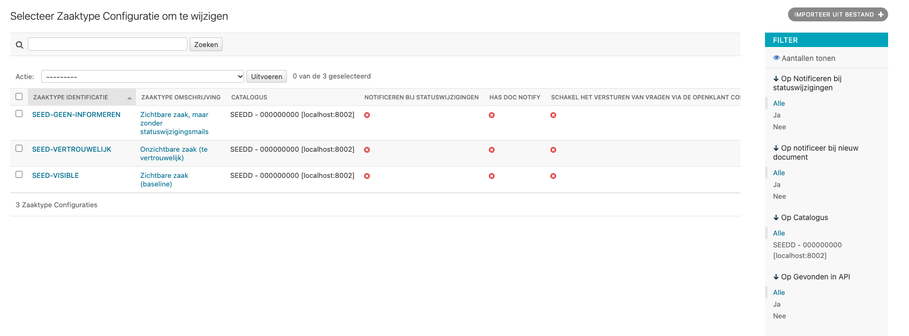

Wanneer u klikt op een zaaktype, opent het scherm waarin u de configuratie van het zaaktype kunt wijzigen.

9.18.1. Zaaktype configuratie wijzigen
--------------------------------------

Bovenaan het scherm staan de gegevens van het zaaktype uit de Catalogi API, die u niet kunt wijzigen: **Gevonden in API** (of het zaaktype bij de laatste import nog in de API stond), **Urls** (de URL's van het zaaktype), **Catalogus**, **Zaaktype identificatie** en **Zaaktype omschrijving**. Daaronder staan de instellingen van het zaaktype. Klik na het wijzigen op [Opslaan].

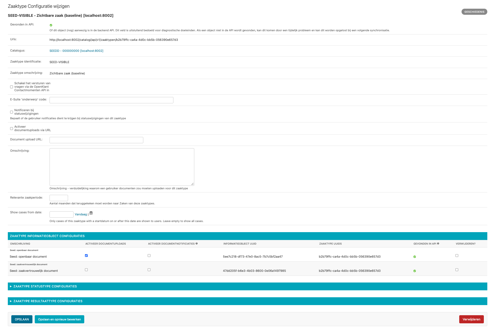

| **Schakel het versturen van vragen via de OpenKlant Contactmomenten API in**
| Wanneer hier een vinkje staat, kan de gebruiker op de detailpagina van een zaak van dit type een vraag stellen via het contactformulier. Dit werkt alleen als het klantensysteem vragen kan registreren (zie hoofdstuk 9.4).

| **e-Suite 'onderwerp' code**
| De onderwerpcode uit de eSuite waarmee vragen over zaken van dit type als contactmoment worden geregistreerd, zodat ze bij de juiste afdeling terechtkomen.

| **Notificeren bij statuswijzigingen**
| Deze instelling geldt alleen als de StatusType.informeren workaround aan staat (zie hoofdstuk 9.3.3), zoals bij een koppeling met de eSuite. De gebruiker krijgt dan alleen notificaties bij statuswijzigingen van zaken van zaaktypen waar hier een vinkje staat. Zonder deze workaround bepaalt het statustype in de Catalogi API (StatusType.informeren) of de gebruiker een notificatie krijgt.

| **Activeer documentuploads via URL**
| Door hier een vinkje te zetten wordt het mogelijk documenten te laten uploaden via een extern systeem dat niet geïntegreerd is in het Open Inwoner Platform. Op de detailpagina van de zaak komt dan een knop in beeld om naar het externe systeem te gaan. Wilt u dat gebruikers via het Open Inwoner Platform zelf bestanden uploaden, dan activeert u dit bij de informatieobjecttypen (zie hieronder). Beide tegelijk is niet toegestaan: de configuratie wordt dan niet opgeslagen.

| **Document upload URL**
| De URL van het externe systeem om een document te uploaden.

| **Omschrijving**
| De verduidelijking waarom een gebruiker documenten zou moeten uploaden voor dit zaaktype.

| **Relevante zaakperiode**
| Het aantal maanden dat wordt teruggekeken naar zaken van dit zaaktype voor de gepersonaliseerde onderwerpen op de homepage (zie hoofdstuk 9.3.2): de onderwerpen van dit zaaktype worden alleen getoond als de laatste zaak van de gebruiker van dit type binnen deze periode is gestart. Laat het veld leeg om niet naar de startdatum te kijken.

| **Show cases from date**
| Een datum vanaf wanneer zaken van dit zaaktype aan gebruikers worden getoond. Zaken met een startdatum vóór deze datum worden niet getoond in Mijn zaken. Laat dit veld leeg om alle zaken te tonen. Dit veld heeft (nog) geen Nederlandse naam.

**Oudere zaken van een zaaktype verbergen**

Wilt u dat inwoners alleen recente zaken van een zaaktype zien, bijvoorbeeld omdat oudere zaken in een ander systeem zijn afgehandeld, vul dan bij **Show cases from date** de datum in (bijvoorbeeld ``01-01-2025``) en klik op [Opslaan]. Vanaf dat moment ziet de inwoner in Mijn zaken alleen de zaken van dit zaaktype die op of na die datum zijn gestart. Zaken van andere zaaktypen worden nog steeds getoond. Maakt u het veld weer leeg, dan worden de oudere zaken weer getoond.

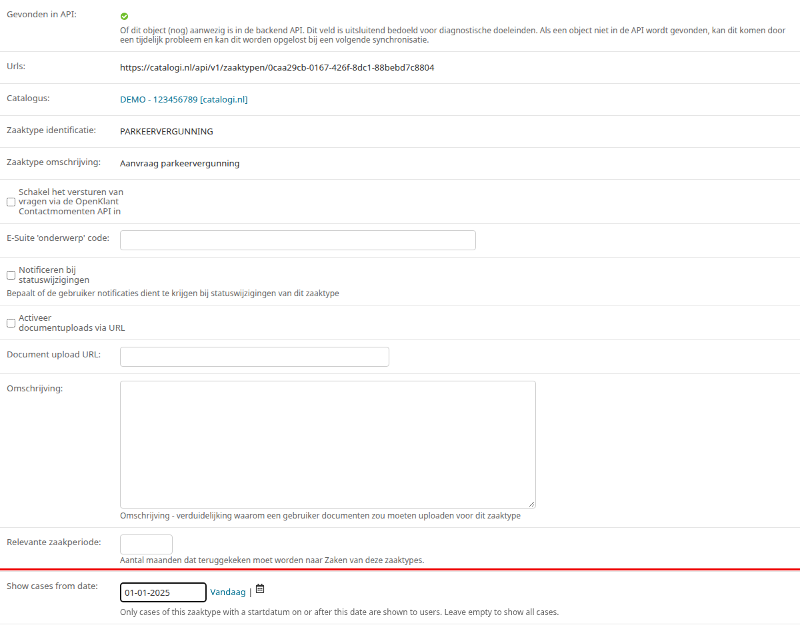

**Zaaktype Informatieobject configuraties**

Onder "Zaaktype Informatieobject configuraties" staan de informatieobjecttypen (de soorten documenten) van het zaaktype. U kunt per informatieobjecttype aangeven of gebruikers via het Open Inwoner Platform documenten van dit type mogen uploaden (**Activeer documentuploads**). Kunnen er meerdere soorten documenten worden geüpload, dan geeft de gebruiker per upload aan om wat voor soort document het gaat. Met **Activeer documentnotificiaties** (sic) krijgen gebruikers een bericht wanneer er een nieuw document van dit type bij hun zaak beschikbaar is. De kolommen **Omschrijving**, **Informatieobject UUID**, **Zaaktype uuids** en **Gevonden in API** komen uit de Catalogi API.

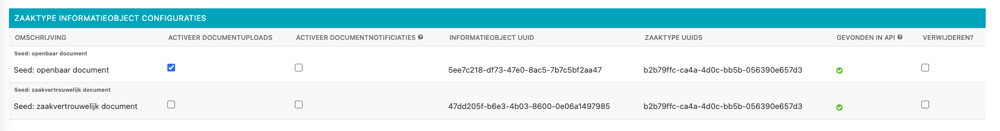

**Let op! Wanneer u bij Zaaktype informatieobject configuraties het
uploaden van bestanden activeert, vindt het uploaden plaats via het Open Inwoner Platform zelf en niet via een extern systeem.**

Onder het overzicht van de statustypen (zie hoofdstuk 9.18.2) staan de "Zaaktype Resultaattype Configuraties": per resultaattype van het zaaktype kunt u een omschrijving invullen.

9.18.2. Zaaktype statustype configuraties
-----------------------------------------
Onder "Zaaktype Statustype Configuraties" kunt u de statustypes die bij het zaaktype horen configureren. Dit onderdeel is standaard ingeklapt; klik op de titel om het uit te klappen. Per statustype zijn de eerste gegevens vast en komen ze uit de Catalogi API: **Gevonden in API**, **Statustekst**, **Omschrijving**, **Statustype URL** en **Zaaktype uuids**. De elementen die kunnen worden gewijzigd worden hieronder behandeld.

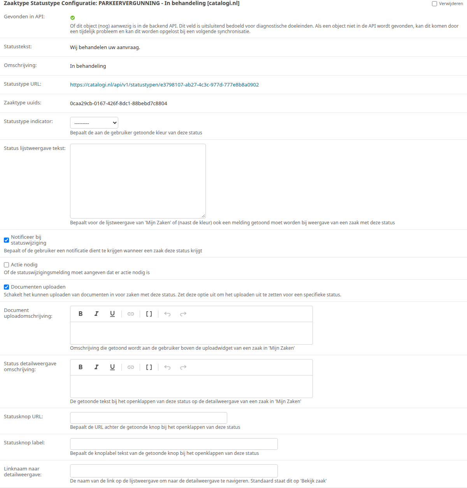

| **Statustype indicator**
| De kleur van de balk die in de lijstweergave van Mijn zaken boven een zaak met deze status staat, om extra nadruk te geven: "Info", "Waarschuwing", "Negatief" of "Succes". De balk wordt alleen getoond als ook de **Status lijstweergave tekst** is ingevuld.

| **Status lijstweergave tekst**
| De melding die in de lijstweergave van Mijn zaken in de balk bij een zaak met deze status wordt getoond.

| **Notificeer bij statuswijziging**
| Of een gebruiker een notificatie krijgt wanneer een zaak deze status krijgt. Dit staat standaard aan.

| **Actie nodig**
| Wanneer hier een vinkje staat, krijgt de gebruiker een e-mail die aangeeft dat hij of zij actie moet ondernemen, in plaats van de gewone notificatie.

| **Documenten uploaden**
| Of een gebruiker documenten kan uploaden voor zaken met deze status. Dit staat standaard aan, en gaat voor deze status voor de instelling van het zaaktype.

| **Document uploadomschrijving**
| De omschrijving die aan de gebruiker getoond wordt boven de uploadwidget op de detailpagina van een zaak. Hier kunt u een teksteditor met eenvoudige opmaak gebruiken.

| **Status detailweergave omschrijving**
| De tekst die wordt getoond bij het openklappen van de status op de detailpagina van een zaak. Hier kunt u een teksteditor met eenvoudige opmaak gebruiken.

| **Statusknop URL**
| De statusknop URL maakt een call-to-action button aan waar mensen direct hun actie kunnen uitvoeren. Als er hier niets is ingevuld en er is wel een mogelijkheid om bestanden te uploaden, dan staat er een standaard uploadwidget.

| **Statusknop label**
| De tekst op de statusknop. Denk aan de richtlijnen voor CTA-buttons.

| **Linknaam naar detailweergave**
| De linktekst om in de lijstweergave van Mijn zaken naar de detailweergave van een zaak met deze status te gaan. Standaard staat hier "Bekijk zaak".

**Een melding en linktekst bij een status instellen**

Stel dat inwoners bij de status "In behandeling" extra informatie moeten aanleveren. Kies bij die status als **Statustype indicator** "Waarschuwing", vul bij **Status lijstweergave tekst** de melding in, bijvoorbeeld "Wij hebben meer informatie van u nodig.", vul bij **Linknaam naar detailweergave** bijvoorbeeld "Bekijk uw aanvraag" in en klik op [Opslaan]. Vanaf dat moment ziet de inwoner in Mijn zaken bij zijn of haar zaken met deze status de melding in een balk in de kleur van de waarschuwing, en de nieuwe linktekst.

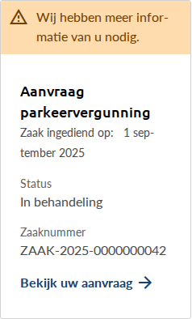

.. _ZTCImportExport:

9.18.3. Zaaktype configuratie importeren/exporteren
---------------------------------------------------

Het is mogelijk om individuele Zaaktype Configuratie objecten te importeren, op analoge wijze zoals beschreven voor de Catalogus Configuraties (zie :ref:`CatalogusImportExport`).

Voor meer details verwijzen we u naar deze sectie. In hoofdlijnen: in het overzicht van de Zaaktype Configuraties selecteert u een of meer zaaktypen, kiest u de actie "Exporteren naar bestand" en klikt u op [Uitvoeren]. U downloadt dan het bestand ``zgw-zaaktype-export.json`` met de configuratie van de geselecteerde zaaktypen en hun informatieobjecttypen, statustypen en resultaattypen.

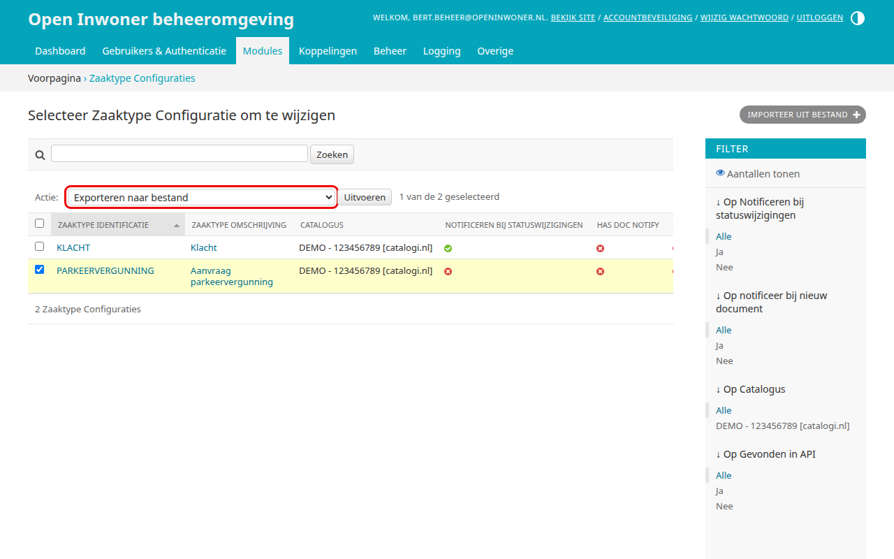

U kunt het aldus opgeslagen bestand vervolgens op een andere installatie importeren via de knop [Importeer uit bestand] rechtsboven in het overzicht. Op de pagina "Importeer ZGW gegevens vanuit een bestand" kiest u het bestand en klikt u op [Upload bestand].

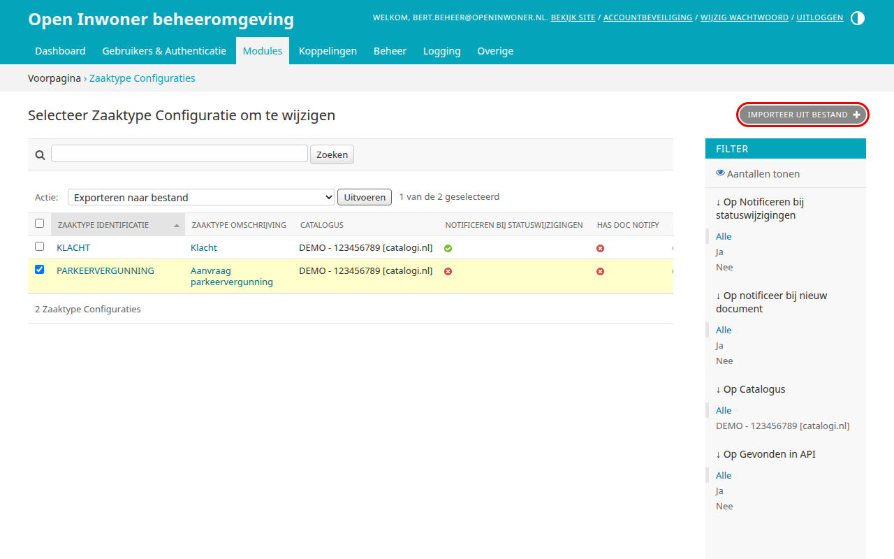

.. note::
   Zaaktype Configuraties die via deze wijze worden geëxporteerd, kunnen ook worden
   geïmporteerd via het Catalogus Configuratie scherm, en omgekeerd.
   Zie verder :ref:`CatalogusImportExport`.
