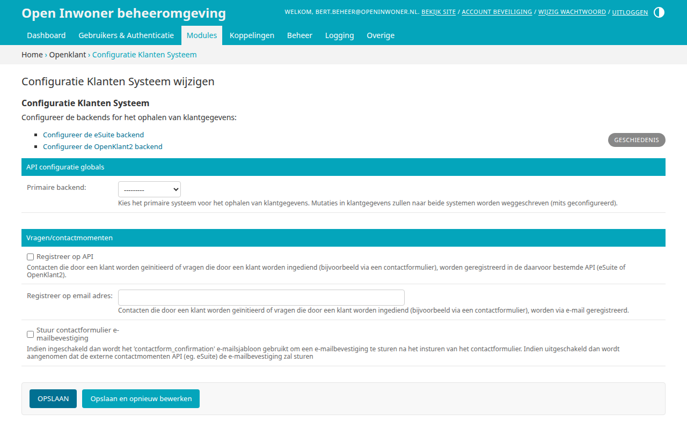
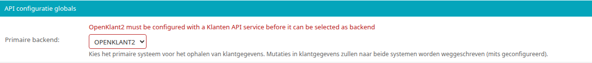
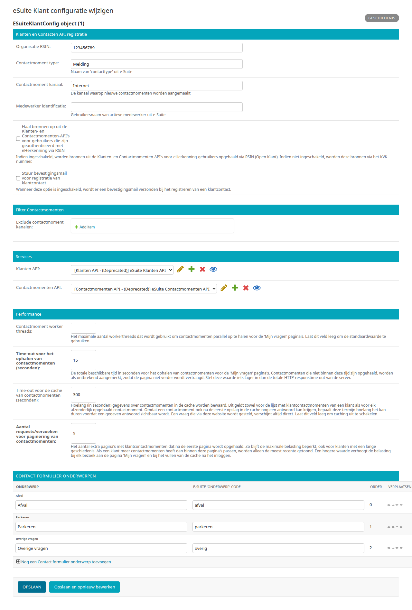
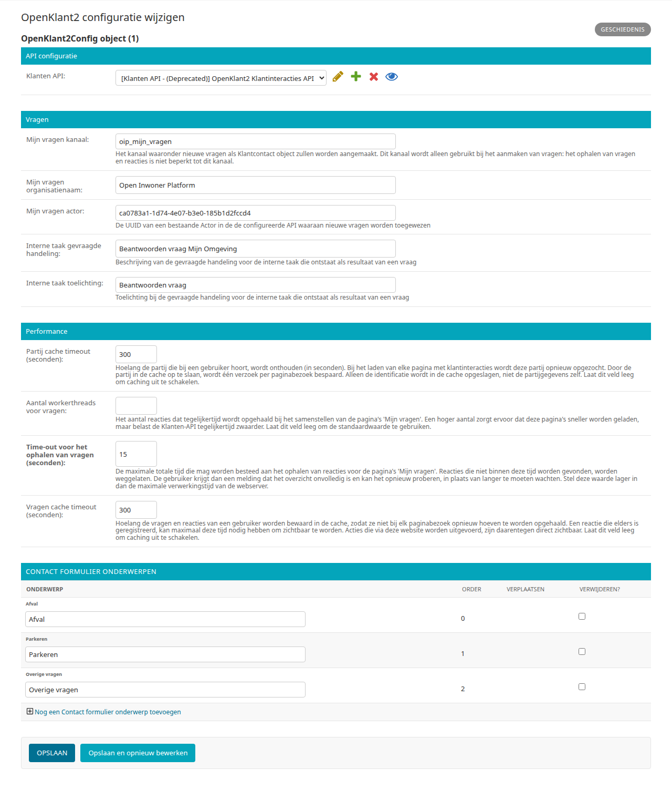
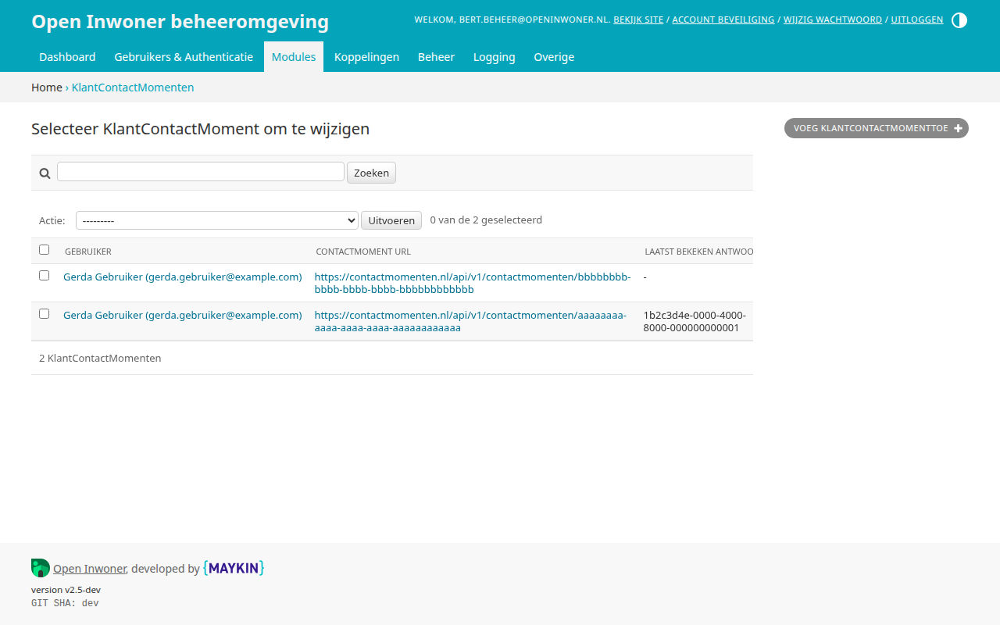

.. _hoofdstuk-9:

=================
9. Klantensysteem
=================

U vindt de onderdelen van dit hoofdstuk in het menu onder **Modules > Klantensysteem**.

.. _configuratie-klanten-systeem:

.. _hoofdstuk-9-1:

9.1. Configuratie Klanten Systeem
=================================

**Locatie in het menu:** Modules > Klantensysteem > Configuratie Klanten Systeem

Dit is de configuratie voor de koppeling van het Open Inwoner platform met een klantensysteem, zoals eSuite of OpenKlant2. U vindt deze via **Modules > Klantensysteem > Configuratie Klanten Systeem**. Indien één of beide systemen zijn geconfigureerd, worden klantgegevens (zoals e-mailadres en telefoonnummer) met deze systemen uitgewisseld. Deze systemen zijn ook noodzakelijk om gebruik te kunnen maken van het "Mijn Vragen" gedeelte van het platform.

Bovenaan het scherm staan de links "Configureer de eSuite backend" en "Configureer de OpenKlant2 backend" naar de configuratie van de twee klantensystemen (zie :ref:`hoofdstuk 9.1.1 <hoofdstuk-9-1-1>` en :ref:`9.1.2 <hoofdstuk-9-1-2>`). Configureer eerst het klantensysteem dat u gebruikt, en kies het daarna als primaire backend.

Onder **API configuratie globals**:

| **Primaire backend**
| Het klantensysteem waaruit Open Inwoner de klantgegevens leest. U kiest uit "ESUITE" en "OPENKLANT2".

.. important::

   De primaire backend bepaalt waar Open Inwoner klantgegevens **uit leest**, niet waar het ze **naartoe schrijft**.

   - **Schrijven:** wijzigt een gebruiker zijn klantgegevens, zoals het e-mailadres of telefoonnummer, dan schrijft Open Inwoner deze altijd naar **alle** geconfigureerde klantensystemen, ook naar een klantensysteem dat niet de primaire backend is.
   - **Lezen:** bij het inloggen worden de klantgegevens van de gebruiker alleen bijgewerkt vanuit de primaire backend.

   Daarnaast bepaalt de primaire backend:

   - in welk klantensysteem nieuwe vragen uit het contactformulier worden aangemaakt;
   - welke onderwerpen het contactformulier toont: bij eSuite de onderwerpen met een e-Suite onderwerpcode, bij OpenKlant2 de onderwerpen van OpenKlant2 (zie :ref:`hoofdstuk 9.1.2 <hoofdstuk-9-1-2>`). Zonder primaire backend toont het contactformulier geen onderwerpen.

   "Mijn Vragen" toont de vragen uit alle geconfigureerde klantensystemen, zodat bijvoorbeeld na een overstap naar OpenKlant2 ook de eerdere vragen uit eSuite zichtbaar blijven.

U kunt alleen een klantensysteem kiezen dat is geconfigureerd: voor eSuite moeten de Klanten API en de Contactmomenten API zijn ingesteld, voor OpenKlant2 de Klanten API. Is dat niet het geval, dan wordt de configuratie niet opgeslagen en ziet u een (Engelse) foutmelding, bijvoorbeeld "OpenKlant2 must be configured with a Klanten API service before it can be selected as backend".

Onder **Vragen/contactmomenten** stelt u in wat er gebeurt met de vragen die gebruikers via het contactformulier stellen. Het contactformulier is beschikbaar zodra hier een e-mailadres is ingevuld of de primaire backend is geconfigureerd.

| **Registreer op API**
| Wanneer hier een vinkje staat, worden vragen die via het contactformulier worden gesteld geregistreerd in het klantensysteem van de primaire backend.

| **Registreer op email adres**
| Vult u hier een e-mailadres in, dan worden vragen die via het contactformulier worden gesteld naar dit e-mailadres gestuurd. Dit kan naast of in plaats van de registratie in het klantensysteem.

| **Stuur contactformulier e-mailbevestiging**
| Wanneer hier een vinkje staat, stuurt Open Inwoner de gebruiker een bevestiging met het e-mailsjabloon "contactform_confirmation" nadat een vraag in het klantensysteem is geregistreerd. Zonder vinkje wordt aangenomen dat het klantensysteem zelf de bevestiging stuurt. Wordt een vraag alleen per e-mail geregistreerd, dan stuurt Open Inwoner altijd een bevestiging.

.. _hoofdstuk-9-1-1:

9.1.1. eSuite
-------------

Wanneer u binnen de Configuratie Klanten Systeem klikt op de link "Configureer de eSuite backend", opent het scherm met de configuratie van de eSuite. De velden **Exclude contactmoment kanalen** en **Contactmoment worker threads** worden (nog) in het Engels getoond.

Onder **Klanten en Contacten API registratie** stelt u in hoe vragen als contactmoment in de eSuite worden geregistreerd:

| **Organisatie RSIN**
| Het RSIN van de organisatie (de gemeente).

| **Contactmoment type**
| De naam van het "contacttype" uit de eSuite waarmee het contactmoment wordt geregistreerd.

| **Contactmoment kanaal**
| Het kanaal waarlangs de contactmomenten worden aangemaakt, de manier waarop contact is gezocht.

| **Medewerker identificatie**
| De gebruikersnaam van een medewerker van de gemeente in de eSuite. Blijft dit veld leeg, dan wordt het contactmoment op basis van het onderwerp bij de juiste afdeling afgeleverd.

| **Haal bronnen op uit de Klanten- en Contactmomenten-API's voor gebruikers die zijn geauthenticeerd met eHerkenning via RSIN**
| Indien dit is ingeschakeld, worden bronnen uit de Klanten- en Contactmomenten-API's voor eHerkenning-gebruikers opgehaald via het RSIN van het bedrijf (Open Klant). Indien dit niet is ingeschakeld, worden deze bronnen via het KvK-nummer opgehaald.

| **Stuur bevestigingsmail voor registratie van klantcontact**
| Indien dit is ingeschakeld, vraagt Open Inwoner de eSuite om een bevestigingsmail te sturen wanneer een vraag als klantcontact wordt geregistreerd. Of Open Inwoner zelf een bevestiging stuurt, stelt u in :ref:`hoofdstuk 9.1 <hoofdstuk-9-1>` in.

Onder **Filter Contactmomenten**:

| **Exclude contactmoment kanalen**
| De kanalen van de eSuite waarvan de contactmomenten niet aan gebruikers worden getoond, één per regel. Dit is met name nuttig voor kanalen die enkel voor intern gebruik bestemd zijn.

Onder **Services** kiest u de **Klanten API** en de **Contactmomenten API** van de eSuite, uit de services die zijn aangemaakt via **Koppelingen > Services** (zie :ref:`hoofdstuk 16.3 <hoofdstuk-16-3>`). Beide zijn nodig om de eSuite als primaire backend te kunnen kiezen.

Onder **Performance** stelt u in hoe de contactmomenten voor de pagina's van "Mijn Vragen" worden opgehaald. De standaardinstellingen volstaan in de meeste gevallen.

| **Contactmoment worker threads**
| Het maximale aantal contactmomenten dat tegelijk wordt opgehaald. Laat dit veld leeg om de standaardwaarde te gebruiken.

| **Time-out voor het ophalen van contactmomenten (seconden)**
| De totale tijd in seconden die het ophalen van de contactmomenten mag duren. Standaard is dit 15 seconden. Contactmomenten die niet op tijd zijn opgehaald, worden als ontbrekend gemeld in plaats van dat de pagina langer laadt. Stel dit iets lager in dan de maximale tijd die de server krijgt om een pagina te tonen.

| **Time-out voor de cache van contactmomenten (seconden)**
| Hoe lang (in seconden) de contactmomenten van een klant worden bewaard, zodat ze niet bij elke pagina opnieuw worden opgehaald. Standaard is dit 300 seconden (5 minuten). Een antwoord op een vraag kan er zo lang over doen om zichtbaar te worden; een vraag die via de website wordt gesteld, is altijd direct zichtbaar. Laat het veld leeg om dit uit te schakelen.

| **Aantal requests/verzoeken voor paginering van contactmomenten**
| Hoeveel extra pagina's met klantcontactmomenten na de eerste worden opgehaald. Standaard is dit 5. Een klant met meer klantcontactmomenten dan in deze pagina's passen, ziet alleen de meest recente. Een hogere waarde maakt elke pagina van "Mijn Vragen" en het vullen van de cache bij het inloggen zwaarder.

Contactformulier onderwerpen
~~~~~~~~~~~~~~~~~~~~~~~~~~~~

Onder "Contact formulier onderwerpen" stelt u de onderwerpen in waaruit de gebruiker in het contactformulier kiest (zie :ref:`hoofdstuk 19.2.10 <hoofdstuk-19-2-10>`). Geef elk onderwerp een **E-Suite 'onderwerp' code**: een contactmoment met deze onderwerpcode komt automatisch bij de juiste afdeling terecht, en met de eSuite als primaire backend toont het contactformulier alleen de onderwerpen met een code. Met de pijlen in de kolom **Verplaatsen** wijzigt u de volgorde van de onderwerpen. U verwijdert een onderwerp door een vinkje te zetten bij **Verwijderen?**. Om nog een onderwerp toe te voegen klikt u op :guilabel:`Nog een Contact formulier onderwerp toevoegen`. Als alles naar wens is geconfigureerd klikt u op :guilabel:`Opslaan`.

.. _hoofdstuk-9-1-2:

9.1.2. OpenKlant2
-----------------

Wanneer u binnen de Configuratie Klanten Systeem klikt op de link "Configureer de OpenKlant2 backend", opent het scherm met de configuratie van OpenKlant2.

API Configuratie
~~~~~~~~~~~~~~~~

Onder **API configuratie** kiest u bij **Klanten API** de service met de technische configuratie voor het communiceren met OpenKlant2 (de Klantinteracties API). Deze is nodig om OpenKlant2 als primaire backend te kunnen kiezen.

Het API-token van OpenKlant2 stelt u als volgt in op de Service:

* **Authorisatietype**: API sleutel
* **Header sleutel**: ``Authorization``
* **Header waarde**: ``Token <uw token>``

Vul het token dus niet in bij het veld *Secret*; dat veld wordt voor deze koppeling niet gebruikt. Bestaande Services waarbij het token nog in *Secret* stond, zijn bij de update automatisch omgezet. De op de Service ingestelde time-out wordt ook toegepast op verzoeken aan OpenKlant2.

Vragen
~~~~~~

De instellingen onder **Vragen** zijn noodzakelijk voor de integratie met OpenKlant2 in het "Mijn Vragen" gedeelte van de website.

| **Mijn vragen kanaal**
| Het kanaal waaronder nieuwe vragen als klantcontact worden aangemaakt. Dit kanaal wordt alleen gebruikt bij het aanmaken van vragen: het ophalen van vragen en reacties is niet beperkt tot dit kanaal.

| **Mijn vragen organisatienaam**
| De naam van de organisatie die bij nieuwe vragen wordt vastgelegd.

| **Mijn vragen actor**
| De UUID van een bestaande Actor in OpenKlant2. Nieuwe vragen worden als interne taak aan deze Actor toegewezen voor afhandeling.

| **Interne taak gevraagde handeling**
| De beschrijving van de gevraagde handeling van de interne taak die voor een vraag wordt aangemaakt.

| **Interne taak toelichting**
| De toelichting bij de gevraagde handeling van de interne taak.

Performance
~~~~~~~~~~~

Onder **Performance** stelt u in hoe de vragen voor de pagina's van "Mijn Vragen" worden opgehaald. De standaardinstellingen volstaan in de meeste gevallen.

| **Partij cache timeout (seconden)**
| Hoe lang (in seconden) wordt onthouden welke partij bij een gebruiker hoort. Elke pagina van "Mijn Vragen" begint hiermee; alleen de identificatie wordt bewaard, niet de gegevens van de partij. Standaard is dit 300 seconden (5 minuten). Laat het veld leeg om dit uit te schakelen.

| **Aantal workerthreads voor vragen**
| Hoeveel reacties tegelijk worden opgehaald. Een hoger aantal maakt de pagina's sneller, maar belast de Klanten API meer. Laat dit veld leeg om de standaardwaarde te gebruiken.

| **Time-out voor het ophalen van vragen (seconden)**
| Hoe lang het ophalen van de reacties in totaal mag duren. Standaard is dit 15 seconden. Wat niet op tijd is gevonden, wordt weggelaten: de gebruiker krijgt dan een melding dat het overzicht niet compleet is en kan het opnieuw proberen. Stel dit lager in dan de maximale tijd die de server krijgt om een pagina te tonen.

| **Vragen cache timeout (seconden)**
| Hoe lang (in seconden) de vragen en reacties van een gebruiker worden bewaard. Standaard is dit 300 seconden (5 minuten). Een reactie die elders is geregistreerd, kan er zo lang over doen om zichtbaar te worden; wat via de website gebeurt, is altijd direct zichtbaar. Laat het veld leeg om dit uit te schakelen.

Contactformulier onderwerpen
~~~~~~~~~~~~~~~~~~~~~~~~~~~~

Onder "Contact formulier onderwerpen" stelt u de onderwerpen in waaruit de gebruiker in het contactformulier kiest wanneer OpenKlant2 de primaire backend is. Deze onderwerpen hebben geen e-Suite onderwerpcode. Met de pijlen in de kolom **Verplaatsen** wijzigt u de volgorde, met een vinkje bij **Verwijderen?** verwijdert u een onderwerp en met :guilabel:`Nog een Contact formulier onderwerp toevoegen` voegt u een onderwerp toe. Als alles naar wens is geconfigureerd klikt u op :guilabel:`Opslaan`.

9.2. KlantContactMomenten
=========================

**Locatie in het menu:** Modules > Klantensysteem > KlantContactMomenten

Bij **Modules > Klantensysteem > KlantContactMomenten** vindt u per vraag van een gebruiker welk antwoord de gebruiker het laatst heeft gezien. Het overzicht toont de **Gebruiker** die de vraag heeft gesteld, de **Contactmoment URL** van de vraag in het klantensysteem en bij **Laatst bekeken antwoord** de UUID van het laatste antwoord dat de gebruiker heeft bekeken. Dit veld is leeg zolang de gebruiker geen vraag met een antwoord heeft geopend. Omdat een vraag in de loop van de tijd meerdere antwoorden kan krijgen, wordt een later antwoord zo weer als nieuw getoond. U kunt zoeken op de naam en het e-mailadres van de gebruiker en op de URL van het contactmoment.

