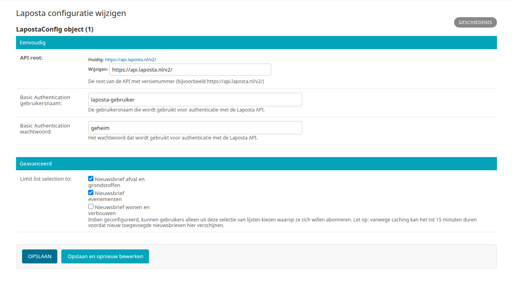
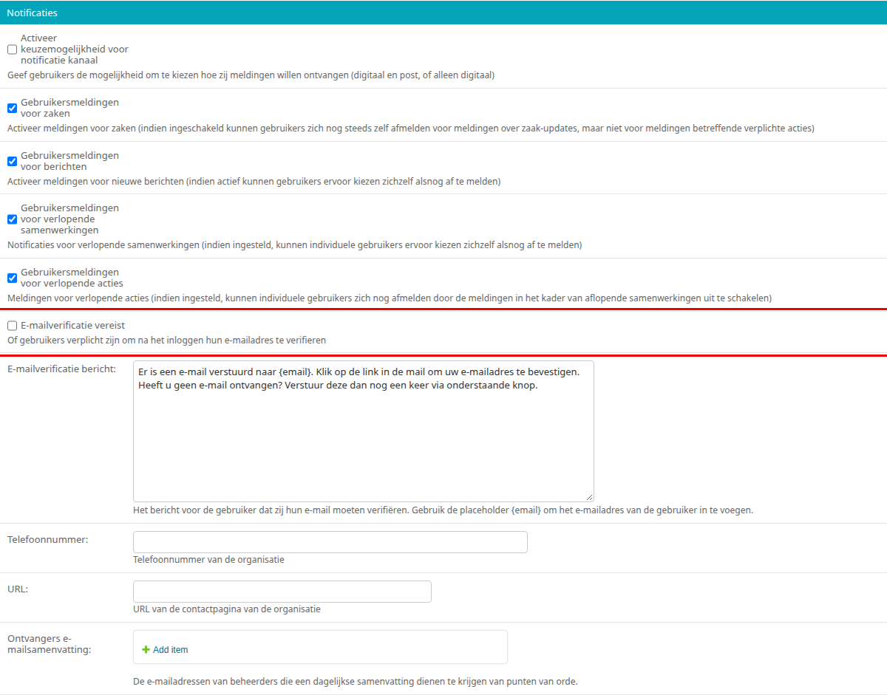

.. _hoofdstuk-10:

==================
10. Mailinglijsten
==================

U vindt de onderdelen van dit hoofdstuk in het menu onder **Modules > Mailinglijsten**.

10.1. Laposta configuratie
==========================

**Locatie in het menu:** Modules > Mailinglijsten > Laposta configuratie

Laposta is de API voor nieuwsbriefintegratie. U vindt de configuratie via **Modules > Mailinglijsten > Laposta configuratie**. Onder "Eenvoudig" vult u de **API root** (de URL van de Laposta API met versienummer, bijvoorbeeld ``https://api.laposta.nl/v2/``), de **Basic Authentication gebruikersnaam** en het **Basic Authentication wachtwoord** in.

Onder "Geavanceerd" staan bij **Limit list selection to** (nog niet vertaald) de nieuwsbrieven die in Laposta bestaan. Zet een vinkje bij de nieuwsbrieven waarvoor gebruikers zich mogen inschrijven en klik op :guilabel:`Opslaan`. Zet u nergens een vinkje, dan kunnen gebruikers uit alle nieuwsbrieven kiezen. De lijst met nieuwsbrieven wordt tijdelijk bewaard: een nieuwe nieuwsbrief in Laposta kan er tot 15 minuten over doen om hier te verschijnen.

Op de website krijgen gebruikers in Mijn Profiel de mogelijkheid zich in te schrijven voor deze nieuwsbrieven. Gebruikers kunnen zich te allen tijde aan- en afmelden en hun voorkeuren wijzigen.

.. _hoofdstuk-10-1-1:

10.1.1. E-mailverificatie vereist
---------------------------------

De nieuwsbrieven worden alleen getoond aan gebruikers die hun e-mailadres hebben bevestigd. Zet daarom in de Algemene configuratie (**Beheer > Configuratie > Algemene configuratie**) onder "Notificaties" een vinkje bij **E-mailverificatie vereist**. Gebruikers die hun e-mailadres nog niet hebben bevestigd, worden dan na het inloggen gevraagd dit te doen: zij krijgen een e-mail met een link waarmee zij hun e-mailadres bevestigen. Dit geldt zodra de pagina Mijn profiel is gepubliceerd. Het veld **E-mailverificatie bericht** is dan verplicht: dit is de tekst die de gebruiker ziet nadat de e-mail is verstuurd.

