.. _cms:

=======
11. CMS
=======

**Locatie in het menu:** Beheer > CMS > Pagina inhoudelijk

Met het CMS (Django CMS 5) beheert u de pagina's van Open Inwoner: de menustructuur, de inhoud van de pagina's en de koppeling van pagina's aan de onderdelen van Open Inwoner (zoals Mijn Zaken of Mijn Profiel). Middels het CMS kunt u eenvoudig pagina's aanmaken, publiceren, verplaatsen en uit het menu halen. Tevens kunt u als beheerder via het CMS wijzigingen aan de voorkant van Open Inwoner doorvoeren zonder dat u hiervoor in de backend naar de configuratie hoeft te gaan.

Alle wijzigingen aan pagina's verlopen via versiebeheer: een wijziging is pas zichtbaar voor bezoekers nadat u deze heeft gepubliceerd. Zie hoofdstuk 11.1.11.

11.1. Pagina's
==============
U opent het paginaoverzicht via het menu Beheer > CMS > Pagina inhoudelijk, in het screenshot rood omkaderd. Hier ziet u de boomstructuur van het menu van Open Inwoner.

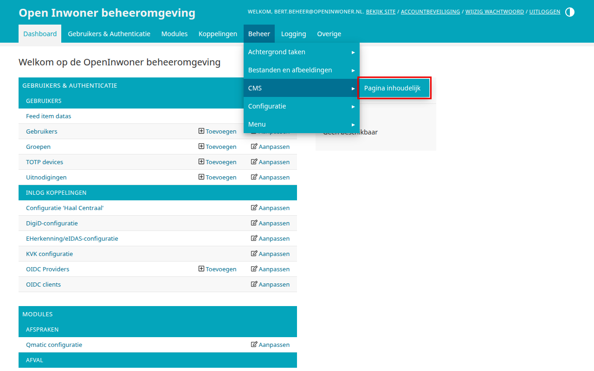

U kunt hier eenvoudig allerlei wijzigingen aanbrengen aan dit menu. Zo kunt u de volgorde van de menu items veranderen, de items aan applicaties koppelen, de status van een pagina wijzigen, items toevoegen of verwijderen, items (tijdelijk) uit het menu halen, kopiëren en pagina's wijzigen.

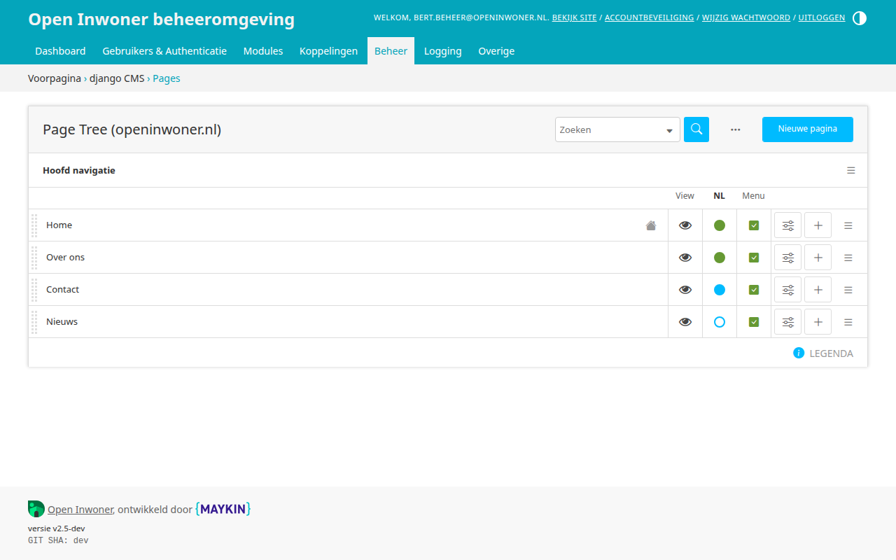

Rechtsonder in het overzicht vindt u de knop [Legenda], met een uitleg van alle icoontjes en gekleurde bolletjes in de boomstructuur.

11.1.1. Menu items verslepen
----------------------------

Door de titel van een menu item aan te klikken en de muisknop ingedrukt te houden kunt u de plek in het menu (de boomstructuur) wijzigen. Dit kunt u doen middels drag-and-drop. Wanneer u een item versleept krijgt u een blauwe pop-up met het betreffende item en wordt er met een blauwe lijn weergegeven waar het item wordt geplaatst als u het loslaat.

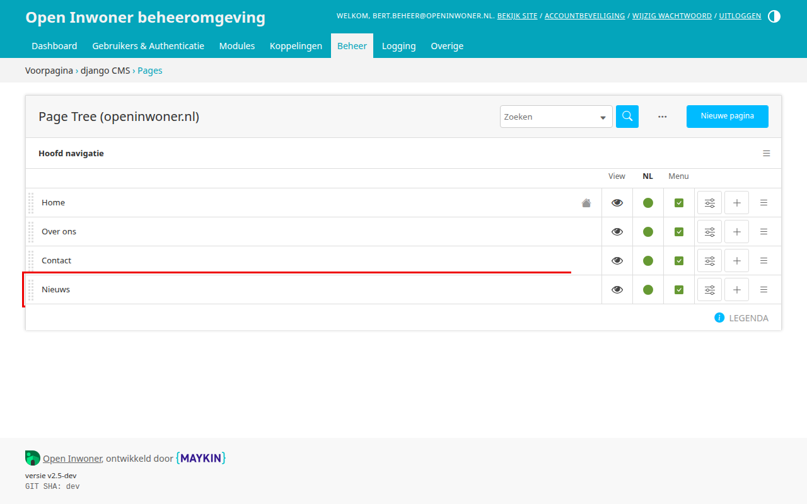

11.1.2. Een pagina als startpagina instellen
--------------------------------------------

De startpagina (de homepage) is aangegeven met het icoontje van het lichtgrijze huisje. De eerste pagina die u aanmaakt wordt automatisch de startpagina.

Wanneer u een andere pagina als startpagina wilt instellen, dan selecteert u in het actiemenu (de drie puntjes) achter de betreffende pagina [Instellen als startpagina]. Deze optie is alleen beschikbaar voor pagina's op het hoogste niveau. Wanneer u dit heeft gedaan komt het icoontje van het huisje achter de geselecteerde pagina te staan. Zie hoofdstuk 11.7 voor het inrichten van de homepage.

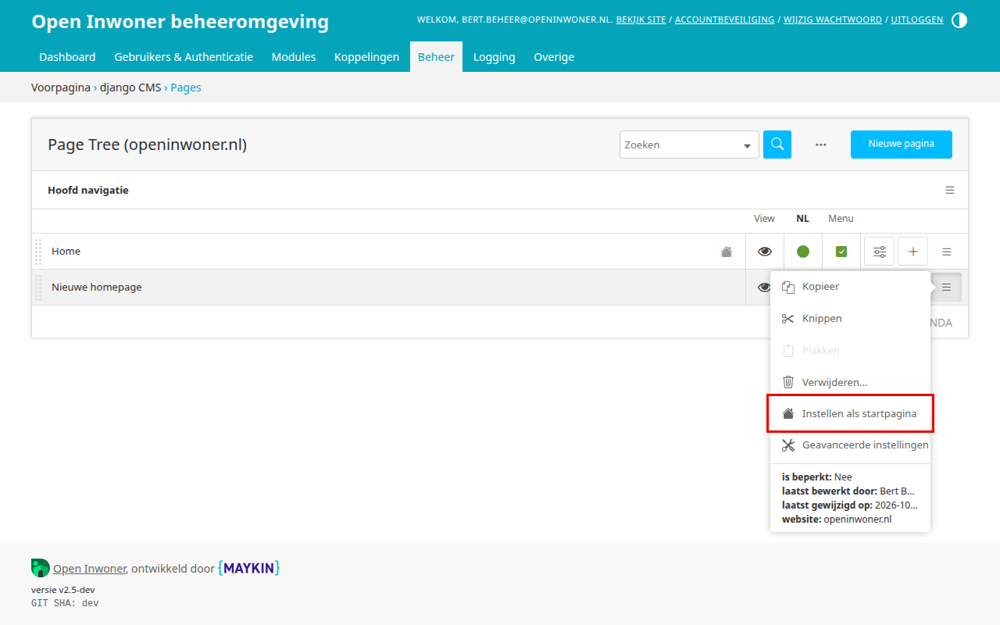

11.1.3. Gekoppelde applicatie wijzigen
--------------------------------------

Pagina's die aan een applicatie gekoppeld zijn (zie hoofdstuk 11.4) hebben een grijs icoontje met puzzelstukjes achter de titel.

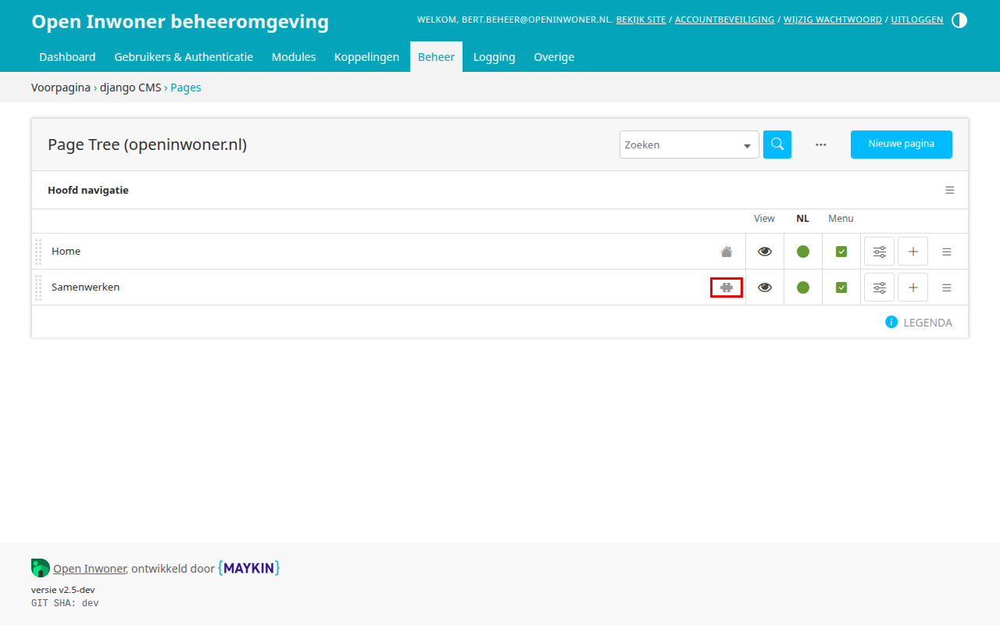

Wanneer u met de muis over dit icoontje gaat, ziet u welke applicatie gekoppeld is. Door op het icoontje te klikken komt u in het scherm met geavanceerde instellingen, waar bij "Applicatie" de gekoppelde applicatie kan worden aangepast. Zie het rode kader in het onderstaande screenshot. Klik na het wijzigen op [Opslaan] om de wijzigingen door te voeren.

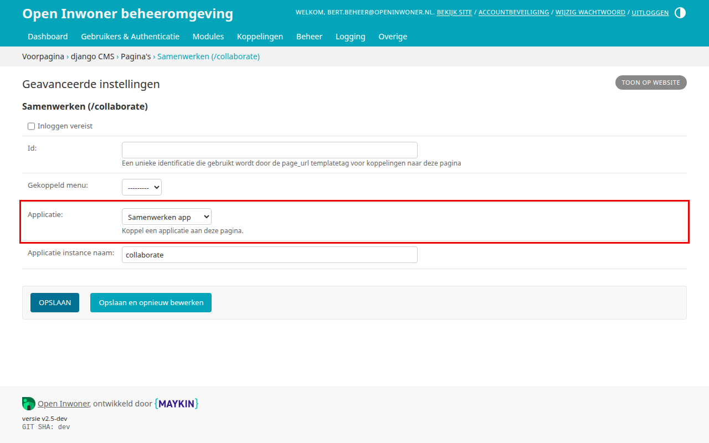

11.1.4. Status wijzigen
-----------------------

In de kolom 'NL' ziet u per pagina een gekleurd bolletje. De kleur van het bolletje geeft de status van de pagina aan (zie ook hoofdstuk 11.1.11 over versiebeheer):

- **Groen** — Gepubliceerd: de pagina is gepubliceerd en zichtbaar voor bezoekers.
- **Blauw (knipperend)** — Aangepast: de pagina is gepubliceerd, en er is daarnaast een conceptversie met nog niet gepubliceerde wijzigingen.
- **Wit met blauwe rand** — Concept: de pagina is nog nooit gepubliceerd. Dit is de status van een nieuwe pagina.
- **Grijs** — Ongepubliceerd: de publicatie van de pagina is ongedaan gemaakt. De pagina is niet bereikbaar voor bezoekers.
- **Lichtgrijs** — Gearchiveerd: de pagina heeft alleen gearchiveerde versies.

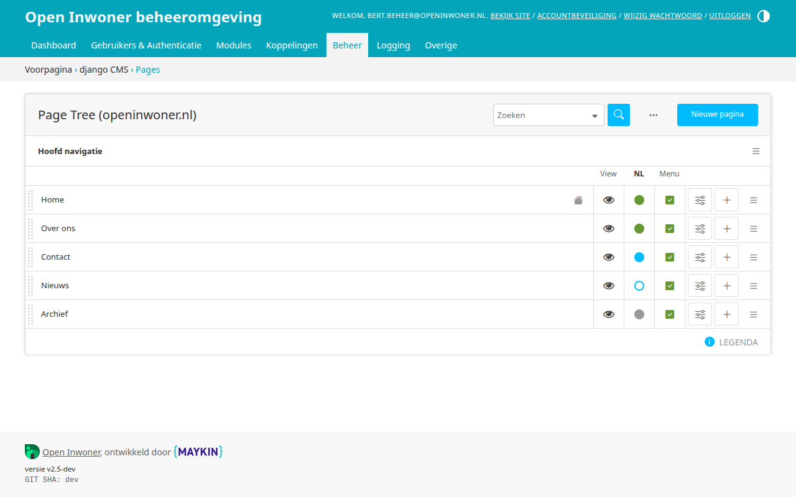

Wanneer u op een bolletje klikt verschijnt er een menu met de acties die bij de huidige status horen:

- [Publiceer] — publiceer de conceptversie.
- [Maakt een nieuw concept] — maak een nieuwe conceptversie van een gepubliceerde pagina, om deze te kunnen bewerken.
- [Gedepubliceerd] — maak de publicatie van de pagina ongedaan. De pagina is daarna niet meer bereikbaar voor bezoekers.
- [Gedepubliceerde terugdraaien] — zet een ongepubliceerde versie terug als nieuwe conceptversie.
- [Verwijder concept] of [Annuleer wijzigingen] — gooi de conceptversie weg.
- [Vergelijk Concept met Gepubliceerde...] — bekijk de verschillen tussen de conceptversie en de gepubliceerde versie.
- [Beheer versies...] — open de versiegeschiedenis van de pagina, zie hoofdstuk 11.1.11.

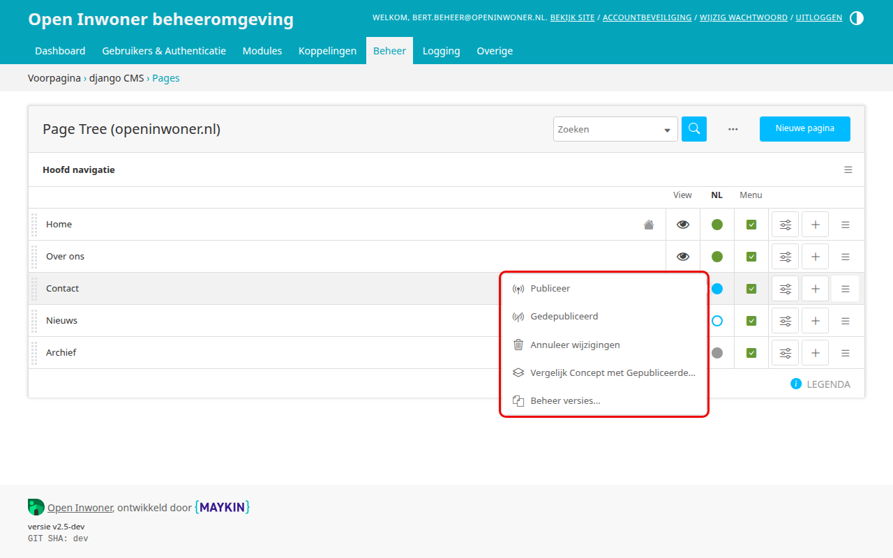

11.1.5. Items toevoegen
-----------------------

Wanneer u nieuwe pagina's wilt toevoegen klikt u op de blauwe button met [Nieuwe pagina]. U maakt dan een nieuwe pagina op hoofdniveau aan. U komt in een nieuw scherm waarin u de gegevens van de nieuwe pagina moet invullen (Titel, Slug, Menu-titel, Pagina-titel en Meta tag omschrijving). Wanneer alle gegevens zijn ingevuld klikt u op [Opslaan]. U keert hierna terug naar het paginaoverzicht. Wilt u een nieuwe subpagina aanmaken? Dan klikt u op [+] achter de betreffende hoofdpagina. U komt vervolgens op een nieuw scherm waarin u de gegevens van de nieuwe subpagina moet invullen. Dit zijn dezelfde gegevens als bij een nieuwe hoofdpagina. Wanneer alle gegevens zijn ingevuld klikt u op [Opslaan].

Let op! De zojuist aangemaakte pagina is nog niet gepubliceerd (wit bolletje met blauwe rand). U dient de pagina eerst te publiceren (zie hoofdstuk 11.1.4).

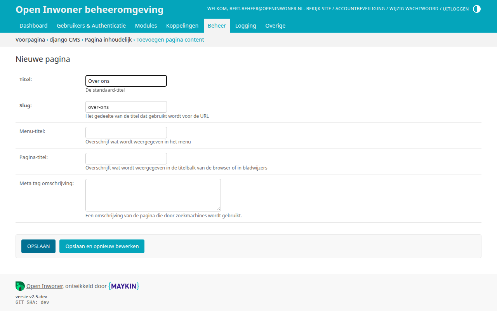

Wanneer u na het aanmaken van de pagina de plek in de boomstructuur wilt veranderen, kunt u de pagina volgens de in hoofdstuk 11.1.1 beschreven methode een gewenste plek geven.

11.1.6. Preview van een pagina bekijken
---------------------------------------

Om een voorbeeld van een pagina te bekijken en te zien hoe het er in de frontend uitziet, klikt u op het oogje achter de betreffende pagina. In hetzelfde venster opent de website op de aangeklikte pagina. U ziet daarbij de nieuwste versie van de pagina, ook als dat een nog niet gepubliceerde conceptversie is. Wilt u dit in een ander tabblad of ander venster, gebruik dan uw rechter muisknop en klik op [open link in nieuw venster] of [open link in nieuw tabblad].

In het nieuw geopende scherm ziet u tevens bovenin beeld een balk met frontend navigatie voor het CMS. Op deze manier kunt u via de voorkant van de website/pagina dingen aanpassen zonder dat u eerst weer terug hoeft te gaan naar de beheeromgeving. Zie meer hierover in hoofdstuk 11.2.

11.1.7. Items kopiëren en verplaatsen
-------------------------------------

Wanneer u een pagina wilt dupliceren klikt u in het actiemenu (de drie puntjes) achter de betreffende pagina op [Kopieer]. Met [Knippen] verplaatst u de pagina in plaats van deze te kopiëren. Wanneer niets gekopieerd of geknipt is, is de knop [Plakken] grijs. Wanneer u echter een pagina gekopieerd of geknipt heeft krijgt u wel de mogelijkheid te plakken. De pagina wordt geplakt op de geselecteerde locatie, maar kan vervolgens eenvoudig op de bij hoofdstuk 11.1.1 beschreven methode worden versleept.

Let op! Een pagina die aan een applicatie gekoppeld is (zie hoofdstuk 11.1.3) kan niet worden gekopieerd. Een applicatie kan maar aan één pagina gekoppeld zijn.

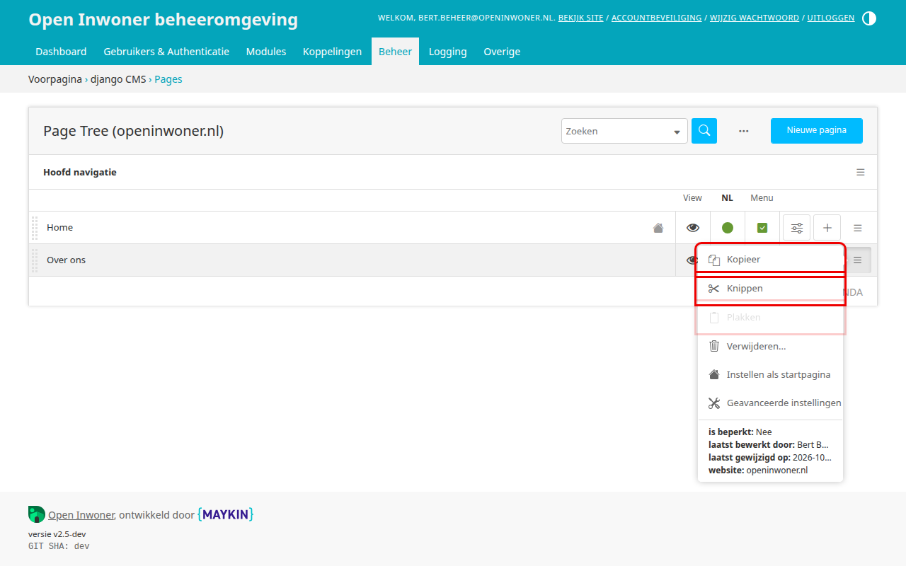

11.1.8. Items (tijdelijk) uit het menu halen
--------------------------------------------

Wanneer u een (sub)pagina al dan niet tijdelijk uit het menu wilt halen, klikt u onder de kolom 'Menu' op het groene vinkje. Wanneer u het vinkje hier weghaalt haalt u de pagina uit het menu. Er komt dan een grijs vierkantje met een streep in de kolom te staan. Wilt u de pagina weer toevoegen aan het menu? Dan klikt u dit vierkantje weer aan en komt er weer een groen vinkje te staan.

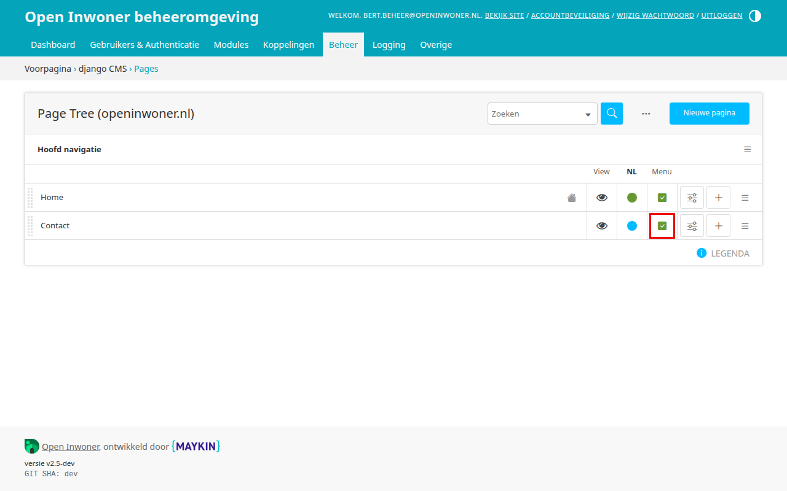

Het vinkje hoort bij de conceptversie van de pagina. Bij een gepubliceerde pagina zonder conceptversie krijgt u de melding "Versie is niet een concept": maak dan eerst een nieuw concept aan (zie hoofdstuk 11.1.4). Bezoekers zien de wijziging pas nadat u het concept heeft gepubliceerd.

Let op! U verwijdert door het vinkje weg te klikken niet de volledige pagina en u maakt ook de publicatie niet ongedaan. De betreffende pagina is alleen niet meer via het menu te raadplegen. Dit betekent dat mensen door middel van een directe link nog altijd de pagina kunnen bereiken.

11.1.9. Pagina's wijzigen
-------------------------

U kunt de instellingen van een pagina wijzigen door in het overzicht op het potloodje te klikken achter de betreffende pagina, zoals middels het rode kader is weergegeven. Houdt u daarbij de SHIFT-toets ingedrukt, dan komt u direct bij de geavanceerde instellingen.

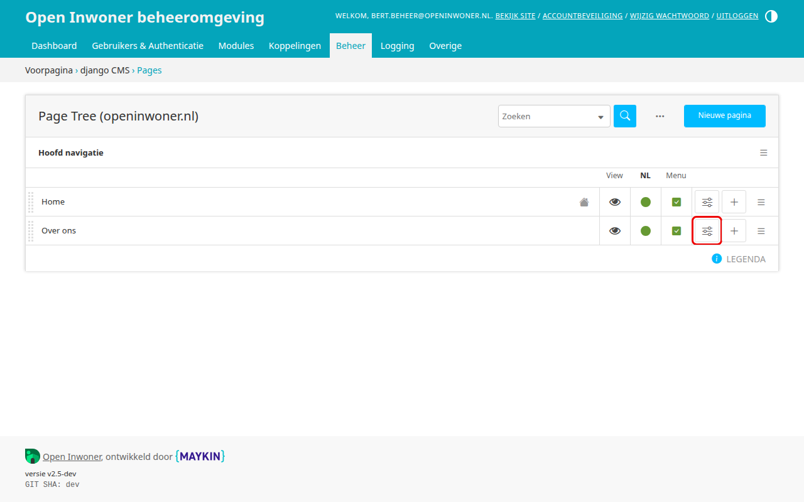

Pagina instellingen
~~~~~~~~~~~~~~~~~~~

Wanneer u op het potlood-icoontje klikt komt u op het scherm met de pagina instellingen:

| **Titel**, **Slug**, **Pagina-titel** en **Meta tag omschrijving**
| De titel van de pagina, het laatste deel van de URL, de titel in de tabbladen van de browser en de omschrijving voor zoekmachines.

| **Sjabloon**
| Het sjabloon voor de indeling en opmaak van de pagina, zie hoofdstuk 11.2.1 (Sjablonen).

| **URL opties**
| Onder het uitklapblok 'URL opties' vindt u **Overschrijf URL** (vul hier een andere URL in als u voor de pagina een andere URL wilt gebruiken) en **Doorsturen** (vul hier een URL in waarnaar de pagina moet worden doorgestuurd, of kies een pagina).

| **Menu opties**
| Onder het uitklapblok 'Menu opties' vindt u:

- **Schijn-oorsprong**: maakt het mogelijk de navigatie-hiërarchie in te korten. Door dit vakje aan te klikken lijkt het in de navigatie alsof de pagina een hoofdpagina is in plaats van een subpagina.
- **Menu-titel**: de titel van de pagina in het menu, als deze moet afwijken van de titel van de pagina.
- **Menu zichtbaarheid**: of de pagina in het menu wordt getoond, zie ook hoofdstuk 11.1.8.

| **Headers**
| Onder het uitklapblok 'Headers' vindt u **X Frame Opties**. Hier kunt u aangeven of de pagina kan worden ingevoegd in andere pagina's of websites:

- Van bovenliggende pagina erven: Instellingen overnemen van de bovenliggende pagina
- Ontzeggen: De pagina kan NIET worden ingevoegd in andere pagina's of websites
- Alleen deze website: De pagina kan enkel worden ingevoegd in deze website
- Toestaan: De pagina kan worden ingevoegd in andere pagina's of websites

Let op! Zodra een pagina gepubliceerd is, kunnen de slug en Overschrijf URL niet meer worden gewijzigd. Deze velden worden dan alleen ter informatie getoond. Wilt u de URL van een gepubliceerde pagina toch wijzigen, maak dan eerst de publicatie ongedaan (zie hoofdstuk 11.1.4).

Geavanceerde instellingen
~~~~~~~~~~~~~~~~~~~~~~~~~
U komt bij de geavanceerde instellingen door in het actiemenu (de drie puntjes) achter de betreffende pagina op [Geavanceerde instellingen] te klikken, of door het potloodje met SHIFT ingedrukt aan te klikken. Na het wijzigen klikt u op [Opslaan].

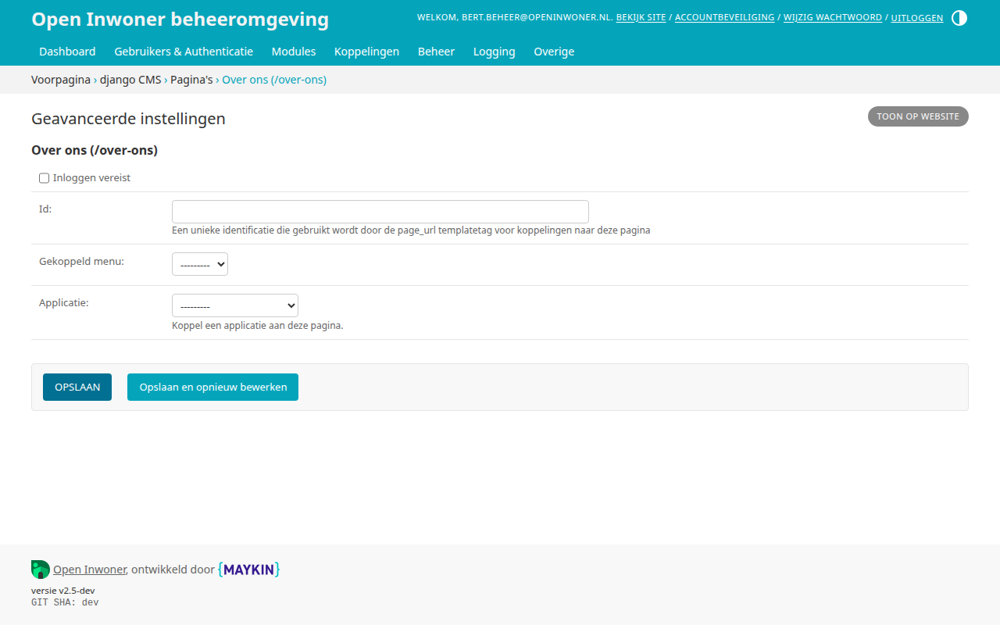

| **Inloggen vereist**
| Standaardinstelling van Django CMS om een pagina alleen voor ingelogde gebruikers toegankelijk te maken. Gebruik in Open Inwoner bij voorkeur de instellingen onder Pagina opties (zie hoofdstuk 11.5), zoals "Inloggen is verplicht" en "Vereist DigiD/eHerkenning authenticatie".

| **Id**
| Vul hier de pagina-ID in. Dit is een unieke identificatie die gebruikt wordt door de page_url templatetag voor koppelingen naar deze pagina.

| **Gekoppeld menu**
| Hier kiest u aan welk menu de pagina moet worden gekoppeld.

| **Applicatie**
| Hiermee kunt u een applicatie aan de betreffende pagina koppelen, zie hoofdstuk 11.4. Afhankelijk van de applicatie verschijnen daaronder ook de velden **Applicatie instance naam** en **Applicatieconfiguraties**.

11.1.10. Pagina's verwijderen
-----------------------------
Om een pagina helemaal te verwijderen klikt u op het actiemenu (de drie puntjes) achter de betreffende pagina. Er verschijnt nu een pop-up met diverse opties, waaronder [Verwijderen...].

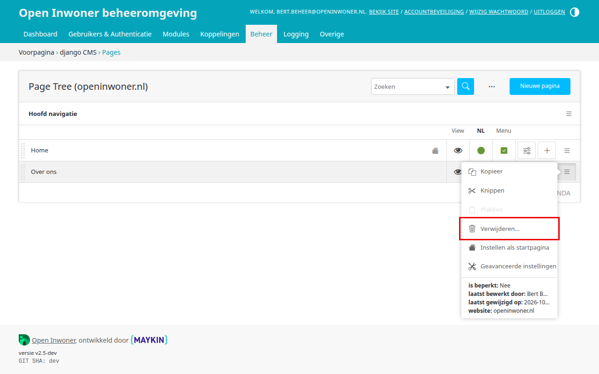

U komt dan op een scherm met een overzicht van wat er verwijderd wordt. Wanneer u hier op [Ja, ik weet het zeker] klikt verwijdert u de gehele pagina, inclusief alle versies en subpagina's. U haalt hiermee dus alles weg en verwijdert niet enkel de pagina uit het menu. Met [Nee, teruggaan] annuleert u het verwijderen.

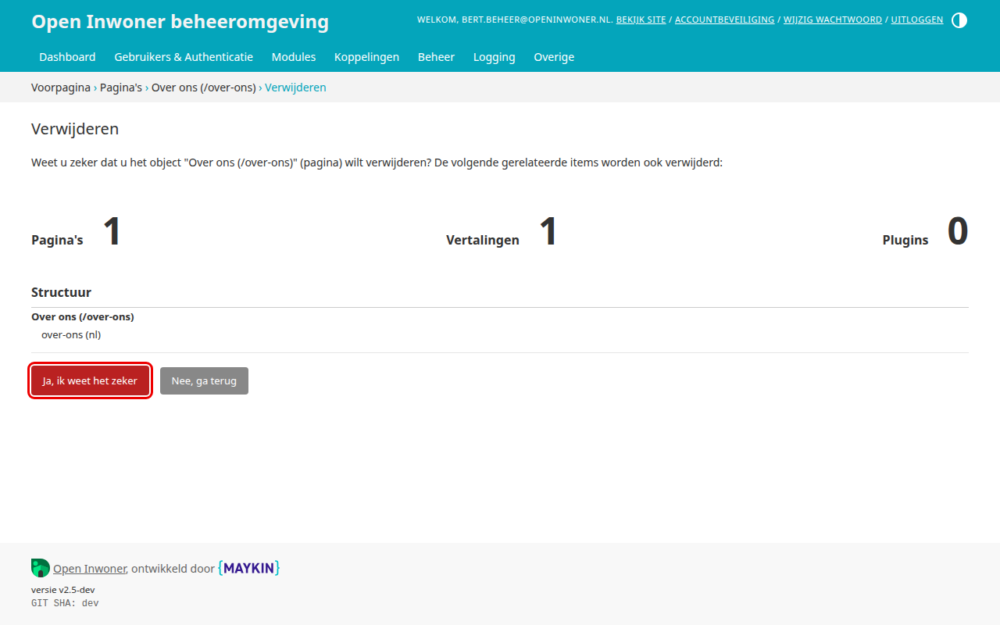

11.1.11. Versiebeheer
---------------------

Django CMS heeft een volledig versiebeheer voor pagina-inhoud (*versioning*): elke pagina heeft één of meer expliciet beheerde versies.

**Versiestatussen**

Elke versie van een pagina bevindt zich altijd in één van de volgende statussen:

- **Concept** — De versie is aangemaakt maar nog niet gepubliceerd. Alleen ingelogde redacteuren en beheerders kunnen deze versie bekijken via de preview. Er kan per pagina maar één conceptversie tegelijk zijn.
- **Gepubliceerd** — De versie is zichtbaar voor alle bezoekers van de website. Er kan op elk moment slechts één versie tegelijk gepubliceerd zijn.
- **Ongepubliceerd** — De versie was eerder gepubliceerd. Dit gebeurt automatisch wanneer een nieuwe versie wordt gepubliceerd: de vorige gepubliceerde versie wordt dan ongepubliceerd. Ook wanneer u de publicatie van een pagina ongedaan maakt, krijgt de gepubliceerde versie deze status; de pagina is dan niet meer zichtbaar voor bezoekers.
- **Gearchiveerd** — Een conceptversie die u in de versiegeschiedenis heeft gearchiveerd ([Archiveer]), zonder deze te publiceren.

**Werkwijze: bewerken en publiceren**

1. Ga naar de voorkant van de website terwijl u bent ingelogd als redacteur of beheerder.
2. Navigeer naar de pagina die u wilt bewerken.
3. Klik op [Bewerken] in de CMS-werkbalk bovenaan. Bestaat er nog geen conceptversie, dan heet deze knop [Nieuw concept] en wordt er een nieuwe conceptversie aangemaakt op basis van de huidige gepubliceerde versie.
4. Breng de gewenste wijzigingen aan.
5. Klik op [Publiceer] om de conceptversie te publiceren. De vorige gepubliceerde versie krijgt automatisch de status Ongepubliceerd.

.. note::

   Wijzigingen worden **niet** automatisch zichtbaar voor bezoekers zodra u ze opslaat. U dient altijd expliciet op [Publiceer] te klikken om een versie live te zetten.

**Versiegeschiedenis bekijken**

U opent de versiegeschiedenis van een pagina op twee manieren:

- In de backend (Beheer > CMS > Pagina inhoudelijk): klik op het gekleurde bolletje van de pagina en kies [Beheer versies...].
- Aan de voorkant van de website: klik in de CMS-werkbalk op het versiemenu (bijvoorbeeld "Versie #3 (Concept)") en kies [Beheer versies].

In de versiegeschiedenis ziet u alle versies van de pagina met hun status. Per versie kunt u, afhankelijk van de status, onder andere een [Voorbeeld] bekijken, de versie [Publiceer]en, [Archiveer]en, de publicatie ongedaan maken ([Gedepubliceerd]) of een oudere versie [Terugdraaien] als nieuwe conceptversie. Selecteer twee versies en kies de actie "Vergelijk versies" om de verschillen te bekijken.

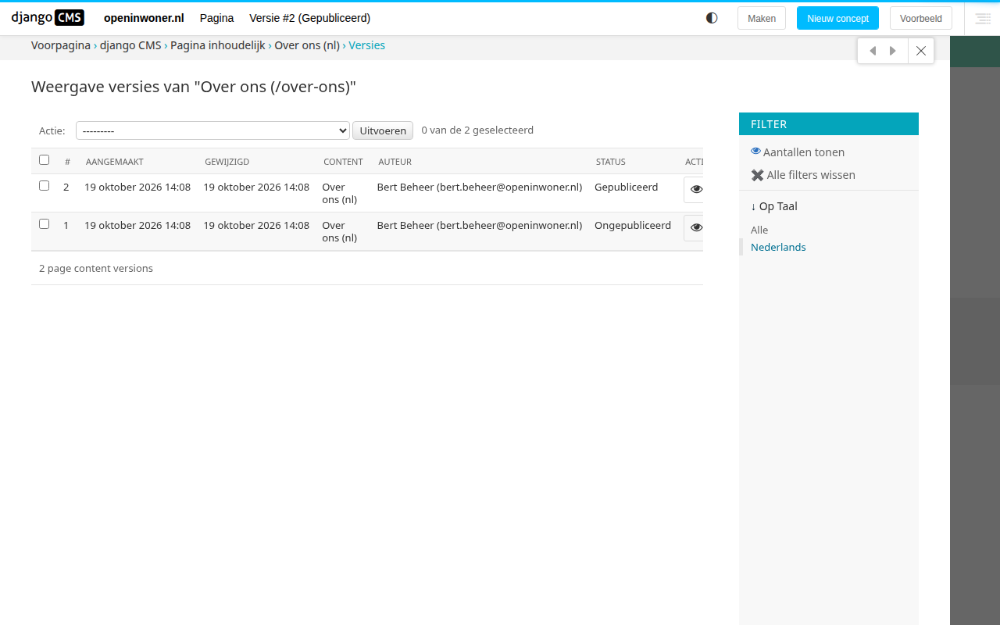

**Versies verwijderen**

Gearchiveerde en ongepubliceerde versies kunt u verwijderen. Selecteer in de versiegeschiedenis de betreffende versies en kies de actie "Geselecteerde ... verwijderen". Concept- en gepubliceerde versies kunnen niet worden verwijderd: maak de publicatie eerst ongedaan, of gooi een conceptversie weg met [Annuleer wijzigingen].

Let op! Verwijdert u de laatste versie van een pagina, dan wordt de pagina zelf ook verwijderd.

Een gebruiker die versies van pagina's heeft aangemaakt kan niet worden verwijderd zolang die versies bestaan. Bij het verwijderen van zo'n gebruiker krijgt u een overzicht van de versies die dit tegenhouden.

11.2. Via de frontend wijzigingen doorvoeren
============================================

Het CMS maakt het mogelijk aan de voorkant van Open Inwoner direct bepaalde wijzigingen door te voeren. Op deze manier hoeft u voor sommige wijzigingen niet meer eerst naar de configuratie in de backend te gaan. Om frontend wijzigingen te maken gaat u eerst in de backend naar Beheer > CMS > Pagina inhoudelijk en klikt u op het oogje achter de pagina die u wilt wijzigen, zie hoofdstuk 11.1.6.

In het nieuw geopende scherm ziet u nu bovenin beeld een balk met frontend navigatie voor het CMS (de CMS-werkbalk). Op deze manier kunt u via de voorkant van de website/pagina dingen aanpassen zonder dat u eerst weer terug hoeft te gaan naar de beheeromgeving.

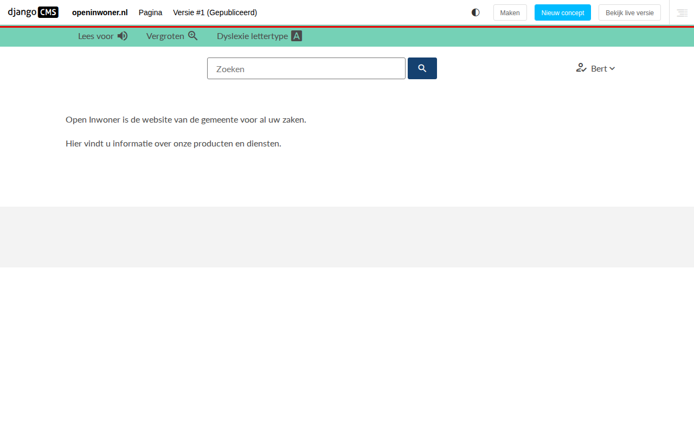

11.2.1. Sitebrede mogelijkheden via CMS menu
--------------------------------------------

U kunt frontend diverse sitebrede dingen (geldend voor de gehele website) aanpassen. Dit doet u door in de CMS-werkbalk op de knop met de naam van de website (bijvoorbeeld [OpenInwoner]) te klikken. Er verschijnt een uitvouwmenu met verschillende opties die u kunt uitvoeren.

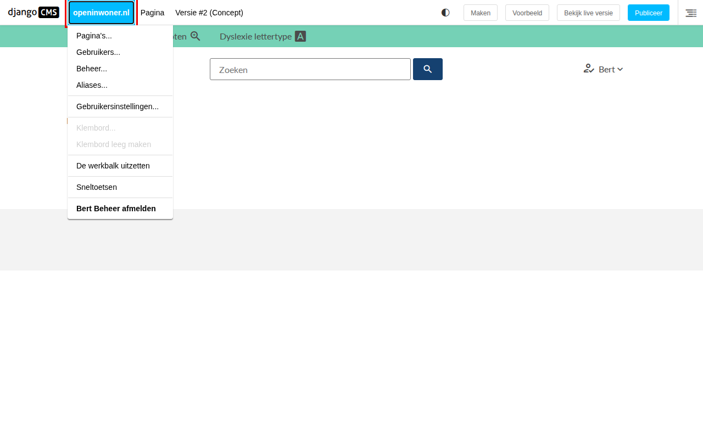

Wanneer u op een van de menu-items klikt, verschijnt er een pop-up pagina met het betreffende scherm uit de backend. Als u klaar bent met de wijzigingen kunt u dit scherm weer wegklikken en zit u weer volledig aan de voorkant van de website. In het screenshot kunt u zien dat het venster van de betreffende pagina in de backend (hier [Pagina's...]) óver de pagina aan de voorkant wordt weergegeven. Wanneer u uw gewenste wijzigingen heeft opgeslagen klikt u op het kruisje dat in het screenshot rood omkaderd is.

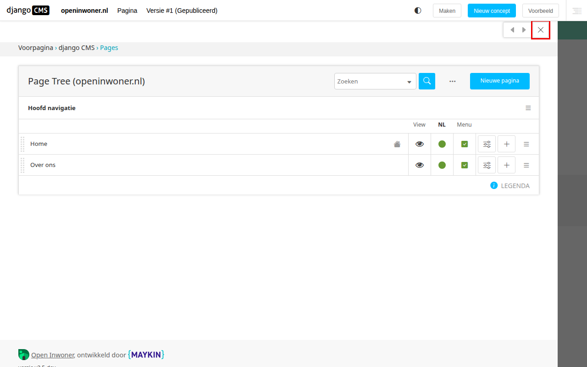

| **Pagina's...**
| U komt terecht op Beheer > CMS > Pagina inhoudelijk. Hier heeft u alle mogelijkheden die in hoofdstuk 11.1 beschreven staan.

| **Gebruikers...**
| U komt terecht op Gebruikers & Authenticatie > Gebruikers. Hier heeft u alle mogelijkheden die in hoofdstuk 4.5 beschreven staan.

| **Beheer...**
| U komt terecht op het dashboard van de backend. Hier heeft u alle mogelijkheden die in hoofdstuk 3 beschreven staan.

| **Aliases...**
| Het overzicht van alle aliassen, waaronder de statische aliassen van de footer. Zie hoofdstuk 11.2.11.

| **Gebruikersinstellingen...**
| Hier kunt u de instellingen van de ingelogde gebruiker wijzigen.

| **Klembord...** en **Klembord leeg maken**
| Wanneer u plugins gekopieerd heeft komen deze op het klembord te staan. Zo kunt u deze eenvoudig op een andere pagina plakken. Met [Klembord leeg maken] verwijdert u alle gekopieerde items. Deze opties zijn alleen zichtbaar wanneer u een pagina aan het bewerken bent.

| **De werkbalk uitzetten**
| Verbergt de CMS-werkbalk, zodat u de pagina ziet zoals een bezoeker deze ziet. U kunt de werkbalk weer tonen door ``?toolbar_on`` achter het adres van de pagina te zetten.

| **Sneltoetsen**
| Een overzicht van de sneltoetsen van de CMS-werkbalk.

| **Afmelden**
| Hiermee logt u uit.

11.2.2. Paginamogelijkheden via CMS menu
----------------------------------------

U heeft frontend diverse mogelijkheden om pagina's te bewerken, aan te maken, verwijderen en instellingen van pagina's te wijzigen. Deze mogelijkheden ziet u in het submenu onder [Pagina]. Sommige opties zijn alleen zichtbaar wanneer u de pagina aan het bewerken bent.

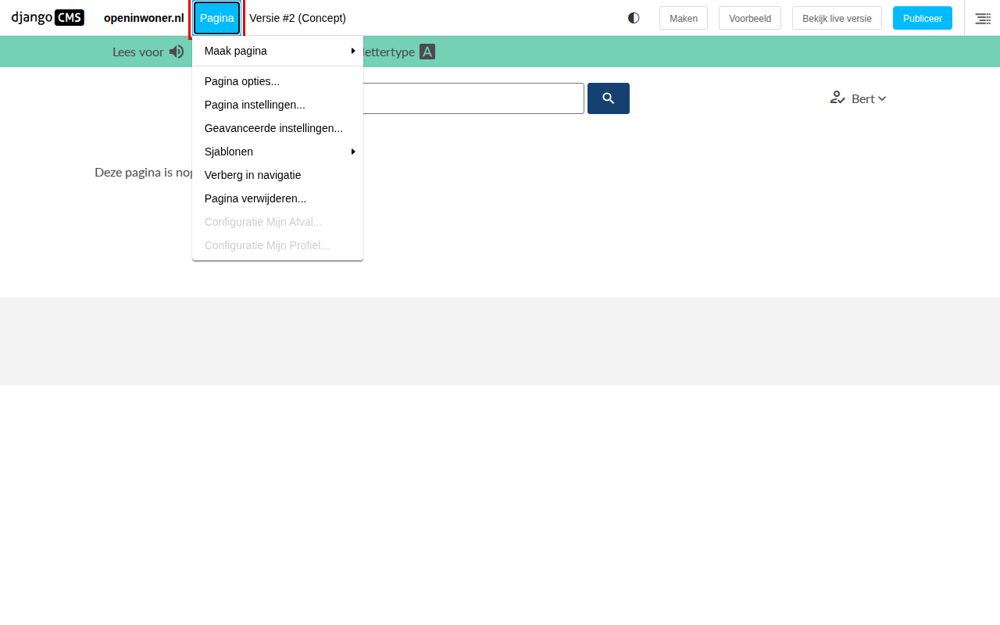

| **Maak pagina**
| Via dit menu-item maakt u een nieuwe pagina of subpagina. Selecteer de juiste optie in het menu. U kunt hier tevens de huidige pagina dupliceren.

| **Pagina opties...**
| Hier stelt u de instellingen van Open Inwoner voor de pagina in: of men voor de betreffende pagina – al dan niet met DigiD of eHerkenning – ingelogd moet zijn, een indicator (teller) en een icoon voor het menu. Zie hoofdstuk 11.5.

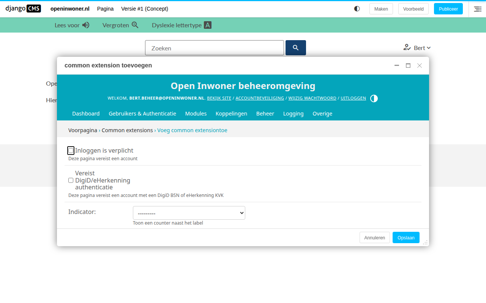

| **Pagina instellingen...**
| U gaat direct naar de pagina instellingen van de betreffende pagina. Zie hoofdstuk 11.1.9.

| **Geavanceerde instellingen...**
| U gaat direct naar de geavanceerde instellingen van de betreffende pagina. Zie hoofdstuk 11.1.9.

| **Sjablonen**
| Hier kiest u het sjabloon voor de pagina, of u laat de pagina het sjabloon van de bovenliggende pagina overnemen. De beschikbare sjablonen zijn:

- **Home page template**: het standaard sjabloon, met plaats voor een bannerafbeelding, een bannertekst en de inhoud van de pagina.
- **CMS Flatpage Template**: een eenvoudige pagina met alleen inhoud, bijvoorbeeld voor de pagina's in de footer.
- **CMS Contactformulier Template**: de pagina met het contactformulier, zie hoofdstuk 11.2.10.

| **Verberg in navigatie / Laat zien in navigatie**
| Selecteer [Verberg in navigatie] om de pagina uit de navigatiebalk te verwijderen. Wanneer de pagina al is verborgen staat hier de knop [Laat zien in navigatie] om de pagina juist weer in de navigatiebalk weer te geven. Zie hoofdstuk 11.1.8.

| **Pagina verwijderen...**
| Selecteer dit om de huidige pagina te verwijderen. Zie hoofdstuk 11.1.10.

| **Configuratie Mijn Profiel...**
| Alleen beschikbaar op de pagina die aan de applicatie Profiel gekoppeld is. U kunt hier de onderdelen van Mijn Profiel in- of uitschakelen: Mijn gegevens, Gekozen onderwerpen, Begeleiders, Mijn netwerkcontacten, Zelfdiagnose, Acties, Mijn meldingen, Mijn vragen, Mijn uitkeringen, Nieuwsbrieven en Mijn afspraken.

| **Configuratie Mijn Afval...**
| Alleen beschikbaar op de pagina die aan de applicatie Mijn Afval gekoppeld is. U kunt hier de paginatitel en paginabeschrijving van Mijn Afval instellen.

De opties om de publicatie van een pagina ongedaan te maken of een conceptversie weg te gooien vindt u niet meer in dit menu, maar in het versiemenu (zie hoofdstuk 11.2.3) en in de versiegeschiedenis (zie hoofdstuk 11.1.11).

11.2.3. Knoppen en versiemenu in de CMS-werkbalk
------------------------------------------------

Rechts in de CMS-werkbalk staan de knoppen voor het bewerken en publiceren van de pagina. Welke knoppen u ziet hangt af van de status van de pagina en of u de pagina aan het bewerken bent:

| **Maken**
| Maak een nieuwe pagina of subpagina, zie hoofdstuk 11.2.4.

| **Bewerken** / **Nieuw concept**
| Open de pagina om te bewerken. Bestaat er nog geen conceptversie, dan heet deze knop [Nieuw concept] en wordt er eerst een conceptversie aangemaakt.

| **Voorbeeld**
| Bekijk de conceptversie zoals bezoekers deze na publicatie zien. Het voorbeeld is alleen zichtbaar voor ingelogde redacteuren en beheerders.

| **Structuur** / **Content**
| Wissel tijdens het bewerken tussen de structuurweergave met alle plugins (zie hoofdstuk 11.2.7) en de weergave van de pagina zelf.

| **Publiceer**
| Publiceer de conceptversie, zie hoofdstuk 11.1.11.

| **Bekijk live versie**
| Ga naar de gepubliceerde versie van de pagina.

| **Terugdraaien**
| Alleen zichtbaar wanneer u een gearchiveerde of ongepubliceerde versie bekijkt: maak van deze versie een nieuwe conceptversie.

Links van deze knoppen staat het versiemenu, met als titel de huidige versie, bijvoorbeeld "Versie #3 (Concept)". Hierin vindt u:

- [Beheer versies] — de versiegeschiedenis van de pagina, zie hoofdstuk 11.1.11.
- [Vergelijk met ...] — bekijk de verschillen met de versie waarop deze versie gebaseerd is.
- [Annuleer wijzigingen] — gooi de conceptversie weg.

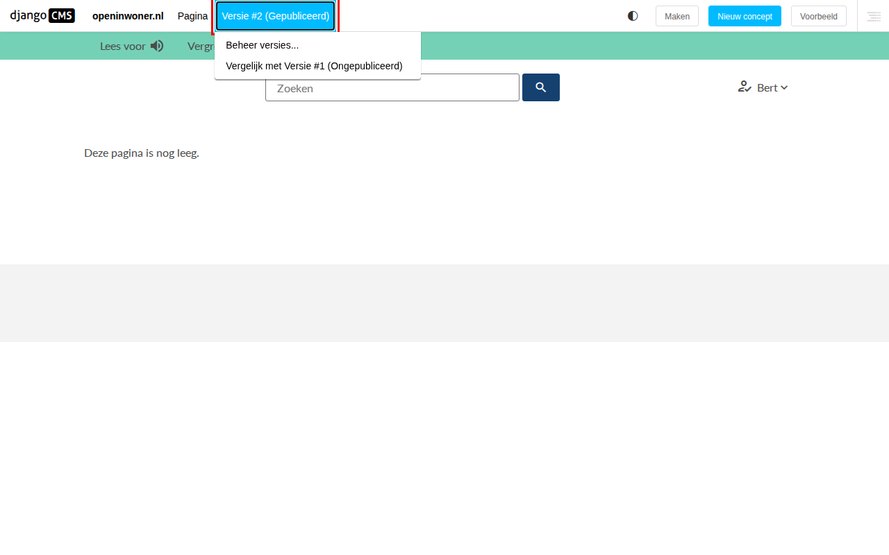

Het CMS kent geen apart Help- of Taalmenu meer. Open Inwoner is alleen in het Nederlands beschikbaar.

11.2.4. Frontend een nieuwe pagina maken
----------------------------------------

U kunt eenvoudig en snel een nieuwe pagina aanmaken wanneer u op de knop [Maken] klikt. U kiest dan uit [Nieuwe pagina] (een pagina naast de huidige pagina) of [Nieuwe subpagina] (een pagina onder de huidige pagina). Op een pagina die aan een applicatie gekoppeld is kunt u geen subpagina maken. De opties [Nieuwe alias] en [Nieuwe alias categorie] zijn voor aliassen, zie hoofdstuk 11.2.11. Maak een keuze en klik op [Volgende].

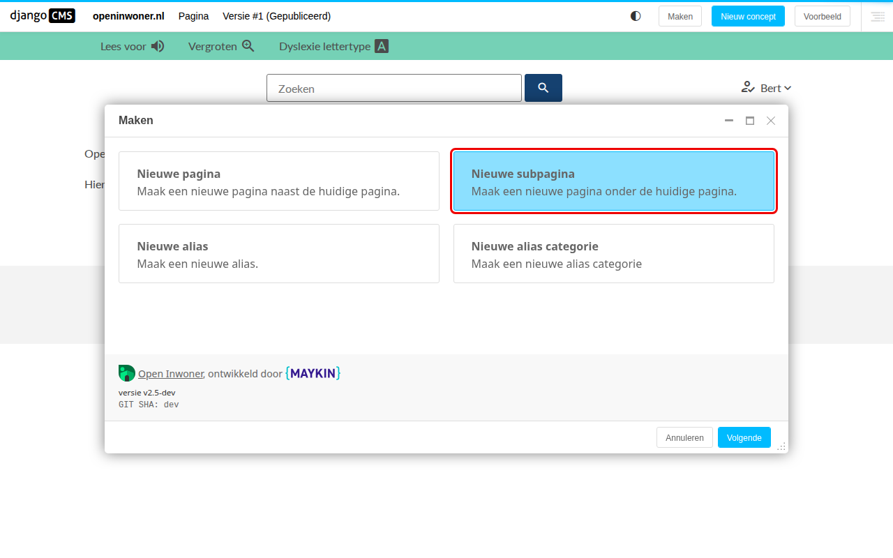

Er opent nu een nieuw scherm waarin u de titel en eventueel de slug van de pagina kunt invoeren. Laat u de slug leeg, dan wordt deze automatisch uit de titel gemaakt. Klik wanneer u klaar bent op [Maken]. De nieuwe pagina is een conceptversie: voeg daarna de inhoud toe en publiceer de pagina.

Let op! Tekst die u in dit scherm in het veld "Content" invult, wordt niet op de pagina geplaatst. Laat dit veld leeg en voeg de inhoud toe nadat de pagina is aangemaakt.

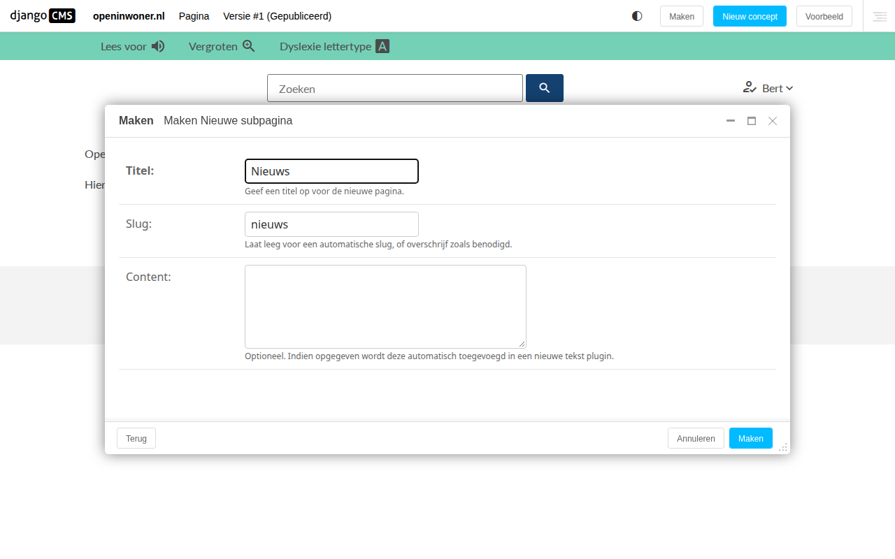

11.2.5. Frontend een pagina wijzigen
------------------------------------

U kunt eenvoudig een pagina bewerken wanneer u op de knop [Bewerken] (of [Nieuw concept]) klikt. Zie voor de werking van de knoppen hoofdstuk 11.2.3.

**Conceptversie bekijken (preview)**

Voordat u een conceptversie publiceert kunt u een voorbeeld bekijken zoals de pagina er voor bezoekers uit zal zien. Klik hiervoor in de CMS-werkbalk op [Voorbeeld]. De preview is alleen zichtbaar voor ingelogde redacteuren en beheerders; bezoekers zien de pagina pas nadat u deze heeft gepubliceerd (zie hoofdstuk 11.1.11).

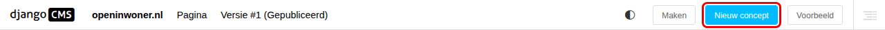

Wanneer u op de knop [Bewerken] heeft geklikt krijgt u de mogelijkheid dingen aan te passen. Wanneer u met de muis over de elementen op de pagina hoovert kunt u zien wat u kunt aanpassen. Er verschijnt een pop-up met de tekst "Dubbelklik om te bewerken". Daarachter staat wát u kunt aanpassen: de naam van de plugin, bijvoorbeeld "Tekst".

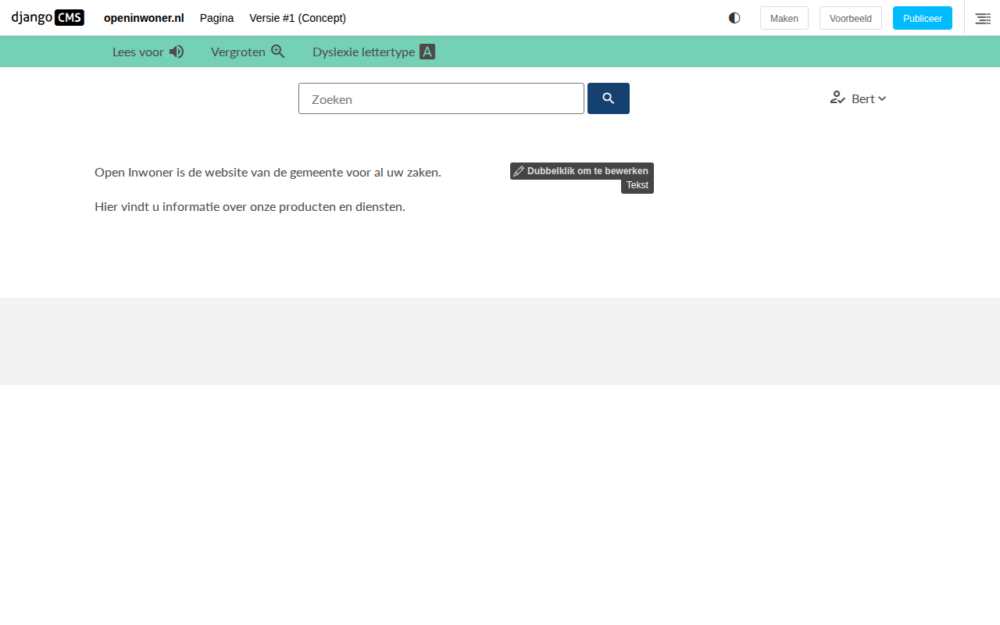

Als u dubbelklikt krijgt u een nieuw venster met de aan te passen dingen. Indien er geen te bewerken plugin is krijgt u hier een melding van in het nieuwe venster.

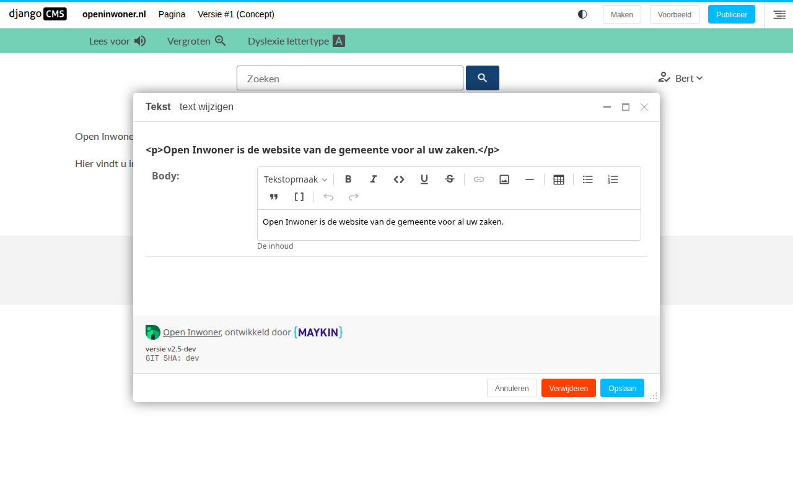

Nadat u de gewenste aanpassingen heeft gedaan publiceert u deze door op de knop [Publiceer] te klikken.

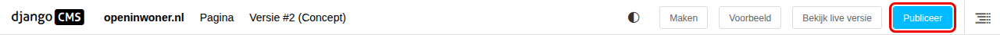

11.2.6. Frontend een onderwerp wijzigen
---------------------------------------
U kunt eenvoudig een onderwerp wijzigen door op de onderwerp-pagina op het potloodicoontje naast de titel te klikken. Dit icoontje ziet u alleen wanneer u bent ingelogd als beheerder. Als u hierover hoovert ziet u staan 'Bekijk in beheeromgeving'. Wanneer u op het potloodicoontje klikt, opent in hetzelfde venster de backend van het betreffende onderwerp. Hier kunt u alles wijzigen rond dit onderwerp. Zie meer hierover in hoofdstuk 6.2.

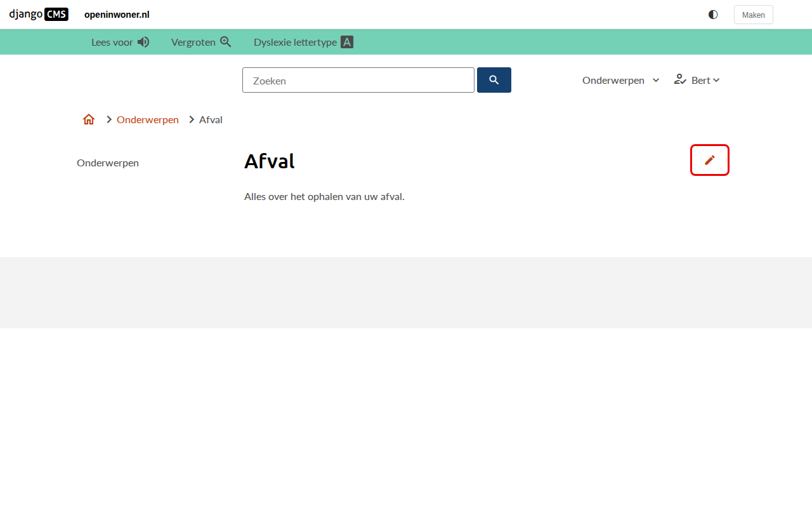

11.2.7. Plugin menu
-------------------
Wanneer u een pagina bewerkt krijgt u de mogelijkheid het plugin menu (de structuurweergave) te openen. Dit is de knop met het plugin-icoon rechts in de CMS-werkbalk ("Wissel structuur"). Zie het rode kader in het screenshot. Met dezelfde knop gaat u terug naar de pagina zelf.

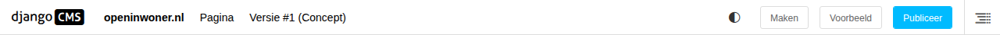

Wanneer dit wordt uitgevouwen ziet u per plek op de pagina (bijvoorbeeld "Content") alle actieve plugins. Deze plugins kunt u bewerken door op het potloodicoontje van de betreffende plugin te klikken. U kunt nieuwe plugins toevoegen door op [+] te klikken en u kunt de plugins eenvoudig een andere plek op de pagina geven door ze te verslepen naar de gewenste plek. Welke plugins beschikbaar zijn leest u in hoofdstuk 11.3.

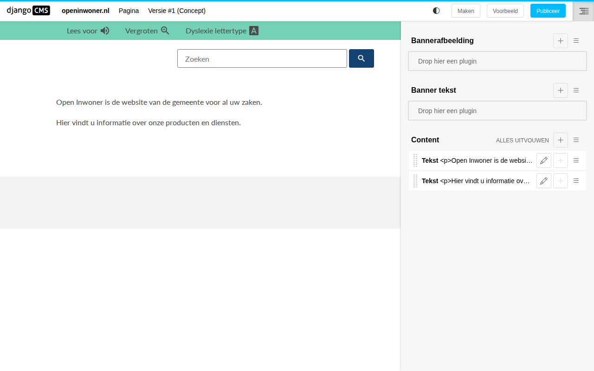

Wanneer u op het hamburgermenu van een plugin klikt krijgt u de mogelijkheid de plugin te knippen ([Knippen]), te kopiëren ([Kopieer]), te plakken ([Plakken]), te verwijderen ([Verwijderen]), te markeren ([Markeer]) en er een alias van te maken ([Alias maken]). Knippen, kopiëren, plakken en verwijderen spreken voor zich.

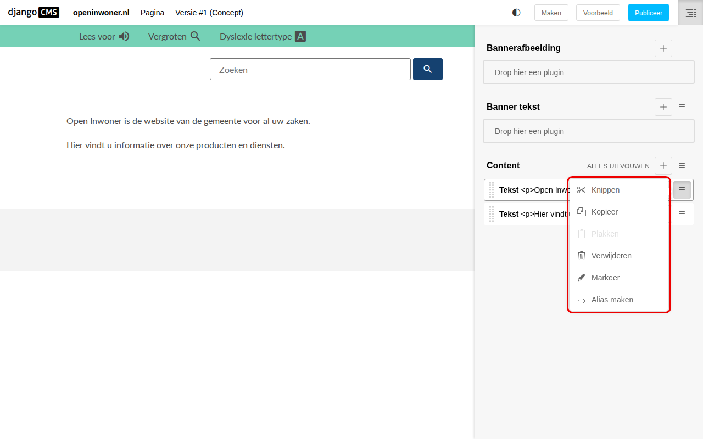

**Markeer**
Wanneer u op [Markeer] klikt wordt de betreffende plugin op de pagina weergegeven met een blauw kader. Zo weet u precies welk element op de pagina met de betreffende plugin wordt bedoeld.

**Alias maken**
Door een alias te maken kunt u content hergebruiken op verschillende pagina's en deze op één plek beheren. Wanneer hergebruikte content op één plek wordt gewijzigd, wordt dit door de alias ook op de andere plekken gewijzigd.

.. note::

   Een eenmaal aangemaakte alias kunt u **niet** bewerken via het plugin menu van de pagina waarop hij is geplaatst. Gebruik hiervoor de optie [Aliases...] in het sitemenu van de CMS-werkbalk. Zie hoofdstuk 11.2.11.

11.2.8. 'Ga Naar' links op homepagina via CMS
---------------------------------------------
Wanneer u de homepagina bewerkt, kunt u via het plugin menu een nieuw blok toevoegen met 1 of meerdere externe links (de plugin "Externe Link plugin"). Dit blok wordt alleen getoond aan ingelogde gebruikers. Elke 'Ga naar' link dient een eigen icoontje te krijgen. De iconenset die in Open Inwoner wordt gebruikt is Material Icons. Deze bevat meer dan 2000 iconen waaruit u kunt kiezen.

1. Voeg eerst de plugin toe aan de pagina door middel van het plus symbool. Sleep deze plugin naar de gewenste volgorde binnen de plugin hiërarchie.

2. Voeg daarna één of meerdere links toe via het plus-symbool [+] van de Externe Link plugin in de structuurweergave. Kies in de keuzelijst onder 'Generiek' de plugin 'Link'. Herhaal dit voor elke link. Let op: de keuzelijst toont ook andere plugins, maar in dit blok horen alleen links.

3. Selecteer voor elke link een passend icoon. De linktekst kan worden ingevoerd via de rich text editor. De gehele tekst en het icoon worden onderdeel van de link en zijn aanklikbaar.

Een icoon kan worden ingesteld door de juiste icoonnaam in te vullen in het veld ‘Icoon’. De exacte namen van alle beschikbare iconen vindt u op: https://fonts.google.com/icons

Kies in de linkerbalk de subset 'Material Icons' (niet 'Material Symbols') en selecteer vervolgens de variant 'Outlined'. In het middendeel kunt u gericht zoeken op soorten iconen, bijvoorbeeld 'park' of 'help'.

De exacte code-naam van het icoon verschijnt in de rechter pop-up. Vul deze naam in het veld ‘Icoon’ in, inclusief eventuele underscores (bijvoorbeeld *help_outline* of *account_balance*).

Plugin toevoegen:

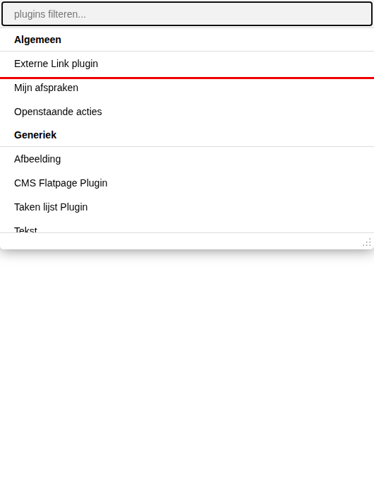

De titel van het blok is standaard ingesteld als 'Ga naar', maar hier kan uiteraard ook een andere tekst worden ingevoerd. Deze titel wordt zichtbaar als H2-kopje boven de links.

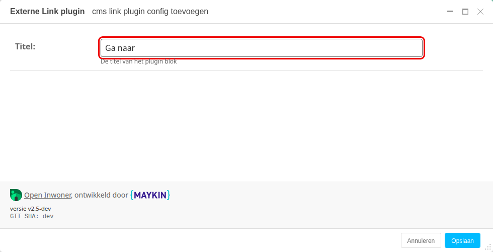

Link toevoegen:

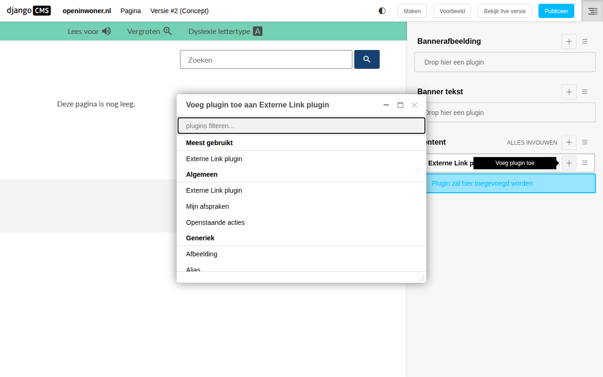

'Material Icons' set selecteren, tevens 'Outlined' set kiezen en icoon zoeken:

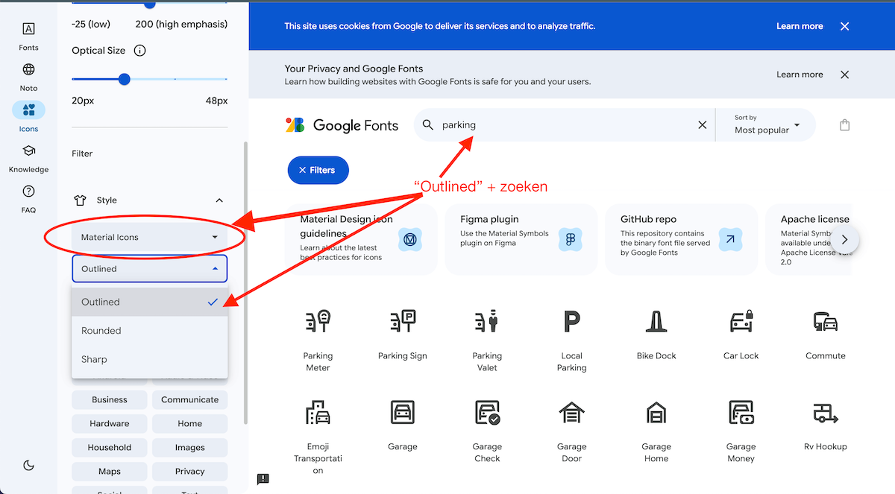

Icoon kiezen en exacte naam zoeken bij 'Web' >> 'Icon Font':

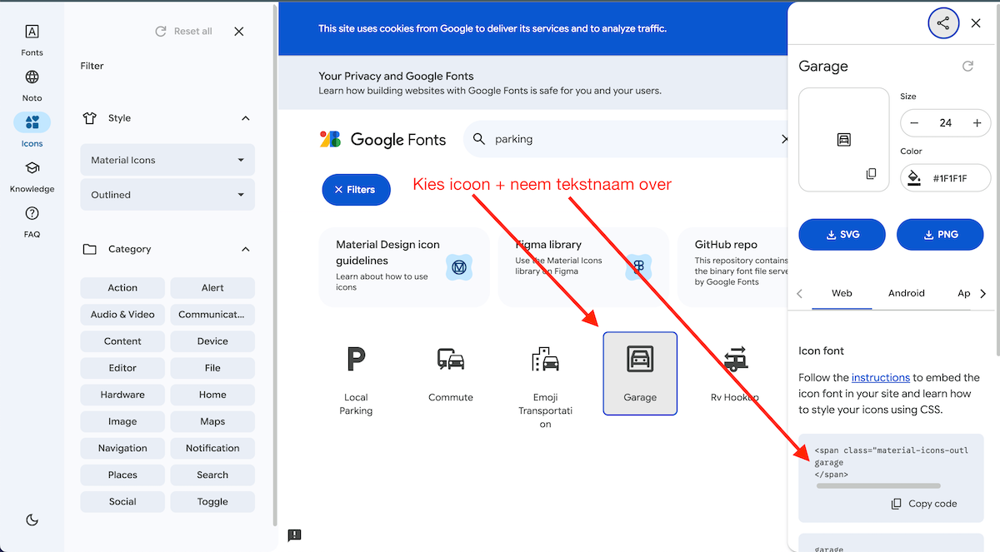

Icoonveld correct invullen en eventueel link laten openen in nieuw venster via geavanceerde instellingen:

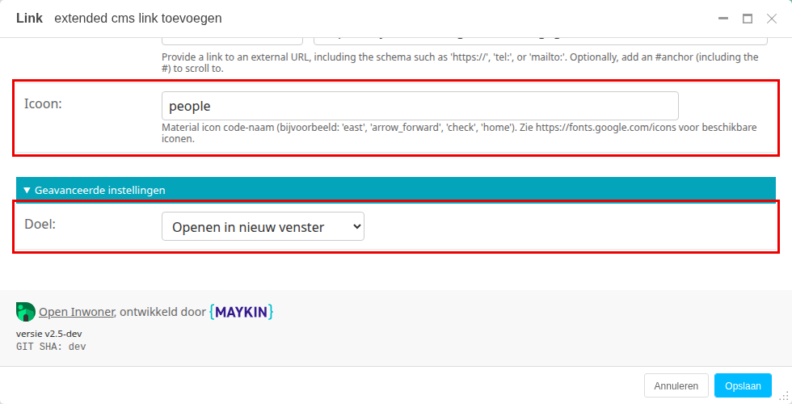

Klik op [Publiceer] om de wijzigingen definitief te maken.

Hieronder een voorbeeld van hoe het blok er aan de voorkant uit kan zien met 4 toegevoegde links. De iconen die hier zijn gebruikt, zijn achtereenvolgens: 'people', 'message', 'list_alt' en 'insert_drive_file'.

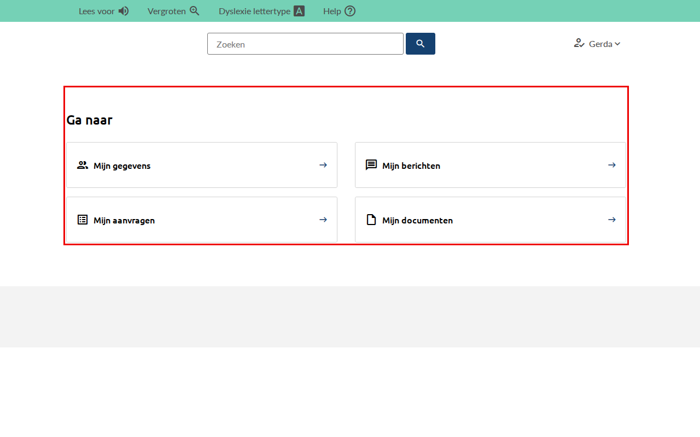

11.2.9. Footer aanpassen via CMS
--------------------------------

De footer van Open Inwoner bestaat uit 3 kolommen: Footer linkerzijde, Footer midden en Footer rechterzijde. Elke kolom is een statische alias (``footer_left``, ``footer_center`` en ``footer_right``, zie hoofdstuk 11.2.11): de inhoud is op alle pagina's hetzelfde. Een nieuwe installatie begint met lege kolommen. Rondom de kolommen toont de footer daarnaast het logo uit de siteconfiguratie (zie hoofdstuk 12).

U past de footer als volgt aan:

1. Klik in de CMS-werkbalk op het sitemenu (zie hoofdstuk 11.2.1) en kies [Aliases...].
2. Zoek de alias van de kolom die u wilt wijzigen (``footer_left``, ``footer_center`` of ``footer_right``) en klik op het oogje ([Voorbeeld]). Klik daarna in de CMS-werkbalk op [Bewerken] (of [Nieuw concept]).
3. Klik op [+] om een plugin toe te voegen, of klik op het potloodicoontje van een bestaande plugin om deze te wijzigen.
4. Klik op [Publiceer] om de gewijzigde kolom te publiceren. Zie ook hoofdstuk 11.2.11.

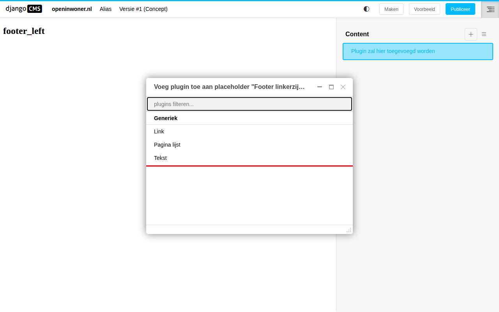

**Footer plugins**
In de footer kunt u drie soorten plugins plaatsen: Tekst, Link en Pagina lijst. Wanneer u meerdere plugins in een kolom heeft, kunt u deze slepen en schikken in de gewenste volgorde.

**Footertekst wijzigen**
Met de plugin Tekst kunt u de tekst van een kolom aanpassen. U krijgt dan een pop-up editor in beeld waar u de tekst kunt opmaken en aanpassen, zoals in het volgende screenshot is weergegeven. Scheid de diverse onderdelen met een enter. Zo maakt u nieuwe 'blokken' in de footer. Er kunnen ook links worden ingevoegd. Klik op [Opslaan] wanneer u klaar bent met wijzigen.

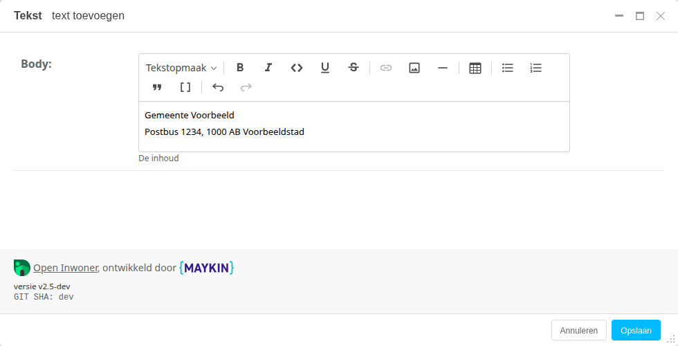

**Footer link invoegen**
Met de plugin Link voegt u een losse link toe. U kunt kiezen voor een interne link, een externe link of een bestand. Voer bij een externe link de URL in, of kies bij een interne link een van de pagina's van Open Inwoner. Vul bij "Naam" de tekst in die u voor deze link wilt gebruiken. Onder "Geavanceerde instellingen" kunt u bij "Doel" instellen dat de link in een nieuw venster opent. Het veld "Icoon" wordt in de footer niet gebruikt: dit is alleen voor de 'Ga naar' links (zie hoofdstuk 11.2.8).

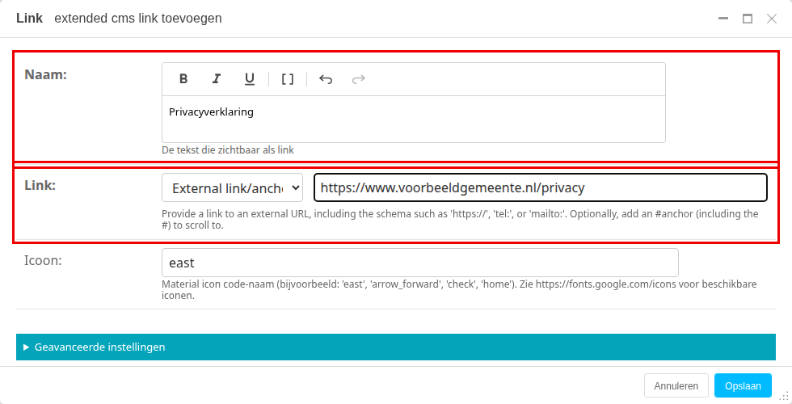

**Paginalijst invoegen**
De plugin Pagina lijst toont een lijst met links naar:

1. de pagina met het contactformulier (zie hoofdstuk 11.2.10), als het contactformulier is ingeschakeld;
2. de CMS-pagina's die in de siteconfiguratie zijn ingesteld onder "CMS pagina's in de footer". Hier bepaalt u ook de volgorde. Zie hoofdstuk 12. Pagina's waarvoor "Inloggen is verplicht" is ingesteld worden alleen aan ingelogde gebruikers getoond;
3. de sitemap.

11.2.10. Contactformulier aanpassen via CMS
-------------------------------------------

Het contactformulier van Open Inwoner kan worden aangepast via het Django CMS. Hiervoor dient u eerst de configuratie voor het klantensysteem te voltooien. Zie :ref:`hoofdstuk 9.4 <configuratie-klanten-systeem>`. Daar kunt u kiezen voor een API of e-mail of beiden. Wanneer aan het Klanten Systeem een "contact formulier onderwerp" wordt toegevoegd, wordt deze zichtbaar in de keuzelijst van het gepubliceerde contactformulier.

Indien u dit nog niet gedaan heeft, maak dan eerst een pagina aan voor het contactformulier, via [Nieuwe pagina] in de paginalijst (zie hoofdstuk 11.1.5) of via [Maken] in de CMS-werkbalk (zie hoofdstuk 11.2.4). De slug bepaalt het webadres van het contactformulier.

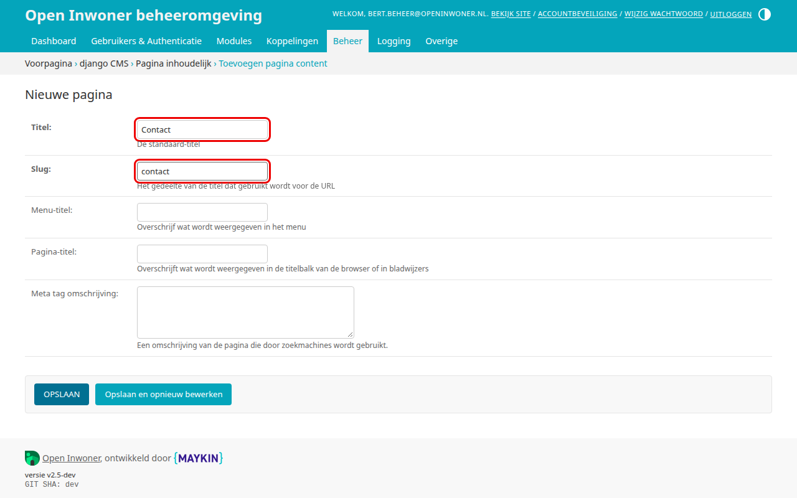

Kies daarna voor deze contactpagina onder [Pagina] > [Sjablonen] het sjabloon "CMS Contactformulier Template", en koppel onder "Geavanceerde instellingen" de Applicatie "OpenKlant applicatie". Is het klantensysteem nog niet geconfigureerd, dan toont deze pagina de melding dat de pagina niet gevonden is. Publiceer de pagina. Deze wordt direct zichtbaar als link in de sitemap en, als de plugin Pagina lijst in de footer staat, in de footer (zie hoofdstuk 11.2.9).

Met het sjabloon "CMS Contactformulier Template" heeft de pagina in de structuurweergave (zie hoofdstuk 11.2.7) de placeholder "Contactformulier plugin". Hierin past alleen de plugin "Contactformulier plugin": wanneer u op [+] klikt, opent dus direct het formulier van deze plugin. Heeft u de plugin al toegevoegd, dan klikt u op het potloodicoontje van de plugin om deze te wijzigen.

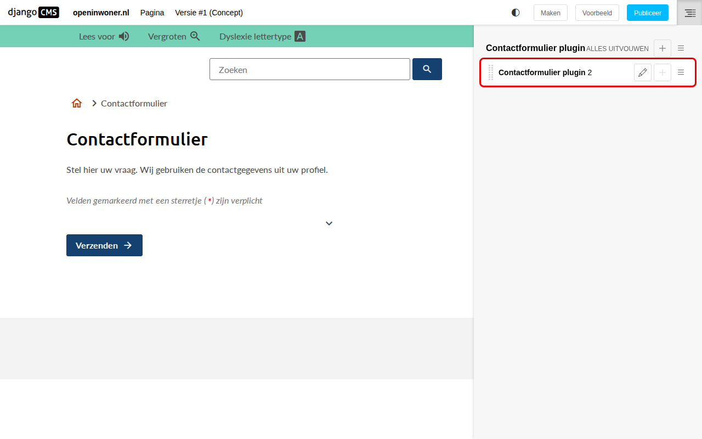

In het formulier van de plugin kunt u de begeleidende teksten van het contactformulier aanpassen middels een rich text editor. Zodra u uw gewenste teksten heeft opgesteld klikt u op [Opslaan] en daarna op [Publiceer]. De tekst wordt direct boven het contactformulier weergegeven.

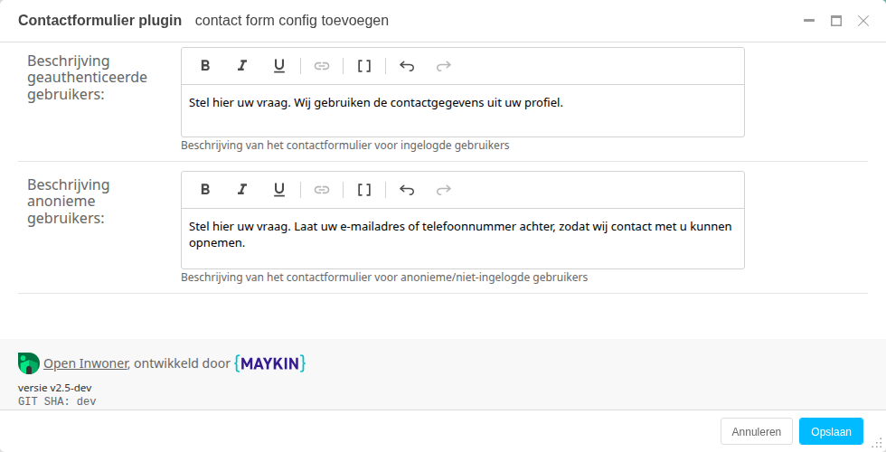

Met de velden "Beschrijving geauthenticeerde gebruikers" en "Beschrijving anonieme gebruikers" kunt u het contactformulier voor ingelogde gebruikers een andere beschrijvende tekst meegeven dan voor bezoekers die niet zijn ingelogd.

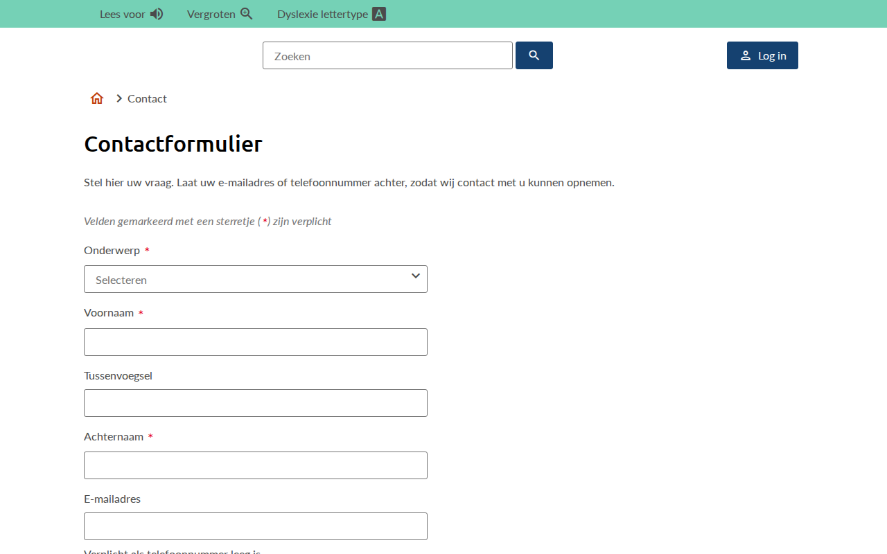

11.2.11. Aliassen bewerken
--------------------------

Een alias is een inhoudsblok dat op meerdere pagina's tegelijk wordt hergebruikt. Wanneer u de inhoud van een alias aanpast, is die wijziging zichtbaar op alle pagina's waar de alias is geplaatst. U maakt zelf een alias aan via het plugin menu (zie hoofdstuk 11.2.7).

Daarnaast zijn er **statische aliassen**: aliassen die vast in de opmaak van de website zijn opgenomen. Open Inwoner gebruikt deze voor de drie kolommen van de footer (``footer_left``, ``footer_center`` en ``footer_right``, zie hoofdstuk 11.2.9) en voor de banner op de inlogpagina (``login_banner``). Een statische alias wordt automatisch aangemaakt zodra de betreffende pagina voor het eerst wordt getoond.

.. note::

   In oudere versies van Django CMS heetten deze blokken **statische placeholders** (*static placeholders*). Aliassen hebben, net als pagina's, een eigen versiebeheer en worden apart van de pagina's gepubliceerd.

**Werkwijze: een alias bewerken**

1. Ga naar de voorkant van de website terwijl u bent ingelogd als redacteur of beheerder.
2. Klik in de CMS-werkbalk op het sitemenu (zie hoofdstuk 11.2.1) en kies **[Aliases...]**.

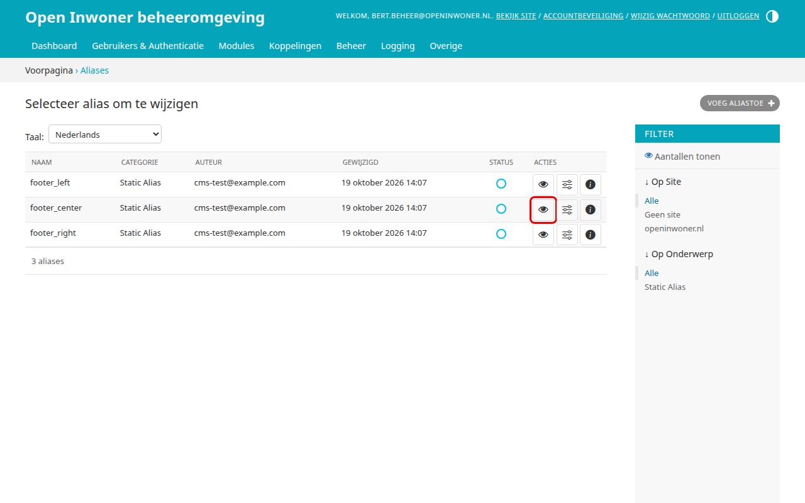

3. Er verschijnt een overzicht van alle aliassen, met hun naam, onderwerp, auteur, datum van wijziging en status. U kunt zoeken op naam en filteren op site en onderwerp.
4. Zoek de alias die u wilt bewerken en klik op het oogje ([Voorbeeld]). De alias opent aan de voorkant van de website. Klik in de CMS-werkbalk op [Bewerken] (of [Nieuw concept]).
5. Breng de gewenste wijzigingen aan aan de plugins binnen de alias.
6. Klik op [Publiceer] om de gewijzigde versie van de alias te publiceren.

Via het menu "Alias" in de CMS-werkbalk kunt u tijdens het bewerken ook de instellingen van de alias wijzigen ([Wijzig alias instellingen]) en zien op welke pagina's de alias gebruikt wordt ([Bekijk gebruik]).

.. note::

   Net als bij gewone pagina's (zie hoofdstuk 11.1.11) zijn wijzigingen aan een alias pas zichtbaar voor bezoekers nadat u de alias expliciet heeft gepubliceerd. Opslaan alleen is niet voldoende.

11.2.12. Takenlijst plugin configureren via CMS
-----------------------------------------------

De Takenlijst plugin toont een gepersonaliseerde lijst met openstaande taken voor
ingelogde gebruikers. Deze taken kunnen afkomstig zijn uit twee verschillende bronnen:

1. **ZGW API taken** - Openstaande taken uit zaakgericht werken systemen
2. **Objects API taken** - Externe taken opgeslagen in de Objects API volgens
   gestandaardiseerde JSON schemas

**Vereisten**

Voordat u de Takenlijst plugin kunt configureren, moeten de volgende koppelingen zijn
ingesteld:

1. **Objects API configuratie** - Zie :ref:`hoofdstuk 9.8 <objects-api-configuratie>`
   voor het configureren van de Objects API service. Deze koppeling is nodig om externe
   taken op te halen.

2. **Object Types configuratie** - In de Objects API moeten twee object types zijn
   geconfigureerd met de juiste JSON schemas. Deze object types worden automatisch
   opgehaald en zijn beschikbaar als keuze in de plugin configuratie via hun titel:

   * **Object Type (Url Taak)** - Voor URL-taken (generieke dienstverlening) volgens het volgende
     JSON schema:

     .. code-block:: json

        {
          "type": "object",
          "title": "ObjectType Taak",
          "description": "Externe klant taak schema V1.1.1",
          "required": ["titel", "status", "soort", "identificatie", "verwerker_taak_id", "eigenaar"],
          "properties": {
            "titel": {"type": "string", "description": "Weergave naam van de taak"},
            "status": {
              "enum": ["open", "afgerond", "verwerkt", "gesloten"],
              "type": "string"
            },
            "soort": {
              "enum": ["url", "portaalformulier", "ogonebetaling"],
              "type": "string"
            },
            "identificatie": {
              "type": "object",
              "description": "KVK of BSN waaraan de taak gericht is"
            },
            "url": {
              "type": "object",
              "properties": {
                "uri": {"type": "string", "format": "uri"}
              }
            },
            "verwerker_taak_id": {"type": "string", "format": "uuid"},
            "eigenaar": {"type": "string"}
          }
        }

     Het volledige schema is beschreven in de `Gitbook documentatie voor generieke
     dienstverlening
     <https://dienstverleningsplatform.gitbook.io/platform-generieke-dienstverlening-public/patronen/taken/externe-klanttaak#jsonschema-taak-object-type>`_.

   * **Object Type (Extern Formulier Taak)** - Voor (legacy) taken met externe
     formulieren volgens het volgende JSON schema:

     .. code-block:: json

        {
          "$id": "oip-klanttaak.schema.json",
          "type": "object",
          "title": "OIP Klanttaak",
          "required": ["titel", "status", "soort", "betrokkene", "portaalformulier",
                       "verwerker_taak_id", "eigenaar"],
          "properties": {
            "soort": {"const": "externformulier"},
            "titel": {"type": "string"},
            "status": {
              "enum": ["open", "uitgevoerd", "afgebroken", "verwerkt", "ingetrokken"],
              "type": "string"
            },
            "betrokkene": {
              "type": "object",
              "required": ["source", "levelOfAssurance", "authorizee"],
              "properties": {
                "source": {"const": "digid"},
                "authorizee": {
                  "type": "object",
                  "properties": {
                    "legalSubject": {
                      "type": "object",
                      "properties": {
                        "identifier": {"type": "string", "pattern": "^[0-9]{9}$"},
                        "identifierType": {"const": "bsn"}
                      }
                    }
                  }
                }
              }
            },
            "portaalformulier": {
              "type": "object",
              "required": ["formulier"],
              "properties": {
                "formulier": {
                  "type": "object",
                  "properties": {
                    "soort": {"const": "url"},
                    "value": {"type": "string", "format": "uri"}
                  }
                }
              }
            },
            "verwerker_taak_id": {"type": "string", "format": "uuid"},
            "eigenaar": {"type": "string"}
          }
        }

3. **ZGW API configuratie** (optioneel) - Indien u ook openstaande taken uit
   zaaksystemen wilt tonen, configureer dan de ZGW API koppelingen. Zie :ref:`hoofdstuk
   9.3 <zgw-api-configuratie>`.

**Plugin toevoegen aan een pagina**

De Takenlijst plugin wordt meestal toegevoegd aan de homepage of aan een persoonlijke
'Mijn Omgeving' pagina:

1. Navigeer naar de gewenste pagina via Beheer > CMS > Pagina inhoudelijk
2. Klik op [Bewerken] om de pagina te bewerken
3. Open het plugin menu (de knop met rechts uitgelijnde regels en bullets)
4. Klik op [+] om een nieuwe plugin toe te voegen
5. Selecteer "Taken lijst Plugin" uit de lijst met beschikbare plugins
6. Configureer de plugin met de volgende velden:

**Plugin configuratie**

In het configuratiescherm van de Takenlijst plugin kunt u de volgende instellingen aanpassen:

| **Titel**
| De titel die boven de takenlijst wordt weergegeven (standaard: "Mijn Taken")

| **Object Type (Url Taak)**
| Selecteer hier het object type voor URL-taken uit de dropdown lijst. Wanneer de Objects API correct is geconfigureerd, verschijnen de beschikbare object types automatisch in de lijst op basis van hun titel. Dit object type wordt gebruikt voor externe taken met een directe URL - deze taken leiden de gebruiker direct naar een externe website of formulier.

| **Object Type (Extern Formulier Taak)**
| Selecteer hier het object type voor taken met externe formulieren uit de dropdown lijst. Wanneer de Objects API correct is geconfigureerd, verschijnen de beschikbare object types automatisch in de lijst op basis van hun titel. Dit object type wordt gebruikt voor de legacy implementatie van externe formuliertaken waarbij het formulier binnen het platform wordt getoond.

7. Klik op [Opslaan] om de configuratie op te slaan
8. Sleep de plugin naar de gewenste positie in de pagina structuur
9. Klik op [Publiceer] om de wijzigingen live te zetten

**Resultaat**

Na het publiceren van de pagina zien ingelogde gebruikers met een BSN een gepersonaliseerde lijst met hun openstaande taken. Elke taak toont:

- Type taak (soort)
- Titel van de taak
- Status
- Verloopdatum
- Eigenaar (waar van toepassing)
- Link naar de taak voor verdere afhandeling

Niet-ingelogde gebruikers of gebruikers zonder BSN zien een lege lijst of een bericht dat zij moeten inloggen om hun taken te kunnen bekijken.

**Troubleshooting**

Als de takenlijst leeg blijft terwijl er wel taken zouden moeten zijn:

1. Controleer of de Objects en Objecttypes API service correct is geconfigureerd
2. Controleer of de object types correct zijn ingevuld in de plugin configuratie
3. Controleer of er daadwerkelijk taken in de Objects API staan met het juiste BSN

11.3. Overzicht van de plugins
==============================

Hieronder vindt u alle plugins die u via het plugin menu (zie hoofdstuk 11.2.7) aan een pagina kunt toevoegen. Tussen haakjes staat de groep waaronder u de plugin in de keuzelijst vindt. Welke plugins beschikbaar zijn hangt af van de plek op de pagina: zie de tabel onder de plugins.

| **Bannerafbeelding plugin** (Generiek)
| Een bannerafbeelding bovenaan de pagina. Velden: Bannerafbeelding en Aangepaste afbeeldinghoogte (in pixels; leeg laten voor de originele hoogte).

| **Bannertext plugin** (Generiek)
| Een welkomsttekst bovenaan de pagina, met een Titel en een Omschrijving. Wordt alleen aan ingelogde gebruikers getoond.

| **Tekst** (Generiek)
| Vrije tekst, op te maken met de teksteditor.

| **Afbeelding** (Generiek)
| Een afbeelding uit de bestandsbibliotheek of van een externe locatie. Onder de uitklapblokken vindt u onder andere de afmetingen, uitlijning, een onderschrift, een link en instellingen voor bijsnijden.

| **Videospeler** (Media)
| Een video uit de lijst met video's in de beheeromgeving: dezelfde video's die u bij een product kunt kiezen (zie hoofdstuk 6.6).

| **Zaken Plugin** (Generiek)
| De meest recente zaken van de ingelogde gebruiker. Velden: Titel (standaard "Mijn zaken") en het aantal getoonde zaken (1 tot en met 10, standaard 4). Alleen zichtbaar voor gebruikers met een BSN, en alleen als de koppeling met het zaaksysteem is ingesteld (zie hoofdstuk 9).

| **Taken lijst Plugin** (Generiek)
| De openstaande taken van de ingelogde gebruiker, zie hoofdstuk 11.2.12.

| **Openstaande acties** (Algemeen)
| De openstaande acties en meldingen van de ingelogde gebruiker. Veld: Titel (standaard "Openstaande acties").

| **Mijn afspraken** (Algemeen)
| De geplande balie-afspraken van de ingelogde gebruiker. Veld: Titel (standaard "Geplande balie-afspraken").

| **Externe Link plugin** (Algemeen)
| Een blok met links, zie hoofdstuk 11.2.8. Alleen zichtbaar voor ingelogde gebruikers.

| **Actieve samenwerkingen Plugin** (Samenwerken)
| De drie meest recente samenwerkingen van de ingelogde gebruiker.

| **Onderwerpen Plugin** (PDC)
| De uitgelichte onderwerpen, of voor ingelogde gebruikers de door hen gekozen onderwerpen.

| **Vragenlijst Plugin** (PDC)
| De uitgelichte, gepubliceerde vragenlijsten (zelfdiagnoses).

| **Productzoeker Plugin** (PDC)
| De productzoeker, waarmee bezoekers op basis van voorwaarden een passend product vinden.

| **Productlocatie Plugin** (PDC)
| Een kaart met de locaties van de producten.

| **CMS Flatpage Plugin** (Generiek)
| Een eenvoudig blok met een Titel en Content (tekst).

De plugins Actieve samenwerkingen, Onderwerpen, Vragenlijst, Productzoeker en Productlocatie worden alleen getoond als er een gepubliceerde pagina bestaat die aan de bijbehorende applicatie (Samenwerken app of Producten app) gekoppeld is. Zie hoofdstuk 11.4.

**Plugins per plek op de pagina**

.. list-table::
   :header-rows: 1
   :widths: 30 70

   * - Plek
     - Toegestane plugins
   * - Content
     - Tekst, Afbeelding, Videospeler, Zaken, Taken lijst, Openstaande acties, Mijn afspraken, Externe Link, Actieve samenwerkingen, Onderwerpen, Vragenlijst, Productzoeker, Productlocatie en CMS Flatpage. De plugin Link kan hier alleen binnen een andere plugin worden gebruikt.
   * - Bannerafbeelding
     - Bannerafbeelding
   * - Banner tekst
     - Bannertext
   * - Footer linkerzijde, Footer midden, Footer rechterzijde
     - Tekst, Link en Pagina lijst (zie hoofdstuk 11.2.9)
   * - Contactformulier plugin
     - Contactformulier plugin (zie hoofdstuk 11.2.10)
   * - Login Banner
     - Bannerafbeelding, op de inlogpagina

11.4. Overzicht van de applicaties
==================================

Een applicatie koppelt een onderdeel van Open Inwoner aan een pagina in het CMS (zie hoofdstuk 11.1.3). De URL van die pagina wordt het startpunt van het onderdeel: koppelt u bijvoorbeeld de applicatie "Mijn Zaken app" aan de pagina met slug ``mijn-zaken``, dan staat het zakenoverzicht op ``/mijn-zaken/``. Een applicatie kan maar aan één pagina gekoppeld zijn, en een pagina met een applicatie kan niet worden gekopieerd.

**Een onderdeel beschikbaar maken**

Een onderdeel van Open Inwoner is voor inwoners pas bereikbaar als er een **gepubliceerde** pagina is die aan de bijbehorende applicatie gekoppeld is. Het instellen van de koppelingen in de beheeromgeving (bijvoorbeeld met het zaaksysteem, zie hoofdstuk 9) is dus niet genoeg. Zonder zo'n pagina:

- staat het onderdeel niet in het menu;
- bestaat het adres van het onderdeel niet, en verwijzen andere pagina's (zoals de sitemap en Mijn Profiel) er niet naar;
- worden plugins die bij het onderdeel horen niet getoond (zie hoofdstuk 11.3).

U maakt een onderdeel beschikbaar door een pagina aan te maken, onder Geavanceerde instellingen de applicatie te kiezen (zie hoofdstuk 11.1.9) en de pagina te publiceren. Met de Pagina opties bepaalt u daarna voor wie het onderdeel in het menu staat (zie hoofdstuk 11.5). Let op: de Pagina opties bepalen alleen of het onderdeel in het menu wordt getoond. Of iemand het onderdeel mag gebruiken, controleert het onderdeel zelf: zo stuurt Mijn Zaken een bezoeker die niet is ingelogd door naar de inlogpagina. Zie hoofdstuk 9.0 voor een volledig voorbeeld met Mijn Zaken.

.. list-table::
   :header-rows: 1
   :widths: 30 70

   * - Applicatie
     - Onderdeel
   * - Profiel app
     - Mijn Profiel: persoonsgegevens, wijzigen van gegevens, acties, contacten, gekozen onderwerpen, meldingen, afspraken en documenten. Onderdelen in- en uitschakelen via [Pagina] > [Configuratie Mijn Profiel...], zie hoofdstuk 11.2.2.
   * - Berichten app
     - Berichten: het versturen en ontvangen van berichten.
   * - Samenwerken app
     - Samenwerken: de samenwerkingen (plannen) met acties en sjablonen. Zie hoofdstuk 5.
   * - Mijn Zaken app
     - Mijn Zaken: het zakenoverzicht en de zaakdetails met documenten, en de vragen van de gebruiker (Mijn vragen).
   * - Producten app
     - Onderwerpen en producten, de productzoeker, vragenlijsten en productlocaties. Zie hoofdstuk 6.
   * - Mijn uitkeringen app
     - Mijn uitkeringen: de maandspecificaties en jaaropgaven van uitkeringen.
   * - Mijn Afval app
     - Mijn Afval: de afvalgegevens van de gebruiker. Titel en beschrijving instellen via [Pagina] > [Configuratie Mijn Afval...], zie hoofdstuk 11.2.2.
   * - OpenKlant applicatie
     - Het contactformulier, zie hoofdstuk 11.2.10.

11.5. Pagina opties en menu-iconen
==================================

Via [Pagina] > [Pagina opties...] in de CMS-werkbalk stelt u de instellingen van Open Inwoner voor de pagina in. Deze optie is alleen beschikbaar wanneer u de pagina aan het bewerken bent.

| **Inloggen is verplicht**
| De pagina is alleen toegankelijk voor ingelogde gebruikers.

| **Vereist DigiD/eHerkenning authenticatie**
| De pagina is alleen toegankelijk voor gebruikers die zijn ingelogd met DigiD (BSN) of eHerkenning (KvK). Wanneer u deze optie aanzet, wordt "Inloggen is verplicht" ook automatisch aangezet.

| **Indicator**
| Toont een teller naast de titel van de pagina in het menu. U kunt kiezen uit het aantal nieuwe contacten bij Samenwerken en het aantal nieuwe berichten.

| **Icoon**
| Het icoon dat in het menu naast de titel van de pagina wordt getoond. U kiest het icoon uit een vaste lijst van ruim 50 iconen, gegroepeerd per thema. Via de link "click here to view all available icons" in de helptekst opent u een overzicht van alle beschikbare iconen met hun naam.

.. note::

   De iconen in het menu komen uit deze vaste lijst. Dit is iets anders dan het veld "Icoon" van de plugin Link (zie hoofdstuk 11.2.8): daar vult u zelf de naam van een Material Icon in.

11.6. CMS-pagina's via setup-configuration
==========================================

Bij een nieuwe installatie kan de technisch beheerder de belangrijkste CMS-pagina's automatisch laten aanmaken via setup-configuration (stap ``cms_pages_config``, zie de technische documentatie). Deze stap kan een gepubliceerde homepage aanmaken met een aantal standaard plugins, per applicatie een gepubliceerde pagina onder de homepage (inclusief de Pagina opties en de instellingen van Mijn Profiel), en een Pagina lijst in een van de footerkolommen.

Let op! Wordt setup-configuration opnieuw uitgevoerd, dan worden de titels, Pagina opties, de instellingen van Mijn Profiel en de door de stap beheerde plugins op de homepage overschreven. Wijzigingen die u daar via het CMS heeft gemaakt gaan dan verloren. Overige inhoud blijft ongewijzigd.

11.7. De homepage inrichten
===========================

De homepage is de pagina die bezoekers zien op het hoofdadres van Open Inwoner (bijvoorbeeld ``https://openinwoner.nl/``). In het CMS is dit de startpagina: de pagina met het icoontje van het huisje in het paginaoverzicht (zie hoofdstuk 11.1.2).

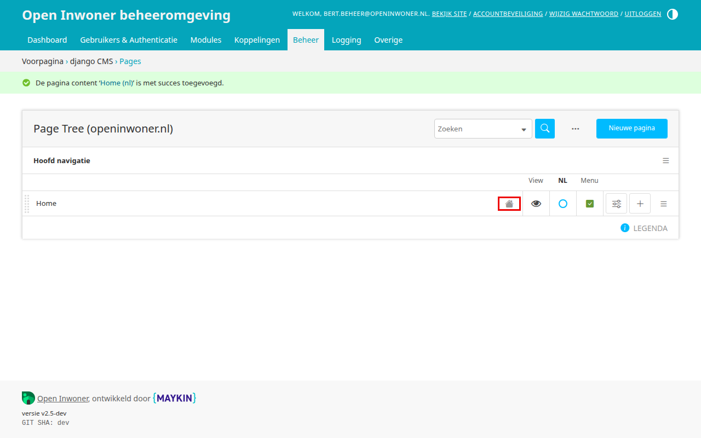

De homepage gebruikt het sjabloon "Home page template". Dit sjabloon heeft drie plekken waar u plugins kunt plaatsen (zie ook de tabel in hoofdstuk 11.3):

- **Bannerafbeelding**: een afbeelding bovenaan de pagina, met de plugin Bannerafbeelding.
- **Banner tekst**: een welkomsttekst voor ingelogde gebruikers, met de plugin Bannertext.
- **Content**: de inhoud van de pagina, zoals tekst, onderwerpen, de productzoeker of de zaken van de gebruiker.

**Stappenplan**

1. Maak de homepage aan via Beheer > CMS > Pagina inhoudelijk (zie hoofdstuk 11.1.5). Is het de eerste pagina van de website, dan wordt deze automatisch de startpagina. Wilt u een andere pagina als startpagina gebruiken, stel deze dan in via [Instellen als startpagina] (zie hoofdstuk 11.1.2).
2. Open de pagina en klik in de CMS-werkbalk op [Bewerken] (of [Nieuw concept]).
3. Open het plugin menu (zie hoofdstuk 11.2.7). Klik bij elke plek op [+] om een plugin toe te voegen. Bij Bannerafbeelding en Banner tekst is maar één soort plugin toegestaan: het formulier van die plugin opent dan direct.
4. Klik op [Publiceer]. Pas dan is de homepage zichtbaar voor bezoekers (zie hoofdstuk 11.1.11).

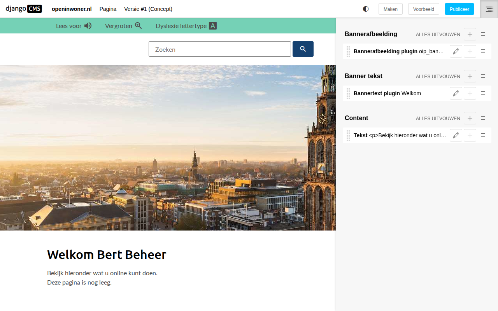

**Wat ziet een bezoeker die niet is ingelogd?**

Een bezoeker die niet is ingelogd ziet de bannerafbeelding, daaronder de welkomsttekst en daarna de plugins in Content. De welkomsttekst komt niet uit het CMS, maar uit de velden "Koptekst homepage" en "Introductietekst homepage" onder Algemene configuratie > Paginateksten (zie hoofdstuk 12.1.5). De plugin Bannertext wordt aan deze bezoekers niet getoond.

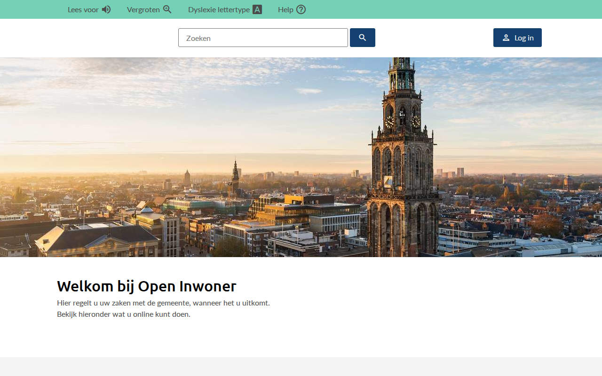

**Wat ziet een ingelogde inwoner?**

Een ingelogde gebruiker ziet in plaats van de welkomsttekst uit de configuratie de plugin Bannertext. Achter de titel van deze plugin staat de naam van de gebruiker, bijvoorbeeld "Welkom Gerda Gebruiker". Heeft u geen Bannertext plugin toegevoegd, dan ziet een ingelogde gebruiker geen welkomsttekst.

Let op! Dit geldt voor elke pagina met het sjabloon "Home page template", niet alleen voor de homepage. Ook op andere pagina's met dit sjabloon zien bezoekers die niet zijn ingelogd de welkomsttekst uit de configuratie.

**Plugins die een applicatie nodig hebben**

De plugins Onderwerpen, Vragenlijst, Productzoeker en Productlocatie worden alleen getoond als er een gepubliceerde pagina is die aan de Producten app gekoppeld is. Voor de plugin Actieve samenwerkingen is dat een gepubliceerde pagina met de Samenwerken app. Ziet u een plugin niet op de homepage, controleer dan of de pagina met de bijbehorende applicatie bestaat en gepubliceerd is (zie hoofdstuk 11.3 en 11.4).

De plugin Onderwerpen toont aan bezoekers die niet zijn ingelogd de gepubliceerde onderwerpen die als uitgelicht zijn gemarkeerd (zie hoofdstuk 6). De titel en introductietekst boven de onderwerpen stelt u in onder Algemene configuratie > Paginateksten.

**Bezoekers doorsturen naar de inlogpagina**

Wilt u dat bezoekers die niet zijn ingelogd de homepage niet zien, dan kunt u hen doorsturen naar een andere pagina, bijvoorbeeld de inlogpagina. Vul hiervoor onder Algemene configuratie het veld "Stuur niet-ingelogde gebruiker door naar" in, bijvoorbeeld met ``/accounts/login/`` (zie hoofdstuk 12.1.1). Na het inloggen komt de gebruiker op de homepage terecht.

De bannerafbeelding op de inlogpagina stelt u niet in op de homepage, maar in de alias ``login_banner`` (zie hoofdstuk 11.2.11). Hierin kunt u de plugin Bannerafbeelding plaatsen.

**Als er geen gepubliceerde homepage is**

Zolang de homepage niet is gepubliceerd, worden bezoekers van het hoofdadres doorgestuurd naar de beheeromgeving. Bezoekers die niet zijn ingelogd komen daar op het inlogscherm van de beheeromgeving terecht. Controleer daarom na het inrichten altijd of de homepage gepubliceerd is.

**Homepage via setup-configuration**

Bij een nieuwe installatie kan de technisch beheerder de homepage, met een aantal standaard plugins, automatisch laten aanmaken via setup-configuration. Zie hoofdstuk 11.6.
