.. _plannen:

.. _hoofdstuk-12:

==================
12. Samenwerkingen
==================

Onder **Modules > Samenwerkingen** vindt u de acties, berichten en documenten van gebruikers, de plan templates en het overzicht van de samenwerkingsplannen van gebruikers. Plan templates zijn vooraf gecreëerde sjablonen die gebruikers kunnen gebruiken als uitgangspunt voor hun samenwerkingsplan. Zo hoeven ze niet blanco te beginnen. U kunt plan templates en samenwerkingsplannen wijzigen of verwijderen en u kunt nieuwe toevoegen.

.. _hoofdstuk-12-1:

12.1. Acties
============

**Locatie in het menu:** Modules > Samenwerkingen > Acties

Onder acties vindt u alle acties die gebruikers op de website (onder Mijn Profiel en in samenwerkingen) hebben aangemaakt. Dit onderdeel is enkel in te zien (read-only): u kunt geen acties toevoegen of wijzigen.

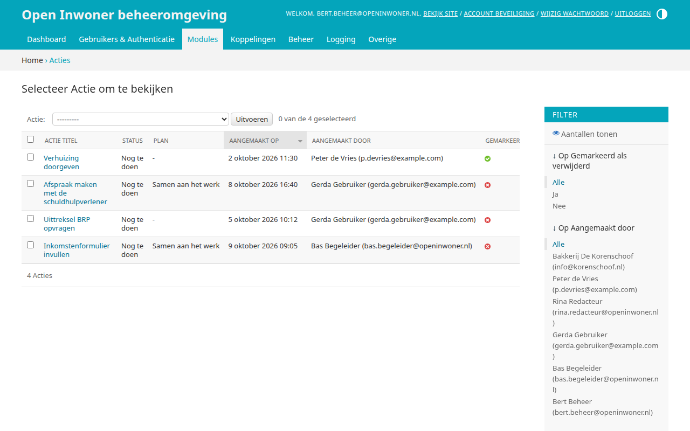

Het overzicht toont per actie de kolommen **Actie titel**, **Status**, **Plan** (de samenwerking waar de actie bij hoort), **Aangemaakt op**, **Aangemaakt door** en **Gemarkeerd als verwijderd**. Standaard staan de acties op volgorde van de datum waarvoor ze moeten worden uitgevoerd.

Rechts kunt u de acties filteren op **Gemarkeerd als verwijderd** en op **Aangemaakt door**. Kiest u bij **Aangemaakt door** een gebruiker, dan ziet u enkel de acties die deze gebruiker heeft aangemaakt.

Een actie die een gebruiker verwijdert, wordt niet echt verwijderd maar gemarkeerd als verwijderd. Via het dropdown menu bij ‘Actie’ kunt u geselecteerde acties zelf als verwijderd markeren ("Markeer geselecteerde acties als soft-deleted.") of zo'n markering ongedaan maken ("Herstel geselecteerde soft-deleted acties"); de gebruiker ziet de actie dan weer. Met "Geselecteerde acties verwijderen" verwijdert u acties definitief.

.. _hoofdstuk-12-1-1:

12.1.1. Actieoverzicht sorteren
-------------------------------

U kunt het actieoverzicht op elke kolom sorteren, bijvoorbeeld op actie titel, aanmaakdatum of de gebruiker die de actie heeft aangemaakt. Dit doet u door op de gewenste kolomnaam te klikken. Klikt u nogmaals op dezelfde kolomnaam, dan wisselt u tussen oplopend en aflopend sorteren. Dit kan ook met het icoontje van het driehoekje dat naar boven of naar beneden wijst.

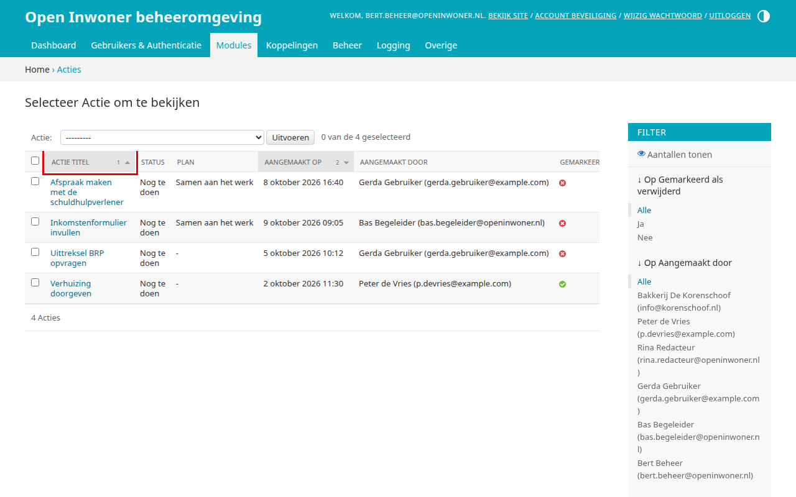

U kunt ook op meerdere kolommen tegelijk sorteren. Klikt u na **Actie titel** ook op **Aangemaakt op**, dan wordt de lijst gesorteerd op aanmaakdatum en daarbinnen op actie titel. Het is belangrijk te weten dat de nieuw aangeklikte kolom óver de al actieve sortering wordt gezet: de laatst aangeklikte kolom geldt dus als ‘hoofd’. Bij elke gesorteerde kolom staat een cijfer dat de volgorde van de sortering aangeeft. Om een kolom uit de sortering te verwijderen, klikt u op het icoontje van de twee driehoekjes met de streep erdoor.

12.2. Berichten
===============

**Locatie in het menu:** Modules > Samenwerkingen > Berichten

Onder berichten vindt u alle berichten die gebruikers elkaar via de Open Inwoner omgeving hebben gestuurd. Dit onderdeel is read-only: er kunnen geen wijzigingen worden aangebracht.

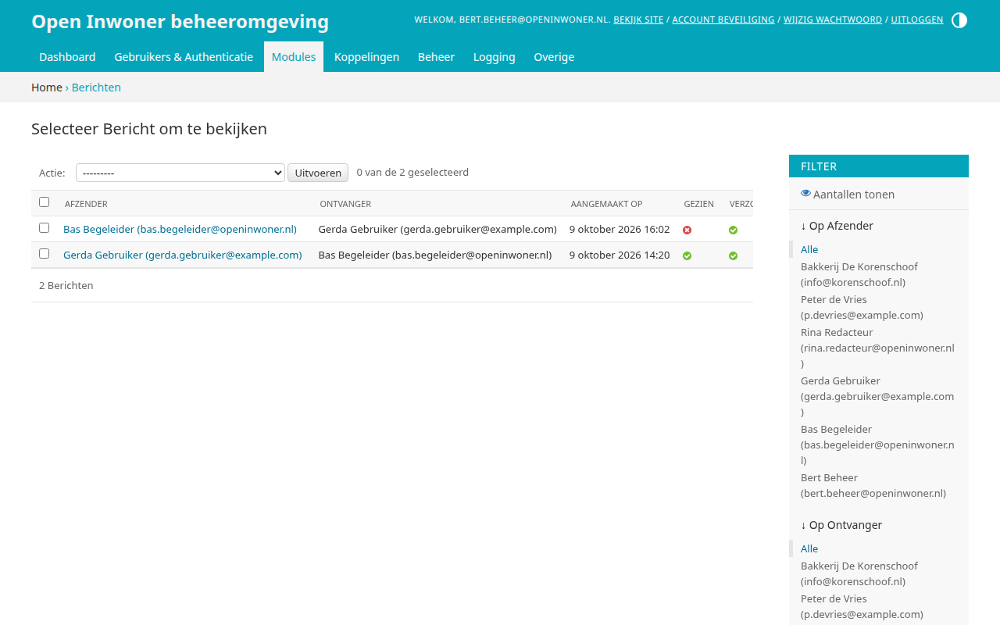

Het overzicht toont per bericht de kolommen **Afzender**, **Ontvanger**, **Aangemaakt op**, **Gezien** en **Verzonden**. Bij **Gezien** ziet u of de ontvanger het bericht heeft gelezen, bij **Verzonden** of de ontvanger een e-mail over het bericht is gestuurd. Dit wordt weergegeven met een groen vinkje (ja) of een rood kruisje (nee).

Rechts kunt u de berichten filteren op **Afzender** en op **Ontvanger**. U ziet dan enkel de berichten die verzonden zijn door, of naar, een bepaalde gebruiker.

12.2.1. Details berichten
-------------------------

Door op een specifiek bericht te klikken kunt u de details van het bericht raadplegen:

| **UUID**
| Het unieke kenmerk (Universally Unique ID) van het bericht.

| **Afzender**
| De gebruiker die het bericht heeft gestuurd.

| **Ontvanger**
| De gebruiker aan wie het bericht is gestuurd.

| **Content**
| De tekst van het bericht.

| **Gezien**
| Of de ontvanger het bericht heeft gezien.

| **Verzonden**
| Of de ontvanger een e-mail over het bericht is gestuurd.

| **Bestand**
| Een eventuele bijlage bij het bericht. Klik op de bestandsnaam om de bijlage te downloaden.

12.3. Documenten
================

**Locatie in het menu:** Modules > Samenwerkingen > Documenten

Onder documenten vindt u alle documenten die gebruikers op de website (onder Mijn Profiel en in samenwerkingen) hebben toegevoegd. Dit onderdeel is read-only: er kunnen geen wijzigingen worden aangebracht.

Het overzicht toont per document de kolommen **Naam**, **Bestand**, **Aangemaakt op** en **Eigenaar**. Klik op de bestandsnaam om het document te downloaden. Rechts kunt u de documenten filteren op **Eigenaar**. U ziet dan enkel de documenten die toegevoegd zijn door een bepaalde gebruiker.

12.3.1. Documentenoverzicht sorteren
------------------------------------

U kunt het documentenoverzicht sorteren op naam, aanmaakdatum en eigenaar; op de kolom **Bestand** kunt u niet sorteren. Dit doet u door op de gewenste kolomnaam te klikken. Voor meer details over het sorteren, raadpleegt u de beschrijving bij :ref:`hoofdstuk 12.1.1 <hoofdstuk-12-1-1>`.

12.4. Plan templates
====================

**Locatie in het menu:** Modules > Samenwerkingen > Plan templates

Onder plan templates vindt u het overzicht van de beschikbare sjablonen voor samenwerkingsplannen. U kunt eenvoudig een nieuwe template aanmaken. U kunt plan templates en plannen direct wijzigen of bestaande templates verwijderen.

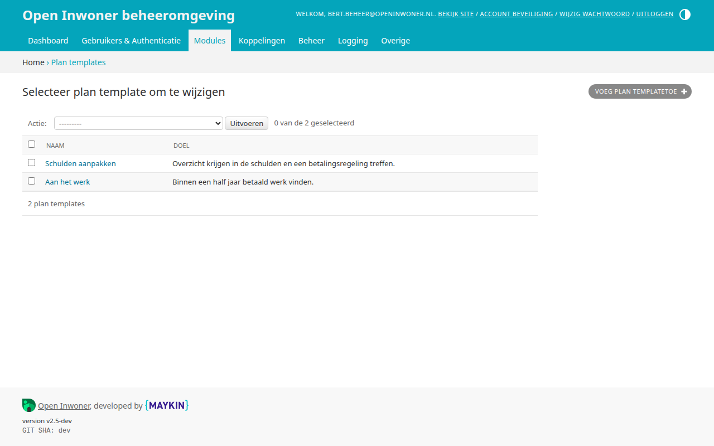

12.4.1. Item toevoegen
----------------------

Door op de knop :guilabel:`Plan template toevoegen +` rechts bovenin uw scherm te klikken kunt u een nieuwe plan template toevoegen. Er wordt een nieuw scherm geopend met allerlei velden die aangepast kunnen worden. Dit scherm is hetzelfde als wanneer u een item wijzigt (zie :ref:`12.4.2 <hoofdstuk-12-4-2>`).

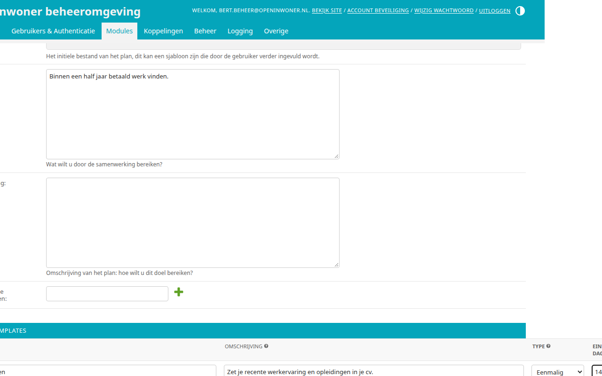

.. _hoofdstuk-12-4-2:

12.4.2. Item wijzigen
---------------------

U kunt een plan template wijzigen door op de betreffende template in het overzicht te klikken. Er wordt een nieuw scherm geopend waar u diverse wijzigingen kunt aanbrengen.

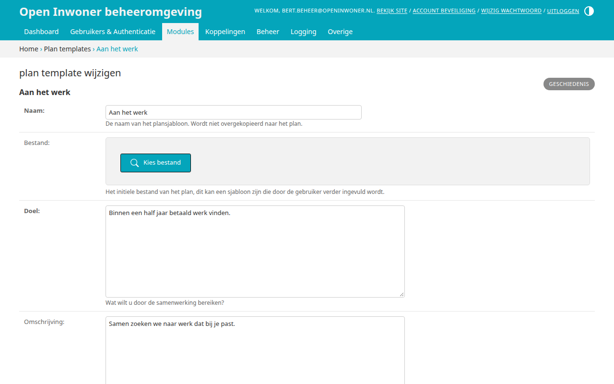

**Naam**
Hier kunt u de template een andere naam geven.

**Bestand**
Hier kunt u een bestand uploaden of het bestaande document vervangen door een nieuw te kiezen bestand. Om dit te doen klikt u op het potloodje. U kunt nu een nieuw document selecteren in de directory of een nieuw bestand uploaden. U kunt ook het huidige bestand verwijderen door op :guilabel:`x` te klikken.

**Doel**
Hier komt het doel van het samenwerkingsplan te staan dat met deze plan template wordt gemaakt. Wat wil de gebruiker bereiken met deze samenwerking?

*Let op: deze tekst ziet de gebruiker bij het kiezen van een plan template. Na het kiezen wordt de tekst overgenomen als* **doel** *van het samenwerkingsplan.*

**Omschrijving**
Hier beschrijft u hoe het doel van het samenwerkingsplan bereikt kan worden. Wanneer de gebruiker een samenwerkingsplan maakt met deze plan template, wordt deze tekst overgenomen als omschrijving van het plan.

**Gerelateerde onderwerpen**
Hier kiest u de onderwerpen (zie :ref:`hoofdstuk 11.2 <hoofdstuk-11-2>`) waarbij deze plan template past. Typ in het veld om een onderwerp te zoeken. Wanneer een gebruiker een samenwerkingsplan maakt, worden de plan templates met een onderwerp uit de interesses van de gebruiker bovenaan getoond.

**Action templates**
Dit zijn de vooraf ingevulde acties van de plan template. Welke acties wil de gebruiker ondernemen om het doel van de samenwerking te bereiken? De teksten die hier staan zijn voor de gebruiker zichtbaar onder het kopje ‘acties’. Ze kunnen door de gebruiker aan de voorzijde van het platform worden gepersonaliseerd.

Elke actie staat op een eigen regel in een tabel met de volgende kolommen. Via de link onder de tabel kunt u een extra actie toevoegen.

**Naam**
Dit is de vooraf ingestelde naam van de actie.

**Omschrijving**
Dit is de vooraf ingestelde omschrijving van de actie. Vul voor iedere actie een omschrijving in.

**Type**
Hier kunt u vooraf ingeven of het een eenmalige of terugkerende actie is. Vul dit in voor iedere actie.

**Eindigt in x dagen**
Hier kunt u vooraf ingeven over hoeveel dagen de actie dient te zijn afgerond. Vul dit in voor iedere actie.

**Verwijderen?**
Hier kunt u een vooraf ingestelde actie uit de template verwijderen. Zet een vinkje in de betreffende checkbox. Wanneer de template is opgeslagen wordt de betreffende actie verwijderd.

**Opslaan of verwijderen**
U kunt in dit scherm ook de betreffende plan template verwijderen door onderaan het scherm op de rode knop :guilabel:`Verwijderen` te klikken.

Als u uw wijzigingen tussentijds wilt opslaan, klikt u op :guilabel:`Opslaan en opnieuw bewerken`. Wanneer u tevreden bent met uw wijzigingen klikt u op :guilabel:`Opslaan` om terug te keren naar het overzicht. Of u klikt op :guilabel:`Opslaan en nog een toevoegen` als u een extra item wilt toevoegen.

12.5. Samenwerken
=================

**Locatie in het menu:** Modules > Samenwerkingen > Samenwerken

Onder samenwerken vindt u een overzicht van de door gebruikers aangemaakte samenwerkingsplannen. U kunt deze vanuit de beheeromgeving inzien, wijzigen of verwijderen en u kunt een nieuw samenwerkingsplan toevoegen.

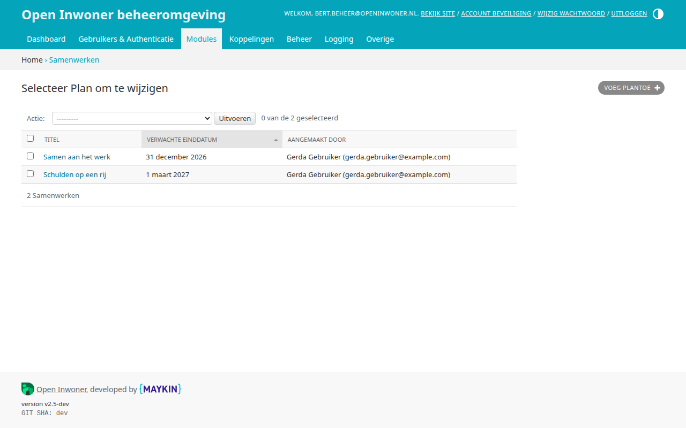

12.5.1. Plan toevoegen
----------------------

Door in het overzicht op de knop :guilabel:`Toevoegen +` rechts bovenin uw scherm te klikken kunt u een nieuw samenwerkingsplan toevoegen. Er wordt een nieuw scherm geopend waar u enkele gegevens dient in te vullen. Wanneer alle gegevens zijn ingevuld klikt u op :guilabel:`Opslaan`.

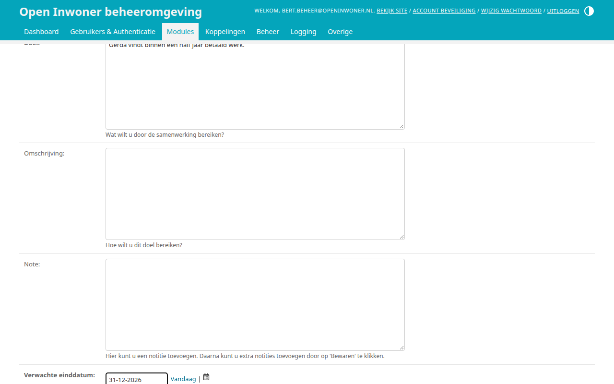

12.5.2. Plan wijzigen
---------------------

Door op een samenwerkingsplan in het overzicht te klikken, kunt u deze wijzigen. Er wordt een nieuw scherm geopend waar u diverse wijzigingen kunt aanbrengen. Dit scherm bestaat uit twee delen: het algemene deel en het actiedeel. In het actiedeel kunt u direct de bij het samenwerkingsplan horende acties wijzigen of toevoegen. Alle informatie over de elementen binnen het actiedeel vindt u in :ref:`hoofdstuk 12.5.3 <hoofdstuk-12-5-3>`.

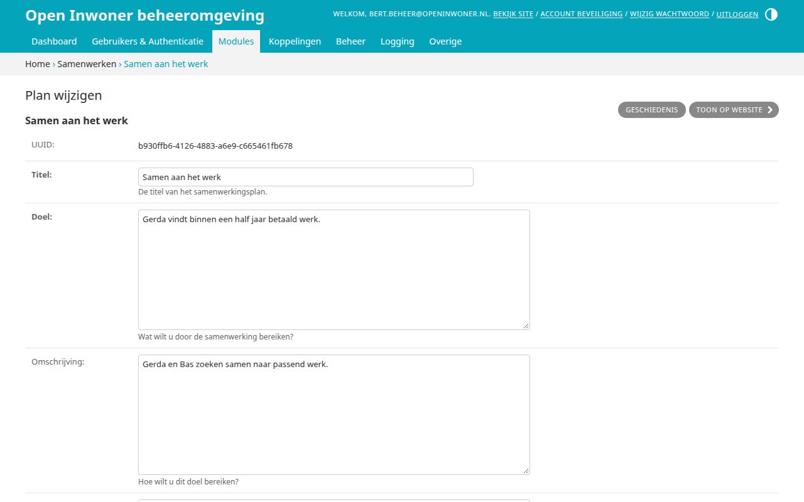

**UUID (Universally Unique ID)**
Dit is het automatisch gegenereerde unieke kenmerk van het samenwerkingsplan. Deze code kunt u niet wijzigen.

**Titel**
Hier kunt u het samenwerkingsplan een andere naam geven.

**Doel**
Hier komt het doel van het samenwerkingsplan te staan. Wat wil de gebruiker bereiken met deze samenwerking?

**Omschrijving**
Hier staat hoe de gebruiker het doel van het samenwerkingsplan wil bereiken.

**Note**
Hier staan de notities bij het samenwerkingsplan. Op de website ziet de gebruiker deze onder het kopje *Notities* van het plan, waar ze ook kunnen worden aangevuld. Dit veld heeft in de beheeromgeving een Engelse naam.

**Verwachte einddatum**
Hier kunt u de einddatum van het samenwerkingsplan wijzigen. Dit is de datum waarvoor het doel van het samenwerkingsplan door de gebruiker dient te zijn behaald.

**Aangemaakt door**
Hier wordt het e-mailadres van de gebruiker die het samenwerkingsplan aangemaakt heeft weergegeven. Door op :guilabel:`+` te klikken kunt u een extra gebruiker toevoegen.

**Plan contacts**
Onder dit kopje worden in een tabel de betrokken contactpersonen weergegeven, in de kolom *Contact*. Klik op een naam om een andere contactpersoon te selecteren. Door op :guilabel:`+` te klikken kunt u een extra contactpersoon aan het samenwerkingsplan toevoegen.

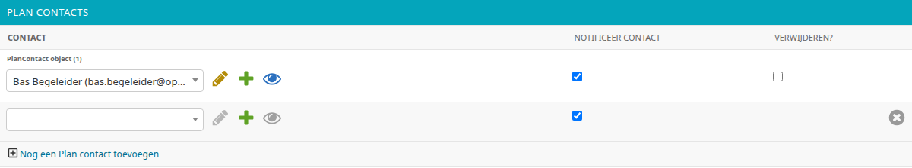

Door een vinkje te zetten bij *Notificeer contact* ontvangt de betrokken contactpersoon een notificatie dat deze bij de samenwerking betrokken is. Om de contactpersoon van de samenwerking te verwijderen zet u een vinkje bij :guilabel:`Verwijderen` alvorens de samenwerking op te slaan.

**Opslaan of verwijderen**
U kunt in dit scherm ook het betreffende samenwerkingsplan verwijderen door onderaan het scherm op de rode knop :guilabel:`Verwijderen` te klikken.

Als u uw wijzigingen tussentijds wilt opslaan, klikt u op :guilabel:`Opslaan en opnieuw bewerken`. Wanneer u tevreden bent met uw wijzigingen klikt u op :guilabel:`Opslaan` om terug te keren naar het overzicht. Of u klikt op :guilabel:`Opslaan en nog een toevoegen` als u een extra item wilt toevoegen.

.. _hoofdstuk-12-5-3:

12.5.3. Acties samenwerkingsplan
--------------------------------

Bij de samenwerkingsplannen horen acties. De acties die gekoppeld zijn aan een samenwerking zijn onder *Samenwerken* in hetzelfde venster te vinden. Alle gekoppelde acties worden hier onder elkaar weergegeven. De onderdelen per actie zijn te zien in de onderstaande screenshot. Deze onderdelen zijn tot op zekere hoogte hetzelfde als het onderdeel *Acties* (zie :ref:`hoofdstuk 12.1 <hoofdstuk-12-1>`), met als verschil dat de onderdelen onder *Samenwerken* kunnen worden gewijzigd.

In *Mijn profiel* vindt de gebruiker een overzicht van alle verzamelde acties bij elkaar. Een voorbeeld van dit scherm op de website is te zien in het volgende screenshot.

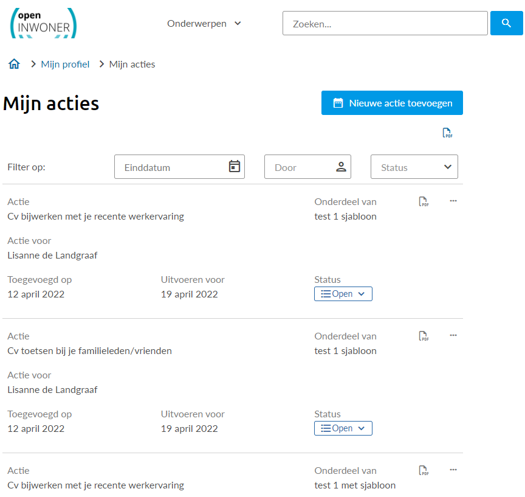

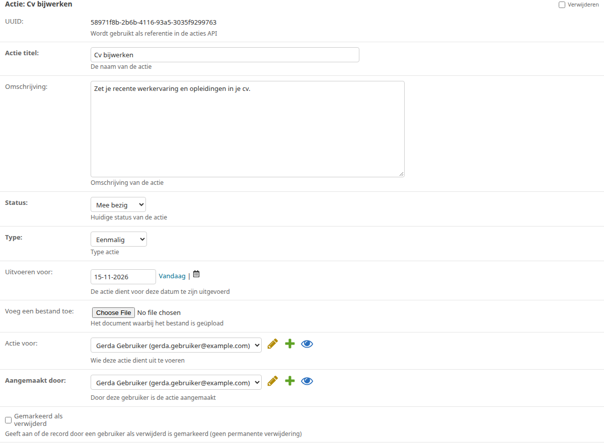

**UUID (Universally Unique ID)**
Dit is het automatisch gegenereerde unieke kenmerk van de actie. Deze code kunt u niet wijzigen.

**Actie titel**
Hier kunt u de actie een andere naam geven.

**Omschrijving**
Hier kunt u een korte omschrijving van de actie invullen.

**Status**
Hier kunt u selecteren wat de huidige status van de actie is: 'Nog te doen', 'Mee bezig' of 'Klaar'.

**Type**
In dit dropdown menu kunt u selecteren of de actie eenmalig is of terugkerend.

**Uitvoeren voor**
Hier kunt u de einddatum van de actie wijzigen. Dit is de datum waarvoor de actie dient te zijn afgerond door de gebruiker.

**Voeg een bestand toe**
Hier kunt u een bestand met betrekking tot de actie uploaden of het bestaande document vervangen door een nieuw te kiezen bestand. Om dit te doen klikt u op :guilabel:`Bestand kiezen`. U kunt nu een nieuwe versie van het document uploaden, of een geheel ander bestand kiezen.

**Actie voor**
Hier kunt u aangeven bij welke gebruiker de actie hoort (welke gebruiker de actie dient uit te voeren), of de gebruiker wijzigen. Door op :guilabel:`+` te klikken kunt u een extra gebruiker toevoegen.

**Aangemaakt door**
Hier kunt u aangeven wie de actie heeft aangemaakt, of de initiator wijzigen. Door op :guilabel:`+` te klikken kunt u een extra initiator toevoegen.

**Gemarkeerd als verwijderd**
Hier kunt u selecteren of de actie als verwijderd moet worden gemarkeerd. Indien de gebruiker de actie als verwijderd heeft gemarkeerd staat hier een vinkje. Let op, het gaat hier niet om een permanente verwijdering.

12.5.4. Plan verwijderen
------------------------

Wanneer u een of meerdere samenwerkingsplannen wilt verwijderen, klikt u in de checkbox links van de titel van het samenwerkingsplan. Selecteer vervolgens in het dropdown menu bij ‘Actie’ de actie ‘Geselecteerde Samenwerken verwijderen’ en klik op de knop :guilabel:`Uitvoeren`. De geselecteerde samenwerkingsplannen zijn nu verwijderd.
