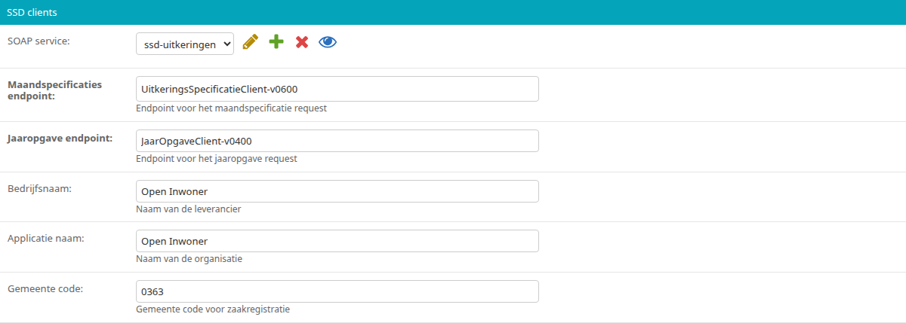
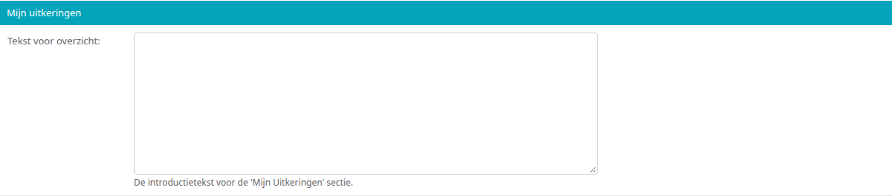
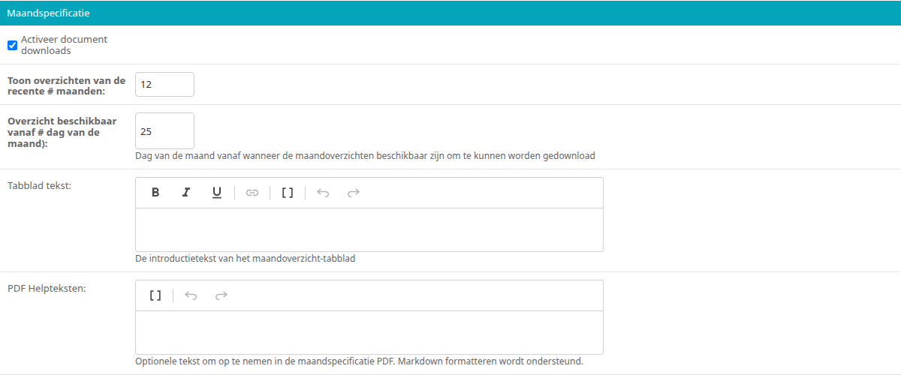
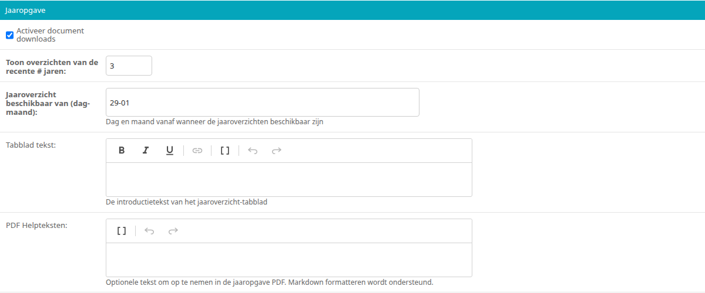

.. _hoofdstuk-13:

===============
13. Uitkeringen
===============

U vindt de onderdelen van dit hoofdstuk in het menu onder **Modules > Uitkeringen**.

.. _hoofdstuk-13-1:

13.1. SSD
=========

**Locatie in het menu:** Modules > Uitkeringen > Mijn uitkeringen

Bij **Modules > Uitkeringen > Mijn uitkeringen** configureert u de koppeling met de Suite voor Sociaal Domein (SSD) en het onderdeel Mijn uitkeringen: welke overzichten van uitkeringen gebruikers kunnen downloaden en welke teksten daarbij staan.

13.1.1. SSD clients
-------------------

Onder "SSD clients" stelt u de koppeling met de Suite voor Sociaal Domein in.

| **SOAP service**
| De SOAP service waarmee de SSD wordt bevraagd (zie :ref:`hoofdstuk 16.2 <hoofdstuk-16-2>`).

| **Maandspecificaties endpoint**
| Het endpoint voor het opvragen van de maandspecificaties.

| **Jaaropgave endpoint**
| Het endpoint voor het opvragen van de jaaropgaven.

| **Bedrijfsnaam**
| De naam van de leverancier.

| **Applicatie naam**
| De naam van de applicatie die gebruik maakt van de SSD.

| **Gemeente code**
| De gemeentecode voor de zaakregistratie.

13.1.2. Mijn uitkeringen
------------------------

Onder "Mijn uitkeringen" vult u bij **Tekst voor overzicht** de begeleidende tekst in die bovenaan het onderdeel Mijn uitkeringen staat. Dit is een tekstveld zonder opmaakmogelijkheden.

13.1.3. Maandspecificatie
-------------------------

Onder "Maandspecificatie" configureert u het tabblad Maandspecificatie in het onderdeel Mijn uitkeringen.

| **Activeer document downloads**
| Wanneer hier een vinkje staat, kunnen gebruikers hun maandspecificaties downloaden. Dit staat standaard aan.

| **Toon overzichten van de recente # maanden**
| Van hoeveel maanden overzichten worden getoond. Standaard is dit 12.

| **Overzicht beschikbaar vanaf # dag van de maand)**
| Vanaf welke dag van de maand de maandspecificatie van de voorgaande maand beschikbaar is om te downloaden. Standaard is dit de 25e.

| **Tabblad tekst**
| De begeleidende tekst op het tabblad Maandspecificatie. Hier kunt u een teksteditor met eenvoudige opmaak (vet, cursief, onderstreept en links) gebruiken.

| **PDF Helpteksten**
| Optionele toelichting die in de PDF van de maandspecificatie wordt opgenomen, in alinea's zonder opmaak.

13.1.4. Jaaropgave
------------------

Onder "Jaaropgave" configureert u het tabblad Jaaropgave in het onderdeel Mijn uitkeringen.

| **Activeer document downloads**
| Wanneer hier een vinkje staat, kunnen gebruikers hun jaaropgaven downloaden. Dit staat standaard aan.

| **Toon overzichten van de recente # jaren**
| Van hoeveel jaar overzichten worden getoond. Standaard is dit 3.

| **Jaaroverzicht beschikbaar van (dag-maand)**
| Vanaf welke dag en maand (bijvoorbeeld ``29-01``) de jaaropgave van het voorgaande jaar beschikbaar is om te downloaden. Standaard is dit 29 januari.

| **Tabblad tekst**
| De begeleidende tekst op het tabblad Jaaropgave. Hier kunt u een teksteditor met eenvoudige opmaak (vet, cursief, onderstreept en links) gebruiken.

| **PDF Helpteksten**
| Optionele toelichting die in de PDF van de jaaropgave wordt opgenomen, in alinea's zonder opmaak.
