.. _hoofdstuk-14:

=========
14. Zaken
=========

U vindt de onderdelen van dit hoofdstuk in het menu onder **Modules > Zaken**. Hoe u Mijn Zaken stap voor stap inricht, leest u in :ref:`hoofdstuk 14.1 <hoofdstuk-14-1>`.

.. _mijn-zaken-inrichten:

.. _hoofdstuk-14-1:

14.1. Mijn Zaken inrichten
==========================

In Mijn Zaken ziet een inwoner die met DigiD (of een bedrijf dat met eHerkenning) is ingelogd zijn of haar zaken uit Open Zaak of eSuite. Om Mijn Zaken in te richten doorloopt u de onderstaande stappen in deze volgorde. Bij elke stap staat waar u de details van het betreffende scherm vindt.

.. _hoofdstuk-14-1-1:

14.1.1. Stap 1: Services aanmaken
---------------------------------

Open Inwoner haalt de zaken op via drie API's van het zaaksysteem. Voor elke API maakt u een service aan via **Koppelingen > Services** en de knop :guilabel:`Service toevoegen`:

- de **Zaken API**, met als type "ZRC (Zaken API)";
- de **Catalogi API**, met als type "ZTC (Catalogi API)";
- de **Documenten API**, met als type "DRC (Documenten API)".

Vul per service ten minste het label, de slug, het type, de basisurl van de API en de autorisatiegegevens in en klik op :guilabel:`Opslaan`. De velden worden beschreven in :ref:`hoofdstuk 16.3 <hoofdstuk-16-3>`.

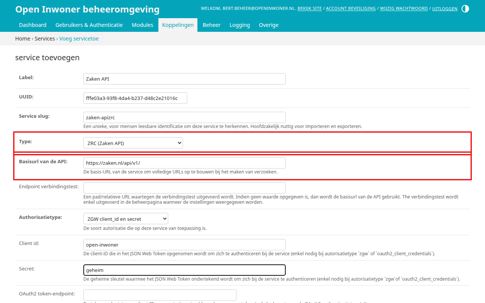

14.1.2. Stap 2: ZGW API set instellen
-------------------------------------

Ga naar **Modules > Zaken > Configuratie 'Open Zaak'** en klik onder "ZGW API sets" op :guilabel:`Nog een ZGW API set toevoegen`. Vul onder "Basisconfiguratie" een naam in en kies de services uit stap 1 bij **Zaken API**, **Documenten API** en **Catalogi API**. Deze drie zijn verplicht; de **Formulieren API** is optioneel. Klik daarna op :guilabel:`Opslaan`.

Gebruikt u (nog) geen klantensysteem (zie :ref:`hoofdstuk 9.1 <hoofdstuk-9-1>`), maak dan het veld **Klanten API back-end** leeg. Staat daar een klantensysteem dat niet is geconfigureerd, dan kunt u de API set niet opslaan.

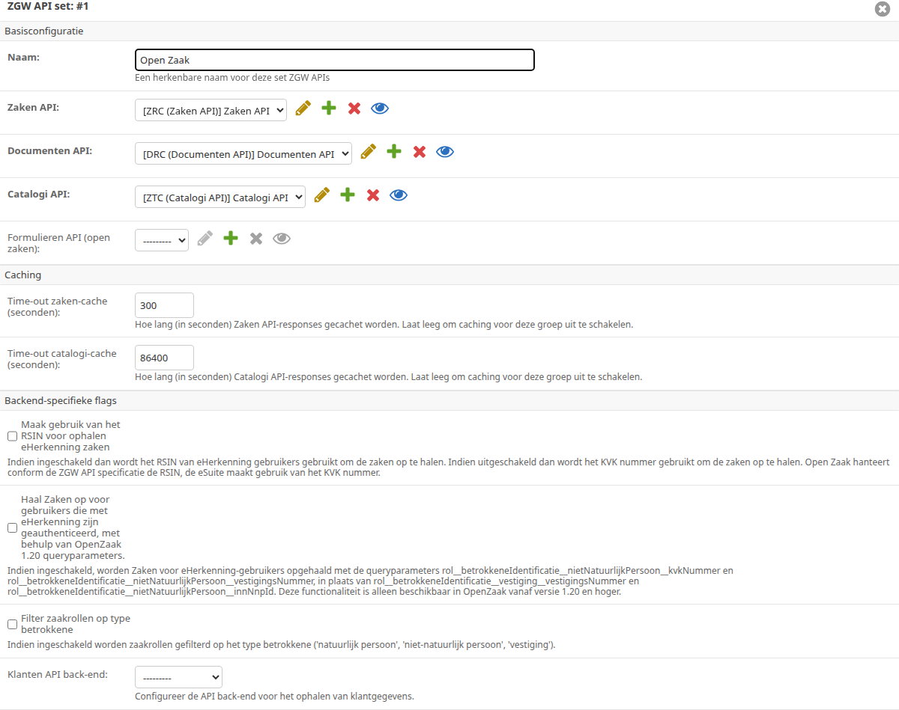

De velden van de API set worden beschreven in :ref:`hoofdstuk 14.3.4 <hoofdstuk-14-3-4>`, de overige instellingen van de Configuratie 'Open Zaak' in :ref:`hoofdstuk 14.3 <hoofdstuk-14-3>`. De standaardinstellingen volstaan om Mijn Zaken te laten werken.

.. _hoofdstuk-14-1-3:

14.1.3. Stap 3: Zaaktypen importeren
------------------------------------

De zaaktypen worden elke dag om 07:00 uur automatisch geïmporteerd door de achtergrondtaak "Importeer ZGW data". Wilt u niet wachten, dan start u de import zelf via **Beheer > Achtergrond taken > Periodic tasks**: klik bij de taak "Importeer ZGW data" op :guilabel:`Start taak`. De taak wordt uitgevoerd door de achtergrondverwerking van het platform; het kan dus even duren voordat de zaaktypen zichtbaar zijn.

Na de import vindt u de zaaktypen onder **Modules > Zaken > Zaaktype Configuraties**. Zaaktypen die in het zaaksysteem als "intern" zijn aangemerkt, worden niet geïmporteerd.

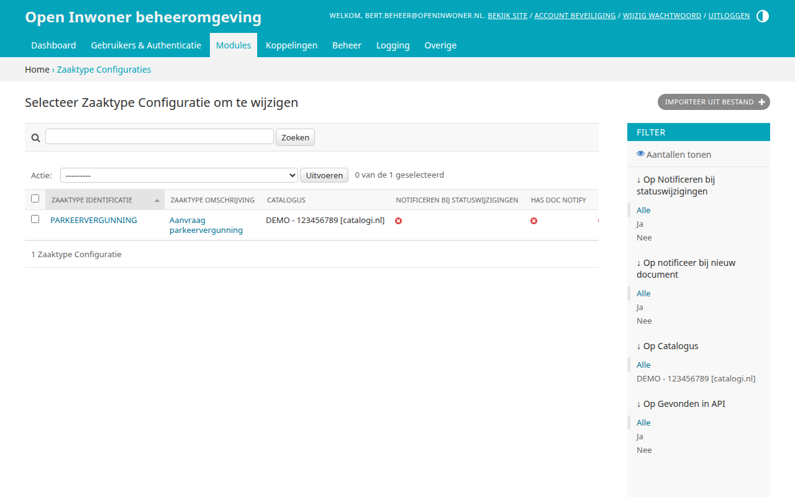

Voor het tonen van zaken is de import niet nodig. U heeft de geïmporteerde zaaktypen wel nodig om per zaaktype instellingen te doen, zoals notificaties, het uploaden van documenten, het contactformulier en de teksten bij statussen. Zie :ref:`hoofdstuk 14.10 <hoofdstuk-14-10>`.

14.1.4. Stap 4: De pagina Mijn zaken aanmaken
---------------------------------------------

Mijn Zaken staat op een pagina in het CMS. Ga naar **Beheer > CMS > Pagina inhoudelijk** en maak onder de startpagina een pagina aan met de titel "Mijn zaken" (zie :ref:`hoofdstuk 19.1.5 <hoofdstuk-19-1-5>`). Pagina's onder de startpagina worden in het menu getoond.

14.1.5. Stap 5: Pagina opties instellen en publiceren
-----------------------------------------------------

Open de pagina in de bewerkmodus en kies in de CMS-werkbalk :guilabel:`Pagina` > :guilabel:`Pagina opties...` (zie :ref:`hoofdstuk 19.5 <hoofdstuk-19-5>`):

- zet een vinkje bij **Vereist DigiD/eHerkenning authenticatie**, zodat alleen inwoners en bedrijven die met DigiD of eHerkenning zijn ingelogd Mijn zaken in het menu zien;
- kies bij **Icoon** het icoon "Zaken" voor het menu.

Klik op :guilabel:`Opslaan` en daarna in de werkbalk op :guilabel:`Publiceer`.

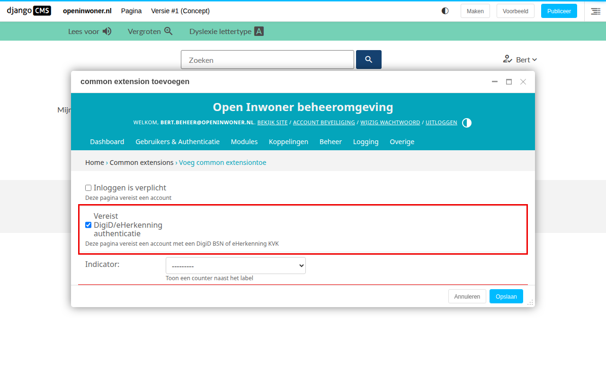

.. note::

   Stel de pagina opties in voordat u in stap 6 de applicatie koppelt. Daarna toont de pagina Mijn Zaken, en die kunt u als beheerder zonder BSN niet openen, ook niet in de bewerkmodus.

14.1.6. Stap 6: De applicatie koppelen
--------------------------------------

Ga in het paginaoverzicht naar de **Geavanceerde instellingen** van de pagina (zie :ref:`hoofdstuk 19.1.3 <hoofdstuk-19-1-3>`), kies bij **Applicatie** de "Mijn Zaken app" en klik op :guilabel:`Opslaan`. De URL van de pagina is vanaf nu het startpunt van Mijn Zaken, bijvoorbeeld ``/mijn-zaken/`` (zie :ref:`hoofdstuk 19.4 <hoofdstuk-19-4>`). De gekoppelde applicatie is een instelling van de pagina zelf en geldt direct, ook voor de gepubliceerde versie; opnieuw publiceren is niet nodig.

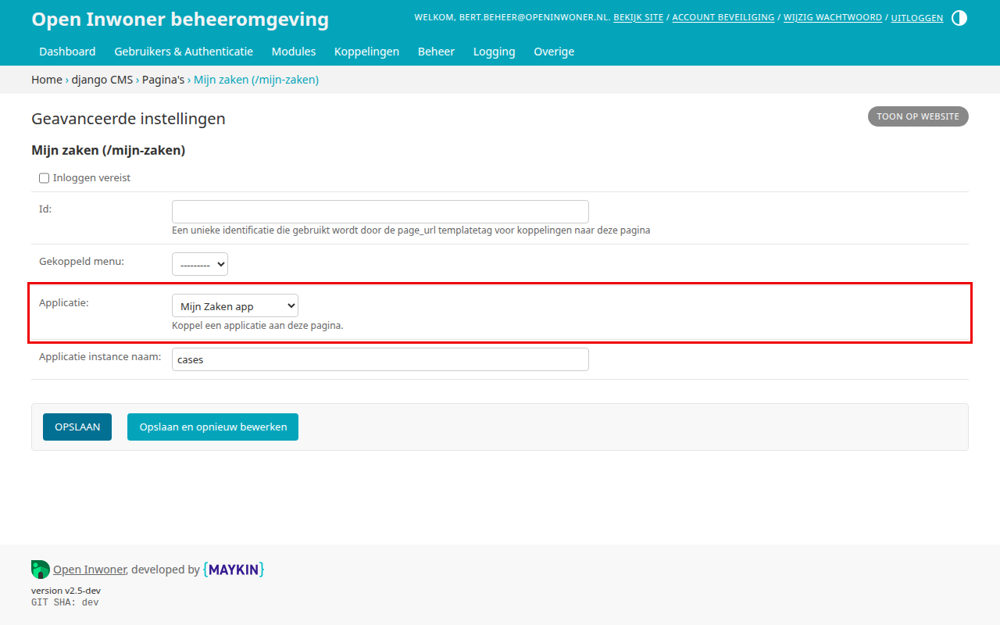

14.1.7. Stap 7: Controleren als inwoner
---------------------------------------

Log in met DigiD als een inwoner die zaken heeft in het zaaksysteem. In de navigatie aan de linkerkant van de pagina staat nu "Mijn zaken". Ingelogde gebruikers vinden de pagina's onder de startpagina in deze navigatie; het menu onder hun naam bevat alleen Mijn profiel (als die pagina bestaat) en Uitloggen.

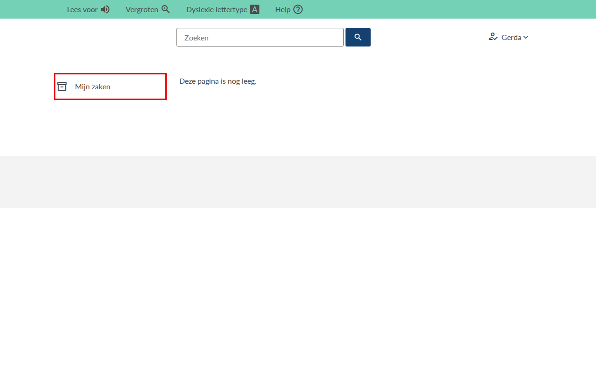

Mijn zaken toont de zaken van de inwoner. Bij elke zaak staat de omschrijving van het zaaktype.

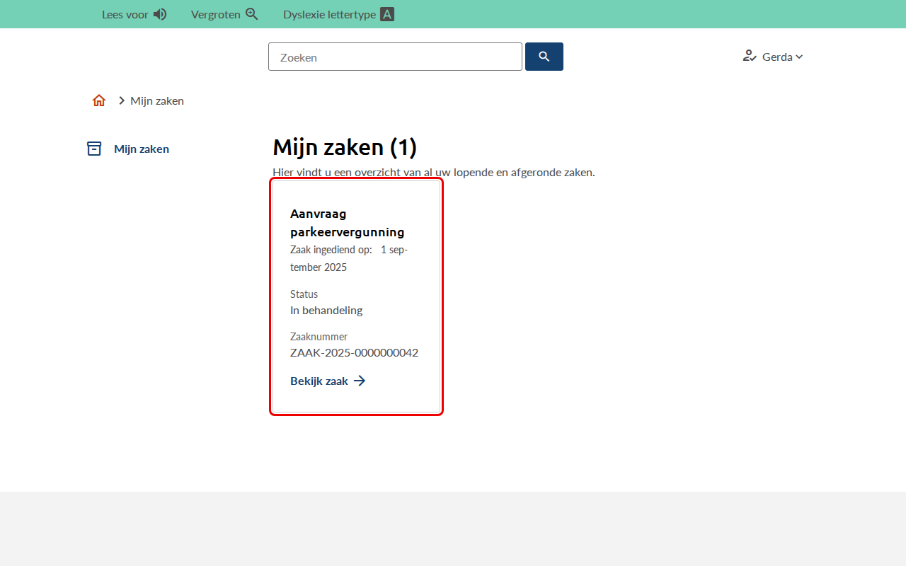

Via een zaak opent de inwoner de details van de zaak, met de statussen en documenten.

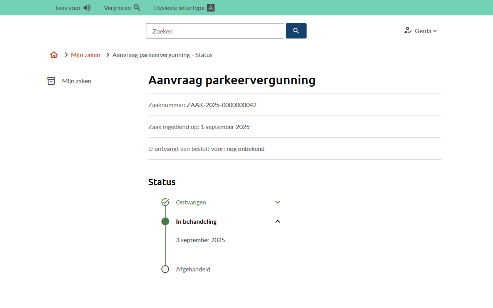

.. _hoofdstuk-14-1-8:

14.1.8. Wanneer ziet een inwoner een zaak?
------------------------------------------

Een inwoner ziet een zaak in Mijn zaken als aan alle volgende voorwaarden is voldaan:

- de inwoner heeft een rol bij de zaak: de zaken worden in de Zaken API opgezocht op het BSN van de inwoner (of het KvK-nummer van het bedrijf). Onder **Beperk de getoonde zaken tot deze rol** kunt u dit beperken tot één rol, bijvoorbeeld de initiator;
- de zaak heeft een status. Wilt u ook zaken zonder status tonen, zet dan een vinkje bij **Toon zaken die geen status hebben** (zie :ref:`hoofdstuk 14.3.2 <hoofdstuk-14-3-2>`);
- het zaaktype is in het zaaksysteem aangemerkt als "extern". Zaken van interne zaaktypen worden nooit getoond;
- de vertrouwelijkheid van de zaak is niet hoger dan de ingestelde **Vertrouwelijkheid van de zaak**. Standaard is dit "Openbaar" (zie :ref:`hoofdstuk 14.3.1 <hoofdstuk-14-3-1>`);
- als bij het zaaktype **Toon zaken vanaf deze datum** is ingevuld, is de zaak op of na die datum gestart (zie :ref:`hoofdstuk 14.10.1 <hoofdstuk-14-10-1>`).

.. _hoofdstuk-14-1-9:

14.1.9. Wat als een stap ontbreekt?
-----------------------------------

- **Geen ZGW API set** (stap 1 en 2): Mijn zaken toont de melding "U heeft op dit moment nog geen lopende zaken."
- **Zaaktypen niet geïmporteerd** (stap 3): de zaken worden wel getoond, maar u kunt geen instellingen per zaaktype doen.
- **Geen gepubliceerde pagina, of geen applicatie gekoppeld** (stap 4 tot en met 6): Mijn zaken staat niet in het menu en er zijn geen links naar Mijn zaken. Zonder gepubliceerde pagina met de "Mijn Zaken app" bestaat het adres van Mijn zaken niet; zonder gekoppelde applicatie is de pagina een gewone, lege pagina.
- **Geen "Vereist DigiD/eHerkenning authenticatie"** (stap 5): Mijn zaken staat ook voor bezoekers die niet zijn ingelogd in het menu. De zaken zelf blijven beschermd: een bezoeker die niet is ingelogd wordt naar de inlogpagina gestuurd, en een gebruiker zonder BSN of KvK-nummer krijgt een melding dat hij of zij geen toegang heeft tot de pagina (403).
- **De zaak voldoet niet aan de voorwaarden** (zie :ref:`14.1.8 <hoofdstuk-14-1-8>`): de zaak wordt niet getoond. Heeft de inwoner geen zichtbare zaken, dan ziet hij of zij de melding "U heeft op dit moment nog geen lopende zaken."
- **Het zaaksysteem is niet bereikbaar**: Mijn zaken toont de melding "Er is iets misgegaan bij het ophalen van uw zaken. Ververs de pagina of probeer het later opnieuw." Kon een deel van de zaken niet worden opgehaald, dan ziet de inwoner de zaken die wel zijn opgehaald, met een melding dat niet alle zaken konden worden opgehaald.

14.2. Catalogus Configs
=======================

**Locatie in het menu:** Modules > Zaken > Catalogus configs

Catalogus configs worden automatisch geïmporteerd vanuit Open Zaak of eSuite via de ZGW-koppeling. Aan deze catalogi zijn zaaktypes gekoppeld, zoals geconfigureerd in het onderdeel Zaaktype configuraties (zie :ref:`hoofdstuk 14.10 <hoofdstuk-14-10>`).

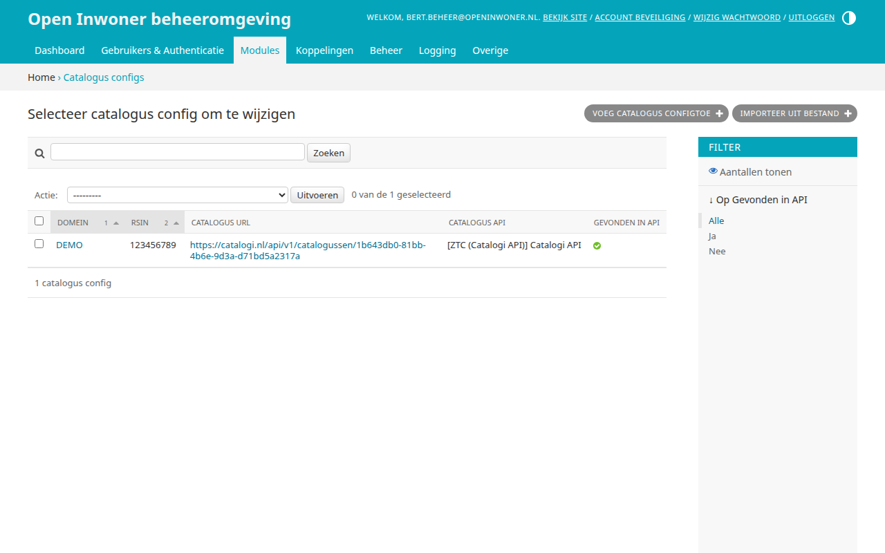

.. _CatalogusImportExport:

.. _hoofdstuk-14-2-1:

14.2.1. Importeren en exporteren
--------------------------------

Catalogi en Zaaktype Configuraties kunnen worden geëxporteerd en geïmporteerd tussen verschillende OIP-installaties (bijvoorbeeld tussen acceptatie- en testomgevingen).

.. note::
   De import/export-functionaliteit vereist dat de gekoppelde zaaksystemen materieel gelijk zijn. Dit betekent dat de catalogi en onderliggende zaaktypes in beide ZGW API's aanwezig moeten zijn (hoewel de URLs en UUIDs mogen verschillen). Voer daarom de ``Importeer ZGW data`` periodieke taak eerst handmatig uit op zowel de bron als bestemming zodat de ZGW objecten volledig in sync zijn.

.. note::
   Het onderstaande proces spitst zich toe op het importeren van hele Catalogus Configuraties. Echter, het is eveneens mogelijk om alleen bepaalde Zaaktype Configuraties te importeren/exporteren. Dit werkt op exact dezelfde wijze als in deze sectie is omschreven voor de Catalogus Configuraties. Ongeacht via welk scherm de export is aangemaakt, kunnen de opgeslagen bestanden op zowel de totaaloverzichten van Catalogus Configuraties en Zaaktype Configuraties geïmporteerd worden. Zie ook :ref:`ZTCImportExport`.

.. _hoofdstuk-14-2-2:

14.2.2. Catalogus configs exporteren
------------------------------------

Stappen voor exporteren:

#. Selecteer een of meer catalogus configs in het overzicht
#. Kies "Exporteren naar bestand" in de "Actie" dropdown linksboven de lijst

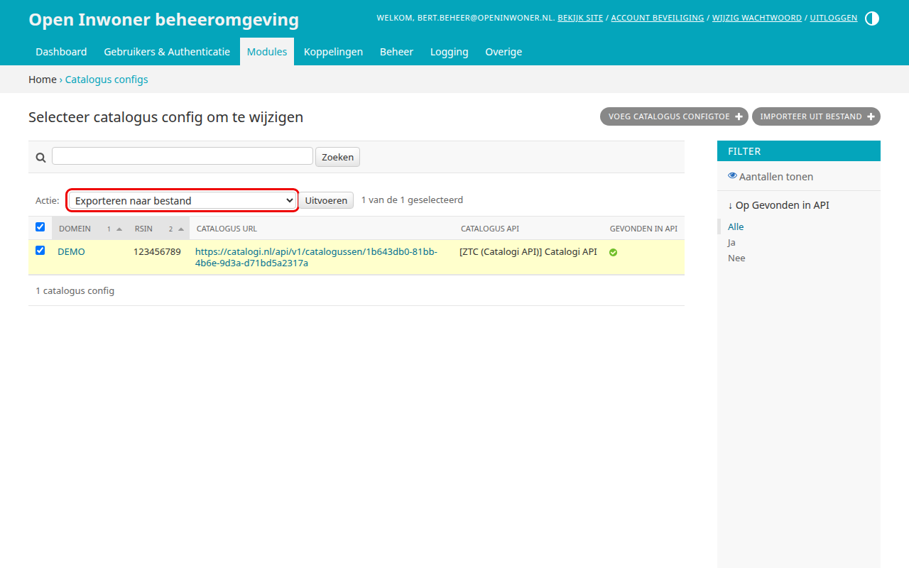

De export omvat alle catalogi, zaaktypes en onderliggende objecten (resultaattypen, informatie-objecttypen, etc.) van de geselecteerde catalogi.

.. _hoofdstuk-14-2-3:

14.2.3. Catalogus configs importeren
------------------------------------

Tijdens de import zoekt de ontvangende installatie catalogi en zaaktypes op basis van specifieke kenmerken. Deze matching bepaalt hoe bijbehorende data (beschrijvingen, instellingen en metadata) worden gekoppeld.

**Matching-attributen**

- **Catalogus Config**: ``domein`` en ``rsin`` moeten gelijk zijn
- **Zaaktype Configuratie**: ``identificatie`` en bovenliggende ``catalogus`` moeten gelijk zijn
- **Status, Resultaat en Informatie Object Typen**: ``omschrijving`` en de bovenliggende
  ``zaaktype`` moeten gelijk zijn

Stappen voor importeren:

#. Klik op "Importeer uit bestand" rechtsboven op de catalogus configs-overzichtspagina

   .. image:: images/zaken-catalogus-import.png
      :alt: De knop "Importeer uit bestand" in het overzicht van de catalogus configs
      :width: 700px

#. Selecteer een bestand van uw lokale computer
#. Upload het bestand

   .. image:: images/zaken-catalogus-import-bestand.png
      :alt: De pagina "Importeer ZGW gegevens vanuit een bestand" met een gekozen bestand
      :width: 700px

   .. warning::
      - Het importeren kan aanzienlijke tijd in beslag nemen

#. Na afloop toont het systeem:

   * Het aantal succesvol geïmporteerde objecten
   * Het aantal niet-geïmporteerde objecten. De meest voorkomende reden voor foutmeldingen
     betreft ontbrekende objecten met de gespecificeerde matching-attributen. De attributen die ertoe leidden dat bepaalde objecten niet gevonden konden worden, zullen zoveel mogelijk worden vermeld.

   .. image:: images/zaken-catalogus-import-resultaat.png
      :alt: De melding met het aantal verwerkte en falende rijen na het importeren
      :width: 700px

.. _zgw-api-configuratie:

.. _hoofdstuk-14-3:

14.3. Configuratie 'Open Zaak'
==============================

**Locatie in het menu:** Modules > Zaken > Configuratie 'Open Zaak'

Dit is de configuratie voor de koppeling van het Open Inwoner platform met Open Zaak of eSuite. U vindt deze via **Modules > Zaken > Configuratie 'Open Zaak'**. Om Mijn Zaken te kunnen gebruiken is het noodzakelijk om in een ZGW API set (zie :ref:`hoofdstuk 14.3.4 <hoofdstuk-14-3-4>`) de Zaken API, de Catalogi API en de Documenten API in te stellen. Hierdoor worden – na het inloggen met DigiD of eHerkenning – de zaken van inwoners en bedrijven getoond onder het onderdeel Mijn zaken. Om gebruikers verder te laten gaan met niet-afgeronde formulieren stelt u daarnaast de Formulieren API in; deze is optioneel. Het volledige stappenplan om Mijn Zaken in te richten vindt u in :ref:`hoofdstuk 14.1 <hoofdstuk-14-1>`. De standaardinstellingen volstaan om Mijn Zaken te laten werken.

Het scherm bestaat uit de onderdelen hieronder. De onderdelen "Advanced options", "Feature flags", "Performance" en "Zaakdetail dashboard labels" zijn standaard ingeklapt; klik op de titel van een onderdeel om het uit te klappen. De titels "Advanced options" en "Feature flags" en het veld **Allowed file extensions** worden (nog) in het Engels getoond. Nadat u iets heeft gewijzigd, klikt u op :guilabel:`Opslaan`.

.. _hoofdstuk-14-3-1:

14.3.1. Geavanceerde opties
---------------------------

Onder "Advanced options" stelt u in welke zaken en documenten aan gebruikers worden getoond, en enkele algemene instellingen voor Mijn zaken.

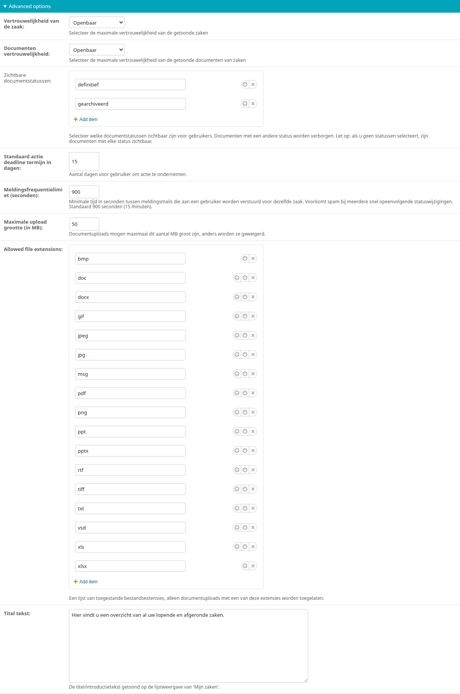

| **Vertrouwelijkheid van de zaak**
| De maximale vertrouwelijkheid van de zaken die aan gebruikers worden getoond. Dit staat standaard op "Openbaar" en kan worden verhoogd tot en met "Zeer geheim". Zaken met een hogere vertrouwelijkheid worden niet getoond: Open Inwoner vraagt bij de Zaken API alleen de zaken op tot en met deze vertrouwelijkheid.

| **Documenten vertrouwelijkheid**
| De maximale vertrouwelijkheid van de documenten die bij een zaak worden getoond. Ook dit staat standaard op "Openbaar"; documenten met een hogere vertrouwelijkheid worden niet getoond.

| **Zichtbare documentstatussen**
| De statussen die een document moet hebben om zichtbaar te zijn voor de gebruiker. U vult per regel een status in: ``in_bewerking`` (In bewerking), ``ter_vaststelling`` (Ter vaststelling), ``definitief`` (Definitief) of ``gearchiveerd`` (Gearchiveerd). Standaard zijn dit ``definitief`` en ``gearchiveerd``. Documenten met een andere status worden niet getoond. **Let op:** wanneer u geen enkele status invult, worden documenten met *alle* statussen getoond.

| **Standaard actie deadline termijn in dagen**
| Het aantal dagen dat de gebruiker krijgt om actie te ondernemen. De uiterste datum (vandaag plus dit aantal dagen) wordt genoemd in de notificatie-e-mails over een zaak. Standaard is dit 15 dagen.

| **Meldingsfrequentielimiet (seconden)**
| De minimale tijd in seconden tussen twee notificatie-e-mails aan dezelfde gebruiker voor dezelfde zaak. Dit voorkomt dat gebruikers worden overspoeld met e-mails wanneer er meerdere statuswijzigingen kort na elkaar plaatsvinden. De standaardwaarde is 900 seconden (15 minuten).

| **Maximale upload grootte (in MB)**
| De maximaal toegestane grootte van documenten die gebruikers uploaden. Grotere bestanden worden geweigerd. Standaard is dit 50 MB.

| **Allowed file extensions**
| De bestandsextensies (zoals ``pdf`` of ``docx``) die documenten mogen hebben die gebruikers uploaden. Documenten met een andere extensie worden geweigerd.

| **Titel tekst**
| De introductietekst die bovenaan de lijstweergave van Mijn zaken wordt getoond.

**Een hogere vertrouwelijkheid instellen**

Standaard ziet een inwoner alleen zijn of haar openbare zaken. Om ook zaken met een hogere vertrouwelijkheid te tonen, kiest u bij **Vertrouwelijkheid van de zaak** de hoogste vertrouwelijkheid die getoond mag worden, bijvoorbeeld "Vertrouwelijk", en klikt u op :guilabel:`Opslaan`. Vanaf dat moment ziet de inwoner in Mijn zaken ook zijn of haar zaken tot en met die vertrouwelijkheid. Verlaagt u de vertrouwelijkheid weer, dan worden deze zaken niet meer getoond. Zie ook :ref:`hoofdstuk 14.1.8 <hoofdstuk-14-1-8>` voor alle voorwaarden waaraan een zaak moet voldoen om getoond te worden.

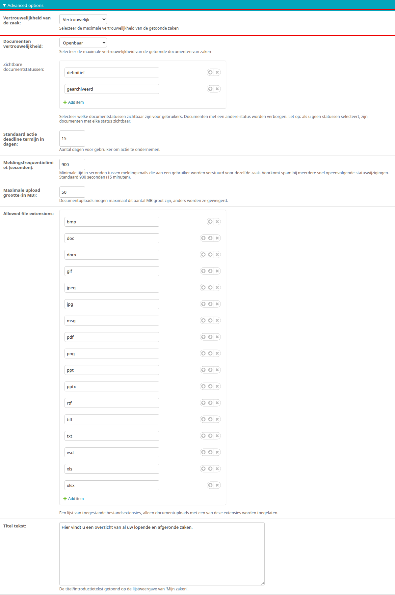

.. _hoofdstuk-14-3-2:

14.3.2. Feature Flags
---------------------

Onder "Feature flags" schakelt u extra functies van Mijn zaken in of uit.

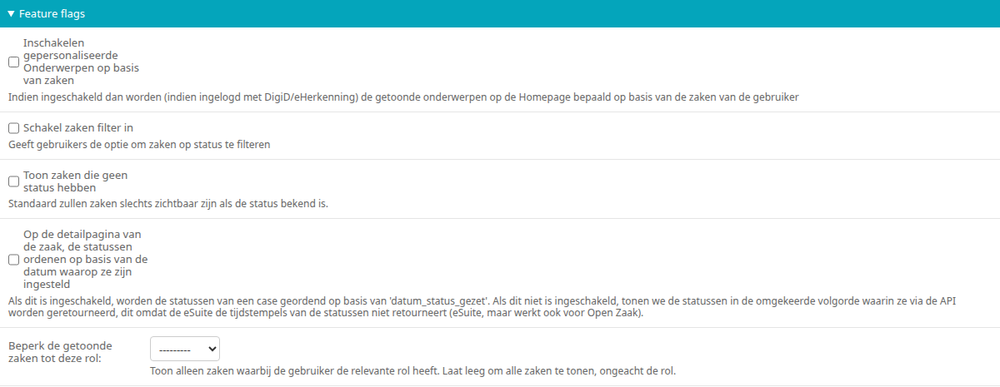

| **Inschakelen gepersonaliseerde Onderwerpen op basis van zaken**
| Wanneer hier een vinkje staat, worden na inloggen met DigiD of eHerkenning de op de homepage getoonde onderwerpen bepaald aan de hand van de zaken van de ingelogde gebruiker: het zijn de onderwerpen die gekoppeld zijn aan zaaktypen waarvan de gebruiker ten minste één zaak heeft. De gebruiker ziet op deze manier dus enkel relevante onderwerpen.

| **Schakel zaken filter in**
| Wanneer hier een vinkje staat, kunnen gebruikers in Mijn zaken hun zaken filteren op status.

| **Toon zaken die geen status hebben**
| Standaard worden zaken alleen in Mijn zaken getoond als ze een status hebben. Wanneer hier een vinkje staat, worden ook zaken zonder status getoond (zie hieronder). Dit staat standaard uit.

| **Op de detailpagina van de zaak, de statussen ordenen op basis van de datum waarop ze zijn ingesteld**
| Wanneer hier een vinkje staat, worden de statussen op de detailpagina van een zaak geordend op de datum waarop ze zijn gezet. Zonder vinkje worden de statussen getoond in de omgekeerde volgorde waarin de Zaken API ze teruggeeft, omdat de eSuite geen tijdstippen van de statussen teruggeeft.

| **Beperk de getoonde zaken tot deze rol**
| Kiest u hier een rol (bijvoorbeeld "Initiator"), dan worden alleen de zaken getoond waarbij de gebruiker die rol heeft. Laat u dit veld leeg, dan worden alle zaken getoond waarbij de gebruiker een rol heeft.

**Zaken zonder status tonen**

Een zaak die (nog) geen status heeft, wordt standaard niet in Mijn zaken getoond. Zet een vinkje bij **Toon zaken die geen status hebben** en klik op :guilabel:`Opslaan` om deze zaken toch te tonen. Vanaf dat moment ziet de inwoner ook zijn of haar zaken zonder status in Mijn zaken.

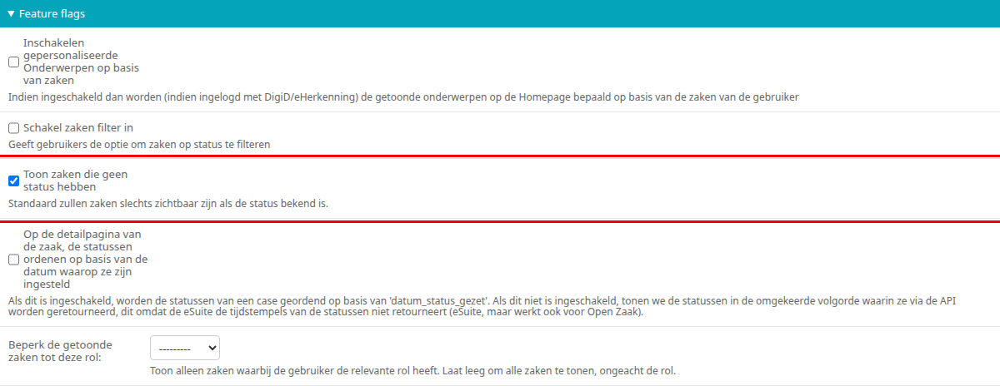

.. _hoofdstuk-14-3-3:

14.3.3. API-gedrag override-opties
----------------------------------

Onder "API-gedrag override-opties" past u aan hoe Open Inwoner de gegevens uit het zaaksysteem gebruikt. De eerste twee opties zijn bedoeld voor een koppeling met de eSuite.

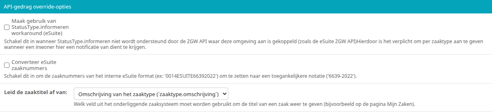

| **Maak gebruik van StatusType.informeren workaround (eSuite)**
| Zet hier alleen een vinkje wanneer StatusType.informeren niet wordt ondersteund door de ZGW API waar Open Inwoner aan is gekoppeld (zoals de eSuite ZGW API). Hierdoor wordt het verplicht om per zaaktype aan te geven wanneer een inwoner een notificatie dient te krijgen (zie :ref:`hoofdstuk 14.10 <hoofdstuk-14-10>`).

| **Converteer eSuite zaaknummers**
| Wanneer hier een vinkje staat, worden de zaaknummers van de eSuite van het interne formaat (bijvoorbeeld "0014ESUITE66392022") omgezet naar een leesbaarder formaat ("6639-2022").

| **Leid de zaaktitel af van**
| Welk gegeven uit het zaaksysteem als titel van een zaak wordt getoond, bijvoorbeeld in Mijn zaken: de omschrijving van het zaaktype (standaard), de omschrijving van de zaak, of het onderwerp van het zaaktype.

.. _hoofdstuk-14-3-4:

14.3.4. ZGW API sets
--------------------

Een API set bestaat uit verschillende API’s die samen een zaaksysteem vormen. Er is geen maximum aantal te configureren API sets. Door meerdere sets te configureren kunnen meerdere zaaksystemen parallel worden gebruikt. U kunt een API set toevoegen door onder "ZGW API sets" op :guilabel:`Nog een ZGW API set toevoegen` te klikken. De API's kiest u uit de services die zijn aangemaakt via **Koppelingen > Services** (zie :ref:`hoofdstuk 14.1.1 <hoofdstuk-14-1-1>`).

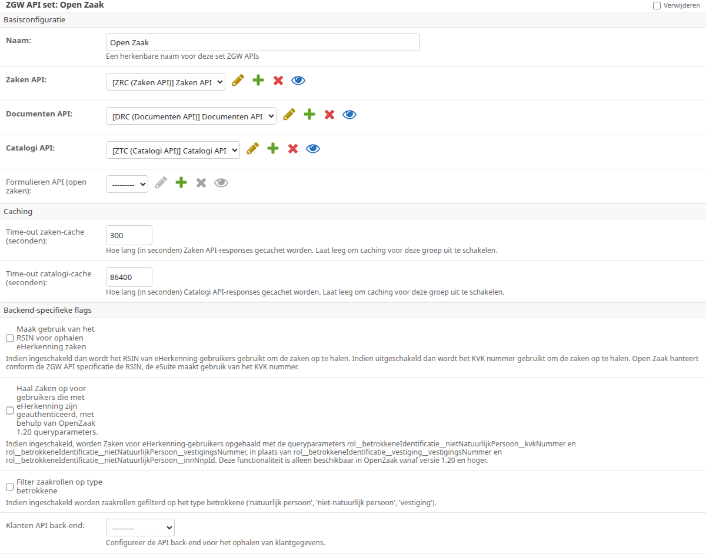

Onder **Basisconfiguratie**:

| **Naam**
| Een herkenbare naam voor de API set. Deze naam is vrij in te vullen.

| **Zaken API**
| Deze API levert de zaken of aanvragen in Mijn zaken. Dit veld is verplicht.

| **Documenten API**
| Deze API haalt de documenten op die bij een bepaalde zaak horen. Dit veld is verplicht.

| **Catalogi API**
| In de catalogi zit alle informatie over zaaktypen en andere gerelateerde informatie, zoals statussen, documenten en resultaten. De Catalogi API vult de zaaktypeconfiguratie in. Dit veld is verplicht.

| **Formulieren API (open zaken)**
| Deze API slaat de gegevens van onvoltooide formulieren op, zodat gebruikers verder kunnen gaan met een formulier dat ze nog niet hebben afgerond. Dit veld is optioneel.

Onder **Caching**:

| **Time-out zaken-cache (seconden)**
| Hoe lang (in seconden) de antwoorden van de Zaken API en de Documenten API worden bewaard, zodat ze niet bij elke pagina opnieuw worden opgehaald. Standaard is dit 300 seconden (5 minuten). Laat het veld leeg om dit voor deze API set uit te schakelen.

| **Time-out catalogi-cache (seconden)**
| Hoe lang (in seconden) de antwoorden van de Catalogi API worden bewaard. Standaard is dit 86400 seconden (24 uur). Laat het veld leeg om dit voor deze API set uit te schakelen.

Onder **Backend-specifieke flags** staan opties die bepalen op welke wijze met deze API's wordt gecommuniceerd:

| **Maak gebruik van het RSIN voor ophalen eHerkenning zaken**
| Indien aangevinkt, worden de zaken van eHerkenning gebruikers opgehaald met het RSIN van het bedrijf in plaats van het KvK-nummer. Open Zaak hanteert conform de ZGW API specificatie het RSIN, de eSuite maakt gebruik van het KvK-nummer.

| **Haal Zaken op voor gebruikers die met eHerkenning zijn geauthenticeerd, met behulp van OpenZaak 1.20 queryparameters.**
| Indien aangevinkt, worden zaken voor eHerkenning gebruikers opgehaald met de ``rol__betrokkeneIdentificatie__nietNatuurlijkPersoon__kvkNummer`` en ``rol__betrokkeneIdentificatie__nietNatuurlijkPersoon__vestigingsNummer`` query parameters, in plaats van de oudere ``rol__betrokkeneIdentificatie__vestiging__vestigingsNummer`` en ``rol__betrokkeneIdentificatie__nietNatuurlijkPersoon__innNnpId`` parameters. Deze nieuwe parameters zijn specifiek bedoeld voor OpenZaak versies 1.20 of hoger. Voor eSuite of oudere versies van OpenZaak maakt u geen gebruik van deze optie.

| **Filter zaakrollen op type betrokkene**
| Indien aangevinkt, worden de rollen van zaken gefilterd op het type betrokkene ('natuurlijk persoon', 'niet-natuurlijk persoon', 'vestiging').

| **Klanten API back-end**
| Het klantensysteem waarin de klantgegevens voor deze API set staan (zie :ref:`hoofdstuk 9.1 <hoofdstuk-9-1>`). In de regel is dit eSuite voor eSuite zaaksystemen, en OpenKlant 2 voor Open Zaak. Laat dit veld leeg indien u geen gebruik maakt van een klantensysteem: staat hier een klantensysteem dat niet is geconfigureerd, dan kunt u de API set niet opslaan.

14.3.5. Performance
-------------------

Onder "Performance" stelt u in hoe Mijn zaken de zaken ophaalt. De standaardinstellingen volstaan in de meeste gevallen.

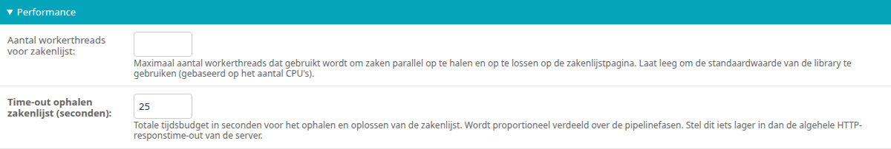

| **Aantal workerthreads voor zakenlijst**
| Het maximale aantal zaken dat tegelijk wordt opgehaald en verwerkt voor het overzicht van Mijn zaken. Laat dit veld leeg om de standaardwaarde te gebruiken, die afhangt van het aantal processoren van de server.

| **Time-out ophalen zakenlijst (seconden)**
| De totale tijd in seconden die het ophalen van de zaken voor het overzicht van Mijn zaken mag duren. Standaard is dit 25 seconden. Stel dit iets lager in dan de maximale tijd die de server krijgt om een pagina te tonen. Zaken die niet op tijd zijn opgehaald worden niet getoond; de gebruiker ziet dan een melding dat niet alle zaken konden worden opgehaald (zie :ref:`hoofdstuk 14.1.9 <hoofdstuk-14-1-9>`).

14.3.6. Zaakdetail dashboard labels
-----------------------------------

Onder "Zaakdetail dashboard labels" stelt u de teksten in die op de detailpagina van een zaak bij de gegevens van de zaak staan.

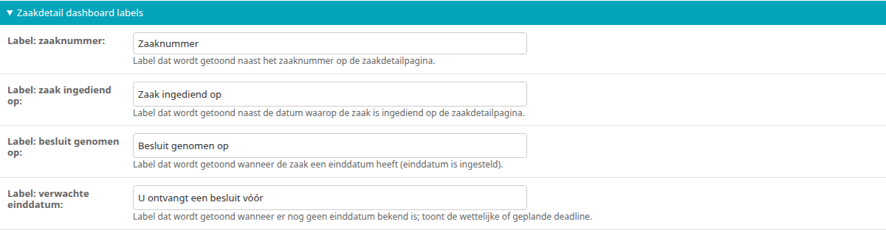

| **Label: zaaknummer**
| De tekst bij het zaaknummer. Standaard is dit "Zaaknummer".

| **Label: zaak ingediend op**
| De tekst bij de datum waarop de zaak is ingediend. Standaard is dit "Zaak ingediend op".

| **Label: besluit genomen op**
| De tekst bij de einddatum van de zaak, als de zaak is afgerond. Standaard is dit "Besluit genomen op".

| **Label: verwachte einddatum**
| De tekst bij de wettelijke of geplande einddatum, zolang de zaak nog geen einddatum heeft. Standaard is dit "U ontvangt een besluit vóór".

.. _hoofdstuk-14-4:

14.4. Notificatieberichten
==========================

**Locatie in het menu:** Modules > Zaken > Notificatieberichten

Elk binnenkomend webhookbericht wordt direct opgeslagen als een notificatiebericht onder
**Modules > Zaken > Notificatieberichten**, ongeacht of de verdere verwerking slaagt. Dit biedt
een auditspoor van alle ontvangen berichten en maakt het mogelijk om mislukte berichten opnieuw
te verwerken. Berichten die groter zijn dan de maximale payload-grootte (zie :ref:`hoofdstuk 14.6 <hoofdstuk-14-6>`), die niet bij een webhook-abonnement horen (de aanmelding van de verzender klopt niet) of die geen geldige JSON zijn, worden geweigerd en niet opgeslagen.

Het overzicht toont per bericht het **ID**, het webhook-abonnement (**Subscription**), het **Kanaal**, de **Status** en wanneer het bericht is ontvangen (**Received at**), het laatst is verwerkt (**Last processed at**) en wanneer de verwerking is gestart (**Process started at**). Deze namen worden (nog) in het Engels getoond. U kunt filteren op status, abonnement, kanaal, of het bericht geldig is (is valid) en op de datum van ontvangst en verwerking, en zoeken in het kanaal, de verwerkingsfout en de inhoud van het bericht (de payload). Notificatieberichten kunt u niet zelf toevoegen.

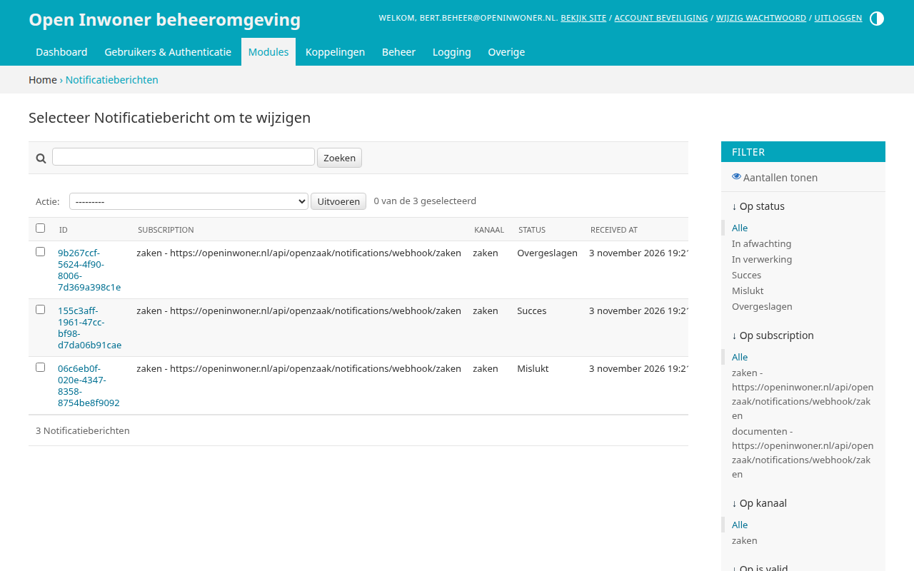

Klik op een bericht om de details te zien. Alle velden zijn alleen-lezen, behalve de status. Onder **Processing output** ziet u de uitkomst van de verwerking, bijvoorbeeld waarom een bericht is overgeslagen, en onder **Processing error** de foutmelding van een mislukte verwerking. **Payload** bevat het ontvangen bericht zelf.

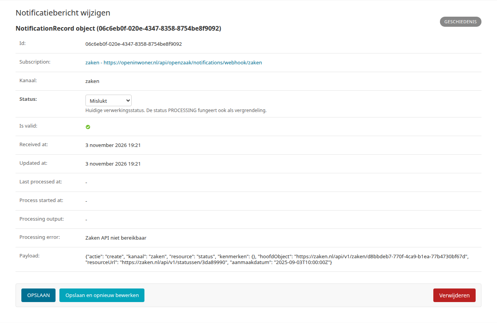

.. _hoofdstuk-14-4-1:

14.4.1. Statusoverzicht
-----------------------

Elk notificatiebericht doorloopt een verwerkingsstatus:

.. list-table::
   :header-rows: 1
   :widths: 20 80

   * - Status
     - Betekenis
   * - **In afwachting** (pending)
     - Het bericht is ontvangen en wacht op verwerking door de achtergrondtaak.
   * - **In verwerking** (processing)
     - De achtergrondtaak is bezig met verwerken. Deze status fungeert tevens als vergrendeling
       om gelijktijdige verwerking te voorkomen.
   * - **Succes** (success)
     - Het bericht is succesvol verwerkt.
   * - **Mislukt** (failed)
     - Er is een fout opgetreden tijdens de verwerking. Het veld **Processing error** bevat de
       foutmelding. Het bericht kan opnieuw worden aangeboden (zie hieronder).
   * - **Overgeslagen** (skipped)
     - Het bericht is bewust niet verwerkt, bijvoorbeeld omdat zaaknotificaties uitgeschakeld
       zijn in de siteconfiguratie.

.. _hoofdstuk-14-4-2:

14.4.2. Berichten opnieuw verwerken
-----------------------------------

Mislukte, overgeslagen of eerder geslaagde berichten kunnen opnieuw worden aangeboden via de
bulkactie **"Geselecteerde notificaties opnieuw proberen"**:

#. Selecteer een of meer berichten in de lijst.
#. Kies "Geselecteerde notificaties opnieuw proberen" in het actiemenu.
#. Klik op :guilabel:`Uitvoeren`.

De geselecteerde berichten worden teruggezet naar de status *In afwachting* en opnieuw
ingepland voor verwerking. Berichten die de status *In afwachting* of *In verwerking* hebben, worden
overgeslagen.

.. _hoofdstuk-14-5:

14.5. Notificatiescomponentenconfiguratie
=========================================

**Locatie in het menu:** Modules > Zaken > Notificatiescomponentenconfiguraties

Wanneer u de notificatiescomponentenconfiguratie instelt kunt u notificaties ontvangen van wijzigingen aan Zaken of documenten in eSuite of Open Zaak. Bij de instellingen kan aangegeven worden hoeveel afleverpogingen het systeem mag doen en de vertraging die er tussen de afleverpogingen mag zitten.

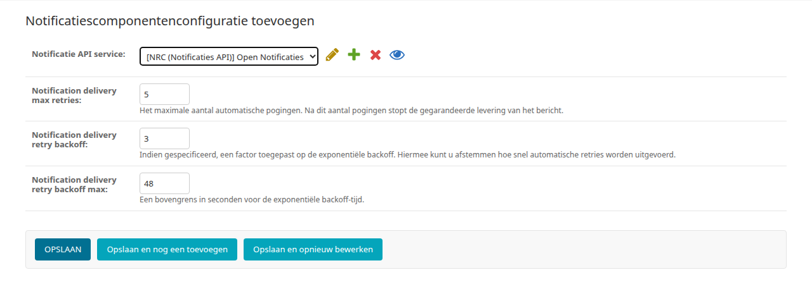

.. _hoofdstuk-14-5-1:

14.5.1. Notificaties instellen
------------------------------

Om de notificaties in te stellen volgt u het volgende stappenplan:

#. Maak een service aan voor de Notificaties API, met het type "NRC (Notificaties API)" en de referenties (client id en secret) die u van de beheerder van het zaaksysteem krijgt (zie :ref:`hoofdstuk 16.3.1 <hoofdstuk-16-3-1>`). Deze referenties hebben de volgende rechten nodig:

   -  catalogi.lezen
   -  zaken.lezen
   -  zaken.bijwerken
   -  documenten.lezen
   -  documenten.aanmaken
   -  notificaties.consumeren

#. Kies in dit scherm bij **Notificatie API service** de service uit stap 1 en klik op :guilabel:`Opslaan`.

#. Stel de Configuratie 'Open Zaak' in voor Zaken (ZRC), Catalogi (ZTC) en Documenten (DRC) (zie :ref:`hoofdstuk 14.3 <hoofdstuk-14-3>`). Gebruikt u eSuite, zet dan ook een vinkje bij **Maak gebruik van StatusType.informeren workaround (eSuite)** (zie :ref:`hoofdstuk 14.3.3 <hoofdstuk-14-3-3>`).

#. Kies in de Zaaktype configuraties per zaaktype en informatieobjecttype welke notificaties gebruikers ontvangen (zie :ref:`hoofdstuk 14.10.1 <hoofdstuk-14-10-1>`). De zaaktypen en informatieobjecttypen worden dagelijks uit de catalogus geïmporteerd. U kunt dit op elk moment zelf doen door de periodieke taak "Importeer ZGW data" te starten met de knop :guilabel:`Start taak` (zie :ref:`hoofdstuk 14.1.3 <hoofdstuk-14-1-3>` en :ref:`hoofdstuk 17.1 <hoofdstuk-17-1>`).

.. _hoofdstuk-14-6:

14.6. Notificatieverwerking configuratie
========================================

**Locatie in het menu:** Modules > Zaken > Notificatieverwerking configuratie

Via **Modules > Zaken > Notificatieverwerking configuratie** kunt u drie instellingen beheren:

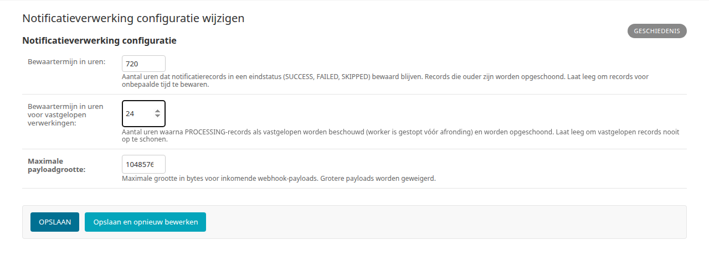

**Bewaartermijn in uren**
Het aantal uren dat notificatieberichten worden bewaard. Berichten in een eindstatus
(geslaagd, mislukt of overgeslagen) die ouder zijn dan deze termijn worden automatisch
verwijderd door de achtergrondtaak *"Opschonen notificatieberichten"*, die elk uur draait.
Laat dit veld leeg om berichten onbeperkt te bewaren.

**Bewaartermijn in uren voor vastgelopen verwerkingen**
Het aantal uren waarna notificatieberichten met de status *In verwerking* worden beschouwd als
vastgelopen - dit treedt op wanneer een achtergrondtaak is gestopt vóór het afronden van
de verwerking. Zulke berichten worden automatisch verwijderd door dezelfde
achtergrondtaak. Laat dit veld leeg om vastgelopen berichten niet automatisch op te schonen.

**Maximale payloadgrootte**
De maximaal toegestane berichtgrootte in bytes voor inkomende webhooks. Berichten die deze
grens overschrijden worden direct geweigerd met een foutmelding aan de verzender. De
standaardwaarde is 1 MB (1.048.576 bytes).

.. note::
   Voorheen werden beide bewaartermijnen in dagen ingesteld. Bij de update zijn bestaande
   waarden automatisch omgerekend naar uren (vermenigvuldigd met 24).

.. note::
   Berichten met de status *In afwachting* worden nooit automatisch verwijderd; deze kunnen
   nog worden opgepakt door een achtergrondwerker.

14.7. Open Zaak informatieobject notificatie records
====================================================

**Locatie in het menu:** Modules > Zaken > Open Zaak informatieobject notificatie records

Bij Open Zaak informatieobject notificatie records vindt u een register met daarin gegevens over naar welke gebruikers welke notificaties zijn verstuurd naar aanleiding van het toevoegen of wijzigen van een document.

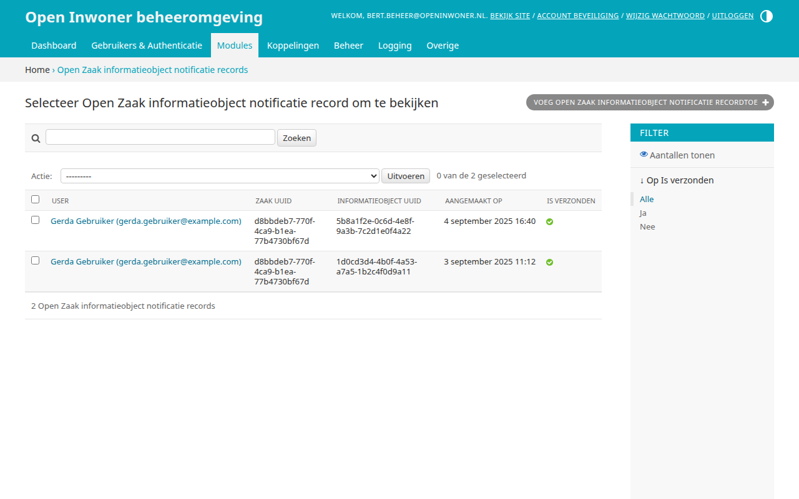

14.8. Open Zaak statusnotificatie records
=========================================

**Locatie in het menu:** Modules > Zaken > Open Zaak statusnotificatie records

Bij Open Zaak statusnotificatie records vindt u naar welke gebruikers welke notificaties zijn verstuurd naar aanleiding van een statuswijziging.

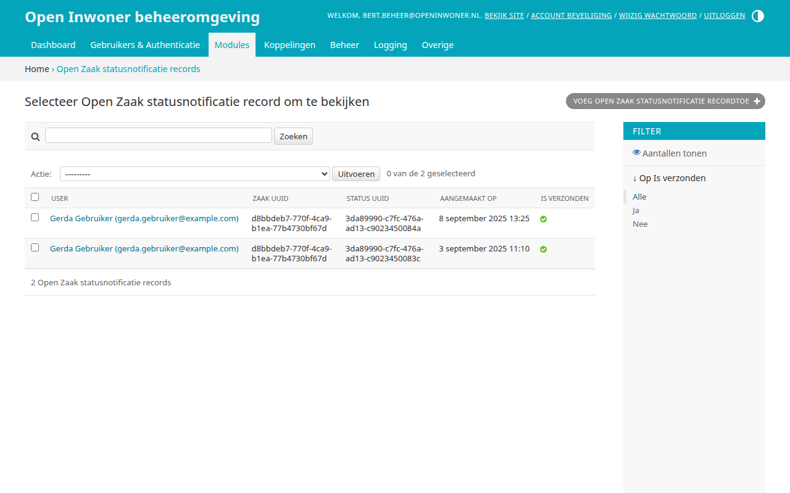

14.9. Webhook-abonnementen
==========================

**Locatie in het menu:** Modules > Zaken > Webhook-abonnementen

Bij **Modules > Zaken > Webhook-abonnementen** stelt u in dat Open Inwoner de notificaties van een bepaald kanaal (zaken, documenten, besluiten) van Open Zaak of eSuite ontvangt, via de Notificaties API. Deze webhookberichten worden onder andere gebruikt om status updates aan inwoners te tonen of e-mailmeldingen te versturen, bijvoorbeeld bij een zaak-update.

In het overzicht van webhook-abonnementen ziet u per abonnement de **Callback URL**, de **Kanalen**, de **Client ID** en het **NC-abonnement**: de URL van het abonnement in de Notificaties API. Is het NC-abonnement leeg, dan is het abonnement (nog) niet geregistreerd.

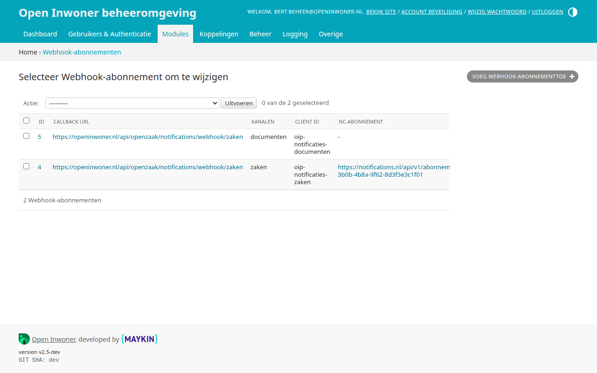

14.9.1. Webhook-abonnement aanmaken
-----------------------------------

U kunt een webhook-abonnement aanmaken door op de knop :guilabel:`Webhook-abonnement toevoegen +` te klikken. Er wordt dan een nieuw venster geopend waar u het webhook-abonnement kunt configureren.

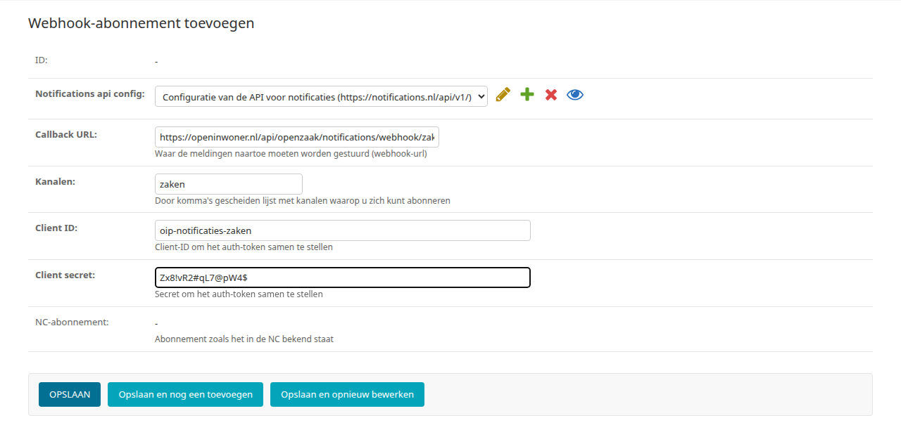

| **Notifications api config**
| De configuratie van de Notificaties API waarbij het abonnement wordt geregistreerd (zie :ref:`hoofdstuk 14.5 <hoofdstuk-14-5>`). U kunt hier ook een nieuwe configuratie toevoegen. Dit veld heeft (nog) geen Nederlandse naam.

| **Callback URL**
| De host waar het Open Inwoner Platform op gedeployed is, gevolgd door het vaste pad ``/api/openzaak/notifications/webhook/zaken``. Bijvoorbeeld: ``https://open-inwoner.gemeente.nl/api/openzaak/notifications/webhook/zaken``.

| **Kanalen**
| De kanalen waarop u zich wilt abonneren. U kunt meerdere kanalen invullen door ze te scheiden met een komma (,), maar in de praktijk zal u hier vaak ``zaken`` invullen.

| **Client ID**
| Het client ID waarmee het token wordt samengesteld waarmee de Notificaties API zich bij Open Inwoner aanmeldt. U kunt hier zelf een waarde voor bedenken. Houd daarbij in gedachte dat de client ID in het systeem van de verzender betekenisvol moet zijn (bijvoorbeeld ``oip-notificaties-gemeente-demodam-acc``).

| **Client secret**
| Het geheim waarmee het token wordt samengesteld. Client ID en Client secret kunnen arbitrair zijn, maar het Client secret moet moeilijk te raden zijn. Gebruik hiervoor dus veel karakters met een mengsel van leestekens, cijfers en letters.

De velden **ID** en **NC-abonnement** worden automatisch ingevuld.

Wanneer alle velden zijn ingevuld klikt u op :guilabel:`Opslaan`. Daarna registreert u het abonnement expliciet: selecteer het in het overzicht, kies de actie "Registreer de webhooks" en klik op :guilabel:`Uitvoeren`. Open Inwoner registreert het abonnement dan bij de Notificaties API, en het **NC-abonnement** toont de URL van het abonnement daar.

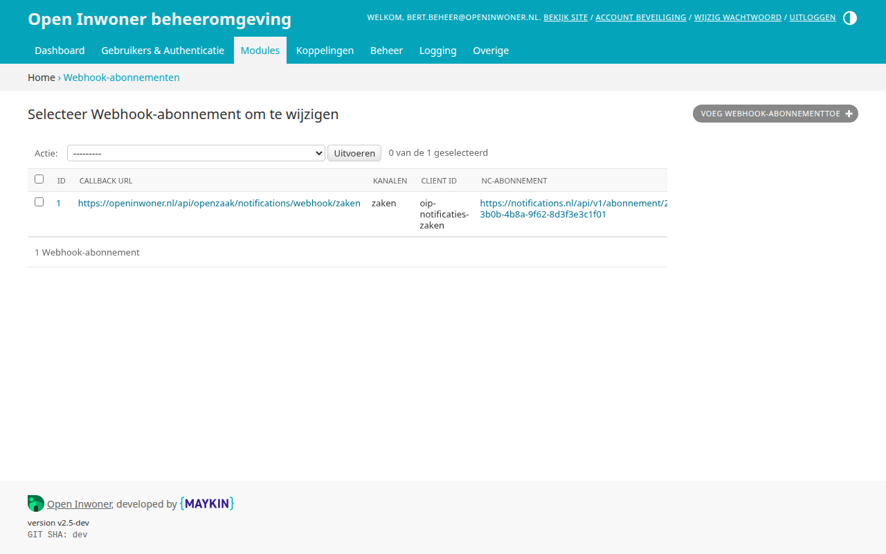

Wanneer de webhook correct is geregistreerd en berichten ontvangt, worden deze opgeslagen als
notificatieberichten en asynchroon verwerkt via een Celery-taak. U kunt de ontvangen berichten
inzien en beheren via :ref:`hoofdstuk 14.4 <hoofdstuk-14-4>`.

.. warning::
   Blijft het veld NC-abonnement na het registreren leeg, dan is de registratie niet gelukt. U krijgt dan een foutmelding in beeld. Een abonnement dat al is geregistreerd, wordt bij opnieuw registreren overgeslagen.

14.9.2. Webhook-abonnement verwijderen
--------------------------------------

Indien u een webhook-abonnement wilt verwijderen is het belangrijk tijdens het verwijderproces de juiste volgorde aan te houden. U dient allereerst de webhook te deregistreren: selecteer het abonnement in het overzicht, kies de actie "De webhooks deregistreren" en klik op :guilabel:`Uitvoeren`. Als de webhook succesvol is gederegistreerd, is in het overzicht de URL bij het NC-abonnement verdwenen. Is het deregistreren niet gelukt, dan krijgt u een foutmelding in beeld. Vervolgens kunt u het abonnement verwijderen met de actie "Geselecteerde Webhook-abonnementen verwijderen".

.. _hoofdstuk-14-10:

14.10. Zaaktype configuraties
=============================

**Locatie in het menu:** Modules > Zaken > Zaaktype Configuraties

Bij **Modules > Zaken > Zaaktype Configuraties** vindt u alle zaaktypen uit de catalogi van Open Zaak of eSuite. Deze worden geïmporteerd door de achtergrondtaak "Importeer ZGW data" (zie :ref:`hoofdstuk 14.1.3 <hoofdstuk-14-1-3>`); u kunt hier zelf geen zaaktypen toevoegen. Het overzicht toont per zaaktype onder andere de identificatie, de omschrijving en de catalogus, of er notificaties worden verstuurd bij statuswijzigingen en hoeveel informatieobjecttypen, statustypen en resultaattypen bij het zaaktype horen. Enkele kolommen worden (nog) in het Engels getoond: **Has doc notify** (of voor ten minste één informatieobjecttype documentnotificaties aan staan), **Num infotypes**, **Num statustypes** en **Num resulttypes**.

U kunt filteren op **Notificeren bij statuswijzigingen**, op "notificeer bij nieuw document", op catalogus en op **Gevonden in API**, en zoeken op onder andere de identificatie en omschrijving van het zaaktype, de catalogus, de e-Suite onderwerpcode en de omschrijving of URL van de statustypen, resultaattypen en informatieobjecttypen van het zaaktype. Met de acties "Set selected Zaaktypes to notify on status changes" en "Set selected Zaaktypes to not notify on status changes" (nog niet vertaald) zet u de notificaties bij statuswijzigingen voor de geselecteerde zaaktypen in één keer aan of uit.

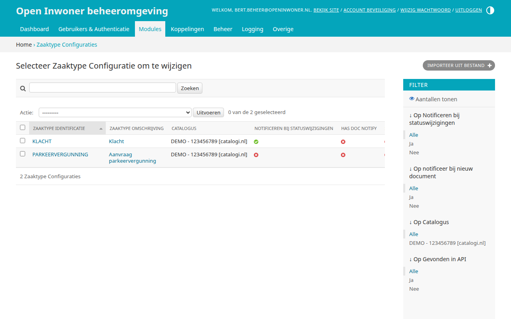

Wanneer u klikt op een zaaktype, opent het scherm waarin u de configuratie van het zaaktype kunt wijzigen.

.. _hoofdstuk-14-10-1:

14.10.1. Zaaktype configuratie wijzigen
---------------------------------------

Bovenaan het scherm staan de gegevens van het zaaktype uit de Catalogi API, die u niet kunt wijzigen: **Gevonden in API** (of het zaaktype bij de laatste import nog in de API stond), **Urls** (de URL's van het zaaktype), **Catalogus**, **Zaaktype identificatie** en **Zaaktype omschrijving**. Daaronder staan de instellingen van het zaaktype. Klik na het wijzigen op :guilabel:`Opslaan`.

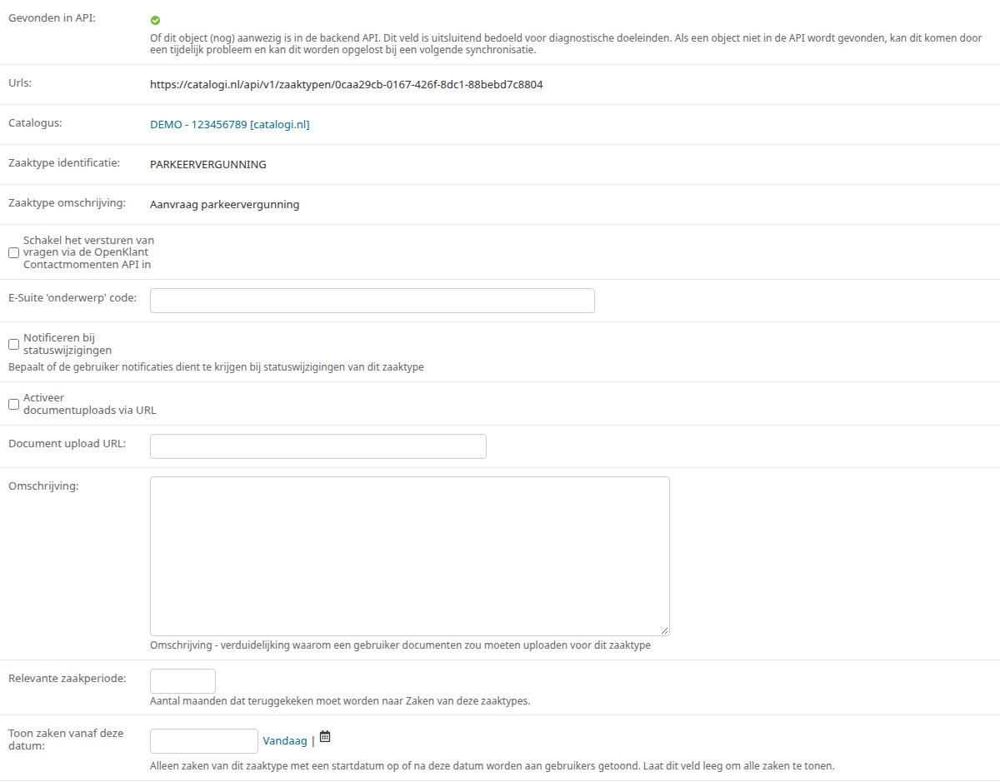

| **Schakel het versturen van vragen via de OpenKlant Contactmomenten API in**
| Wanneer hier een vinkje staat, kan de gebruiker op de detailpagina van een zaak van dit type een vraag stellen via het contactformulier. Dit werkt alleen als het klantensysteem vragen kan registreren (zie :ref:`hoofdstuk 9.1 <hoofdstuk-9-1>`).

| **E-Suite 'onderwerp' code**
| De onderwerpcode uit de eSuite waarmee vragen over zaken van dit type als contactmoment worden geregistreerd, zodat ze bij de juiste afdeling terechtkomen.

| **Notificeren bij statuswijzigingen**
| Deze instelling geldt alleen als de StatusType.informeren workaround aan staat (zie :ref:`hoofdstuk 14.3.3 <hoofdstuk-14-3-3>`), zoals bij een koppeling met de eSuite. De gebruiker krijgt dan alleen notificaties bij statuswijzigingen van zaken van zaaktypen waar hier een vinkje staat. Zonder deze workaround bepaalt het statustype in de Catalogi API (StatusType.informeren) of de gebruiker een notificatie krijgt.

| **Activeer documentuploads via URL**
| Door hier een vinkje te zetten wordt het mogelijk documenten te laten uploaden via een extern systeem dat niet geïntegreerd is in het Open Inwoner Platform. Op de detailpagina van de zaak komt dan een knop in beeld om naar het externe systeem te gaan. Wilt u dat gebruikers via het Open Inwoner Platform zelf bestanden uploaden, dan activeert u dit bij de informatieobjecttypen (zie hieronder). Beide tegelijk is niet toegestaan: de configuratie wordt dan niet opgeslagen.

| **Document upload URL**
| De URL van het externe systeem om een document te uploaden.

| **Omschrijving**
| De verduidelijking waarom een gebruiker documenten zou moeten uploaden voor dit zaaktype.

| **Relevante zaakperiode**
| Het aantal maanden dat wordt teruggekeken naar zaken van dit zaaktype voor de gepersonaliseerde onderwerpen op de homepage (zie :ref:`hoofdstuk 14.3.2 <hoofdstuk-14-3-2>`): de onderwerpen van dit zaaktype worden alleen getoond als de laatste zaak van de gebruiker van dit type binnen deze periode is gestart. Laat het veld leeg om niet naar de startdatum te kijken.

| **Toon zaken vanaf deze datum**
| Een datum vanaf wanneer zaken van dit zaaktype aan gebruikers worden getoond. Zaken met een startdatum vóór deze datum worden niet getoond in Mijn zaken. Laat dit veld leeg om alle zaken te tonen.

**Oudere zaken van een zaaktype verbergen**

Wilt u dat inwoners alleen recente zaken van een zaaktype zien, bijvoorbeeld omdat oudere zaken in een ander systeem zijn afgehandeld, vul dan bij **Toon zaken vanaf deze datum** de datum in (bijvoorbeeld ``01-01-2025``) en klik op :guilabel:`Opslaan`. Vanaf dat moment ziet de inwoner in Mijn zaken alleen de zaken van dit zaaktype die op of na die datum zijn gestart. Zaken van andere zaaktypen worden nog steeds getoond. Maakt u het veld weer leeg, dan worden de oudere zaken weer getoond.

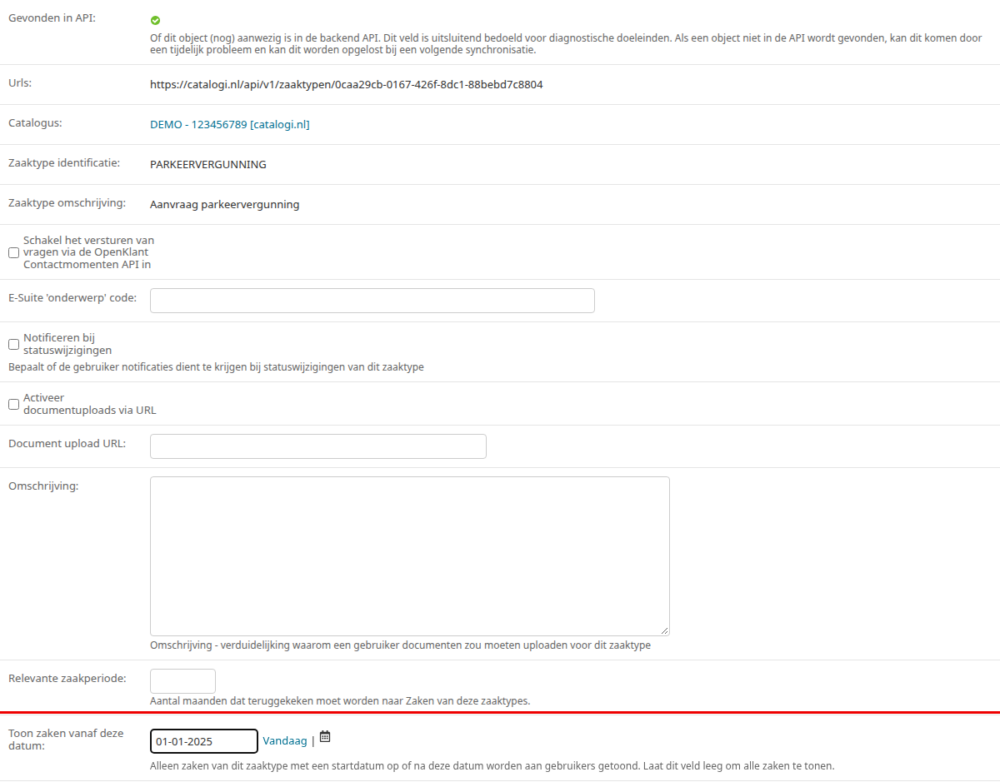

**Zaaktype Informatieobject configuraties**

Onder "Zaaktype Informatieobject configuraties" staan de informatieobjecttypen (de soorten documenten) van het zaaktype. U kunt per informatieobjecttype aangeven of gebruikers via het Open Inwoner Platform documenten van dit type mogen uploaden (**Activeer documentuploads**). Kunnen er meerdere soorten documenten worden geüpload, dan geeft de gebruiker per upload aan om wat voor soort document het gaat. Met **Activeer documentnotificiaties** (sic) krijgen gebruikers een bericht wanneer er een nieuw document van dit type bij hun zaak beschikbaar is. De kolommen **Omschrijving**, **Informatieobject UUID**, **Zaaktype uuids** en **Gevonden in API** komen uit de Catalogi API.

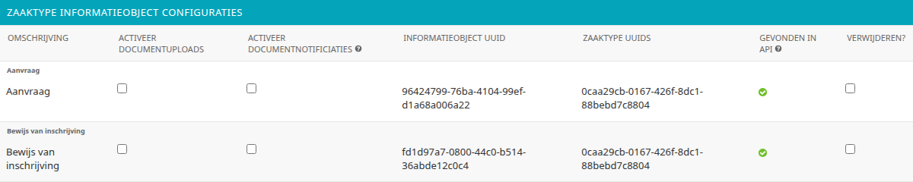

**Let op! Wanneer u bij Zaaktype informatieobject configuraties het
uploaden van bestanden activeert, vindt het uploaden plaats via het Open Inwoner Platform zelf en niet via een extern systeem.**

Onder het overzicht van de statustypen (zie :ref:`hoofdstuk 14.10.2 <hoofdstuk-14-10-2>`) staan de "Zaaktype Resultaattype Configuraties": per resultaattype van het zaaktype kunt u een omschrijving invullen.

.. _hoofdstuk-14-10-2:

14.10.2. Zaaktype statustype configuraties
------------------------------------------
Onder "Zaaktype Statustype Configuraties" kunt u de statustypes die bij het zaaktype horen configureren. Dit onderdeel is standaard ingeklapt; klik op de titel om het uit te klappen. Per statustype zijn de eerste gegevens vast en komen ze uit de Catalogi API: **Gevonden in API**, **Statustekst**, **Omschrijving**, **Statustype URL** en **Zaaktype uuids**. De elementen die kunnen worden gewijzigd worden hieronder behandeld.

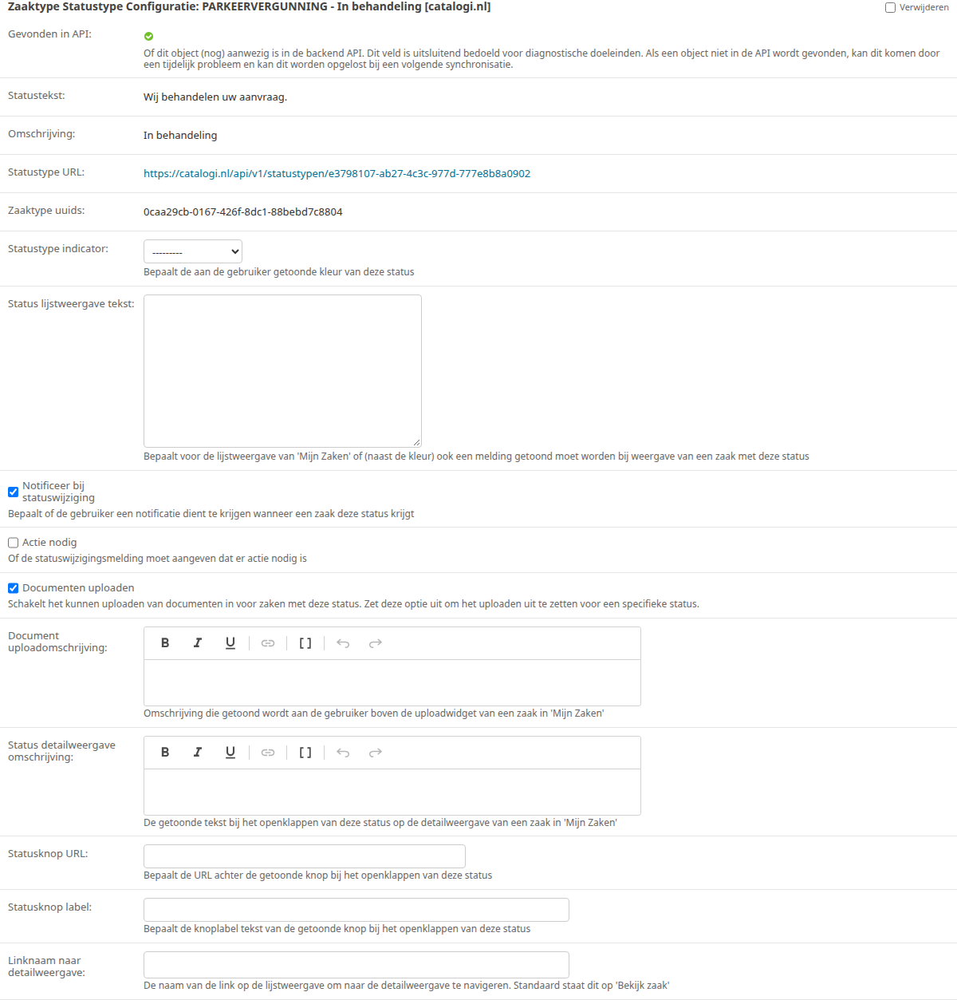

| **Statustype indicator**
| De kleur van de balk die in de lijstweergave van Mijn zaken boven een zaak met deze status staat, om extra nadruk te geven: "Info", "Waarschuwing", "Negatief" of "Succes". De balk wordt alleen getoond als ook de **Status lijstweergave tekst** is ingevuld.

| **Status lijstweergave tekst**
| De melding die in de lijstweergave van Mijn zaken in de balk bij een zaak met deze status wordt getoond.

| **Notificeer bij statuswijziging**
| Of een gebruiker een notificatie krijgt wanneer een zaak deze status krijgt. Dit staat standaard aan.

| **Actie nodig**
| Wanneer hier een vinkje staat, krijgt de gebruiker een e-mail die aangeeft dat hij of zij actie moet ondernemen, in plaats van de gewone notificatie.

| **Documenten uploaden**
| Of een gebruiker documenten kan uploaden voor zaken met deze status. Dit staat standaard aan, en gaat voor deze status voor de instelling van het zaaktype.

| **Document uploadomschrijving**
| De omschrijving die aan de gebruiker getoond wordt boven de uploadwidget op de detailpagina van een zaak. Hier kunt u een teksteditor met eenvoudige opmaak gebruiken.

| **Status detailweergave omschrijving**
| De tekst die wordt getoond bij het openklappen van de status op de detailpagina van een zaak. Hier kunt u een teksteditor met eenvoudige opmaak gebruiken.

| **Statusknop URL**
| De statusknop URL maakt een call-to-action button aan waar mensen direct hun actie kunnen uitvoeren. Als er hier niets is ingevuld en er is wel een mogelijkheid om bestanden te uploaden, dan staat er een standaard uploadwidget.

| **Statusknop label**
| De tekst op de statusknop. Denk aan de richtlijnen voor CTA-buttons.

| **Linknaam naar detailweergave**
| De linktekst om in de lijstweergave van Mijn zaken naar de detailweergave van een zaak met deze status te gaan. Standaard staat hier "Bekijk zaak".

**Een melding en linktekst bij een status instellen**

Stel dat inwoners bij de status "In behandeling" extra informatie moeten aanleveren. Kies bij die status als **Statustype indicator** "Waarschuwing", vul bij **Status lijstweergave tekst** de melding in, bijvoorbeeld "Wij hebben meer informatie van u nodig.", vul bij **Linknaam naar detailweergave** bijvoorbeeld "Bekijk uw aanvraag" in en klik op :guilabel:`Opslaan`. Vanaf dat moment ziet de inwoner in Mijn zaken bij zijn of haar zaken met deze status de melding in een balk in de kleur van de waarschuwing, en de nieuwe linktekst.

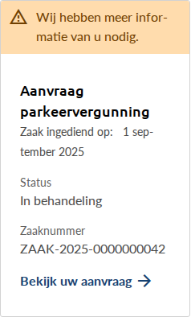

.. _ZTCImportExport:

14.10.3. Zaaktype configuratie importeren/exporteren
----------------------------------------------------

Het is mogelijk om individuele Zaaktype Configuratie objecten te importeren, op analoge wijze zoals beschreven voor de Catalogus Configuraties (zie :ref:`CatalogusImportExport`).

Voor meer details verwijzen we u naar die sectie. In hoofdlijnen: in het overzicht van de Zaaktype Configuraties selecteert u een of meer zaaktypen, kiest u de actie "Exporteren naar bestand" en klikt u op :guilabel:`Uitvoeren`. U downloadt dan het bestand ``zgw-zaaktype-export.json`` met de configuratie van de geselecteerde zaaktypen en hun informatieobjecttypen, statustypen en resultaattypen.

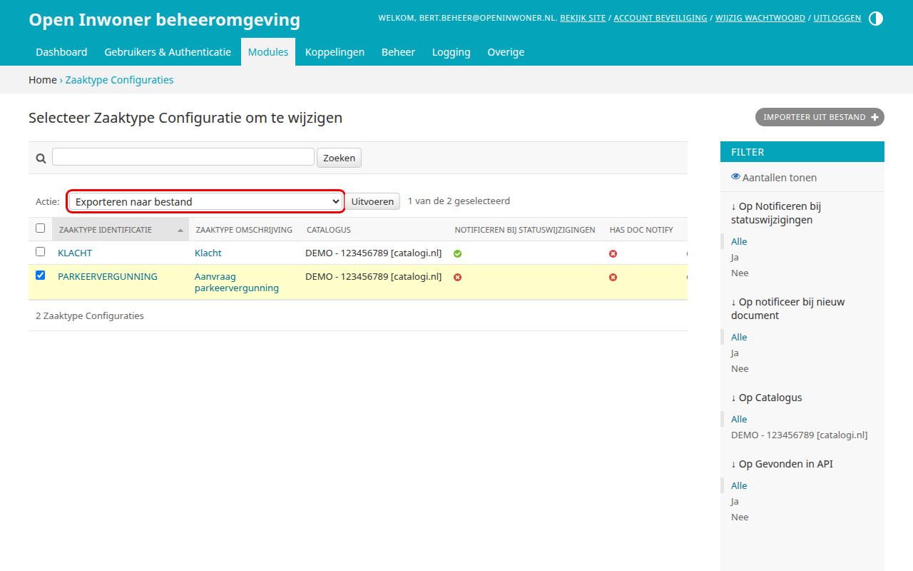

U kunt het aldus opgeslagen bestand vervolgens op een andere installatie importeren via de knop :guilabel:`Importeer uit bestand` rechtsboven in het overzicht. Op de pagina "Importeer ZGW gegevens vanuit een bestand" kiest u het bestand en klikt u op :guilabel:`Upload bestand`.

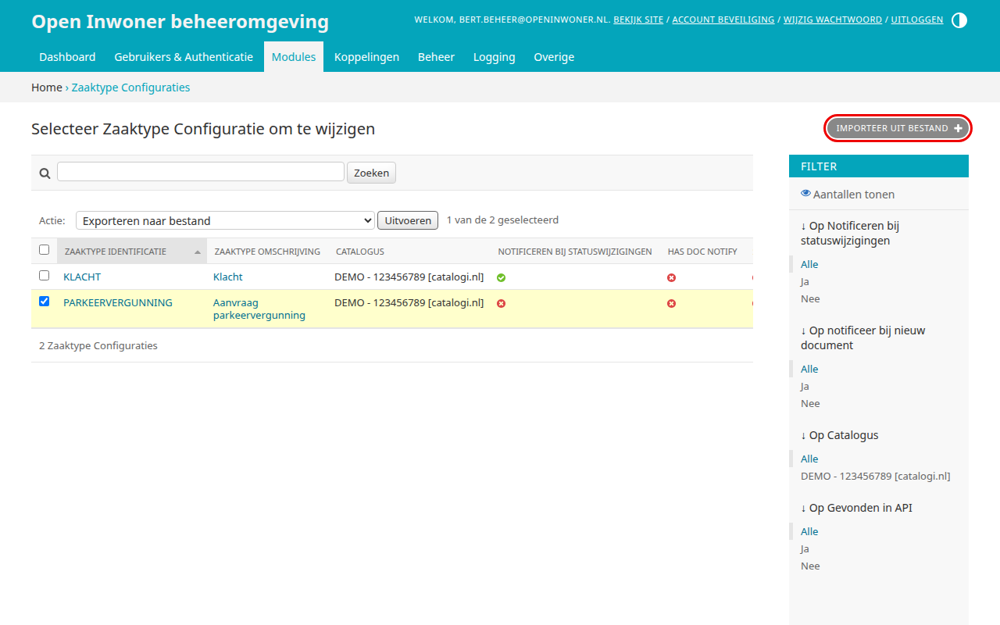

.. note::
   Zaaktype Configuraties die via deze wijze worden geëxporteerd, kunnen ook worden
   geïmporteerd via het Catalogus Configuratie scherm, en omgekeerd.
   Zie verder :ref:`CatalogusImportExport`.
