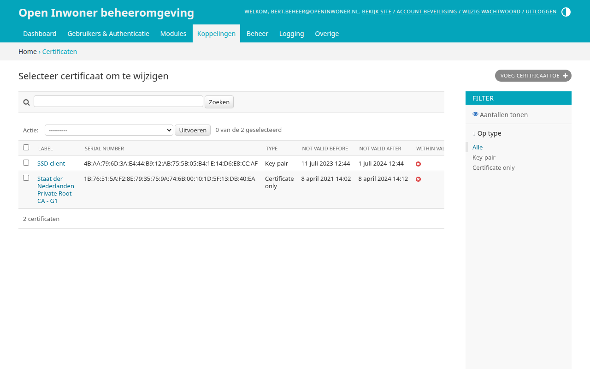
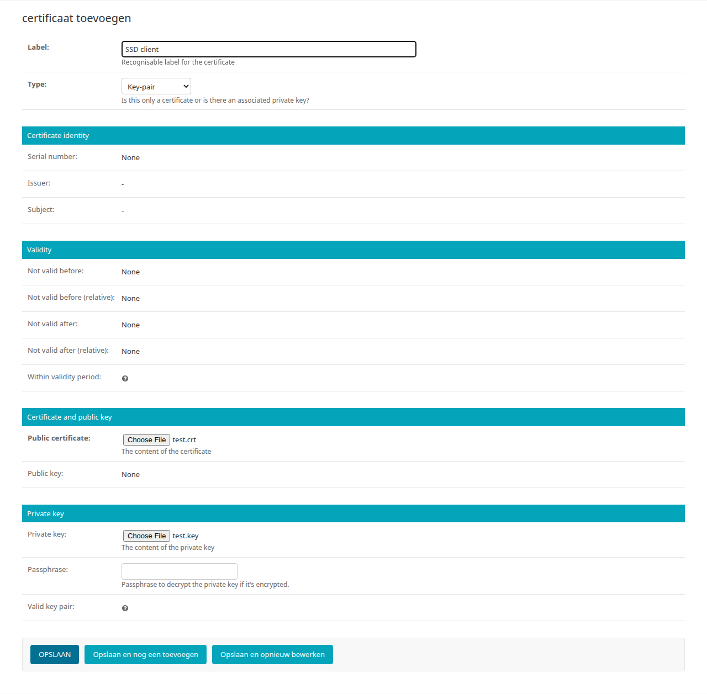
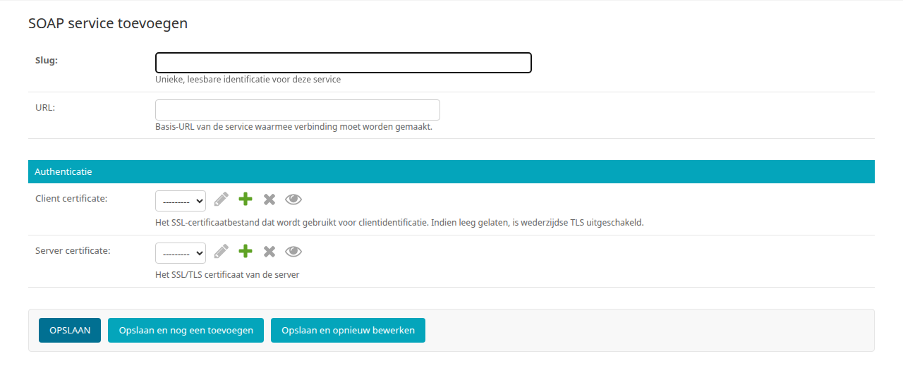
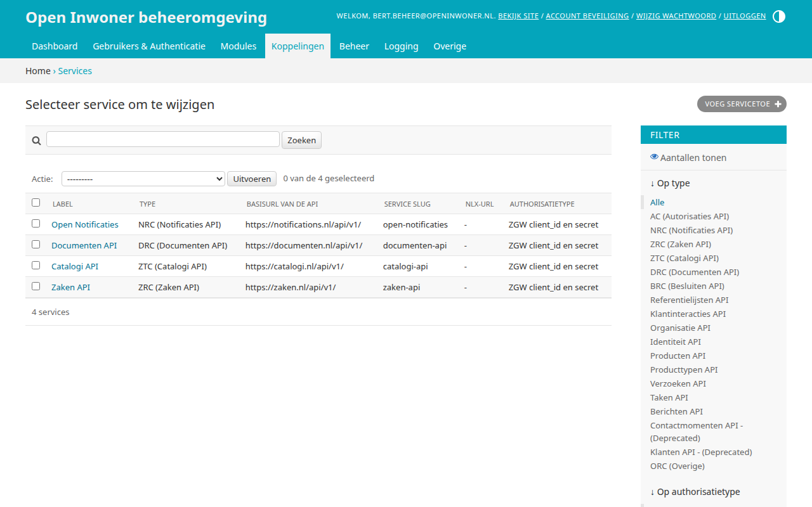
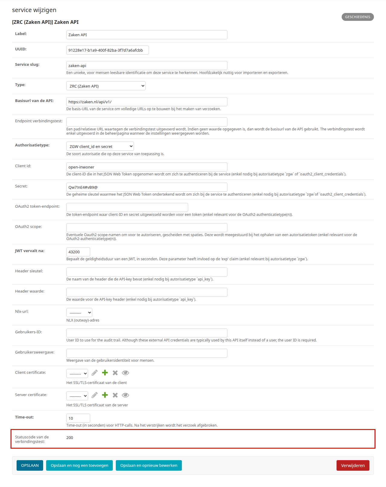
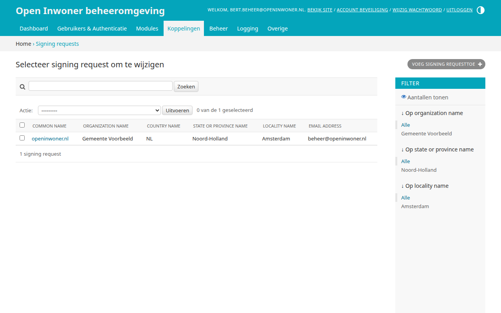
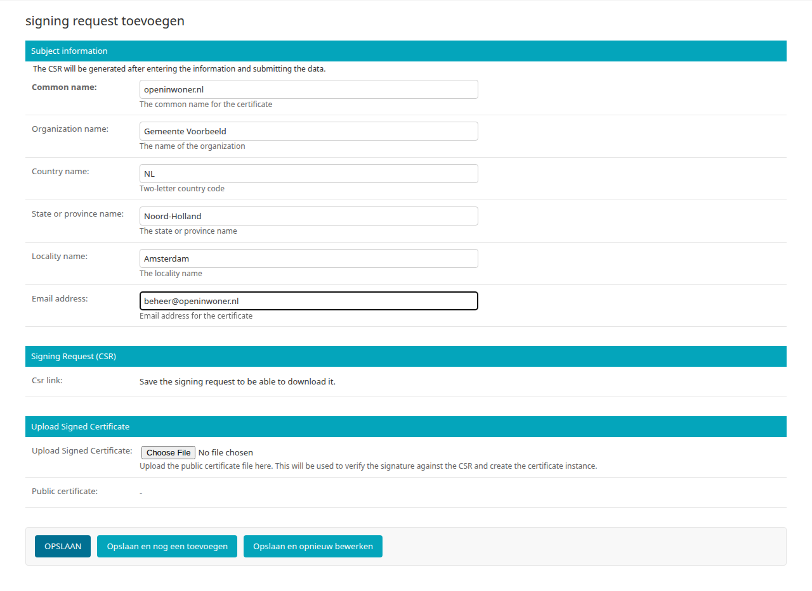
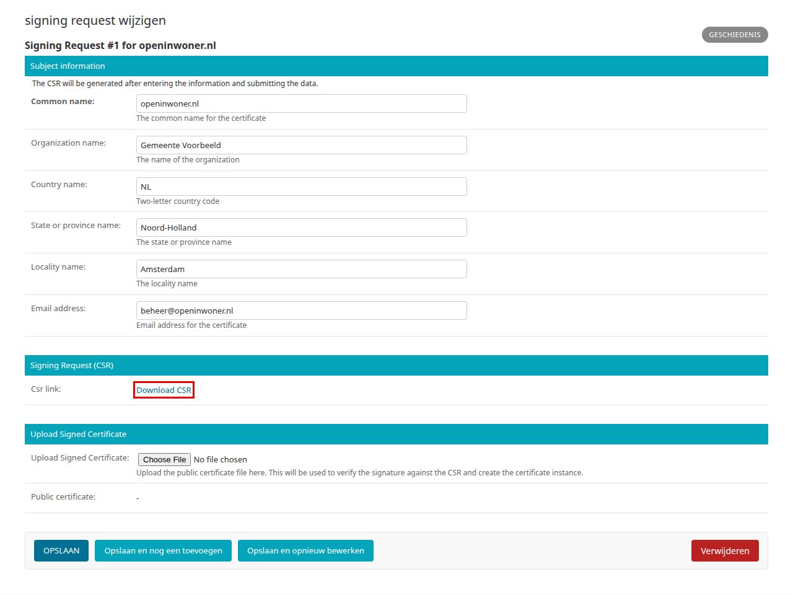

.. _hoofdstuk-16:

===============
16. Koppelingen
===============

U vindt de onderdelen van dit hoofdstuk in het menu onder **Koppelingen**. Hier staan de services, SOAP services, certificaten en signing requests waarmee Open Inwoner externe systemen bereikt. De configuratie van de koppelingen zelf vindt u bij de module die ze gebruikt.

.. _hoofdstuk-16-1:

16.1. Certificaten
==================

**Locatie in het menu:** Koppelingen > Certificaten

Hier worden de certificaten van het platform beheerd, bijvoorbeeld voor de koppelingen met SOAP services (zie :ref:`hoofdstuk 16.2 <hoofdstuk-16-2>`) en KvK. U vindt ze via **Koppelingen > Certificaten**. Het overzicht toont per certificaat het label, het serienummer, het type, de periode waarin het certificaat geldig is, of het certificaat op dit moment geldig is en of de private key bij het certificaat past. Er zijn twee typen: "Key-pair" (een certificaat met de bijbehorende private key) en "Certificate only" (alleen het certificaat). U kunt het overzicht filteren op type. Klik op een certificaat om het te wijzigen.

De schermen van de certificaten worden (nog) in het Engels getoond.

16.1.1. Nieuw certificaat toevoegen
-----------------------------------

U voegt een certificaat toe met de knop :guilabel:`Certificaat toevoegen +` rechtsboven in het overzicht. Vul het label en het type in, upload het certificaat en, bij een key-pair, de private key, en klik op :guilabel:`Opslaan`.

| **Label**
| Een herkenbaar label voor het certificaat. Onder dit label kiest u het certificaat bij een koppeling.

| **Type**
| "Key-pair" voor een certificaat met de bijbehorende private key, bijvoorbeeld een clientcertificaat waarmee Open Inwoner zich bij een andere partij identificeert. "Certificate only" voor alleen het (publieke) certificaat, bijvoorbeeld het certificaat van een server of een rootcertificaat.

Onder **Certificate identity** en **Validity** ziet u, nadat u het certificaat heeft opgeslagen, de gegevens die uit het certificaat worden gelezen: **Serial number** (het serienummer), **Issuer** (de uitgever), **Subject** (voor wie het certificaat is uitgegeven), **Not valid before** en **Not valid after** (de geldigheidsperiode, ook als relatieve tijd) en **Within validity period** (of het certificaat op dit moment geldig is).

Onder **Certificate and public key**:

| **Public certificate**
| Het certificaat, als bestand in PEM-formaat. Na het opslaan wordt de bijbehorende **Public key** getoond.

Onder **Private key**:

| **Private key**
| De private key van het certificaat, als bestand in PEM-formaat. Alleen nodig bij het type "Key-pair". De private key kan na het uploaden niet meer worden gedownload.

| **Passphrase**
| Het wachtwoord van de private key, als deze is versleuteld. De private key wordt dan ontsleuteld opgeslagen. Laat dit veld leeg bij een private key die niet is versleuteld: vult u toch een wachtwoord in, dan wordt het certificaat niet opgeslagen.

| **Valid key pair**
| Na het opslaan ziet u hier of de private key bij het certificaat past.

.. _hoofdstuk-16-2:

16.2. SOAP services
===================

**Locatie in het menu:** Koppelingen > SOAP services

Bij **Koppelingen > SOAP services** staan de externe SOAP-API koppelingen van het Open Inwoner Platform, zoals de koppeling met de Suite voor Sociaal Domein (zie :ref:`hoofdstuk 13.1 <hoofdstuk-13-1>`). Wijzig bestaande SOAP services alleen als u zeker weet wat het gevolg is: de koppelingen die ernaar verwijzen gebruiken de wijziging direct.

| **Slug**
| Een unieke, korte naam voor de SOAP service, zonder spaties, bijvoorbeeld ``ssd-uitkeringen``. Onder deze naam kiest u de SOAP service bij een koppeling. Dit veld vervangt het vroegere veld "Label".

| **URL**
| De basis-URL van de SOAP service.

Onder **Authenticatie** (de velden worden nog in het Engels getoond):

| **Client certificate**
| Het certificaat waarmee Open Inwoner zich bij de SOAP service identificeert (mutual TLS), gekozen uit de certificaten van :ref:`hoofdstuk 16.1 <hoofdstuk-16-1>`. Laat u dit veld leeg, dan wordt geen clientcertificaat gebruikt.

| **Server certificate**
| Het SSL/TLS-certificaat van de server, waarmee Open Inwoner controleert dat het met de juiste server verbinding maakt.

.. _hoofdstuk-16-3:

16.3. Services
==============

**Locatie in het menu:** Koppelingen > Services

Bij Services staan alle externe REST-API koppelingen met het Open Inwoner Platform ingesteld. Wijzig bestaande services alleen als u zeker weet wat het gevolg is: andere onderdelen van het platform, zoals de ZGW API sets (zie :ref:`hoofdstuk 14.3.4 <hoofdstuk-14-3-4>`), verwijzen ernaar.

.. _hoofdstuk-16-3-1:

16.3.1. Een ZGW service toevoegen
---------------------------------

Voor Mijn Zaken heeft u een service nodig voor de Zaken API, de Catalogi API en de Documenten API van het zaaksysteem (zie :ref:`hoofdstuk 14.1 <hoofdstuk-14-1>`). U voegt een service toe via de knop :guilabel:`Service toevoegen +`. De belangrijkste velden zijn:

| **Label**
| Een herkenbare naam voor de service, bijvoorbeeld "Zaken API".

| **Service slug**
| Een unieke, korte naam voor de service, zonder spaties. Deze wordt automatisch ingevuld op basis van het label.

| **Type**
| Het soort API, bijvoorbeeld "ZRC (Zaken API)", "ZTC (Catalogi API)" of "DRC (Documenten API)". In een ZGW API set kunt u alleen services van het juiste type kiezen.

| **Basisurl van de API**
| De URL waarop de API begint, bijvoorbeeld ``https://zaken.gemeente.nl/zaken/api/v1/``. U krijgt deze URL van de leverancier of beheerder van het zaaksysteem.

| **Authorisatietype**
| De manier waarop Open Inwoner zich bij de API aanmeldt: "ZGW client_id en secret" (gebruikelijk voor Open Zaak en eSuite), "API sleutel" of "Geen authorisatie".

| **Client id** en **Secret**
| De gegevens waarmee Open Inwoner zich aanmeldt bij het authorisatietype "ZGW client_id en secret". U krijgt deze van de beheerder van het zaaksysteem.

| **Header sleutel** en **Header waarde**
| De gegevens waarmee Open Inwoner zich aanmeldt bij het authorisatietype "API sleutel".

Klik op :guilabel:`Opslaan`. Wanneer u de service daarna opnieuw opent, ziet u bij **Statuscode van de verbindingstest** of de API bereikbaar is: de statuscode 200 betekent dat de verbinding werkt. Staat er geen statuscode, dan kon geen verbinding worden gemaakt.

16.4. Signing requests
======================

**Locatie in het menu:** Koppelingen > Signing requests

Hier kunt u een CSR (Certificate Signing Request) genereren die kan worden ingediend bij een certificeringsinstantie (CA) voor de uitgifte van een digitaal certificaat. Open Inwoner maakt daarbij zelf de bijbehorende private key aan; deze verlaat het systeem niet. Het overzicht toont per signing request de gegevens van het certificaat. Deze namen worden (nog) in het Engels getoond.

.. _hoofdstuk-16-4-1:

16.4.1. Signing request aanmaken
--------------------------------

Klik in het overzicht op de knop :guilabel:`Signing request toevoegen +` en vul onder **Subject information** de gegevens van het certificaat in:

| **Common name**
| De (domein)naam waarvoor het certificaat wordt aangevraagd, bijvoorbeeld ``openinwoner.nl``. Dit veld is verplicht.

| **Organization name**, **Country name**, **State or province name**, **Locality name** en **Email address**
| De organisatie, het land (twee letters, standaard ``NL``), de provincie, de plaats en het e-mailadres die in het certificaat komen te staan. Vraag bij uw certificeringsinstantie na welke gegevens zij verplicht stelt.

Klik op :guilabel:`Opslaan` en open de signing request opnieuw. Open Inwoner heeft de CSR en de private key dan aangemaakt.

.. _hoofdstuk-16-4-2:

16.4.2. CSR downloaden en certificaat uploaden
----------------------------------------------

#. Klik in de signing request onder **Signing Request (CSR)** op :guilabel:`Download CSR`. U kunt de CSR ook downloaden door de signing request in het overzicht te selecteren en bij **Actie** te kiezen voor *Download csr action*.
#. Dien de CSR in bij uw certificeringsinstantie.
#. Wanneer u het ondertekende certificaat heeft ontvangen, opent u de signing request opnieuw, kiest u het bestand bij **Upload Signed Certificate** en klikt u op :guilabel:`Opslaan`.

Open Inwoner maakt dan een certificaat aan met het ondertekende certificaat en de private key, met als naam "Certificate #<nummer> - <common name>". U vindt het onder Certificaten (zie :ref:`hoofdstuk 16.1 <hoofdstuk-16-1>`), en bij **Public certificate** in de signing request. Daarna kunt u het certificaat kiezen bij de koppeling waarvoor het bedoeld is.

