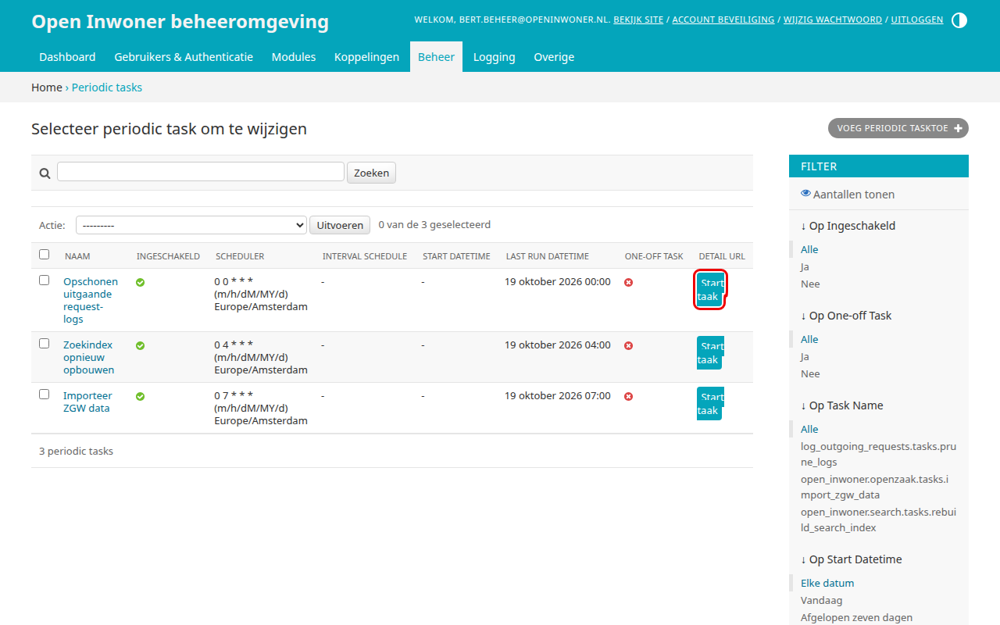
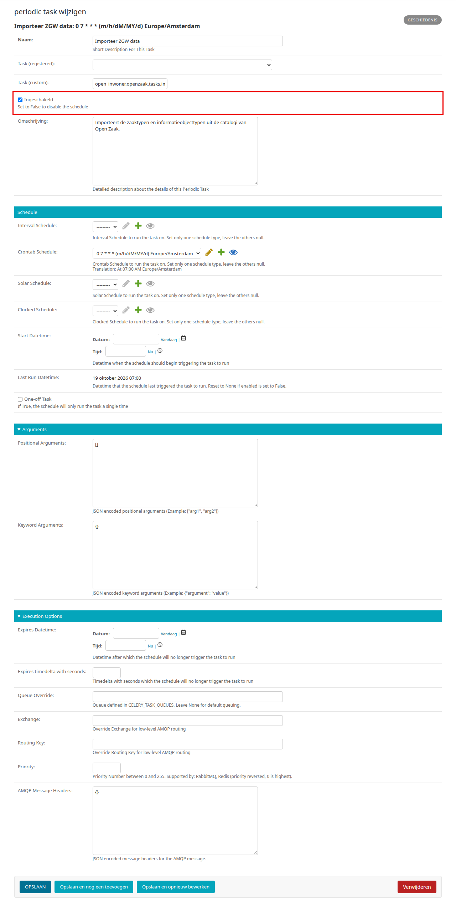
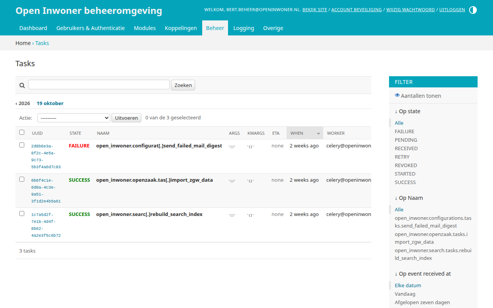
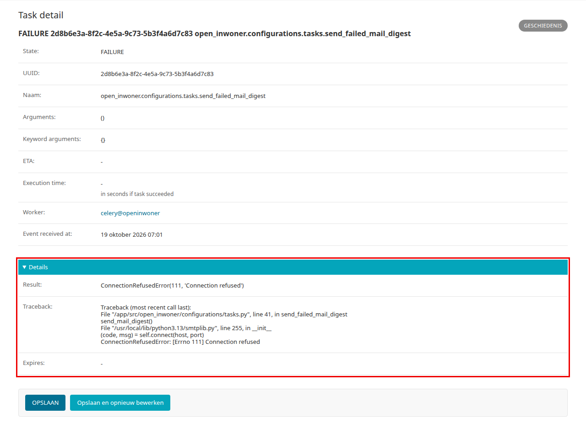

.. _hoofdstuk-17:

=====================
17. Achtergrond taken
=====================

U vindt de onderdelen van dit hoofdstuk in het menu onder **Beheer > Achtergrond taken**.

.. _hoofdstuk-17-1:

17.1. Periodieke taken
======================

**Locatie in het menu:** Beheer > Achtergrond taken > Periodic tasks

Onder periodieke taken vindt u de taken die Open Inwoner op vaste momenten uitvoert, zoals het importeren van data uit Open Zaak, het opnieuw opbouwen van de zoekindex en het opschonen van oude logs. Deze taken worden door Open Inwoner zelf ingesteld. Het is niet de bedoeling dat u hier taken toevoegt of wijzigt.

Om een taak handmatig, buiten het vaste moment om, uit te voeren klikt u op de knop :guilabel:`Start taak` achter de betreffende taak. Wat de taak heeft gedaan ziet u daarna onder Taken (zie :ref:`hoofdstuk 17.2 <hoofdstuk-17-2>`).

.. warning::

   Open Inwoner stelt de periodieke taken bij elke herstart (bijvoorbeeld bij een update) opnieuw in. Wijzigingen in de taak, het tijdstip of de instellingen van een taak gaan daarbij verloren, en een verwijderde taak wordt opnieuw aangemaakt. Alleen het uitschakelen van een taak blijft behouden.

.. _hoofdstuk-17-1-1:

17.1.1. Periodieke taak uitschakelen
------------------------------------

Veroorzaakt een periodieke taak problemen, dan kunt u de taak tijdelijk uitschakelen. Klik in het overzicht op de naam van de taak, haal het vinkje bij **Ingeschakeld** weg en klik op :guilabel:`Opslaan`. De taak wordt dan niet meer uitgevoerd, ook niet na een herstart. Zet het vinkje terug om de taak weer in te schakelen.

U kunt ook een of meer taken in het overzicht selecteren en bij **Actie** kiezen voor *Disable selected tasks* of *Enable selected tasks*. Klik daarna op :guilabel:`Uitvoeren`.

.. _hoofdstuk-17-2:

17.2. Taken
===========

**Locatie in het menu:** Beheer > Achtergrond taken > Tasks

Onder taken vindt u een overzicht van de taken die het systeem heeft uitgevoerd, met per taak de status: *SUCCESS* als de taak gelukt is, *FAILURE* als er een fout is opgetreden. U kunt de taken filteren en sorteren.

17.2.1. De uitvoer van een taak bekijken
----------------------------------------

Klik in het overzicht op de UUID van een taak om de details ervan te bekijken, zoals het tijdstip, de looptijd en de worker die de taak heeft uitgevoerd. Klik op **Details** om ook de uitvoer van de taak te zien, als die er is: bij **Result** staat wat de taak heeft opgeleverd, en bij **Traceback** de foutmelding als de taak is mislukt. Deze foutmelding is nuttig wanneer u een probleem meldt bij uw leverancier.

