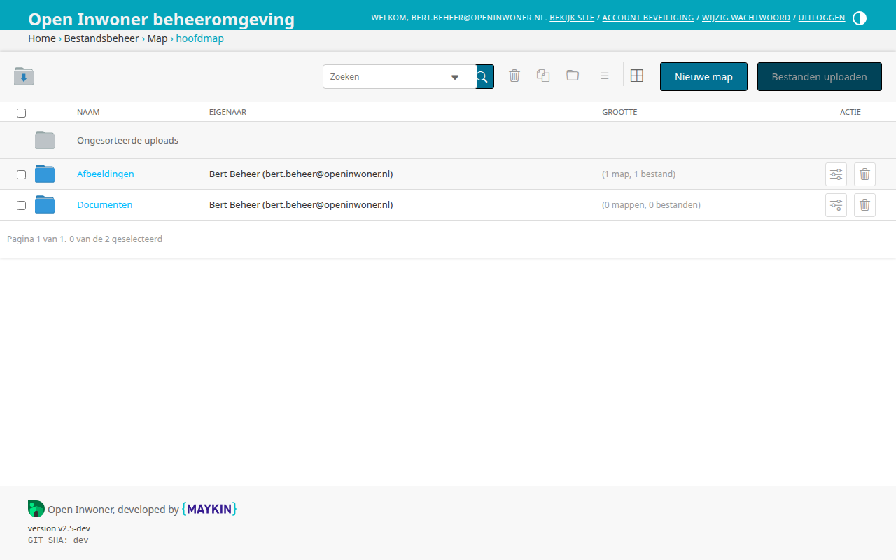
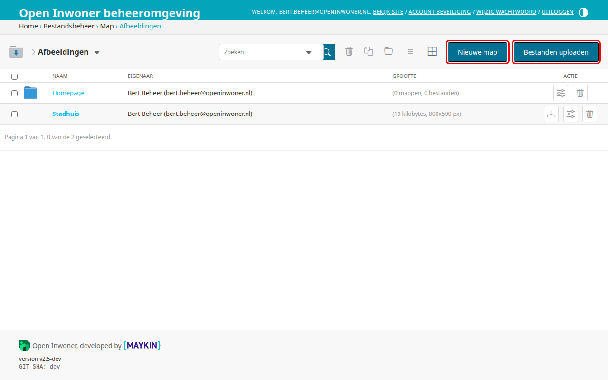
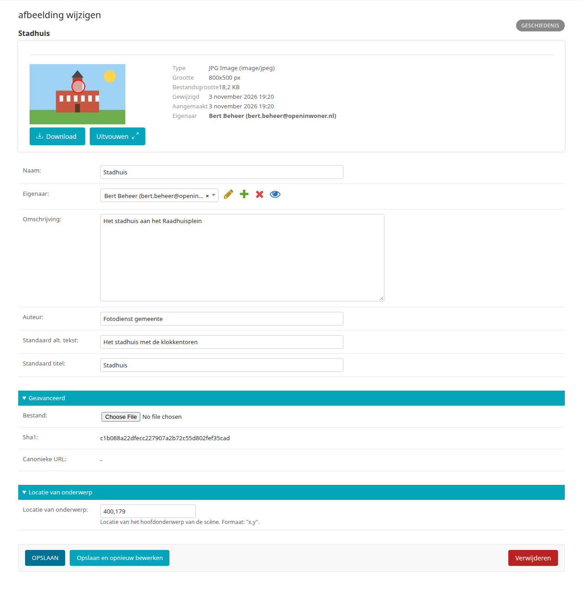
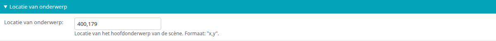

.. _hoofdstuk-18:

=============================
18. Bestanden en afbeeldingen
=============================

U vindt de onderdelen van dit hoofdstuk in het menu onder **Beheer > Bestanden en afbeeldingen**.

18.1. Mappen
============

**Locatie in het menu:** Beheer > Bestanden en afbeeldingen > Mappen

Onder mappen vindt u alle uploads van uw Open Inwoner omgeving. Het gaat hier om de gebruikte afbeeldingen en eventueel documenten. U kunt onder mappen geheel naar wens mappen toevoegen, verplaatsen, hernoemen en verwijderen.

18.1.1. Map toevoegen
---------------------

Om een nieuwe map toe te voegen klikt u op de knop :guilabel:`Nieuwe map` rechts bovenin het scherm. U kunt op ieder niveau een nieuwe map toevoegen en zo uw uploads handig bewaren.

18.1.2. Bestanden uploaden
--------------------------

Om bestanden te uploaden klikt u op de knop :guilabel:`Bestanden uploaden` rechts bovenin het scherm (zie bovenstaande afbeelding). U kunt op ieder niveau losse bestanden uploaden: van de hoofdmap tot de submappen. Nadat bestanden zijn geüpload kunnen deze indien nodig worden verplaatst.

.. _hoofdstuk-18-1-3:

18.1.3. Afbeeldingen wijzigen
-----------------------------

Bestanden kunnen na het uploaden nog worden gewijzigd. Om een afbeelding of bestand te wijzigen klikt u op de titel van een afbeelding in het
overzicht. Er wordt dan een nieuw venster geopend met de te wijzigen details van de betreffende afbeelding.

**Naam**
Hier wijzigt u de naam van de afbeelding. Let op! Dit is NIET de bestandsnaam, maar de naam zoals hij in het overzicht wordt weergegeven. Wanneer dit veld leeg blijft zal de bestandsnaam in het overzicht worden weergegeven.

**Eigenaar**
Hier ziet u de naam en het e-mailadres van degene die de afbeelding/het bestand heeft geüpload. U kunt de eigenaar wijzigen door in de keuzelijst een andere eigenaar te selecteren.

**Omschrijving**
Hier kunt u de omschrijving van de afbeelding wijzigen. Dit is handig voor mensen met een visuele beperking.

**Auteur**
Hier kunt u wijzigen wie de auteur (of tekenaar/fotograaf) van de afbeelding is.

**Standaard alt. tekst**
Hier wijzigt u de alt-tekst (alternatieve tekst) of alt-tag. De alt-tekst wordt weergegeven als de afbeelding om een bepaalde reden niet te zien is. De alt-tekst is vaak de titel van de afbeelding of een samenvatting wat er op de afbeelding te zien is. Deze informatie is belangrijk voor SEO – want zoekmachines lezen geen plaatjes - maar is ook handig voor mensen met een visuele beperking (digitale toegankelijkheid).

**Standaard titel**
Hier kunt u de titel van de afbeelding wijzigen.

**Geavanceerd**
Onder geavanceerd vindt u enkele technische details van de afbeelding/het bestand. U kunt hier wél het daadwerkelijke bestand veranderen door een nieuwe versie te uploaden.

**Locatie van onderwerp**
De locatie van het onderwerp geeft het brandpunt van de afbeelding aan. Hier worden de x en y-coördinaten weergegeven. Om het brandpunt van de afbeelding te wijzigen is het beter gebruik te maken van de visuele manier. Zie :ref:`18.1.4 <hoofdstuk-18-1-4>`.

**Opslaan**
Als u uw wijzigingen tussentijds wilt opslaan, klikt u op :guilabel:`Opslaan en opnieuw bewerken`. Wanneer u tevreden bent met uw wijzigingen klikt u op :guilabel:`Opslaan` om terug te keren naar het overzicht.

.. _hoofdstuk-18-1-4:

18.1.4. Brandpunt van afbeelding wijzigen
-----------------------------------------

Wanneer u een afbeelding uploadt kan het zijn dat de afbeelding te groot is voor de uiteindelijke weergave. Er wordt dan slechts een gedeelte van de afbeelding weergegeven. Door een brandpunt (focus point) toe te voegen of te verplaatsen bepaalt u welk gedeelte van de afbeelding als centrale punt wordt genomen.

U kunt het brandpunt verleggen door in het scherm ‘afbeelding wijzigen’ de rode cirkel te verslepen. De plek van de rode cirkel wordt indien nodig als midden (brandpunt) van de uiteindelijke weergave genomen. Controleer altijd of de uiteindelijke weergave van de afbeelding naar
wens is.
