.. _configuratie:

.. _hoofdstuk-20:

================
20. Configuratie
================

U vindt de onderdelen van dit hoofdstuk in het menu onder **Beheer > Configuratie**. Ook kunnen hier de platte pagina’s worden gecreëerd en – in beperkte mate – worden opgemaakt.

20.1. Algemene configuratie
===========================

**Locatie in het menu:** Beheer > Configuratie > Algemene configuratie

De algemene configuratie is de hoofdconfiguratie. Hier kunt u de gehele Open Inwoner omgeving configureren. Het gaat hierbij om kleurgebruik, paginavoorkeuren, afbeeldingen, logo’s, adresgegevens, footer-indeling, teksten op de belangrijkste pagina’s en Google Analytics of SiteImprove ID.

Indien gewenst kunt u wijzigingen aan de weergave en voorkeuren van uw omgeving aanbrengen door de configuratie te veranderen. Houd er rekening mee dat wijzigingen aan een liveomgeving direct op de website zichtbaar zijn. Door de knop :guilabel:`Geschiedenis` te raadplegen kunt u zien wanneer wie welke wijzigingen heeft doorgevoerd. Let op: vanwege de paginalengte zijn enkele te wijzigen onderdelen standaard ingeklapt. Klik op de titel van een ingeklapt onderdeel, zoals Paginateksten of Helpteksten, om het uit te klappen.

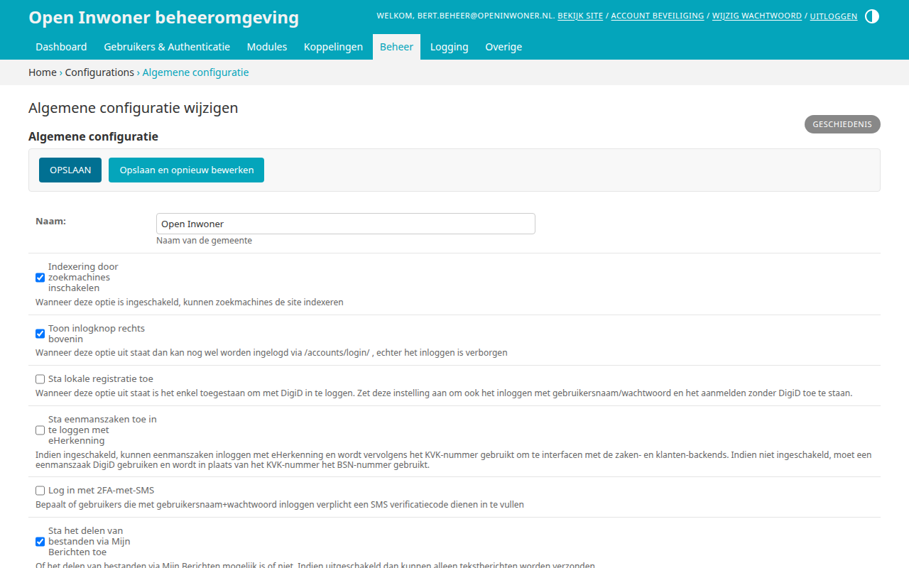

.. note::
   **Beperkte toegang**: Het is mogelijk om gebruikers slechts toegang te geven tot
   specifieke onderdelen van deze configuratie in plaats van volledige beheerdersrechten.
   Zie :ref:`beperkte_toegang_beheeromgeving` voor meer informatie over het instellen van
   beperkte toegangsrechten.

.. _hoofdstuk-20-1-1:

20.1.1. Naam en opties
----------------------

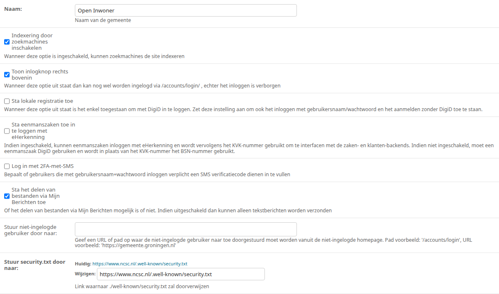

In het bovenste gedeelte van het scherm kunt u de naam van uw gemeente aanpassen en u kunt bepaalde voorkeuren instellen door deze aan te vinken.

**Naam**
Voer hier de naam van uw gemeente in.

**Indexering door zoekmachines inschakelen**
Door hier een vinkje te zetten kunnen zoekmachines de niet-ingelogde versie van uw omgeving van Open Inwoner indexeren.

**Toon inlogknop rechts bovenin**
Dit zorgt ervoor dat er standaard een knop is om in te loggen. Wanneer deze optie uit staat is er nog altijd de mogelijkheid om in te loggen via accounts/login, maar de functie is niet zichtbaar.

**Sta lokale registratie toe**
Wanneer deze optie uit staat is het enkel toegestaan om met DigiD in te loggen. Zet deze instelling aan om ook het inloggen met gebruikersnaam/wachtwoord en het aanmelden zonder DigiD toe te staan.

**Sta eenmanszaken toe in te loggen met eHerkenning**
Eenmanszaken kunnen op Open Inwoner inloggen via DigiD of eHerkenning. Indien hier geen vinkje staat kunnen eenmanszaken enkel met DigiD inloggen. Wanneer een eenmanszaak dan alsnog via eHerkenning probeert in te loggen zal de gebruiker een foutmelding krijgen en worden doorgestuurd naar aanmelden via DigiD. Bij inloggen met eHerkenning wordt het KVK-nummer gebruikt voor de gekoppelde systemen. Wanneer DigiD wordt gebruikt wordt hier het BSN voor gebruikt.

**Log in met 2FA-met-SMS**
Vink dit aan om te bepalen of gebruikers die met een gebruikersnaam en wachtwoord inloggen verplicht een verificatiecode in moeten voeren die per SMS naar het geregistreerde telefoonnummer wordt verstuurd. Wanneer deze optie is uitgeschakeld kunnen gebruikers met enkel gebruikersnaam en wachtwoord inloggen.

**Sta het delen van bestanden via Mijn Berichten toe**
Vink dit aan om te bepalen of gebruikers via Mijn Berichten bestanden kunnen delen als attachment bij berichten. Wanneer deze optie is uitgeschakeld kunnen gebruikers enkel tekstberichten versturen.

**Stuur niet-ingelogde gebruiker door naar**
Geef hier een URL of pad op waar niet-ingelogde gebruikers naartoe doorgestuurd moeten worden vanuit de niet-ingelogde homepagina.

- Een pad is bijvoorbeeld: '/accounts/login/'.
- Een URL is bijvoorbeeld: 'https://groningen.nl'.

**Stuur security.txt door naar**
Voor alle overheidsinstanties is het verplicht een security.txt bestand te hebben. Het adres van dit bestand vult u hier in. Voor meer informatie over een security.txt bestand kijkt u op: https://www.ncsc.nl/cvd-beleid/handreiking-securitytxt-voor-rijksoverheidsorganisaties

20.1.2. Kleur
-------------

Hier kunt u het kleurgebruik op uw Open Inwoner omgeving instellen. Gebruik hier de huisstijlkleuren van uw gemeente. Wanneer u de huisstijlkleuren hebt geselecteerd kunt u aangeven of de tekst die in blokken van deze kleuren wordt weergegeven donker of licht moet zijn. Selecteer de optie die voor de beste leesbaarheid zorgt. Bij accentkleur gaat het om de kleur die gebruikt wordt om dingen te accentueren (highlighten). De accent tekstkleur is de kleur die tekst moet krijgen die op vlakken met de accentkleur wordt gebruikt.

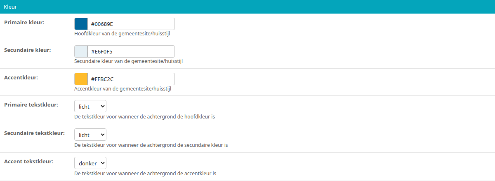

.. _hoofdstuk-20-1-3:

20.1.3. Afbeeldingen
--------------------

Hier kunt u diverse afbeeldingen die gebruikt worden op uw Open Inwoner omgeving instellen. Het gaat hier om logo’s en de Favicon (de thumbnail die in de browser klein wordt gebruikt). De banners op de homepage en de inlogpagina stelt u in via het CMS (zie :ref:`hoofdstuk 19.7 <hoofdstuk-19-7>`).

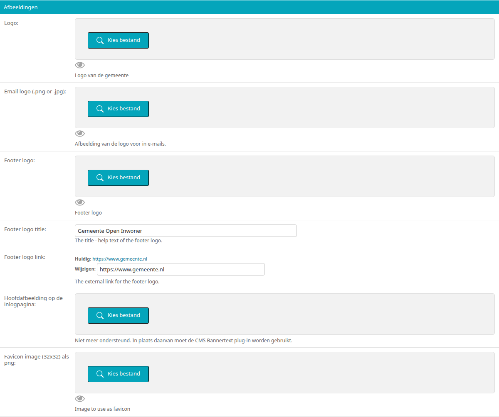

**Logo**
Hier kunt u het logo van de gemeente uploaden. Sleep het gewenste bestand naar het veld of klik op :guilabel:`Kies bestand`.

**Footer logo**
Hier kunt u het logo van de gemeente naar de footer uploaden. Sleep het gewenste bestand naar het veld of klik op :guilabel:`Kies bestand`.

**Footer logo title**
Hier kunt u een tekst invullen die in de footer naast het logo wordt getoond, ook als er geen footer logo is geüpload. Regeleinden in de tekst worden overgenomen. De alternatieve tekst van het logo zelf stelt u in bij de afbeelding (zie :ref:`hoofdstuk 18.1.3 <hoofdstuk-18-1-3>`).

**Footer logo link**
Hier vult u de URL in waar het footer logo naar verwijst wanneer de gebruiker erop klikt. Laat u dit veld leeg, dan verwijst het logo naar de homepage. Deze link wordt alleen gebruikt als u een footer logo heeft geüpload.

**Hoofdafbeelding op de inlogpagina**
Dit veld wordt niet meer gebruikt: een afbeelding die u hier uploadt wordt nergens op de website getoond. Gebruik in plaats daarvan de plugin Bannerafbeelding. Voor de homepage plaatst u deze plugin op de homepage zelf (zie :ref:`hoofdstuk 19.7 <hoofdstuk-19-7>`), voor de inlogpagina in de alias ``login_banner`` (zie :ref:`hoofdstuk 19.2.11 <hoofdstuk-19-2-11>`).

**Favicon image (32x32) als png**
Dit is een pictogrammetje dat bij uw gemeente of Open Inwoner Platform hoort. Dit pictogrammetje wordt gebruikt in uw internetbrowser.

20.1.4. Waarschuwingsbanner
---------------------------

De waarschuwingsbanner is een gekleurde band bovenin beeld die u kunt gebruiken om belangrijke meldingen weer te geven. Hier kunt u de waarschuwingsbanner aan- of uitzetten en configureren. De configuratie van de waarschuwingsbanner heeft betrekking op zowel opmaak als inhoud.

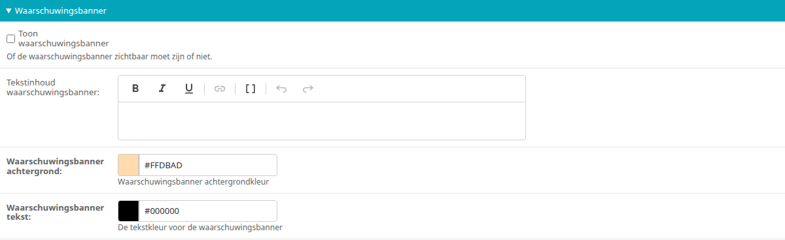

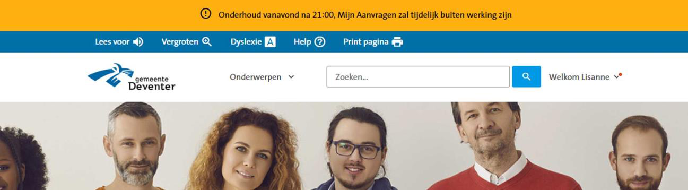

**Toon waarschuwingsbanner**
Vink dit aan wanneer u wilt dat de waarschuwingsbanner bovenin de schermen van het Open Inwoner Platform zichtbaar is. Wanneer u deze optie heeft aangevinkt wordt de waarschuwingsbanner op **alle pagina’s** weergegeven.

**Tekstinhoud waarschuwingsbanner**
Hier kunt u de tekst invoeren die op de waarschuwingsbanner wordt weergegeven. Denk hierbij aan onderhoudsmomenten, updates etc.

**Waarschuwingsbanner achtergrond en Waarschuwingsbanner tekst**
Hier kunt u de kleuren selecteren voor respectievelijk de achtergrondkleur en de tekstkleur van de waarschuwingsbanner. De kleur kan worden geselecteerd in een pop-up kleurvinder of door het invoeren van de gewenste kleurcode.

Houd er rekening mee dat de waarschuwingsbanner moet opvallen. Kies bij het gebruik van de waarschuwingsbanner daarom géén kleur die bij de huisstijl van de Gemeente past. Roodtinten worden vaak gebruikt als waarschuwing, maar kan als negatief worden ervaren. Oranje heeft een minder negatieve associatie en valt desondanks vaak goed op.

.. _hoofdstuk-20-1-5:

20.1.5. Paginateksten
---------------------

Hier kunt u de paginateksten van de vaste pagina’s aanpassen. U kunt hier eenvoudige tekstuele wijzigingen aanbrengen. Er wordt geen gebruik gemaakt van een editor.

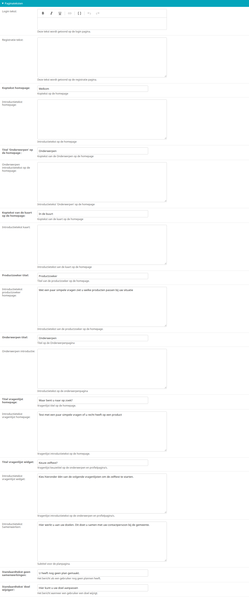

**Login tekst**
Dit is de tekst die wordt weergegeven wanneer de gebruiker op de website op :guilabel:`Login` rechts bovenin het scherm klikt.

**Registratie tekst**
Dit is de tekst die wordt weergegeven op de registratiepagina.

**Koptekst homepage**
Dit is de header die op de homepage wordt weergegeven aan bezoekers die niet zijn ingelogd. Ingelogde gebruikers zien in plaats daarvan de plugin Bannertext uit het CMS (zie :ref:`hoofdstuk 19.7 <hoofdstuk-19-7>`).

**Introductietekst homepage**
Dit is de tekst die onder de koptekst op de homepage wordt weergegeven aan bezoekers die niet zijn ingelogd. Ingelogde gebruikers zien in plaats daarvan de omschrijving van de plugin Bannertext.

Deze twee teksten worden getoond op elke pagina met het sjabloon "Home page template", niet alleen op de homepage.

**Titel 'Onderwerpen' op de homepage**
Dit is de header van het tweede blok op de homepage. (Het blok met onderwerpen).

**Onderwerpen introductietekst op de homepage**
Dit is de lopende tekst die bij het tweede blok op de homepage wordt weergegeven. (Het blok met onderwerpen).

**Koptekst van de kaart op de homepage**
Dit is de header die bij de kaart wordt weergegeven.

**Introductietekst kaart**
Dit is de lopende tekst die bij de kaart wordt weergegeven.

**Productzoeker titel**
Dit is de titel die bij de productzoeker op de homepage wordt weergegeven.

**Introductietekst productzoeker homepage**
Dit is de introductietekst van de productzoeker op de homepage.

**Onderwerpen titel**
Dit is de header die op de onderwerp-pagina wordt weergegeven. Wijzig deze titel alleen als u de term onderwerpen wilt wijzigen.

**Onderwerpen introductie**
Dit is de lopende tekst die op de onderwerp-pagina boven de onderwerpblokken wordt weergegeven.

**Titel vragenlijst homepage**
Dit is de titel van de vragenlijst die op de homepage staat.

**Introductietekst vragenlijst homepage**
Dit is de introductietekst die bij de vragenlijst op de homepage wordt weergegeven.

**Titel vragenlijst widget**
Dit is de titel van de vragenlijst widget om de zelfdiagnose te starten. Deze wordt weergegeven op de onderwerp- en profielpagina’s.

**Introductietekst vragenlijst widget**
Dit is de introductietekst die bij de vragenlijst widget op de onderwerp- en profielpagina’s wordt weergegeven.

**Introductietekst Samenwerken**
Dit is de introductietekst die op de *Samenwerken* pagina’s wordt weergegeven.

**Standaardtekst geen samenwerkingen**
Deze tekst wordt weergegeven als een gebruiker nog geen samenwerkingsplannen heeft aangemaakt.

**Standaardtekst ‘doel wijzigen’**
Deze tekst wordt weergegeven als een gebruiker een doel wil wijzigen.

20.1.6. Helpteksten
-------------------

Dit zijn de teksten die in een pop-up worden getoond wanneer de gebruiker op een specifieke pagina op de knop :guilabel:`Help` in het topmenu heeft geklikt. Deze teksten geven een korte uitleg van wat de gebruiker op de betreffende pagina kan doen/vinden.

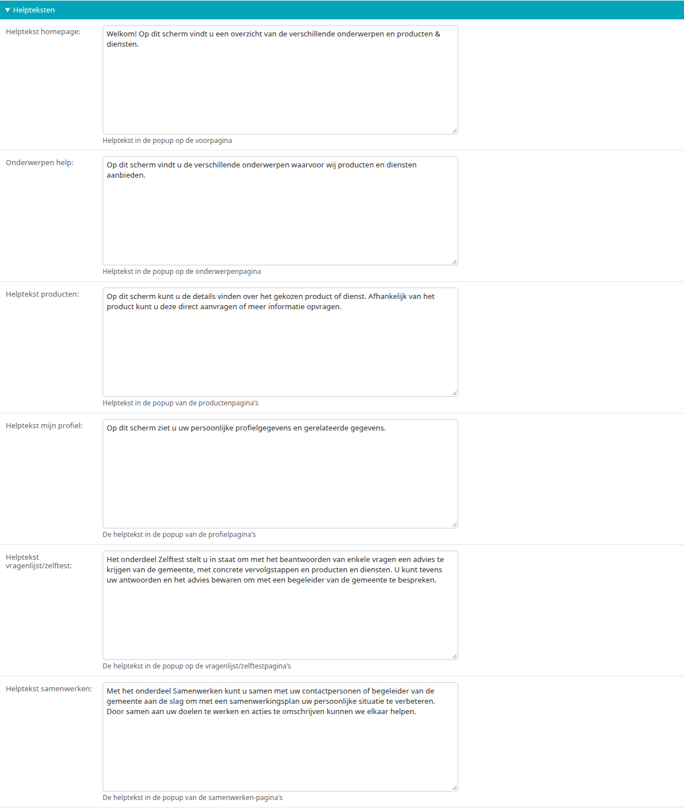

**Helptekst homepage**
Dit is de tekst die wordt weergegeven wanneer de gebruiker op de homepage op :guilabel:`Help` klikt.

**Onderwerpen help**
Dit is de tekst die wordt weergegeven wanneer de gebruiker op de onderwerppagina op :guilabel:`Help` klikt.

**Helptekst producten**
Dit is de tekst die wordt weergegeven wanneer de gebruiker op een productpagina op :guilabel:`Help` klikt.

**Helptekst mijn profiel**
Dit is de tekst die wordt weergegeven wanneer de gebruiker op de profielpagina op :guilabel:`Help` klikt.

**Helptekst vragenlijst/zelftest**
Dit is de tekst die wordt weergegeven wanneer de gebruiker tijdens de vragenlijst of zelftest op :guilabel:`Help` klikt.

**Helptekst samenwerken**
Dit is de tekst die wordt weergegeven wanneer de gebruiker op de pagina *Samenwerken* op :guilabel:`Help` klikt.

.. _hoofdstuk-20-1-7:

20.1.7. Zoeken
--------------

Hier kunt u de zoekfunctie in- of uitschakelen en verschillende filters toevoegen aan de zoekresultaten, bijvoorbeeld een onderwerpfilter, een tagfilter en/of een organisatiefilter.
U kunt deze filters naar eigen inzicht selecteren.

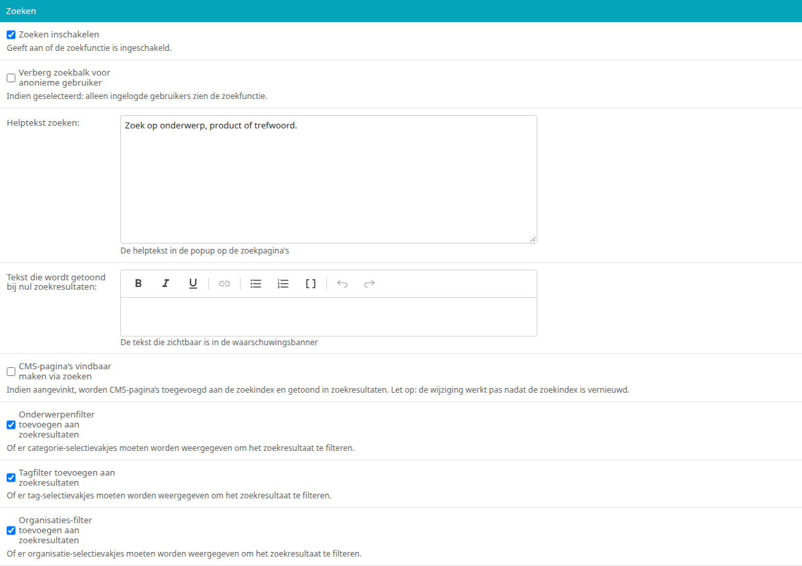

**Zoeken inschakelen**
U kunt de zoekfunctie voor de hele site in- of uitschakelen (standaard: ingeschakeld).

**Verberg zoekbalk voor anonieme gebruiker**
Indien aangevinkt, wordt de zoekbalk niet weergegeven voor anonieme gebruikers.

**Helptekst zoeken**
Dit is de tekst die wordt weergegeven wanneer de gebruiker op de zoekpagina op :guilabel:`Help` klikt.

**Tekst die wordt getoond bij nul zoekresultaten**
De tekst die wordt weergegeven als er geen zoekresultaten zijn.

**CMS-pagina’s vindbaar maken via zoeken**
Indien hier een vinkje staat worden CMS-pagina’s toegevoegd aan de zoekindex en zullen ze worden getoond in zoekresultaten. Let op: de wijziging werkt pas nadat de zoekindex is vernieuwd. Dit kunt u handmatig forceren via de periodieke taken (zie :ref:`hoofdstuk 17.1 <hoofdstuk-17-1>`). Hier vindt u een taak 'Zoekindex opnieuw opbouwen'. Als u deze aanvinkt en dan op de knop :guilabel:`Start taak` klikt wordt de zoekindex opnieuw geïndexeerd. Wanneer u dit niet handmatig doet, zal de zoekindex pas op de periodiek ingestelde tijd opnieuw worden opgebouwd.

**Onderwerpenfilter toevoegen aan zoekresultaten**
Hier kunt u selecteren of er categorie-selectievakjes moeten worden weergegeven om het zoekresultaat te filteren.

**Tagfilter toevoegen aan zoekresultaten**
Hier kunt u selecteren of er tag-selectievakjes moeten worden weergegeven om het zoekresultaat te filteren.

**Organisaties-filter toevoegen aan zoekresultaten**
Hier kunt u selecteren of er organisatie-selectievakjes moeten worden weergegeven om het zoekresultaat te filteren.

De hierboven ingestelde zoekfilters worden op de website aan de linkerkant van de pagina met zoekresultaten weergegeven. Een voorbeeld hiervan is weergegeven in het onderstaande screenshot:

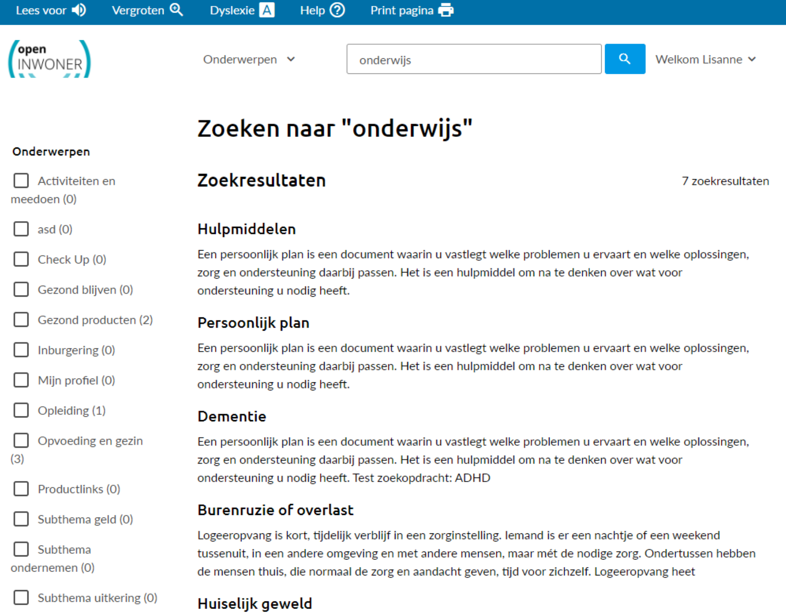

.. _hoofdstuk-20-1-8:

20.1.8. Notificaties
--------------------

Wanneer u het onderdeel 'Notificaties' weergeeft, krijgt u de mogelijkheid notificaties aan- en uit te schakelen op het niveau van het gehele platform. Door vinkjes te zetten bij de verschillende soorten notificaties worden de instellingen voor alle gebruikers mogelijk gemaakt of gewijzigd. Gebruikers kunnen deze instellingen op gebruikersniveau alsnog wijzigen.

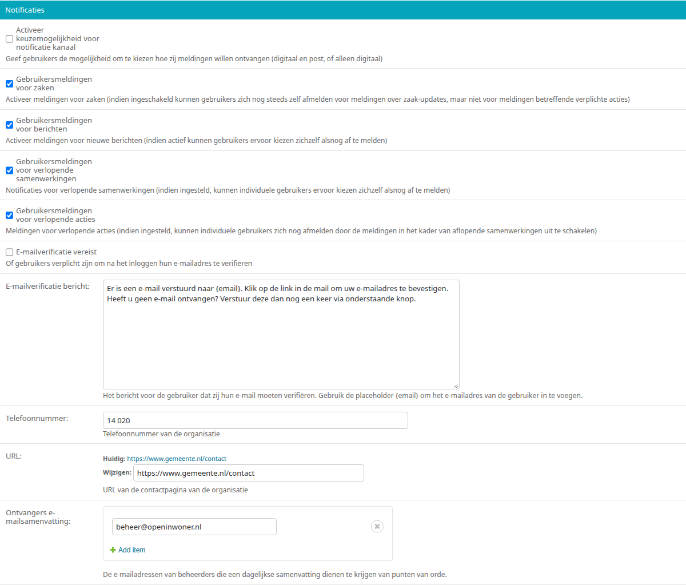

**Activeer keuzemogelijkheid voor notificatie kanaal**
Wanneer dit is aangevinkt wordt gebruikers de mogelijkheid geboden te kiezen hoe zij meldingen willen ontvangen.

**Gebruikersmeldingen voor zaken**
Wanneer dit is aangevinkt ontvangen gebruikers een e-mailnotificatie bij wijzigingen in hun zaken, zoals een nieuwe status of een nieuw document (zie :ref:`hoofdstuk 14.4 <hoofdstuk-14-4>`). Gebruikers kunnen zich voor deze meldingen afmelden, maar niet voor meldingen dat er voor een zaak een actie van hen nodig is. Staat het vinkje uit, dan worden binnenkomende zaaknotificaties niet verwerkt.

**Gebruikersmeldingen voor berichten**
Wanneer dit is aangevinkt wordt er een e-mailnotificatie gestuurd naar gebruikers als zij in Open Inwoner een nieuw bericht hebben ontvangen.

**Gebruikersmeldingen voor verlopende samenwerkingen**
Wanneer dit is aangevinkt wordt er een e-mailnotificatie gestuurd naar gebruikers als een van hun samenwerkingen eerdaags verloopt.

**Gebruikersmeldingen voor verlopende acties**
Wanneer dit is aangevinkt wordt er een e-mailnotificatie gestuurd naar gebruikers als een van hun acties eerdaags verloopt.

**E-mailverificatie vereist**
Hier kunt u selecteren of gebruikers verplicht zijn om na het inloggen hun e-mailadres te verifiëren voor bepaalde handelingen.

**E-mailverificatie bericht**
Hier kunt u een bericht invoeren dat gebruikers teruggekoppeld krijgen wanneer zij via
een e-mailadres een account willen registreren. Dit e-mailadres dient eerst bevestigd te worden
alvorens het kan worden geactiveerd.

**Telefoonnummer**
Hier voert u het telefoonnummer van de organisatie in.

**URL**
Hier voert u de URL naar de contactpagina van de organisatie in.

**Ontvangers e-mailsamenvatting**
Hier vult u de e-mailadressen van beheerders die dagelijks een samenvatting dienen te ontvangen van alle op te lossen zaken (e-mails die niet aankomen).

.. _hoofdstuk-20-1-9:

20.1.9. OpenID Connect
----------------------

Dit is een alternatieve login methode die naast DigiD kan worden ingesteld (zie :ref:`hoofdstuk 5.2 <hoofdstuk-5-2>`). In de algemene configuratie kunt u de login button voor OpenID Connect configureren. Alle andere zaken rond de OpenID Connect configuratie vindt u onder inlog koppelingen (:ref:`hoofdstuk 5.5 <hoofdstuk-5-5>`); voor deze loginmethode gebruikt u de OIDC client ``admin-oidc``.

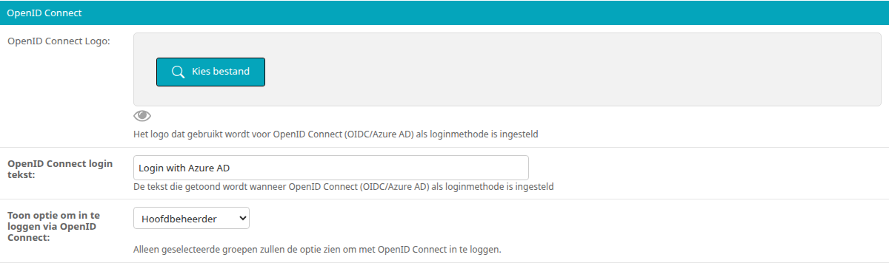

**OpenID Connect logo**
Hier kunt u het logo uploaden van de OpenID connect methode die u wilt gebruiken. Door een logo te uploaden maakt u het voor de gebruiker duidelijker welke login methode er wordt geboden.

**OpenID Connect login tekst**
Hier voegt u de tekst toe die bij de login knop komt te staan. Deze tekst moet in ieder geval “Log in met :guilabel:`X`” of iets vergelijkbaars bevatten.

**Toon optie om in te loggen via OpenID Connect**
Hier kunt u selecteren welk soort gebruiker er de mogelijkheid moet krijgen om via OpenID Connect in te loggen. Dit kan de standaardgebruiker zijn of de Hoofdbeheerder.

20.1.10. Authenticatie
----------------------

**EHerkenning authentication ingeschakeld**
Hier kunt u aanvinken of u gebruikers de mogelijkheid wilt bieden in te loggen met eHerkenning. Standaard wordt er gebruik gemaakt van de SAML integratie (bij een rechtstreekse aansluiting op een eHerkenning Makelaar). Een OpenID Connect koppeling met eHerkenning kunt u configureren onder inlog koppelingen (zie :ref:`hoofdstuk 5.5 <hoofdstuk-5-5>`).

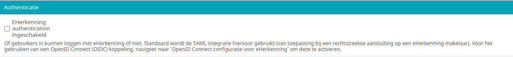

20.1.11. Analytics
------------------
Dit zijn de gegevens die u dient in te vullen als u Google Analytics of Matomo – het Open Source alternatief voor Google Analytics - wilt laten draaien op het platform. Hierdoor krijgt u inzicht in het gedrag van de bezoekers van het platform.

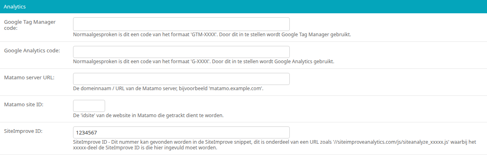

**Google Tag Manager code**
Deze code ziet er meestal uit als ‘GTM-XXXX’. Het invoeren van deze code zorgt ervoor dat Google Tag Manager geïnstalleerd wordt. Installeer Google Tag Manager om tags te configureren en te implementeren, inclusief tags van Google Ads, Google Analytics, Floodlight en tags van derden.

**Google Analytics code**
Deze trackingcode ziet er meestal uit als ‘G-XXXXX’. Het invoeren van deze code zorgt ervoor dat Analytics geïnstalleerd wordt. Google Analytics verzamelt statistische gegevens waarmee inzicht kan worden verkregen in het gedrag van bezoekers. Hierdoor kan er beter op de bezoeker worden ingespeeld.

**Matomo server URL**
Vul hier de URL in van uw Matomo server. Matomo is het open source alternatief voor Google Analytics.

**Matomo site ID**
Vul hier de Matomo ID in van de website die u wilt analyseren. Deze code is te vinden wanneer u ingelogd bent in Matomo.

**SiteImprove ID**
Vul hier de SiteImprove ID in van de website die u wilt analyseren. Deze code kunt u vinden in de SiteImprove snippet. Dit is onderdeel van een URL zoals '//siteimproveanalytics.com/js/siteanalyze_xxxxx.js' waarbij het xxxxx-deel de SiteImprove ID is die hier moet worden ingevuld.

Let op! Wanneer de SiteImprove ID is ingevuld dienen ook de volgende twee CSP settings ingesteld te worden via het menu-item CSP settings (zie :ref:`hoofdstuk 22.1 <hoofdstuk-22-1>`):

.. code::

    default-src https://siteimproveanalytics.com

    img-src https://*.siteimproveanalytics.io

20.1.12. Toestemming voor cookies
---------------------------------

Open Inwoner maakt gebruik van cookies om de website te verbeteren. Deze melding wordt weergegeven wanneer een nieuwe gebruiker op de site komt. De gebruiker krijgt een cookiemelding (cookiebanner) in beeld waarmee akkoord moet worden gegaan voordat verder kan worden gegaan. In dit onderdeel vindt u de gegevens die in de cookiebanner worden weergegeven. U kunt hier de tekst, link en de URL naar de privacyverklaring aanpassen.

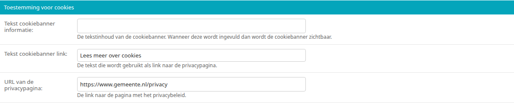

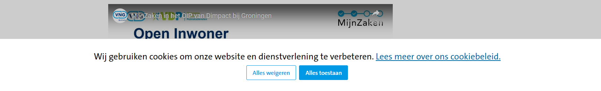

**Tekst cookiebanner informatie**
Hier kunt u de tekstuele informatie invoeren die in de cookiebanner wordt weergegeven. Dit is een disclaimer voor het gebruik van cookies, zoals: “Wij gebruiken cookies om onze website en dienstverlening te verbeteren.”

**Tekst cookiebanner link**
Hier kunt u de tekst invoeren waaronder de link naar de privacypagina zit. Deze tekst is klikbaar indien er een URL is opgegeven.

**URL van de privacypagina**
Plaats hier de link naar de privacypagina.

20.1.13. Gebruikersfeedbackonderzoek
------------------------------------

Hier kunt u de mogelijkheid voor gebruikers om feedback te geven over het platform configureren.

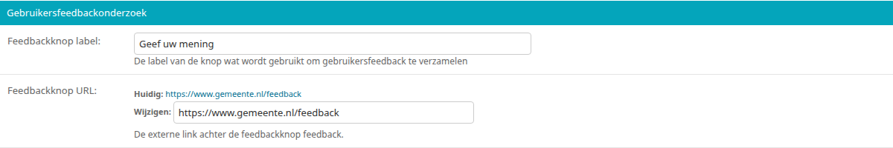

**Feedbackknop label**
Hier vult u de tekst in van de link in de footer naar het klanttevredenheidsonderzoek, bijvoorbeeld "Geef uw mening". De link wordt alleen getoond als zowel het label als de URL zijn ingevuld, en opent in een nieuw tabblad.

**Feedbackknop URL**
Hier vult u de URL in naar het formulier waar gebruikers feedback kunnen geven.

20.1.14. Weergaveopties voor anonieme gebruikers
------------------------------------------------

Hier kunt u selecteren of u het onderwerpen-menu voor anonieme gebruikers wilt verbergen. Wanneer u het vakje heeft aangevinkt zal de betreffende optie alleen zichtbaar zijn voor ingelogde gebruikers.

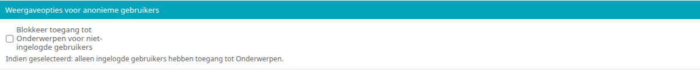

20.1.15. Geavanceerde opties
----------------------------

Klik op de titel van dit onderdeel om deze opties uit te klappen.

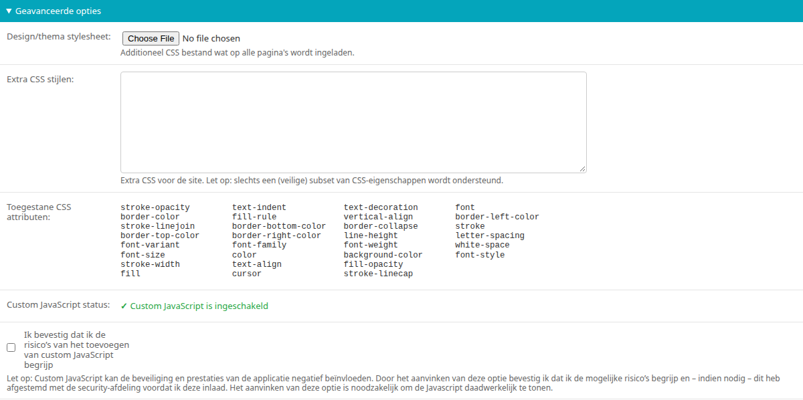

**Design/thema stylesheet**
Hier kunt u een eigen CSS-bestand uploaden dat op alle pagina's van de website wordt geladen. Voor dit bestand gelden geen beperkingen op de CSS-eigenschappen. Dit is tevens de plek waar NL Design System design tokens kunnen worden toegevoegd. Wanneer u een CSS-bestand met NLDS-waarden of -variabelen hier uploadt, zal dit bestand de bestaande stijlen overschrijven.

In het onderstaande voorbeeld ziet u de NLDS-tokenwaarde voor de 'actieve' kleur van de zij-navigatie. Als er geen design tokens worden ingeladen, wordt de primaire kleur overgenomen uit de kleurkiezer (*'Algemene configuratie'* >> *'Kleur'*). Zodra design tokens wel worden toegepast, krijgen deze de prioriteit en bepalen zij de uiteindelijke kleur.

*Voorbeeldbestand: design-tokens.css*

.. code-block:: css

    .openinwoner-theme {
        --denhaag-side-navigation-link-active-color: aqua;
    }

**Extra CSS stijlen**
Hier kunt u zelf CSS-stijlen invoeren die op de site gebruikt worden, zonder een bestand te uploaden. Let op, hier kan enkel gebruik worden gemaakt van een beperkte, veilige subset van CSS-eigenschappen. Bij het opslaan worden niet-ondersteunde eigenschappen verwijderd. Heeft u meer flexibiliteit nodig, gebruik dan **Design/thema stylesheet**.

**Toegestane CSS attributen**
De lijst van CSS-eigenschappen die u bij **Extra CSS stijlen** kunt gebruiken. Deze lijst kunt u niet wijzigen.

**Custom JavaScript status**
Hier ziet u of het uploaden van een eigen JavaScript bestand is ingeschakeld. Is dit het geval, dan kunt u na het aanvinken van **Ik bevestig dat ik de risico's van het toevoegen van custom JavaScript begrijp** bij **Custom JavaScript** een eigen JavaScript bestand uploaden, dat automatisch op alle pagina's van de website wordt geladen. Het bestand wordt alleen geladen zolang dit vinkje aan staat.

.. note::
   Deze functionaliteit moet eerst worden ingeschakeld door uw systeembeheerder via de ``ALLOW_CUSTOM_JS`` environment variabele, door deze toe te voegen en op 'True' te zetten. Is dit niet gebeurd, dan staat hier dat het uploaden van custom JavaScript is uitgeschakeld. Neem in dat geval contact op met degene die uw deployment beheert.

.. warning::
   JavaScript kan de beveiliging en prestaties van de applicatie negatief beïnvloeden. Door het aanvinken van de checkbox bevestigt u dat u de mogelijke risico's begrijpt.

20.1.16. Sociale media
----------------------

Hier kunt u selecteren of u de mogelijkheid wilt bieden producten te delen op sociale media, zoals Facebook, LinkedIn en X. Indien u deze optie aanvinkt zullen er knoppen zichtbaar zijn om bepaalde elementen extern te delen.

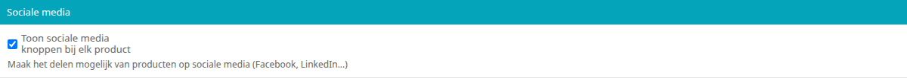

.. _hoofdstuk-20-1-17:

20.1.17. CMS pagina's in de footer
----------------------------------

Hier kunt u de volgorde van de CMS pagina's in de footer veranderen, een CMS pagina toevoegen aan de footer of een CMS pagina uit de footer verwijderen.

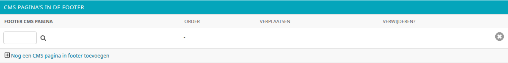

**CMS pagina aan footer toevoegen**
Klik op :guilabel:`Nog een CMS pagina in footer toevoegen` om een extra CMS pagina aan de footer toe te voegen. Klik bij **Footer CMS pagina** op het vergrootglas om de gewenste pagina te selecteren. Hoe u een CMS pagina aanmaakt, leest u in :ref:`hoofdstuk 19 <hoofdstuk-19>`.

**Volgorde CMS pagina's veranderen**
U kunt de volgorde van de CMS pagina's in de footer veranderen. Onder ‘Order’ ziet u de huidige volgorde, waarbij 0 de bovenste link is en het hoogste getal de onderste. Om de volgorde te veranderen gebruikt u de pijltjes knoppen achter de CMS pagina's, onder ‘Verplaatsen’.

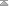

helemaal naar boven

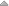

één plaats naar boven

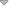

één plaats naar beneden

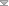

helemaal naar beneden

**CMS pagina's uit footer verwijderen**
Selecteer de gewenste CMS pagina door het vierkantje onder ‘Verwijderen?’ aan te klikken. Wanneer u nu op :guilabel:`Opslaan` klikt wordt de geselecteerde CMS pagina uit de footer verwijderd.

**Opslaan**
| Als u uw wijzigingen tussentijds wilt opslaan, klikt u op :guilabel:`Opslaan en opnieuw bewerken`. Wanneer u tevreden bent met uw wijzigingen klikt u op :guilabel:`Opslaan` om terug te keren naar het overzicht.

20.1.18. Fonts
--------------

Hier kunt u de gebruikte fonts van het systeem aanpassen. U kunt hier diverse TTF lettertypes uploaden voor de heading (koppen), bodytext (lopende tekst), italic (schuingedrukt), bold (vetgedrukt) en bold italic (schuin vetgedrukt).

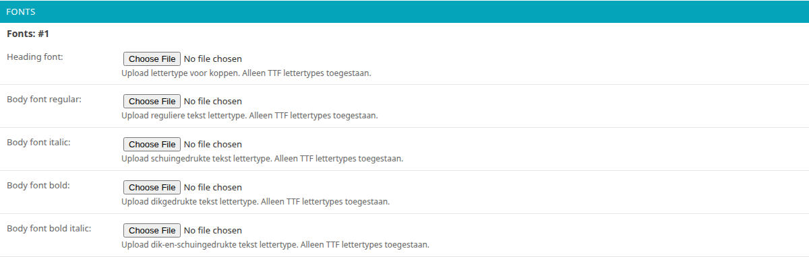

20.2. Mail templates
====================

**Locatie in het menu:** Beheer > Configuratie > Mail templates

Bij mail templates kunt u e-mailsjablonen opstellen, wijzigen en verwijderen. E-mailsjablonen zijn vooraf opgemaakte standaardmails die ideaal zijn om te gebruiken voor mails die regelmatig moeten worden verstuurd. Denk aan uitnodigingen, herinneringen enzovoorts.

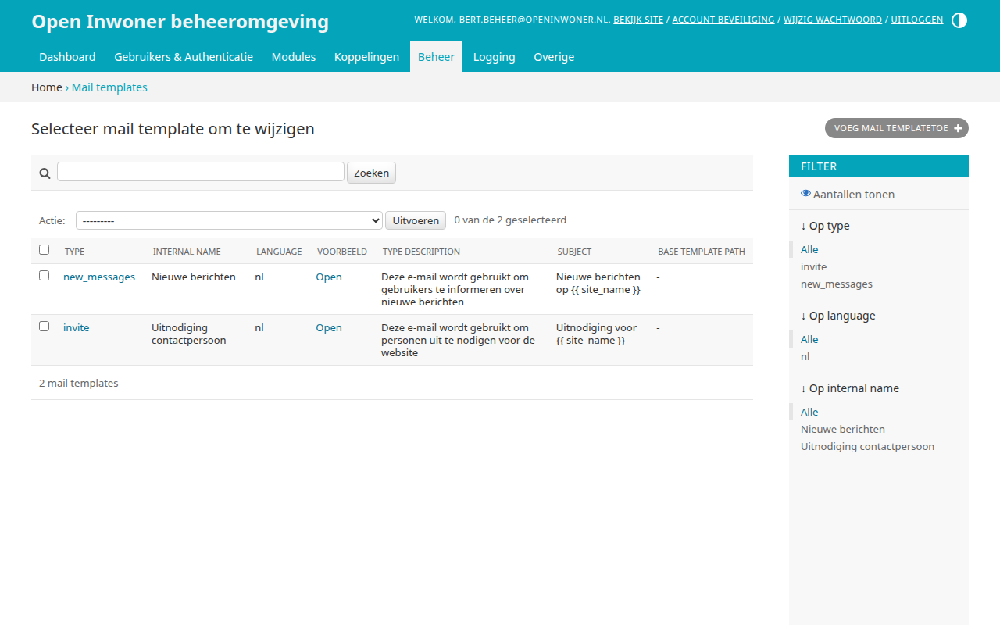

20.2.1. Mail template toevoegen
-------------------------------

Door in het overzicht op de knop :guilabel:`mail template toevoegen +` rechts bovenin uw scherm te klikken kunt u een nieuwe mail template toevoegen. Er wordt een nieuw scherm geopend waar u enkele gegevens dient in te vullen. Wanneer alle gegevens zijn ingevuld klikt u op :guilabel:`opslaan`.

20.2.2. Mail template wijzigen
------------------------------

Door op een mail template in het overzicht te klikken, kunt u deze wijzigen. Er wordt een nieuw scherm  geopend waar u diverse wijzigingen kunt aanbrengen.

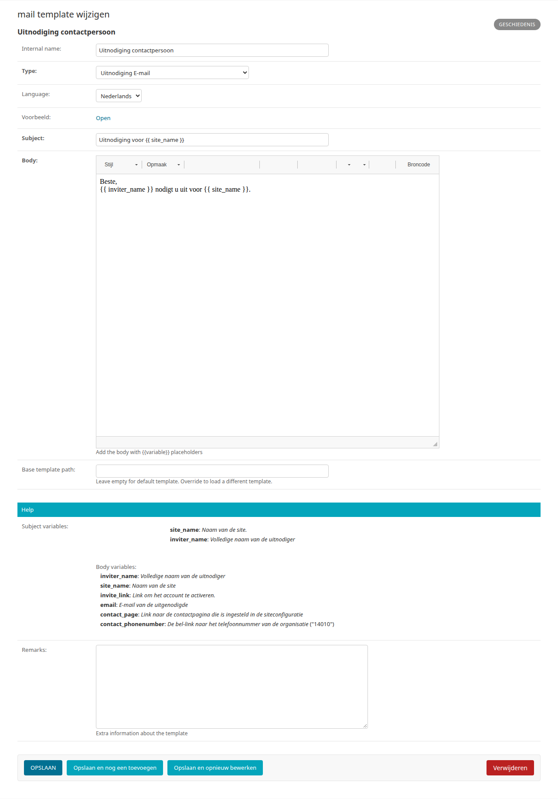

**Interne naam**
Hier zet u de naam van het e-mailsjabloon voor intern gebruik, zoals hij onder medewerkers vindbaar moet zijn.

**Type**
Selecteer de soort mailsjabloon: uitnodiging of nieuwe e-mail.

**Taal**
Selecteer de taal waarin de e-mailsjabloon is opgesteld.

**Subject**
Typ hier het onderwerp van de te verzenden e-mail. Dit is het onderwerp van de uiteindelijke mail. Deze is zichtbaar voor de ontvanger. Houd deze kort en bondig. Raadpleeg onder *Help* de subject variables voor beschikbare variabelen voor het onderwerp. Variabelen zijn automatisch ingevulde teksten op basis van de beschikbare gegevens op het moment van versturen. U plaatst deze tussen twee accolades, zoals: {{site_name}}.

**Body**
Hier kunt u de e-mail volledig opmaken. Hiervoor is een editor aanwezig, zoals hieronder afgebeeld. Raadpleeg onder *Help* de body variables voor beschikbare variabelen voor de body text.

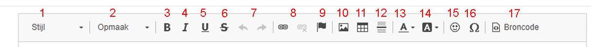

1. Hier selecteert u de stijl die u aan de tekst wilt meegeven. Denk aan italic, bold, doorgehaald etc.
2. Hier selecteert u wat voor soort tekst u aan het typen bent. Dit heeft gevolgen voor de standaardopmaak. Kies uit paragraph, heading 1, heading 2, heading 3 etc.
3. Hiermee maakt u de tekst vetgedrukt
4. Hiermee maakt u de tekst italic
5. Hiermee maakt u de tekst onderstreept
6. Hiermee maakt u de tekst doorgehaald
7. Hiermee maakt u de laatste stap ongedaan (pijltje naar links), of voert u de laatste stap opnieuw uit (pijltje naar rechts)
8. Hiermee voegt u een link toe aan de tekst of wijzigt u deze, of verwijdert u de aanwezige link (met kruisje door het icoontje)
9. Hiermee voegt u een interne link toe
10. Hiermee voegt u een afbeelding aan de tekst toe
11. Hiermee voegt u een tabel in
12. Hiermee voegt u een horizontale lijn in
13. Hiermee verandert u de tekstkleur
14. Hiermee verandert u de achtergrondkleur
15. Hiermee voegt u een emoji in
16. Hiermee voegt u een speciaal teken in
17. Hiermee wisselt u naar de broncode van de tekst

**Base template path**
Dit is de locatie van de e-mailsjabloon. Laat dit veld leeg voor een automatisch gegenereerd pad.

Help
----

**Subject variables, body variables**
Subject variables en body variables zijn de beschikbare variabelen voor het onderwerp en de body text. Variabelen zijn automatisch ingevulde teksten op basis van de beschikbare gegevens op het moment van versturen. U plaatst deze tussen twee accolades, zoals: {{site_name}}.

**Opmerkingen**
Hier kunt u enkele opmerkingen met betrekking tot de mail template neerzetten. Deze opmerkingen zijn enkel voor intern gebruik.

**Opslaan**
Als u uw wijzigingen tussentijds wilt opslaan, klikt u op :guilabel:`opslaan en opnieuw bewerken`. Wanneer u tevreden bent met uw wijzigingen klikt u op :guilabel:`opslaan` om terug te keren naar het overzicht. Of u klikt op :guilabel:`opslaan en nieuwe toevoegen` als u een extra item wilt toevoegen.

20.2.3. Mail template verwijderen
---------------------------------
Wanneer u een of meerdere mail templates wilt verwijderen, kikt u in de checkbox links van de titel van de template. Selecteer vervolgens in het dropdown menu bij ‘Actie’ de actie ‘Geselecteerde mail templates verwijderen’ en klik op de knop :guilabel:`uitvoeren`. De geselecteerde mail templates zijn nu verwijderd.

20.3. Platte pagina’s
=====================
Bij Platte pagina’s kunt u als beheerder de platte pagina’s van de Open Inwoner omgeving aanmaken of aanpassen. De platte pagina’s beschikken slechts over beperkte opmaakmogelijkheden. In het overzicht vindt u alle bestaande platte pagina’s. U kunt nieuwe pagina’s toevoegen, pagina’s wijzigen of verwijderen.

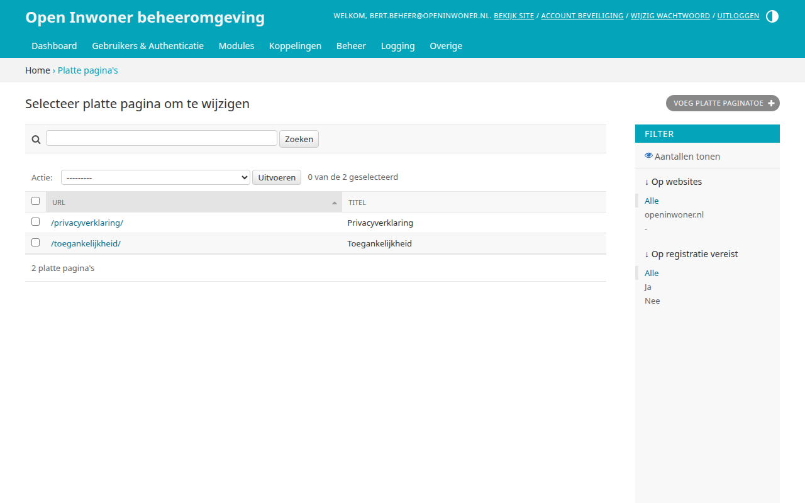

.. _hoofdstuk-20-3-1:

20.3.1. Platte pagina toevoegen
-------------------------------
Door in het overzicht op de knop :guilabel:`Platte pagina toevoegen +` rechts bovenin uw scherm te klikken kunt u een nieuwe platte pagina toevoegen. Er wordt een nieuw scherm geopend waar u de pagina in beperkte mate kunt opmaken. Wanneer alle gegevens zijn ingevuld klikt u op :guilabel:`Opslaan`.

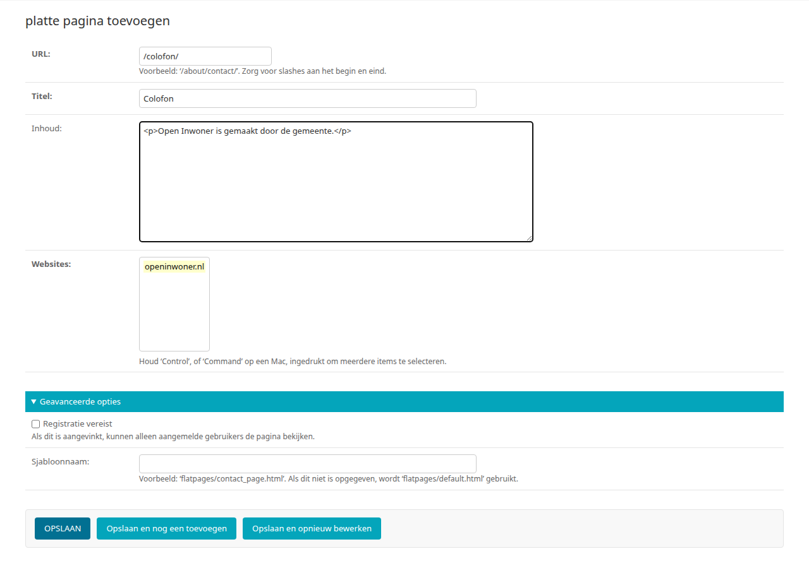

20.3.2. Platte pagina wijzigen
------------------------------
Door op een platte pagina in het overzicht te klikken, kunt u deze wijzigen. Er wordt een nieuw scherm geopend waar u de pagina kunt opmaken.

**URL**
Voer hier het achtervoegsel van de URL in voor de betreffende platte pagina. Gebruik hiervoor kleine letters en indien nodig een koppelteken (-) in plaats van een spatie. Begin en eindig de URL met een / .
Bijvoorbeeld: ``/contact-opnemen/``

**Titel**
Voer hier de titel van de platte pagina in.

**Inhoud**
Bij inhoud vult u de inhoud in die u op de platte pagina wilt hebben. Dit is een eenvoudig tekstveld, waarin u de opmaak met HTML aangeeft, bijvoorbeeld ``
Tekst van de pagina.
``.

**Websites**
Selecteer hier op welke website(s) de betreffende platte pagina moet worden weergegeven. Houd :kbd:`Ctrl` ingedrukt om meerdere websites te selecteren. Staat de noodzakelijke website niet in de lijst? Dan voegt u deze toe door op :guilabel:`+` te klikken.

Onder **Geavanceerde opties** vindt u de volgende velden.

**Registratie vereist**
Wanneer dit is aangevinkt zal de betreffende pagina alleen worden weergegeven wanneer de gebruiker is ingelogd.

**Sjabloonnaam**
Hier kunt u eventueel een vooraf opgemaakte paginasjabloon (html) gebruiken. Laat dit veld leeg om zonder sjabloon te werken.

**Opslaan**
Als u uw wijzigingen tussentijds wilt opslaan, klikt u op :guilabel:`Opslaan en opnieuw bewerken`. Wanneer u tevreden bent met uw wijzigingen klikt u op :guilabel:`Opslaan` om terug te keren naar het overzicht. Of u klikt op :guilabel:`Opslaan en nog een toevoegen` als u een extra item wilt toevoegen.

20.3.3. Platte pagina verwijderen
---------------------------------

Wanneer u een of meerdere platte pagina’s wilt verwijderen, klikt u in de checkbox links van de titel van de pagina. Selecteer vervolgens in het dropdown menu bij ‘Actie’ de actie ‘Geselecteerde platte pagina’s verwijderen’ en klik op de knop :guilabel:`Uitvoeren`. De geselecteerde platte pagina’s zijn nu verwijderd.

20.4. Websites
==============

**Locatie in het menu:** Beheer > Configuratie > Websites

Hier vult de beheerder de domeinnaam en weergavenaam van de website(s) in. Deze kunnen indien noodzakelijk worden aangepast. Dit is ter inrichting van het systeem. De domeinnaam moet overeenkomen met de domeinnaam van de omgeving.

Voor het gebruik van Open Inwoner is een website vereist. Aangezien er geen gebruiksscenario is voor meerdere sites, is het niet mogelijk om de primaire website te verwijderen of extra sites toe te voegen.

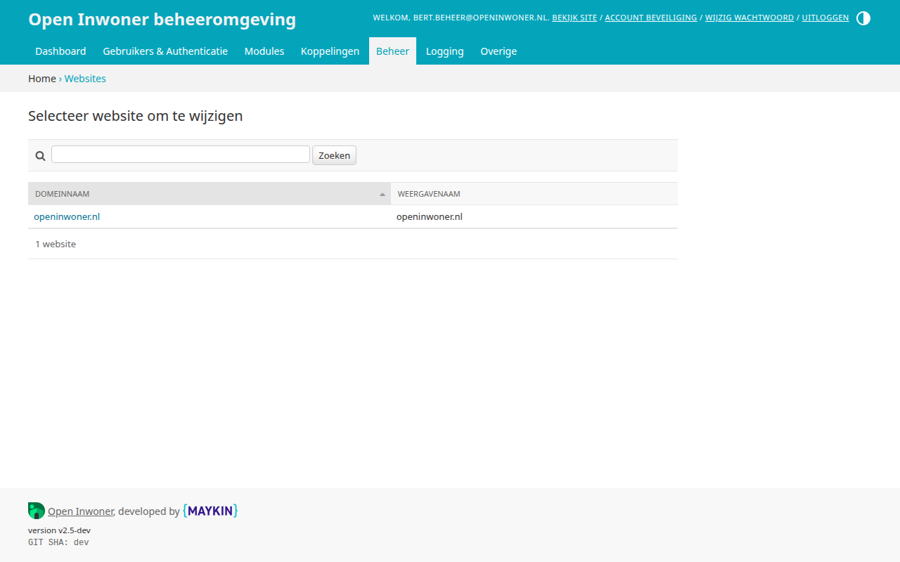

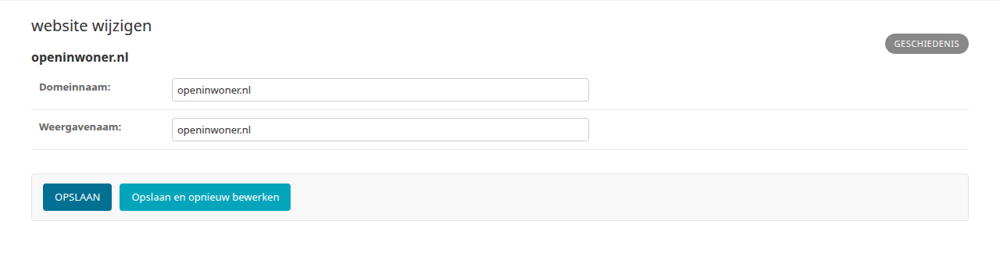
