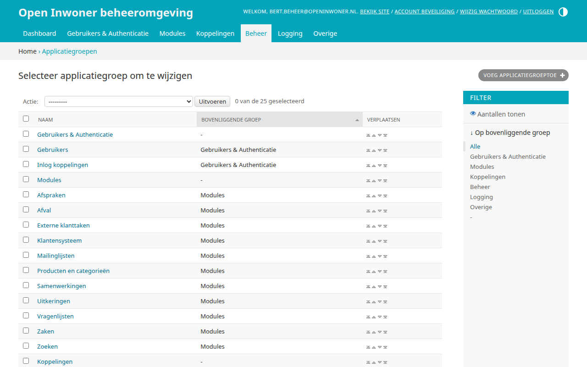
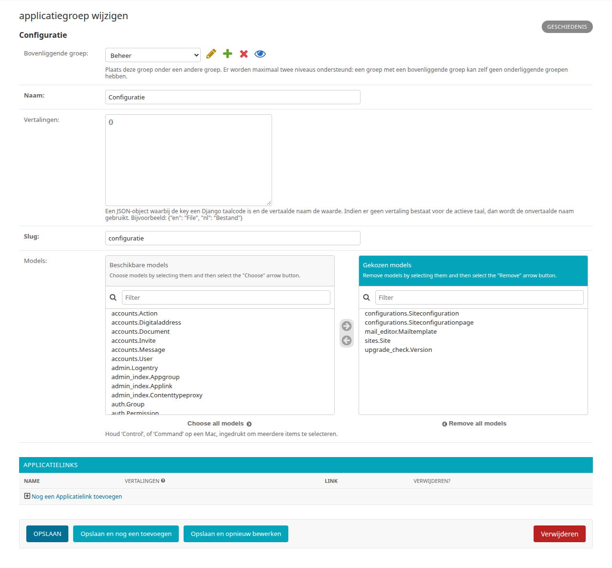

.. _hoofdstuk-21:

========
21. Menu
========

U vindt de onderdelen van dit hoofdstuk in het menu onder **Beheer > Menu**.

.. _hoofdstuk-21-1:

21.1. Applicatiegroepen
=======================

**Locatie in het menu:** Beheer > Menu > Applicatiegroepen

Onder applicatiegroepen vindt u de hoofditems van het topmenu, met onder elk hoofditem de groepen die bij dat item horen (de kolom ‘Bovenliggende groep’). U kunt nieuwe items toevoegen, items verplaatsen, wijzigen en verwijderen.

21.1.1. Applicatiegroep toevoegen
---------------------------------

Door in het overzicht op de knop rechts bovenin uw scherm te klikken kunt u een nieuwe applicatiegroep toevoegen. Er wordt een nieuw scherm geopend waar u enkele gegevens dient in te vullen. Wanneer alle gegevens zijn ingevuld klikt u op :guilabel:`Opslaan`.

21.1.2. Applicatiegroep verplaatsen
-----------------------------------

U kunt de volgorde van de menu-items veranderen door in het overzicht op de icoontjes onder ‘Verplaatsen’ naast het betreffende menu-item te klikken.

21.1.3. Applicatiegroep wijzigen
--------------------------------

Door op een menu-item in het overzicht te klikken, kunt u deze wijzigen. Er wordt een nieuw scherm geopend waar u diverse wijzigingen kunt aanbrengen.

**Bovenliggende groep**
Plaats deze groep onder een andere groep. Er worden maximaal twee niveaus ondersteund: een groep met een bovenliggende groep kan zelf geen onderliggende groepen hebben.

**Naam**
Hier zet u de naam van het gewenste menu-item.

**Vertalingen**
Een JSON-object waarbij de key een Django taalcode is en de vertaalde naam de waarde. Bijvoorbeeld: ``{"en": "File", "nl": "Bestand"}``.

**Slug**
Dit is het onderdeel van de URL wat het onderwerp beschrijft. Gebruik enkel kleine letters en koppeltekens (-) in plaats van spaties. Bijvoorbeeld activiteiten-en-meedoen.

**Models**
Onder models stelt u de menustructuur in. U selecteert hier de gewenste sub-items door ze naar het rechterveld te verplaatsen. Om een sub-item uit te schakelen verplaatst u het gekozen item weer naar het linker veld. In principe staat de menustructuur vast en dient deze niet door de beheerder te worden aangepast.

**Applicatielinks**
Hier kunt u de naam (Name) van en de link naar een applicatie toevoegen die bij de applicatiegroep hoort. Klik op :guilabel:`Nog een Applicatielink toevoegen` om een link toe te voegen. Door op het X icoontje te klikken kunt u een applicatielink verwijderen.

**Opslaan**
Als u uw wijzigingen tussentijds wilt opslaan, klikt u op :guilabel:`Opslaan en opnieuw bewerken`. Wanneer u tevreden bent met uw wijzigingen klikt u op :guilabel:`Opslaan` om terug te keren naar het overzicht. Of u klikt op :guilabel:`Opslaan en nog een toevoegen` als u een extra item wilt toevoegen.

21.1.4. Applicatiegroep verwijderen
-----------------------------------

Wanneer u een of meerdere applicatiegroepen wilt verwijderen, klikt u in de checkbox links van de naam van de applicatiegroep. Selecteer vervolgens in het dropdown menu bij ‘Actie’ de actie ‘Geselecteerde applicatiegroepen verwijderen’ en klik op de knop :guilabel:`Uitvoeren`. De geselecteerde applicatiegroepen zijn nu verwijderd.
