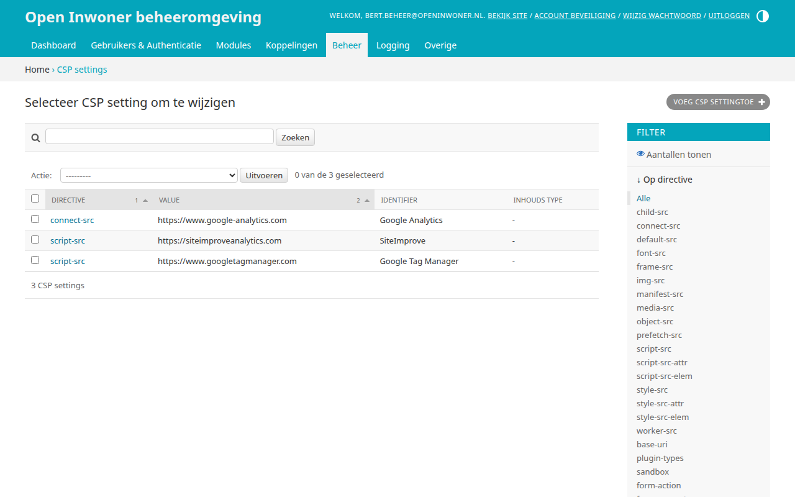
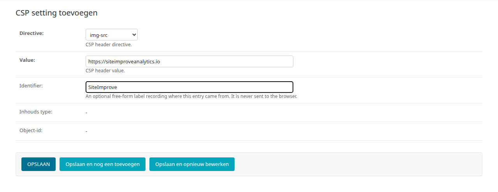

.. _hoofdstuk-22:

=======
22. CSP
=======

U vindt de onderdelen van dit hoofdstuk in het menu onder **Beheer > CSP**.

.. _hoofdstuk-22-1:

22.1. CSP settings
==================

**Locatie in het menu:** Beheer > CSP > CSP settings

De CSP (content security policy) settings moeten worden ingesteld wanneer u gebruik wilt maken van Google Analytics, Matomo, SiteImprove of een vergelijkbare tool. Met de CSP instellingen kunt u aangeven welke verzoeken er zijn toegestaan vanuit de Open Inwoner omgeving. Wanneer bijvoorbeeld Google Analytics wordt gebruikt, dan moet bij de CSP settings worden ingesteld dat verzoeken naar Google Analytics vanaf de browser zijn toegestaan. Standaard staan de CSP settings dusdanig ingesteld dat verzoeken naar derde partijen niet toegestaan zijn. Dit is in verband met het gebruik van DigiD en de noodzakelijke security audit.
Voor meer informatie over CSP settings, raadpleeg: https://developer.mozilla.org/en-US/docs/Web/HTTP/CSP

Bij het toevoegen van een CSP setting vult u de volgende velden in.

**Directive**
De directive van de CSP header waarvoor deze setting geldt, bijvoorbeeld ``script-src`` of ``img-src``.

**Value**
De waarde die bij de directive wordt toegestaan, bijvoorbeeld ``https://www.googletagmanager.com``.

**Identifier**
Een optioneel label waarmee u vastlegt waar deze setting vandaan komt, bijvoorbeeld ``Google Tag Manager``. Dit label wordt niet naar de browser gestuurd.

**Inhouds type** en **Object-id**
Hiermee kan een setting aan een ander object in de beheeromgeving worden gekoppeld. Voor een setting die u zelf toevoegt, laat u deze velden leeg.
