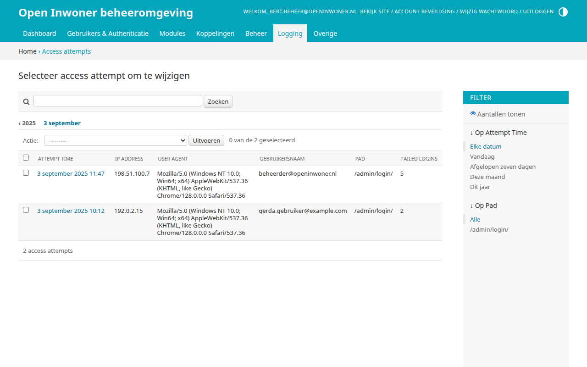
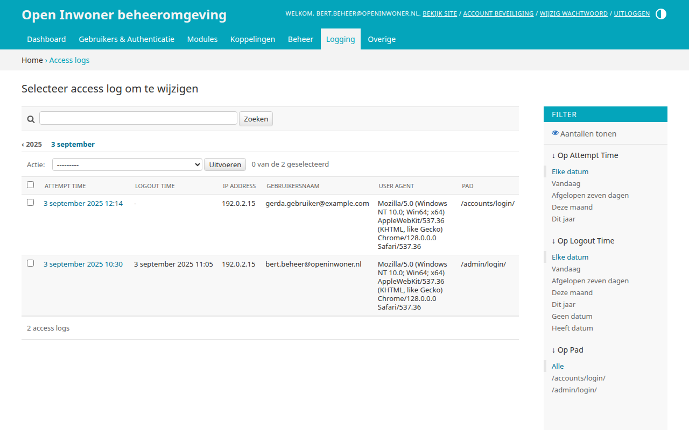
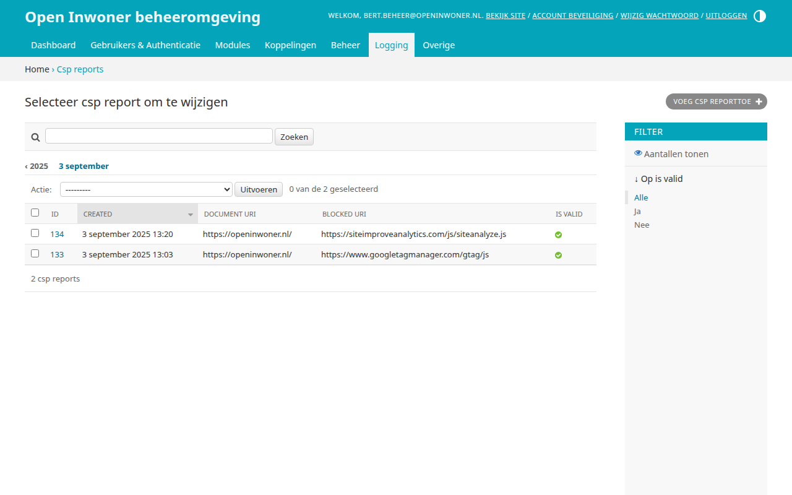
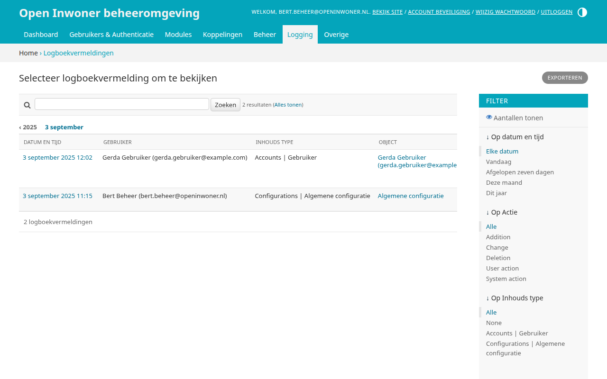
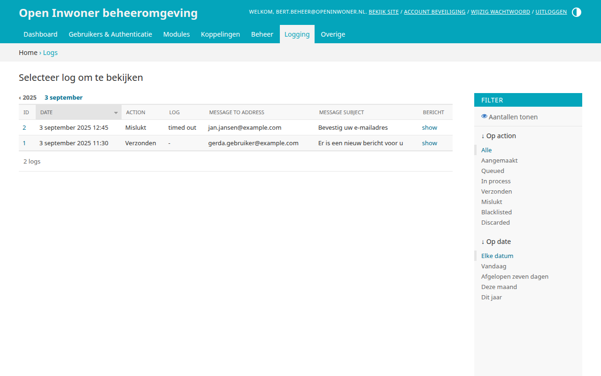
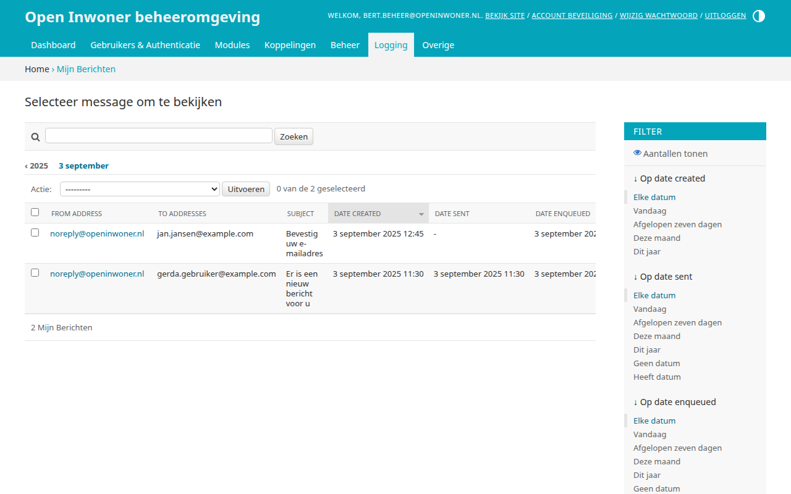
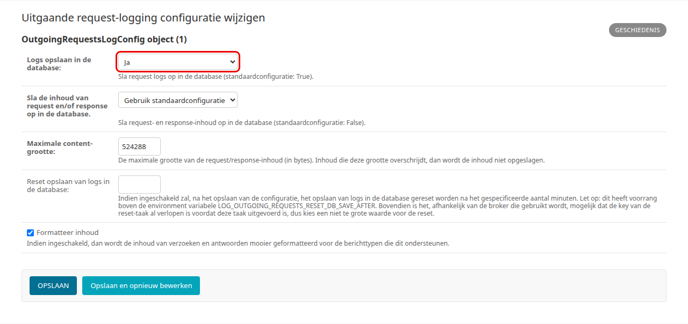
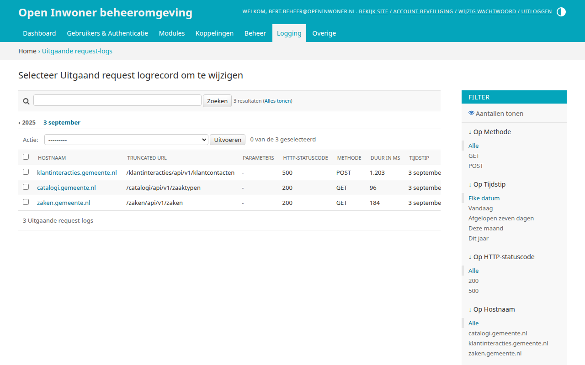

.. _hoofdstuk-23:

===========
23. Logging
===========

In dit hoofdstuk leest u welke logs Open Inwoner bijhoudt, zoals mislukte inlogpogingen en verzonden e-mails.

U vindt de onderdelen van dit hoofdstuk in het menu onder **Logging**.

23.1. Access attempts
=====================

**Locatie in het menu:** Logging > Access attempts

Bij Access attempts vindt u een overzicht van alle mislukte inlogpogingen op uw Open Inwoner omgeving. In dit overzicht vindt u data, IP-adressen en via welk gebruikersaccount is geprobeerd in te loggen. Op deze manier kan worden gemonitord wie er geprobeerd heeft in te loggen of welk gebruikersaccount wellicht in verkeerde handen is gevallen.

23.2. Access logs
=================

**Locatie in het menu:** Logging > Access logs

Bij Access logs vindt u een overzicht van alle succesvolle inlogpogingen. In dit overzicht worden het moment van in- en uitloggen, het IP-adres, de gebruikersnaam, de manier van inloggen en de
apparaatgegevens getoond. Het overzicht kan worden gefilterd op datum van in- of uitloggen of op de manier van inloggen (de gevolgde route). Daarnaast kan het overzicht eenvoudig worden gesorteerd door op de gewenste kolomnamen te klikken.

23.3. CSP reports
=================

**Locatie in het menu:** Logging > Csp reports

Dit onderdeel is bedoeld voor technische controles van de content security policy header. Dit is enkel voor de technisch beheerder.

23.4. Logboekvermeldingen
=========================

**Locatie in het menu:** Logging > Logboekvermeldingen

Bij logboekvermeldingen vindt u een read-only register van op het Open Inwoner platform uitgevoerde acties. In dit logboek wordt geregistreerd wie er wanneer welke actie uitvoerde. Het gaat hier zowel om gebruikersacties als beheerdersacties.

23.5. Logs
==========

**Locatie in het menu:** Logging > Logs

Bij logs vindt u per verzendpoging van een e-mail een logregel, met de datum, de actie, de ontvanger en het onderwerp van de e-mail. Deze logs zijn read-only en kunnen enkel worden gesorteerd en gefilterd op actie en datum.

23.6. Verzonden e-mails
=======================

**Locatie in het menu:** Logging > Mijn Berichten

Bij verzonden e-mails vindt u het overzicht van alle door het systeem verzonden e-mails. In het menu heet dit onderdeel (door een vertaalfout) "Mijn Berichten"; het gaat niet om de berichten die gebruikers op de website zien. De e-mails zelf kunt u niet wijzigen. U kunt ze sorteren en filteren, en met de acties "Enqueue selected messages" (opnieuw in de wachtrij zetten om te verzenden), "Mark as sent selected messages" en "Mark as created selected messages" de status van geselecteerde e-mails aanpassen.

23.7. Uitgaande request-logging configuratie
============================================

**Locatie in het menu:** Logging > Uitgaande request-logging configuratie

Bij de uitgaande request-logs configuratie kunt u met het veld "Logs opslaan in de database" instellen of uitgaande request-logs worden opgeslagen, zodat ze zichtbaar worden onder :ref:`uitgaande request-logs <hoofdstuk-23-8>`. U kiest uit "Gebruik standaardconfiguratie", "Ja" of "Nee".

.. _hoofdstuk-23-8:

23.8. Uitgaande request-logs
============================

**Locatie in het menu:** Logging > Uitgaande request-logs

Onder uitgaande request-logs vindt u een overzicht van alle verzoeken die het Open Inwoner platform stuurt naar andere API’s. U kunt dit overzicht filteren op methode, tijdstip van de request, statuscode en hostnaam. In dit read-only register wordt tevens het antwoord (statuscode) geregistreerd en wordt er opgeslagen hoe lang de API over het betreffende verzoek heeft gedaan. Door bepaalde requests te selecteren kunt u deze – indien gewenst – verwijderen.

